# Ray'z Barber Shop platform

Booking, front desk, POS, and reporting for Ray'z Barber Shop's 8 locations (Coralville, Kimberly, Le Claire, Moline, Rock Island, Dubuque, Silvis, Utica). It replaces Squire. The core flows (online booking, the day calendar, checkout) follow Squire's so staff feel at home, and the UI is built to need fewer clicks. Every place where it does better than Squire is listed under [Improvements over Squire](#improvements-over-squire).

**Status: phases 1a, 1b, and 1c are all complete for v1.** The end-to-end path works on seeded data. A customer books online. The manager sees the booking on the Coralville day calendar and checks it out with a tip on a Stripe test credit card (the 3% credit fee is disclosed). The sale then shows up in reports, payroll tips, and the client's loyalty progress. What's simulated or stubbed is listed under [What's stubbed](#whats-stubbed-or-simulated).

| Phase | Scope | Status |
| --- | --- | --- |
| 1a | Online booking, schedules, day calendar, notifications (stubbed), Squire importer, versioned booking API | Done |
| 1b | POS (services, retail, tips, discounts, promos, gift cards, refunds/voids), drawer close, inventory, audit log | Done |
| 1c | Sales reports, CSV exports, bi-weekly payroll tips, KPIs, loyalty | Done |
| Inventory | Stock ledger per shop, par levels and low-stock alerts, vendors, purchase orders (suggest, approve, email, receive), transfers, counts, inventory reports | Done |
| Shop workspaces | A login per shop, each shop its own workspace on one database; brand logins over all of them; client history visible at every shop; a role per assigned shop for multi-shop staff; isolation enforced by a central tenant guard and tested | Done |
| Client data protection | Hidden, masked, or full for every client field by role and person, brand-wide or per shop, enforced on the server everywhere; full phone, email and address and client list downloads only for brand-level roles, never grantable to shop logins or shop and staff roles; calls and texts through the shop line; reveal with a reason; lookup limits with alerts; a data-access report | Done |

Screenshots of the key screens are in the PR description.

---

## Quick start

**Prerequisites:** Node 20+, pnpm 9+, and Postgres 16. The `btree_gist` extension is required; it ships with Postgres, Neon, and Supabase.

```bash
# Postgres via Docker (or use a local install / Neon / Supabase)
docker run -d --name rayz-pg -p 5432:5432 -e POSTGRES_USER=rayz -e POSTGRES_PASSWORD=rayz -e POSTGRES_DB=rayz postgres:16
docker exec rayz-pg createdb -U rayz rayz_test   # for pnpm test:db

pnpm install
cp .env.example .env          # then set AUTH_SECRET to a long random string
pnpm db:reset                 # runs migrations + seeds real shops/services and ~8 weeks of sample history
pnpm dev                      # http://localhost:3000
```

`pnpm db:reset` wipes and reseeds the database. `SEED_HISTORY_DAYS` (default 56) controls how much sample history is generated.

To put a demo online for the owner (Vercel and Neon, sample data, mock payments and messages), follow [DEPLOY.md](DEPLOY.md).

### Logins (seeded; password `rayz2026!`)

| Who | Email | Role and shops | Sees |
| --- | --- | --- | --- |
| Owner | `owner@rayz.test` | Brand Owner, every shop | Everything, including brand-level settings (loyalty, Sunday hours) and granting Brand Owner |
| Admin | `admin@rayz.test` | Brand Admin, every shop | Everything except brand-level settings; manages roles and permissions |
| Regional | `regional@rayz.test` | Regional Manager, Moline and Rock Island | Manager tools and every report, for those two shops only |
| Michelle | `michelle@rayz.test` | Shop Manager, Coralville | Manager tools and Coralville's reports |
| Front desk | `frontdesk@rayz.test` | Front Desk, Coralville | Calendar, walk-ins, checkout for every barber, the drawer, blocking time for anyone, discounts up to 10%, **We have openings**, and four reports (view only) |
| Makenna | `makenna@rayz.test` | Barber, Coralville | Her own calendar column, appointments, clients, and sales (My sales shows only her own numbers), and **My time** for lunch, blocks and time off requests |
| Morgan | `manager.moline@rayz.test` | Shop Manager, Moline | Manager tools and Moline's reports, inside the Moline workspace |
| Kat | `kat@rayz.test` | Barber at Moline and Silvis, Shop Manager at Rock Island | Works one shop at a time under that shop's role; the switcher offers only her three shops |
| Shop logins | `coralville@rayz.test`, `kimberly@rayz.test`, `le-claire@rayz.test`, `moline@rayz.test`, `rock-island@rayz.test`, `dubuque@rayz.test`, `silvis@rayz.test`, `utica@rayz.test` | Front Desk, that one shop | The shared front-desk sign-in for that shop's workspace (see [Shop workspaces](#shop-workspaces)); its one Campaign Center action is **We have openings** |

What each role can do is editable under **Permissions** (see [Roles and permissions](#roles-and-permissions)). How much of each client's details they see is set separately under **Client data protection**: by default barbers, the front desk, and managers see contact details masked or hidden (see [Client data protection](#client-data-protection)).

Staff sign in at `/login`. Customers don't need an account to book. They can optionally sign in at `/account` with a one-time code. In development, the code is shown on screen because `AUTH_DEV_CODES=true`.

Handy demo data:

- The gift card `DEMO-GIFT-2500` has $25.00 on it.
- The promo code `WELCOME5` takes $5 off services.
- Client "Jordan" (phone `319-555-0100`) has $290 of loyalty progress, so their next $33 haircut earns a $15 reward.
- Families share one phone: the Hayes family at Coralville (`319-555-0201`), the Nguyens at Moline (`309-555-0202`), and the Carters at Kimberly (`563-555-0203`), each booked back to back with one barber in the coming days. They show up on **Clients → Duplicates** as a shared phone, and signing in at `/account` with that phone asks which of them it is.
- Squire-import duplicates at Kimberly fill **Clients → Duplicates → Imported from Squire**: Jonathon / Jonathan Reyes (a typo, same birthday), Mike / Michael Kowalski (a nickname, same phone), and two Darnell Prices on one phone with different birthdays (a father and son, so they're kept apart).

### Try the full flow

1. Go to `/` and pick **Coralville**. Choose a service, add-ons, "Any barber", and a time, then enter a name and phone. The confirmation page lives at `/a/{code}`, and the customer can cancel or reschedule there until 30 minutes before the appointment.
2. Sign in as `michelle@rayz.test`. Open **Calendar** and go to the booked day, then click the appointment and choose **Check out**.
3. On the POS, tap a tip (20/25/30%, $5/$10/$15/$20, or custom). Choose **Card**, use the card reader, and pick "Visa (credit)". The 3% credit surcharge is added and disclosed; debit cards pay no fee. Optionally tap **4 wk** to rebook the client, then click **Charge**. Or tap **Hand to customer** to let the client tip, sign, pick a receipt and pay on the screen; any staff time clock PIN (`2468` in the demo) takes it back (see [Customer screen at checkout](#customer-screen-at-checkout)).
4. The ticket shows taxes with their rates, the tip, the fee, the payment, and loyalty progress, and asks **How would they like the receipt?**: **Text** (a link), **Email** or **No receipt**, with what's on file offered first (see [Digital receipts](#digital-receipts)). Sign in as `owner@rayz.test` and check **Reports** (Sales summary), **Tips and payroll export**, and the client's page under **Clients**.
5. As `admin@rayz.test`, open **Permissions**, edit the Front Desk role, or open a person to give them a one-off permission or change their shops. Under **Bulk upload**, download the template, fill in a few rows, and preview the upload before saving it.
6. As `owner@rayz.test` with **All shops** selected, open **Inventory → Low stock**, tick a few suggested orders, and click **Create purchase orders**. Open one over $500 (the seeded PO-1005 at Coralville is one), approve it, and **Send** it by email; the PDF and CSV show up under **Notifications**. Then **Receive** part of it at a different price, and check the product's ledger and **Reports → Stock movement and shrink**.
7. Sign in as `moline@rayz.test`. The sidebar says **Shop workspace** with Moline's name and address, and every page (calendar, sales, drawer, stock, reports) covers Moline only. Search **Clients** for a Coralville client's full phone number to book them; a partial search won't find them. Then sign in as `regional@rayz.test` and open **Setup → Shop logins** to create a login for Moline or reset the Moline desk's password.
8. Sign in as `makenna@rayz.test` and open one of her clients: the phone and birthday are masked, email and address aren't there, and **Call through shop line** places the call without showing the number. As `michelle@rayz.test`, the phone, email and address stay masked with no **Reveal** (only brand-level roles see them in full), and there's no **Export CSV**. As `owner@rayz.test`, open **Setup → Client data protection** to change what a role or person sees (try **What someone sees**), and **Setup → Client data access** to see both lookups and the reveal with its reason.
9. As `owner@rayz.test`, open **Setup → Shop settings** and use **Open a new location**. Location setup opens for the new shop. Under **Card payments and payouts**, click **Set up card payments with Stripe**. Without keys, a stand-in for Stripe's onboarding opens. Submit it without the bank account to see "Needs attention", then add the bank account. Under **Owners**, add a franchisee and move two shops to it. Then open **Reports → Shop P&L by Stripe account**.
10. Sign in as `makenna@rayz.test` on a phone (or a narrow window) and open **My time**. Tap **Take lunch now**, block a break, or add a recurring lunch, then request a day off. Sign in as `michelle@rayz.test` and open **Time off** to approve or deny it. If it covers booked appointments, move one to another barber or ask the client to reschedule. As `manager.moline@rayz.test`, Mackenzie's pending day lists her bookings. **Calendar** shows who's off today, and **Reports → Who's working, off and blocked** has the totals.
11. Set `NOTIFICATIONS_SMS_PROVIDER=simulator` and `NOTIFICATIONS_VOICE_PROVIDER=simulator` in `.env` and restart. As `michelle@rayz.test`, open **Call-ins** and mark Makenna sick for a day she has bookings. On the next screen, keep the suggested options (or **Apply to all**) and send. As `owner@rayz.test`, open **Notifications → Call and text simulator**: reply "1" as one of the clients, open a rebook link and pick a new time, answer an automated call and press 1, or call the shop and let it ring out. Back on the call-in, each appointment shows how it ended; questions are in **Inbox**, and **Reports → Call-ins and client outreach** has the totals.
12. Sign in as `michelle@rayz.test`, open **Front-desk clock** and click **Register this device** (Coralville). Tap **Makenna**, type the demo PIN `2468` and **Clock in**. Sign in as `makenna@rayz.test` on a phone, open **Time clock** and allow location: Coralville takes its registered device or GPS within 150 m of the shop. Take a break, then open **My timesheet**. Back as Michelle, open **Timesheets → Makenna**, edit a punch with a reason and see it in the edit history. As `owner@rayz.test`, open **Time clock setup**, **Reports → Labor hours and cost** and **Reports → Attendance**. Today lists the seeded forgotten clock-out at Utica.
13. With Makenna on that break, open **Calendar** as Michelle on today's date. Makenna's column says **On break since…**, her worked time runs down the left edge next to her shift, and the break is a ⏱ Break block-out from the time clock. Any client booked in it has a red ring and a **Reassign or rebook** link to start a call-in on the block. Click the block to see the punch it came from, then set new times or remove it (with a reason; both are in the audit log). As Makenna the same panel says only a manager can change it. Book online as a client: Makenna's times in the break are gone, and nothing mentions the clock. **Today** lists the client booked over her break, and the who's-in list shows each barber's clock status. End the break and the block is trimmed to the end; the calendar updates within 15 seconds, without a reload.

### Other commands

```bash
pnpm test          # unit tests: availability/DST, checkout totals, payroll, loyalty, permission rules, client data masking and rules, upload parsing, report views,
                   # suggested orders (par, reorder point, case packs), receiving plans, PO PDF and CSV
pnpm test:db       # integration tests against TEST_DATABASE_URL (migrates + seeds it first), incl. every page/action/route per login
                   # and per-location totals adding up to multi-location and brand totals (refunds, multi-shop barbers);
                   # stock ledger math across sales, refunds, voids, receiving, transfers and concurrent sales, partial receiving,
                   # and inventory and purchasing permissions; shop isolation (tests/db/tenant.test.ts): canary records at
                   # Coralville never reach Moline's logins through any page, URL, export, API route, action, job or login flow;
                   # client data protection (tests/db/client-privacy.test.ts): hidden and masked details never reach restricted
                   # roles' pages, action results or CSVs, and every reveal, export, call and text is audited;
                   # entering details (tests/db/client-entry.test.ts): a restricted user's saved phone comes back only masked or hidden;
                   # staff time (tests/db/staff-time.test.ts): recurring blocks, part-day time off, pending holds, conflicts, approval rights
                   # block reasons (tests/db/block-reasons.test.ts): private reasons and notes never reach the desk's pages, CSVs or
                   # audit search, or online booking; the manager and the barber see them; renames carry; archived can't be picked
                   # call-ins (tests/db/call-ins.test.ts): affected appointments, reassign vs rebook, channels and permissions,
                   # link security and expiry, "1"/"2" replies, STOP/START/9, the retry then flag, missed-call texts, the inbox, the report
                   # time clock (tests/db/time-clock.test.ts): punches and breaks, shop checks, the PIN lockout, edits and the audit log,
                   # approvals and the period lock, export totals, forgotten clock-outs, FT crossings, page access, rate gating
                   # clock on the calendar (tests/db/clock-live.test.ts): the late clock-in alert (sent once), online time held by a
                   # break and an early clock-out (not the shop's), clients in that time flagged with the call-in link, nothing for clients
pnpm lint && pnpm typecheck
pnpm build && pnpm start
pnpm worker        # local stand-in for the cron job that drains the reminder queue (every 30s; --once for one pass)
pnpm import:squire clients samples/squire/clients.csv            # dry run
pnpm import:squire clients samples/squire/clients.csv --commit   # write
pnpm import:squire appointments appts.csv --errors=skipped.csv   # also write skipped rows to a CSV
npx tsx scripts/make-squire-fixture.ts   # regenerate samples/squire/realistic (deterministic)
```

---

## Owner's guide: running it without a developer

Everything below happens in the portal. Nothing in the code names a shop, a barber, a service or a list item, so new ones show up everywhere on their own: booking, the public site, the calendar, POS, every report and filter, permission scopes, location groups, Today and the Morning Dashboard.

**Add a location** (Brand Owner or Brand Admin, `locations.setup`): **Setup → Location setup → Add a location**. The wizard has 12 steps and saves the shop hidden from clients ("Setting up"):

1. **Name and address:** name, public booking link (never a surname), address, phone, email, time zone (Central by default), owner and location groups.
2. **Hours and holidays:** weekly hours (Sunday closed by default; only the Brand Owner opens Sundays), closed days and holidays.
3. **Sales tax:** service and product tax rates, which stay flagged on Today until someone ticks them verified.
4. **Payments and banking:** where the shop's card money goes, its statement descriptor, card fee, Stripe Terminal readers, the customer screen at checkout (the brand's tip buttons or the shop's own, signature, PIN rules) and receipt. See [Banking per location](#banking-per-location) below.
5. **Online booking:** slot interval, earliest booking, how far ahead clients can book, and the online cancel cutoff.
6. **Services:** copied from the brand menu or another shop, with per-shop prices, durations and on/off.
7. **Products and par levels:** copied from another shop, or pasted as a list.
8. **Vendors:** who supplies the shop, with the shop's own account number at each.
9. **Team and payroll:** existing barbers (a barber can work at several shops) with their days and hours here, and the pay calendar.
10. **Login, sign-in and phone line:** shop logins and what they can do, where staff can sign in from (see [Sign-in restrictions](#sign-in-restrictions)), and the Twilio number.
11. **Branding:** accent color, logo and the "About this location" text.
12. **Review**, then save. A shop on its own Stripe account gets a **Continue to Stripe onboarding** button.

**Go live:** the location's page in **Location setup** shows a checklist. Address and phone, time zone, booking link, owner, hours, taxes, menu, barbers, and payments and banking are required; the shop line, card readers, front desk login and retail are optional. **Go live** stays greyed out until the required steps are done. Staff can practise bookings and checkouts at a shop that's still setting up; clients can't see it.

<a id="banking-per-location"></a>**Banking per location** (Brand Owner, or someone the owner gives `payments.banking`). Each shop's **Payments and banking** step picks one of three:

- **Its own Stripe account and bank.** Use this for a shop that's its own business, such as an LLC with its own EIN. Stripe's hosted onboarding collects the legal entity, EIN, owner identity and bank account. Ray'z stores only the Stripe account ID and what Stripe reports back: charges enabled, payouts enabled, and what's still due. It never stores bank or Social Security numbers. The shop can go live once Stripe enables charges; payouts can follow later.
- **The brand's Stripe account and bank.** Card sales settle in the brand's main account and are paid out to the brand's bank with the other brand-account shops. There's nothing to onboard, so it doesn't hold up go-live.
- **No cards.** The shop takes cash and gift cards only and can go live without Stripe. A shop on its own account can also open cash-only while Stripe reviews it, and cards start once Stripe enables charges.

The same step sets the **statement descriptor** (what clients see on their card statement; on the brand's account it's the part after `STRIPE_STATEMENT_PREFIX`, `RAYZ` by default) and shows the **payout schedule** Stripe reports. **Card readers** are registered with the code the reader shows (in test mode, `simulated-wpe`), each to the shop's own Stripe Terminal Location. The **card fee**, the **customer screen at checkout** (tip buttons, tips on the reader, signature, who takes the device back) and **receipt** (headline, footer, logo, address, phone, the Google review link and follow-up, and whether staff get a Print button) are in Shop settings. Switching a shop between accounts affects new charges only: earlier charges, and their refunds, stay with the account they settled in. Every change is audited.

**Payouts:** **Insights → Payouts** lists every deposit to each shop's bank, and the brand's, with gross, fees, refunds and net. Choose one shop or all of them. Only people who see every shop see the brand account's deposits, because they pool several shops. Today flags a failed payout.

**Temporarily close** (renovation, weather): pick an end date or leave it open, and add the note clients see. Booking stops, the public page shows the note, and the shop reopens by itself the day after the end date. **Archive** (closing for good) needs no upcoming appointments, no open tickets and no open drawer. It signs out the shop logins, removes the barbers' schedules there, cancels its pending messages, turns off its readers and releases its number. All of its sales, payroll, appointments and audit history stay in every report and filter, labelled "(archived)".

**Staff:**
- To onboard someone, use **Setup → Staff & schedules → Add staff**. Then set their role and shops under **Permissions**, and their schedule per shop.
- To offboard someone, open their profile and use **Offboard**, then type their name to confirm. They're signed out on every device at once and taken off online booking. Their schedules, pending time off and recurring blocks end. Their booked appointments stay put and are listed, so you can move each one or ask the client to rebook. The Brand Owner can't be offboarded, and nobody can offboard themselves.

**Keep staff signing in at the shop** (Brand Owner or Brand Admin, `network.settings`): **Setup → Sign-in security** turns on a location's restriction and lists its allowed IP addresses and ranges, with **Use my current IP** while you're on the shop Wi-Fi. The location then refuses its staff and shop logins anywhere else: the POS, the calendar, the time clock and client records. For a shop whose internet address changes, approve its tablet or computer as a trusted device instead. Brand Admins can sign in from anywhere; give **Can access remotely** to anyone else who should. Every blocked try is listed on the same page and emailed to the brand. See [Sign-in restrictions](#sign-in-restrictions).

**Services and add-ons:** use **Setup → Services** for the brand menu, per-shop prices, durations and add-ons.

**Lists and wording:** these need `settings.lists`.
- **Setup → Picklists**: service and product categories, refund, discount and price-change reasons. They're suggested wherever staff type them.
- **Setup → Client messages**: the wording of confirmations, reminders, cancellations and Today's texts. Each message uses merge fields like `{first_name}`, `{barber}`, `{when}` and `{book_link}`, and shows a live preview and its character count. Reset puts the default back.
- **Setup → Block reasons**: the reasons for blocks and time off. **Setup → Booking times** sets slot grids and durations.

**Time clock:** everyone is paid hourly and punches in and out, with breaks.
- **Payroll → Time clock setup**, brand rules (`payroll.run`): which breaks are unpaid (30 minutes or more by default), an optional automatic meal deduction, grace minutes for late and early, when a missing clock-out is flagged, and the iSolved column layout. Overtime (over 40 h a week, optional daily) is set in **Payroll → Setup**.
- The same page, per shop (`settings.shop`): how a phone punch proves it's at the shop. Choose any of a registered device, GPS within a radius of the shop's latitude and longitude, or the shop's network (its public IP addresses or ranges). You can also make a photo optional or required, and revoke front-desk devices. A shop with none ticked takes any punch from its team, and every punch records how it was made either way.
- **Front-desk clock:** register the shop's iPad once from **Front-desk clock** while signed in as a manager. Staff then tap their name and type their own PIN, which they set on **Time clock**.
- **The calendar and online booking follow the clock**, set per shop on the same page under **Online booking follows the clock**:
  - A break closes online booking from its start for 30 minutes by default, or for as long as it lasts.
  - Clocking out before the scheduled end closes online booking for the rest of the day.
  - Clocking in early opens the time before the scheduled start, off by default. Each barber also has to allow it on their own **Time clock** page.
  - Managers are told when a barber isn't clocked in 10 minutes before their first client. Set the minutes, or leave it blank to turn it off.

  The front desk can still book anyone at any time. Clients booked over a break or after an early clock-out are flagged on the calendar and Today, and the shop's managers get one email with a link to the call-in form, filled in to move or rebook them.
- **Timesheets** (`timesheet.edit`, `timesheet.approve`): fix punches with a reason, then each person signs off and a manager approves. **Lock the period** once it has ended and everyone is approved. The **Payroll export** card downloads the CSVs (`payroll.export`), and nothing is sent to iSolved.

**Tip payouts:** see [Tip payouts](#tip-payouts).
- **Tip payout settings** (`tips.settings`, brand-only): which methods the brand allows (cash from the drawer, Stripe to the employee's own card or bank, through payroll), whether employees choose their own, and whether instant payouts are offered. Per shop: the schedule, the card settlement delay, the weekly day, the default method, and taking the card fee off card tips (off; ask the accountant first).
- **Tip payouts** (`tips.approve`): review each batch per employee and ticket, hold, adjust or take out a payout with a reason, then approve. Cash payouts are handed over from **Cash drawer** before closing, and each employee confirms with their clock PIN or name.
- Everyone sees their own tips under **My tips**, and picks how they're paid and sets up their Stripe payout account under **My banking**. Managers see only each person's payout status and last 4 digits.

**Customer screen at checkout:** the brand's tip buttons are under **Setup → Shop settings → Tip buttons on the customer screen** (`handoff.settings`, brand-only). Each shop's **Customer screen at checkout** card (`settings.shop`) uses the brand's buttons or its own (percent or dollar amounts, up to 4, with custom and no tip on or off), and sets whether the tip is asked on the screen or on the Stripe Terminal reader, whether the client signs, whether any staff PIN or only a manager's takes the device back, and what happens after payment. Percent buttons are also the counter's quick tips. See [Customer screen at checkout](#customer-screen-at-checkout).

**Campaign Center:** before anything goes out, set the brand's postal address, quiet hours and weekly and monthly limits under **Campaign Center → Settings**. Then, under **Campaign Center → Campaigns**, give each campaign its wording and coupon and switch it on at the locations that want it. Locations (shop logins, front desk and managers) get only **We have openings** by default. The rest of the Campaign Center (coupons, campaigns, segments, blasts, exports and the marketing reports) is the brand's, unless the brand grants it in the role editor or per person. Coupons are under **Promos & gift cards**. See [Campaign Center](#campaign-center).

**Morning Dashboard:** **Insights → Morning Dashboard** shows yesterday's numbers, today's schedule and what needs attention. **Setup → Morning Dashboard email** (`settings.lists`) sets the send time (7:02 AM by default, any minute from 4 to 11 AM), who gets it (by role, plus always or never per person), whether someone with several shops gets one email for all of them, one per shop, or both, which sections go in, and whether to attach a PDF and text a one-line summary. The page previews your own copy, and **Email me a test** sends it to you now. See [Morning Dashboard](#morning-dashboard).

**Custom reports:** **Reports → Custom reports** builds a client report from a field picker (columns, filters, grouping, totals, dates, locations and barbers), saves it for you, your roles or the whole brand, emails it on a schedule, adds its totals to the Morning Dashboard, and turns it into a Campaign Center blast. Grant the three **Custom reports** permissions per role or person. See [Custom reports](#custom-reports).

**Rayz Assistant:** **Ask Rayz**, at the bottom right of every staff page, answers questions about the business and how to use the app from the reports the person can open, under their own permissions and locations. Set `OPENAI_API_KEY` or `ANTHROPIC_API_KEY` on the server for real answers; without one, a built-in demo answers by keyword outside production. **Setup → Rayz Assistant** (`assistant.settings`, brand-only) turns it on or off per role and sets the limits. See [Rayz Assistant](#rayz-assistant).

<a id="what-we-store"></a>
## What we store and what Stripe stores

*For staff.* Ray'z never asks for, sees or keeps card numbers, bank details or identity numbers. Stripe's own pages and card readers collect them, and Ray'z keeps only what Stripe sends back to show status.

| Whose | Stripe collects and keeps | Ray'z keeps |
| --- | --- | --- |
| Clients' cards | The card field on the checkout screen (a Stripe frame) and the Stripe card reader | Stripe's payment IDs, card brand, last 4 digits, debit or credit |
| Each shop's business | Stripe's onboarding page and the shop's Stripe dashboard: legal entity, EIN, the owner's date of birth, SSN and ID, the bank account | Stripe's account ID, whether cards and payouts are on, what Stripe still needs, payouts and their status |
| Employees' tip payouts | Stripe's onboarding page and the employee's Stripe dashboard: date of birth, SSN, ID, debit card or bank account | Stripe's account ID, its status, what Stripe still needs, card or bank, the bank or card name and last 4 |
| Tax forms | Stripe files the shops' 1099-K forms (once tax reporting is on, see DEPLOY.md) and puts them in each shop's Stripe dashboard. Tips are wages on the W-2 through payroll, so employees get no 1099 for them. | Nothing |

These numbers never go in our database, logs, error reports, backups or audit log: full card numbers and security codes, bank account and routing numbers, SSNs, TINs and EINs, dates of birth for identity checks, and ID documents. If one is typed in anyway (a note, a text to the shop, an import file), Ray'z replaces it with "[card number removed]", "[SSN removed]" or "[EIN removed]" before it's saved or logged.

Rules for staff:
- Never write a card, bank or Social Security number in a note, a message, a spreadsheet or on paper. Cards go in the card field or on the reader, nowhere else.
- If a client or coworker offers those details, don't take them. Employees set up their payouts themselves under **My banking**, on Stripe's page.
- Ray'z and Stripe never ask for these numbers by text, email or phone. Treat any such request as a scam.

Card payments stay at PCI SAQ A: card details only ever pass through Stripe's frame or reader. Stripe shows which questionnaire applies under **Dashboard → Settings → Compliance**.

---

## What's done

### Locations (self-service)

- The Add Location wizard, the lifecycle and the setup checklist are described in the [owner's guide](#owners-guide-running-it-without-a-developer). Shop status is `setup`, `live`, `closed` (with an optional `closed_until` and a public note) or `archived`, and a database check keeps `active` in step with it.
- Every list of shops comes from the database and respects status. Online booking and the public site show live shops only; temporarily closed shops are listed with their note. Staff pickers and switchers show every shop that isn't archived. Reports, filters and permission screens include archived shops, labelled "(archived)", so their history stays.
- Purchase orders print the shop's own vendor account number when there is one.
- Only Central time is supported: a shop in another zone can be saved but can't go live (the checklist explains why).
- Test: `tests/db/locations.test.ts` creates a location through the wizard, takes it live and checks that it appears in booking, the calendar, POS, reports (CSV, all shops and by group), permissions and location groups. It then archives the location (refused while an appointment is booked) and checks that its history is kept. The same file covers offboarding, client messages and picklists.

<a id="today"></a>
### Today

- **Needs attention** on the Today page, for the shop you're in or all your shops. Each person sees only their shops and only the alerts their permissions cover. Urgent alerts come first. Brand-wide, the same alert at three or more shops folds into one line.
- Most alerts have a one-click fix with a confirm step. The server works the alert out again before acting, so the browser can only name it.
- **Dismiss** hides an alert for everyone until tomorrow.

| Alert | One-click fix |
| --- | --- |
| Open chair time today (60+ minutes free per barber) | Text clients who are due for a cut and agreed to marketing texts |
| Clients with a no-show history booked today | Send an extra reminder |
| Barber running 15+ minutes behind | Tell their next clients they can come later |
| Booked with a barber who's off | Link to the appointments |
| Waitlist while chairs are open, open tickets from earlier days, drawer never closed | Link |
| Low stock | Draft the suggested purchase order |
| Drafts waiting to send, deliveries past due | Link |
| Time off waiting, call-in clients still to reach | Link |
| Regulars overdue to rebook | Text them (marketing consent) |
| Drawer over or short by $5 or more | Link |
| Unusual refunds or discounts, bursts of client lookups | Link to the report or review |
| Unconfirmed tax rates, setup checklist, shop not taking cards | Link |
| Sales against the same day last week, by shop | Link |
| Failed messages in the last 2 days | Retry |
| Forgotten clock-outs (urgent; needs `timesheet.edit`) | Link to the timesheet |
| A barber not clocked in close to their first client (needs `calendar.manage` or `timesheet.edit`) | Link to the appointment |
| Clients booked over a break or after an early clock-out (urgent) | The call-in form, filled in to reassign or rebook (`callins.mark`) |
| Someone crossed the 32-hour full-time line (needs `timesheet.approve` or `payroll.run`) | Link to Timesheets |

- Marketing texts (open chair, rebook) follow these rules:
  - They go only to clients who agreed to marketing texts and haven't replied STOP.
  - They're sent between 9 AM and 8 PM (open-chair texts until 7 PM), at most one per client per week and 40 per send. They also count toward the brand's marketing limits (see [Campaign Center](#campaign-center)).
  - Until the consent columns from PR #8 exist, nobody qualifies, and the alert says to call clients through the shop line instead.
- Tests: `tests/today.test.ts` (open-time math, no-show risk, rebook timing) and `tests/db/today.test.ts`. The DB test fixes the clock at 10 AM on a working day and covers each alert's cause, the reminder and running-late texts (sent once), drafting the PO, the retry, dismissal and shop scoping. It also covers the open-chair texts with consent (once a week, not after 7 PM).

<a id="morning-dashboard"></a>
### Morning Dashboard

The last open day's numbers with week to date and the same day last week, today's schedule, and the exceptions to handle. It's a page in the app (**Insights → Morning Dashboard**, `/admin/morning`) and an email each morning, built from the same data (`src/server/morning-dashboard.ts`) and laid out once (`src/domain/morning-render.ts`) for the page, the HTML and text email, the PDF and the text message.

- **When:** 7:02 AM Central by default, any minute from 4 to 11 AM (**Setup → Morning Dashboard email**). The job runs every minute during the morning and catches up until noon; after that the day is skipped rather than sent late. Days every shop is closed (Sundays) get no email. With **Cover the last day the shops were open** (on by default), Monday's covers Saturday, against the Saturday before, and says that Sunday was closed.
- **Who:** by role, a person's main role or their role at one shop (Brand Owner, Brand Admin, Regional Manager and Shop Manager by default), plus **Always** or **Never** per person. Nobody gets it without the **Morning Dashboard** report (`report.morning_dashboard.view`) at one or more of their live or temporarily closed shops. One shop is that shop's version. Several shops (the owner, the brand team, a regional manager) is the all-locations version by default; the brand can switch a person to one email per shop, or both, and pick which shops.
- **What's in it, each section only where the person's own reports allow it:**

| Section | Needs | Shows |
| --- | --- | --- |
| Sales | Sales summary | Gross and net, services and products, tips, card fees, refunds, tickets, average ticket; net by day this week against last, and by location. Voids need Discounts & refunds. The barber table needs Barber performance, and without **See every barber's numbers** shows only your own row |
| Clients and bookings | KPIs | New and returning clients, bookings made (online, walk-in, front desk), appointments, cancellations, no-shows |
| Barber utilization | Barber performance | Booked against available hours, overall and per barber, day and week to date. Average cut against booked time needs Service times |
| Loyalty and gift cards | Loyalty / Gift cards | Rewards earned and redeemed; gift cards sold and redeemed, and what's still owed |
| Campaign Center | Campaign Center (or We have openings) | Sends, clicks, bookings, coupon redemptions and attributed revenue for messages sent that day |
| Google review links | Google reviews | Review link clicks and follow-ups sent, by location |
| Today | Staffing | Each shop's hours, who's working and when, appointments, open time left per barber (with the stretches), time off and call-ins |
| Needs attention | Each kind's report | Missed clock-ins and clock-outs (Attendance); anyone on track for over 40 hours this week, or a part-timer over 32 (Labor); low stock (Low stock); late and draft purchase orders (Purchasing); pending and failed tip payouts (Tip payouts); failed, pending and paid Stripe payouts (Shop accounts); time off, We have openings blasts and over-limit purchase orders waiting for approval (whoever can approve them) |

  Each row compares the day with the same weekday last week and the week to date (Sunday through the day) with the same days last week; percentages compare in points. A section covering fewer shops than the email says so. Card fees, refunds, voids, cancellations and no-shows going up show red.
- **The email** is HTML that fits a phone (one column under 480 px, the main columns of wide tables), with bar charts, a link into each report for the same day and shops, a link per exception, and **Open the dashboard**. It has a plain-text part too. It lists the top 15 barbers and the first 5 of each kind to handle; the page and the PDF list everything. The subject carries the headline: `Morning Dashboard Mon Oct 26 · Coralville: $1,138 net, down 1% · 2 urgent`.
- **Options:** attach the PDF; text a one-line summary (net sales, tickets, week to date, no-shows, today's open time, what's to handle, the link) to recipients with a mobile number, one text a day for their broadest version. Both are off by default.
- **The page** picks the shops (all of yours, or one) and the morning, with the previous and next day. **PDF** and **CSV** need `report.morning_dashboard.export` and are audited like other exports.
- **Sending once:** each person, version and channel is claimed in `morning_dashboard_sends` before it's built, so overlapping runs, a retry or both crons never send twice. A claim left by a run that died is taken over after 10 minutes. A version with nothing the person may see is marked skipped. The email goes through the notification queue (kind `digest`), so it shows in the outbox and follows the provider settings: with no provider it's queued and not sent, and `NOTIFICATIONS_EMAIL_PROVIDER=console` logs it with the size of the HTML part.
- Settings live in `brand_settings.digest`; settings saved by the earlier morning digest carry over.
- Tests: `tests/morning-dashboard.test.ts` (settings and their limits, Monday covering Saturday, versions, change labels and tones, partial coverage, the email's escaping, charts, links and phone layout, the text part, the text message, the PDF) and `tests/db/morning-dashboard.test.ts` (recipients and versions per seeded person, each section against its report permission, partial shop coverage, the numbers against the sales and KPI reports, the send window, overlapping runs and a stale claim, closed days and off, the PDF and text options, scrubbing of the HTML part, the settings page and actions, the page per person, and the PDF and CSV downloads).

### Other efficiency wins

These came with the Today work, beyond what was asked for:
- **Alerts:** booked with a barber who's off; waitlist while chairs are open; draft purchase orders waiting to send; late deliveries; tickets left open from earlier days; drawers never closed; a shop that can't take cards; unread client texts.
- **Per shop:** purchase orders carry the shop's own vendor account number.
- **One-step changes from the portal:** offboarding, picklists and editable client messages. Reminders use each shop's own cancel cutoff.

### Customer booking (web + API)

- The flow goes shop, then service plus add-ons, then barber or "Any barber", then a time slot, then contact details. There's a confirmation page and a manage page with cancel and reschedule. Online changes close at the 30-minute mark itself, and the page and the API agree on that.
- Online and API bookings must start on one of the offered times (the shop's slot grid). Staff booking from the calendar can pick any minute.
- Booking URLs carry only an opaque appointment code and the barber's public slug (first name plus a number, e.g. `makenna-3549`), never a surname.
- Barbers appear by their **display label** (e.g. "Olivia A.", "Taylor B."), and each has a unique staff ID (`S-0007`).
- Dubuque has no barbers. It shows as "Opening soon", its booking page explains why, and the API returns empty lists rather than errors.
- Slot math runs in `America/Chicago` with Luxon and is DST-safe; the spring-forward and fall-back days are covered by tests. "Any barber" spreads bookings to the least-booked barber.
- **No double-booking, ever.** The app checks every shop's appointments and schedules, and a Postgres exclusion constraint (`appointments_no_double_booking`) rejects any overlapping booking for the same barber, even across shops and even if app code is bypassed. The constraint includes the shop's buffer between appointments (stored on each appointment when it's booked). Booked, confirmed, checked-in, and in-service appointments hold the chair; a completed one frees it, so a cut that finishes early opens the rest of its slot.
- A time staff type that doesn't exist (2:30 AM on a spring-forward morning) is refused instead of being moved an hour.
- **Versioned REST API at `/api/v1`** with an OpenAPI 3.1 spec at `/api/v1/openapi.json` and readable docs at `/docs/api`. It covers shops, services, barbers, availability (day and month views), booking, appointment lookup, cancel, reschedule, customer auth, profile, "my appointments", and loyalty balance. The public web booking UI calls this same API. See [Booking API and the mobile app](#booking-api-and-the-mobile-app).

### Front desk

- **Day calendar** (per shop): a column per barber who's scheduled or has appointments that day.
  - Time the barber isn't working is shaded, and blocked time (lunch, appointments, etc.) shows hatched with its reason.
  - Time the barber spends at *another* shop shows as "At Moline".
  - A red line marks the current time, the view refreshes every minute, and there are status counts at the top.
  - Click an appointment to confirm, check in, start, check out, mark a no-show, cancel, or restore it. Click an empty slot to book (search an existing client or add one) or to block time.
  - Barbers see only their own column.
- **Walk-ins and waitlist:**
  - Quick-add a walk-in with a name, optional phone, service chip, and barber chip, then either **Seat now** (it books the first free barber immediately) or add them to the waitlist.
  - The waitlist shows time waited against the quoted wait, with **Seat**, **Text "you're up"**, and **Left** actions.
- **Today dashboard:** a **Needs attention** list that finds problems on its own (see [Today](#today)), today's numbers against the same day last week, who's up next, who's in, and per-shop totals in brand view.

### Schedules and staff

- Each barber has a weekly schedule *per shop*, can work at several shops, and has days off and time off with a reason. Barbers block their own lunch and breaks and request time off themselves on **My time** (see [Staff time](#staff-time-lunch-blocks-and-time-off)). Someone with the schedules permission can block time only for barbers who work at their shops; an all-shops day off is allowed for a barber whose shops are all theirs, and anyone with access to every shop can do it for anyone.
- Shops are closed Sundays. Only the Brand Owner can open a shop on a Sunday or change its Sunday hours.
- Saving a schedule that overlaps the barber's hours at another shop is refused with a clear message.
- Duplicate first names are handled with unique staff IDs plus admin-set display labels. Saving a duplicate active label is refused, and the error suggests an alternative.
- Who can do what is set by roles, per-person overrides, and shop access, all under **Permissions**. See [Roles and permissions](#roles-and-permissions).

### Booking times

**Setup → Booking times** controls which start times are offered and how long each booking holds the chair.

- **Slot intervals,** where the most specific setting wins: a barber at one shop, then the barber, then the shop, then the brand. The choices are 15, 20 or 30 minutes, or a custom value. A barber's starts are on their own grid, and the whole booking has to fit inside their working hours.
- **Service timing:**
  - a duration step (lengths come in multiples of it)
  - a booking increment (a gray blending that starts only on the half hour, say)
  - prep and cleanup buffers
- **Durations per barber,** for every shop or for one. For example, Casey's specialty fade takes 40 minutes everywhere.
- **The day calendar** draws each barber's own grid. A row toggle switches between each barber's grid and a shop-wide 15, 30 or 60. Prep and cleanup are shaded. Drag an appointment to move it.
- **Staff bookings** follow the grid, unless the person has the squeeze-in permission. A squeeze-in is logged.
- **The database** never lets service times overlap. Buffers can't overlap either, unless the booking was squeezed in.
- **Changing an interval** only changes new availability. Existing bookings keep their times.
- Covered by `tests/db/slot-timing.test.ts`: mixed grids, multi-shop barbers, interval changes under existing bookings, buffers, add-ons, squeeze-in, and the DST Sundays.

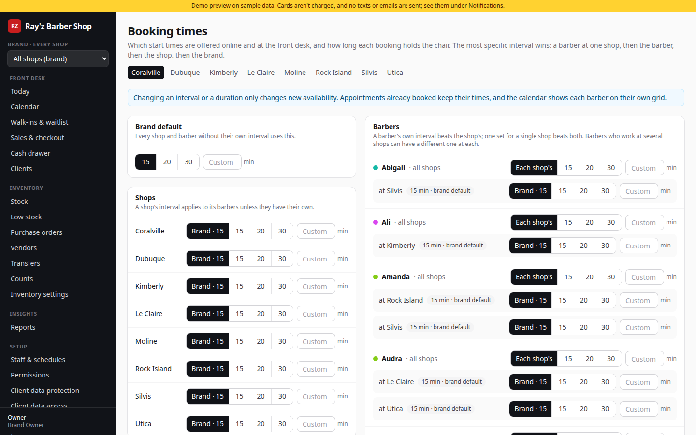

### Catalog, POS, and money

- A **brand master catalog** of services and add-ons, with per-shop price and duration overrides and per-shop enable/disable. The real Squire prices for each shop are seeded, and Squire's disabled items (design add-ons, memberships) are seeded as disabled.
- **POS** (`/admin/checkout/{id}`):
  - Services, add-ons, and retail items.
  - Tip presets per shop, flat tip buttons, or a custom amount.
  - A barber per line (with the reassign permission), and the tip split between a ticket's barbers by their services or evenly.
  - **Hand to customer**: the client tips, signs, picks a receipt and pays on the same device (see [Customer screen at checkout](#customer-screen-at-checkout)).
  - Promo codes, loyalty rewards, and manual discounts (needs the discount permission and a reason, and is capped at the person's discount limit, e.g. 10% for Front Desk).
  - Gift cards: sell them, check the balance, redeem them as partial payment.
  - Cash with quick-tender buttons and change due, or card through the reader (simulated Stripe Terminal) or keyed in (Stripe Elements).
  - One-tap rebook after payment.
- **Totals are computed by one pure function** (`src/domain/checkout.ts`) that both the POS screen and the server use. The server prices every service, add-on, and product from the shop's menu and ignores prices sent by the browser. Someone with the price override permission (managers by default) can override a line's price with a reason; the override is stored next to the menu price and audited. It refuses the charge if the totals don't match what the cashier saw.
- **Double-submits are safe.** The ticket is locked before the card is charged, a second submit waits and then sees the ticket already paid, and the app only ever refunds a charge that the same request created.
- **Taxes:** each shop has separate service and product rates stored in the database, so nothing is hard-coded. Only people with the tax permission can edit them (Brand Owner and Brand Admin by default), and every change is audited. Every service and product has a tax category (service, product, or exempt) that picks which rate applies; exempt items are never taxed. The seeded rates are placeholders marked "unverified" (see [Data caveats](#data-caveats)).
- **Credit card fee:** optional, set per shop, and the default is 3%. A database check caps it at 3%. It's applied only when Stripe reports the card's funding as `credit`; debit, prepaid, gift card, and cash pay no fee. The fee is disclosed before charging, on the POS, and on the receipt.
- **Refunds and voids:** need the refund permission, and a reason is required. A refund picks the lines (with quantity), the tip, and optionally the card fee; tax follows the lines. It can restock items and goes back to the original tender. Refunding a gift card sale voids the card. If part of it has been spent, a full-ticket refund gives back only what's left on it, and a fully spent card can't be refunded. Refunds reverse loyalty progress and revoke a reward the ticket earned. Voids are same-day only and are blocked once the drawer is closed.
- **Refunds issued in the Stripe dashboard** reach the books through the webhook (`charge.refunded`) and run the same reversal as a refund from the POS.
- **Split tender:** a gift card plus one cash or card payment. Paying the remainder half in cash and half on a card isn't supported yet.
- **End-of-day drawer:** a denomination counter, expected against counted cash with the variance, and history.
- **Audit log** records sales, voids, refunds, discounts, price, tax, and fee changes, schedule edits, imports, client ratings, settings changes, permission changes, every stock movement, purchase order step, transfer, and count, and every item a bulk upload creates or changes, including before and after values where it matters. Entries are append-only.
- **Card data never touches our server.** Elements tokenizes cards in the browser and Terminal reads them on the device; we store only brand, last 4, funding, and Stripe IDs, which keeps us in SAQ-A scope. See [What we store and what Stripe stores](#what-we-store) and [Processor-hosted data](#processor-hosted-data).

<a id="customer-screen-at-checkout"></a>
### Customer screen at checkout (hand to customer)

At checkout, **Hand to customer** turns the iPad or phone round to the client, like Squire's and Square's tip screens. The client tips, signs, chooses a receipt and pays, and staff take the device back with a PIN.

- **What the client sees** (`/handoff/{id}`): the shop's logo (or its name), the ticket's items, discounts, tax and tip, and the total. A credit card surcharge is shown before they pay and added only for a credit card. The steps, in order:
  1. **Tip:** the shop's buttons (percent with their dollar amounts, or dollar amounts), **Custom** on a keypad, and **No tip**, each set on or off. A tip over half the services asks "Are you sure?". With several barbers on the ticket, it says who shares it.
  2. **Signature** (optional per shop): a finger signature, with **Clear and sign again**. Changing the tip afterwards asks for it again.
  3. **Receipt:** a text with a link, an email, or none (see [Digital receipts](#digital-receipts)). The number or email on file is offered masked (`***-***-0142`), unless it has opted out; typing another goes on a keypad or the email field. It's used for this ticket's receipts and isn't saved to the client.
  4. **Pay:** on the shop's Stripe Terminal reader, by card in Stripe Elements, or **Pay with cash instead**, which sends the device back to the counter with the tip. A ticket a gift card covers just completes.
  5. **Thank you, please hand the device back to {barber}.** It then goes back to staff by itself after 3 to 60 seconds (8 by default), or stays until a staff PIN, set per shop.
- **Locked to the ticket.** A signed `rayz_handoff` cookie marks the device. While it's handed over, the middleware sends every other page (the calendar, client records, the POS, sign-in) back to the customer screen, and refuses every other server action. The staff session can't be used: `getStaffContext` returns nothing, so admin pages, actions and CSV downloads are refused too. The screen has no staff navigation, Back stays on it, and a page restored from the back-forward cache reloads. The customer screen's own actions only work on the device that holds that ticket's cookie, and only for that ticket. The cookie lasts 12 hours at most.
- **Taking it back:** the **Staff** button in the corner opens a PIN pad. Each shop picks **any staff time clock PIN** (anyone with access to the shop) or **a manager's PIN only** (roles with `handoff.unlock`: Brand Admin, Regional Manager and Shop Manager by default; the Brand Owner always). Wrong PINs count toward that person's time clock lockout. Before payment, staff land back on checkout with the ticket as it was, the client's tip and whether they asked for cash. After payment, they land on the receipt. If the client walks off with the device, **End hand-off here** on the ticket at another device ends it. Every unlock is audited with who and which rule.
- **Tips on the reader** (per shop): the Stripe Terminal reader asks for the tip instead of the screen. Saving the setting pushes the shop's first three buttons to a Terminal configuration on the shop's Stripe Terminal Location. A brand change reaches every shop on the reader that uses the brand's buttons. Until the shop has a registered reader, or when a gift card leaves nothing for the reader to charge, the screen asks for the tip.
- **Checks on payment.** The server prices the ticket again and refuses the payment if the total isn't what the client saw. A paid ticket can't be changed, and the ticket can't be charged at the counter while it's with the client.
- **Split tips.** Each service line has its barber (the ticket's barber by default; changing it needs `checkout.any`). With more than one barber, the tip is split **by services** (their share of the ticket's services after discounts) or **evenly**, chosen at checkout. The split is saved with the sale (`sale_tip_shares`). Every tip and tip refund on the ticket is divided in whole cents by largest remainder, so the shares always add up; a tie for the last cent goes to the barber whose ID sorts first. The tip ledger and tip payouts, every report that breaks tips down by barber (Barber performance, the sales and tender totals per barber, daily and monthly), and the payroll report credit each barber's share. Shop and brand totals don't change. Tickets with one barber work as before.
- **On the receipt:** each line's barber when it isn't the ticket's, the tip "on the customer screen" or "on the reader", each barber's share, and the signature with when it was signed. Where the receipt went is in the ticket's receipt history.
- **Phones and tablets, upright or sideways.** In portrait, the total sits at the top with **See items**; in landscape, the items are a column on the left. The client's buttons are at least 56 px tall (tip buttons 96 px), and the screen keeps clear of the notch and home bar.
- **Settings and permissions:** see the owner's guide above. `handoff.settings` (brand tip buttons) is brand-only and on for Brand Admin; `handoff.unlock` is for the manager PIN. The location wizard has the same choices.
- **Simulator:** without Stripe keys, the reader is simulated: the client picks the tip and a test card where the reader would show them. With keys, tips on the reader are pushed to Stripe, but taking the card on a real reader is still the simulated flow (see [What's stubbed or simulated](#whats-stubbed-or-simulated)).
- **Tests:** `tests/handoff.test.ts` (unit): tip buttons and their amounts, settings checks, the steps, the split by services and evenly with the extra cent, the credit total, the permissions, and that the middleware, PIN pad and locked context are wired. `tests/db/handoff.test.ts`: the whole hand-off with tip, signature, receipt and card (the total checked, the counter refused while it's with the client); the lock (every page redirected, actions refused, the staff session unusable, another ticket's screen refused); PINs (wrong PIN, a barber refused under the manager rule, the lockout); going back by itself after the thank-you or staying until a PIN; returning before payment with the tip; tips on the reader; split tips through the ledger, refunds, Barber performance and the payroll report; and the settings.

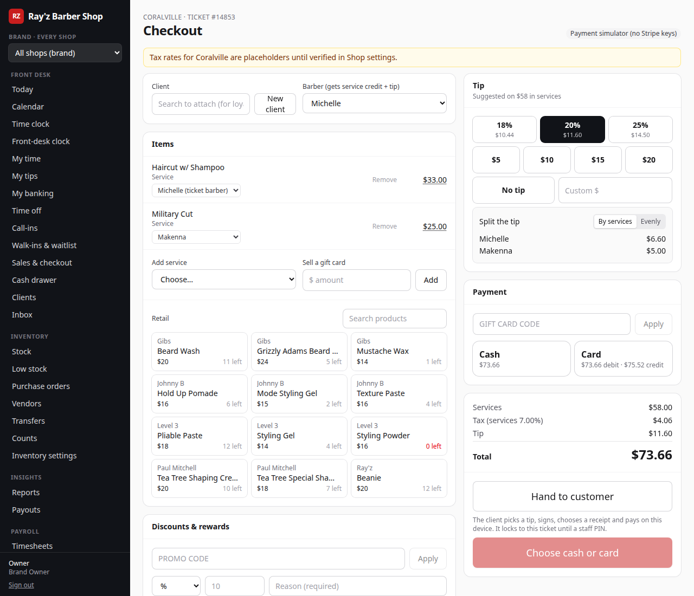

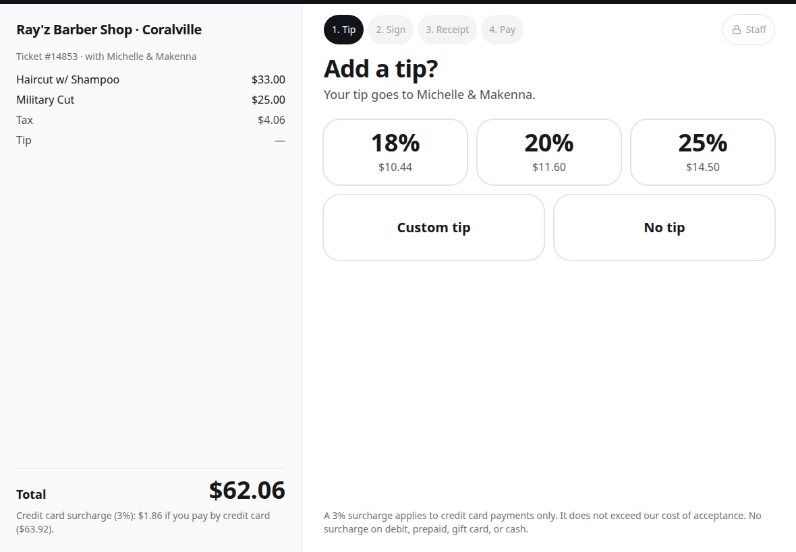

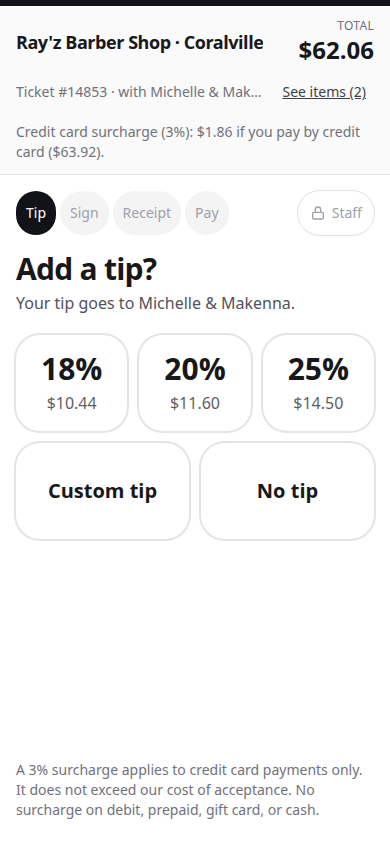 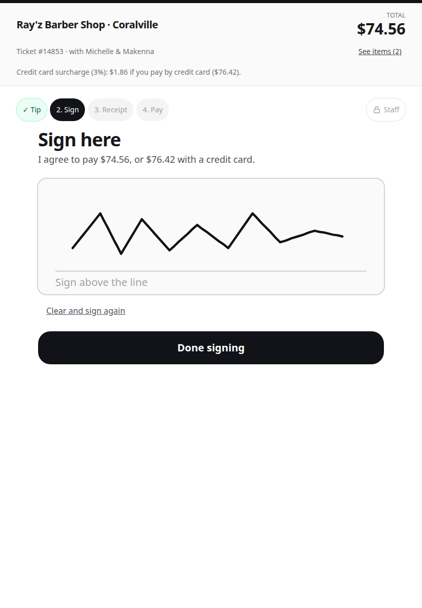

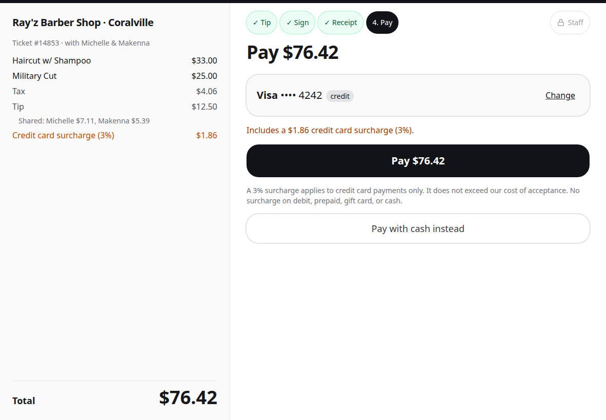

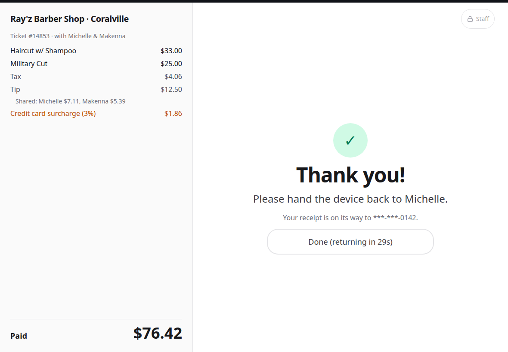

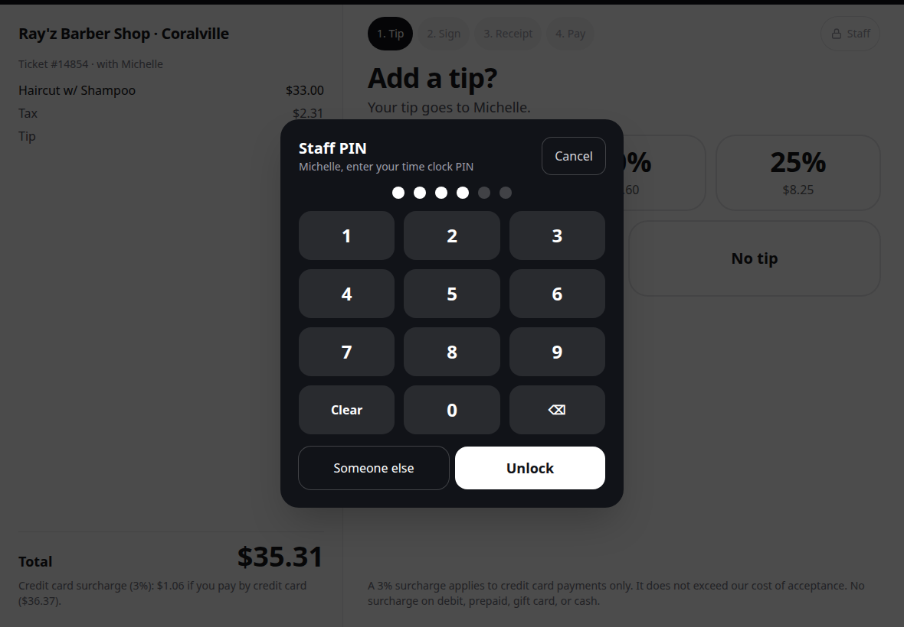

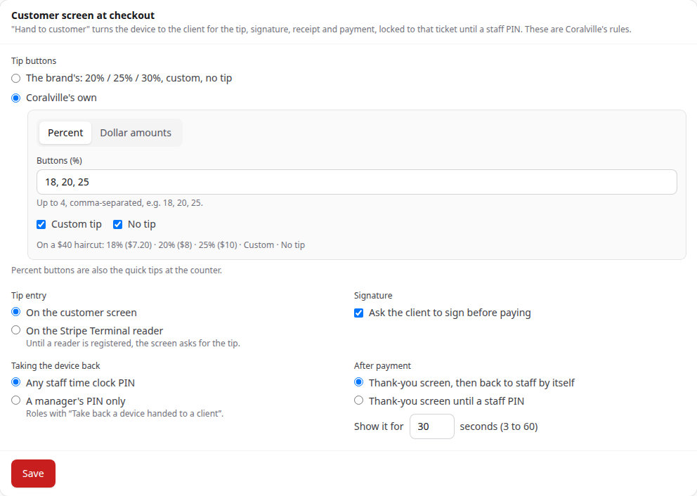

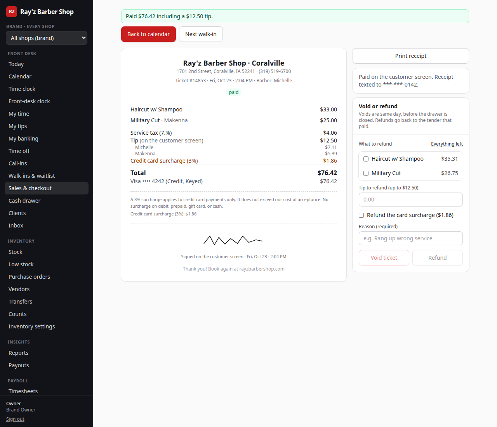

### Digital receipts

Receipts are a text with a link, an email, or none. Paper is off: the staff ticket has no Print button unless a shop turns it on (**Shop settings → Receipts**).

- **At checkout.** Right after paying at the counter, the ticket asks **How would they like the receipt?**: **Text**, **Email** or **No receipt**. On the customer screen it's the receipt step (see [Customer screen at checkout](#customer-screen-at-checkout)). The client's number or email on file is offered first. Staff whose **Client data** settings mask or hide it see it masked (`***-***-1234`, `j***@example.com`) and can still send to it; **Use a different number** takes what the client says.
- **The receipt page** (`/receipt/{token}`), built for a phone: the shop's logo, name, address and phone (per the receipt settings), the date and ticket number, the barber's first name, each service and product, discounts, tax, tip, the credit card surcharge, the total, how it was paid (**card brand and last 4 only**, or cash or gift card), refunds, the client's loyalty progress and rewards ready, the card fee disclosure, and **Rebook** (the shop's booking page with the same barber and service) and **Leave a review** (the location's Google review link; no button without one, see [Google reviews](#google-reviews)). It never shows the client's last name, number or email, only where this copy was sent, masked. It isn't indexed and sends no referrer.
- **Each link has its own token** (256 bits; only the SHA-256 is stored, like the rebook links), and every link shows the ticket as it is now.
- **Refunds and voids** send an updated receipt ("Updated receipt: $21.40 was refunded") to where the client last chose for that ticket, from the POS or a Stripe dashboard refund. The page shows the refund and what they paid after it. If they chose no receipt, nothing is sent. It never holds up the refund: if the update can't go, it's recorded as not sent.
- **Again later.** The ticket's **Receipt** card sends it again and lists every receipt sent (when, where, why, by whom, and whether the provider sent it). The **Receipt** column in a client's **Purchases** does the same per ticket. Anyone who can open the ticket can send it: their own clients' tickets, or with `sales.view` or `checkout.any`.
- **Clients ask for copies** at `/receipt` (linked from the site footer and every receipt): they enter their mobile number or email, and links to their last 3 receipts (13 months) go to that number or email if it's on file. The answer is the same either way, so it doesn't tell anyone who's a client, and it sends at most 3 times an hour to one place.
- **Consent and opt-outs.** A number that replied STOP is never texted, and an email that used **Stop receipt and review emails** on the page is never sent receipts or review requests; staff see why. The client choosing a receipt at checkout, or asking for copies, is consent for that receipt. Updates and resends to what's on file need the client to have chosen that number or email for this ticket, or to have said yes to texts or emails (`sms_opt_in`, `email_opt_in`); a number or email staff type in is the client asking. Texts end with "Reply STOP to opt out."
- **Settings** (Shop settings → Receipts): headline, footer, logo, address, phone, the Google review link and follow-up (below) and **Show a Print button**.
- **Audit:** `receipt.sent`, `receipt.none`, `receipt.resent`, `receipt.requested` and `receipt.email_opt_out`, with the destination masked; refund and void entries record the update.
- **Tests:** `tests/receipts.test.ts` (consent rules, card labels, wording, settings) and `tests/db/receipts.test.ts` (the counter choice with masked contact details, the page's contents and what it leaves out, refund and void updates, no receipt, STOP and email opt-outs, resends, copy requests and their limit), plus the receipt step in `tests/db/handoff.test.ts`.

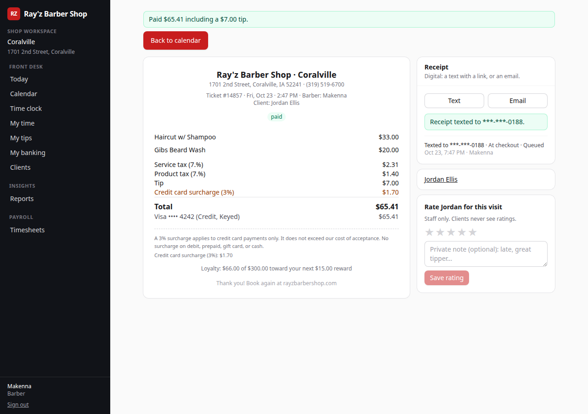

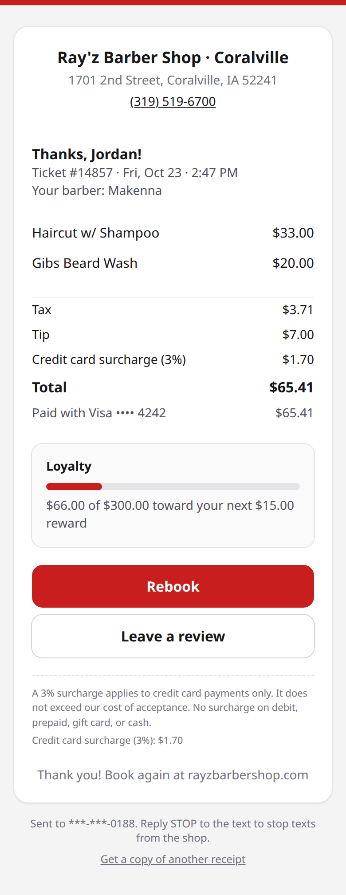 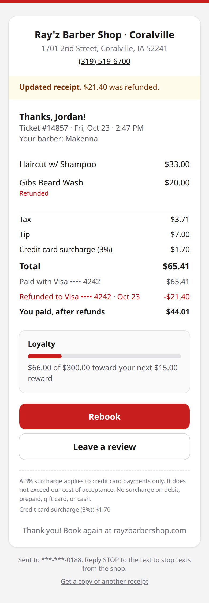 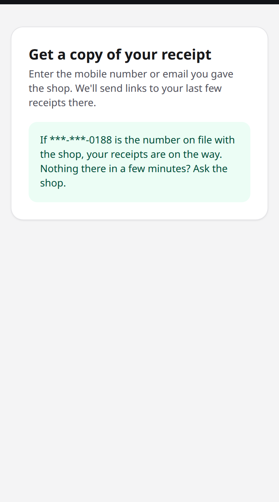

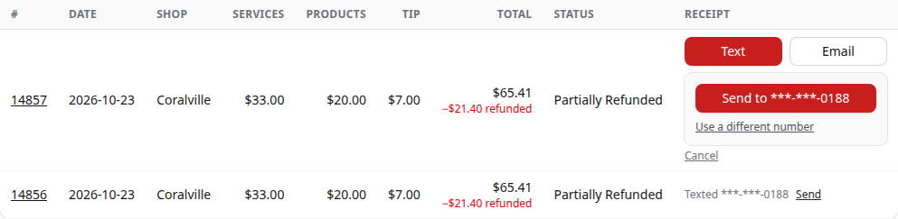

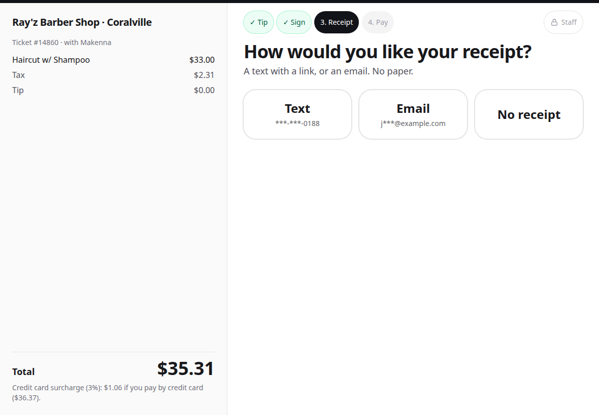

#### Google reviews

**Leave a review** on the receipt goes to the location's Google review page. It's shown, and the follow-up is sent, from the client's 3rd visit on (the brand can change this, and each location can set its own), and not again at a location for a while after the client taps its link. Beyond that, every client gets the same link and the same follow-up. Nothing checks how the visit went, the rating, the tip, a refund or a complaint before showing or sending it: asking only happy clients ("review gating") is against Google's review policy.

- **The link, per location** (Shop settings → Receipts, and the Receipts part of the new location wizard's payments step). Paste the Google Business Profile **Ask for reviews** link (`g.page/r/…` or `https://g.page/r/…/review`), a `search.google.com/local/writereview?placeid=…` link, or just the Place ID, which becomes `https://search.google.com/local/writereview?placeid=<id>`. It's saved as `https`, rebuilt from the code or Place ID alone (extra parameters dropped), and the field shows where clients will go. Anything else (Yelp, a Maps page, another site) is refused. Blank means no button. A saved link that isn't Google's is read as no link.
- **From which visit** (Shop settings → **Google reviews**, brand-wide, `settings.brand`; default visit 3). A visit is a location and day the client was in: a checked-out appointment or a paid ticket (refunded ones still count), at any location, imported history included. Cancelled appointments, no-shows, open tickets and voided tickets don't count, and two tickets the same day at one location are one visit. A ticket's number is fixed by the visits up to its day, so the 1st and 2nd receipts never get the button, even when opened later. A ticket with no client on file counts as a 1st visit. 1 shows it to everyone.
- **The pause after a tap** (same card; default 90 days, 0 never pauses). Google doesn't say who posted a review, so a tap on a location's link (from the receipt or the follow-up, not a link preview) is the signal: that client's other receipts and follow-ups at that location don't show or send the link for the set days. Other locations, with their own Google listings, aren't paused. The receipt they tapped keeps its button.
- **Per location** (Shop settings → Receipts, and the wizard): **Show Leave a review from visit** and **After a tap, don't ask again for**; blank uses the brand's, shown in the field. The card says which visit and pause apply.
- **Clicks.** The button and the follow-up link go through `/receipt/{token}/review`, which counts the click against the location and the ticket's barber, then redirects to Google with no referrer, so the token never reaches Google. A removed link goes back to the receipt. Link previews and email scanners (empty or bot user agents) are still redirected, but not counted.
- **Follow-up after the visit** (optional, per location, off by default). A set number of hours after the ticket is paid (1 to 48, default 3), the notifications cron texts the review link, or emails it if the client agreed only to emails: "Hi Riley, thanks for visiting Ray'z Barber Shop · Coralville. We'd appreciate an honest review on Google: {link} Reply STOP to opt out." The email has the same request plus the receipt link, where **Stop receipt and review emails** turns them off.
  - **Consent:** only clients who agreed to texts or emails (`sms_opt_in`, `email_opt_in`). Choosing a receipt at checkout isn't consent for this. A number that replied STOP isn't texted and an email that turned them off isn't emailed. Nothing goes out in the brand's quiet hours (call-in rules, 9 PM to 8 AM by default); those tickets are asked when quiet hours end.
  - **Limits:** the same visit and pause as the button (not sent: "before the review visit" or "tapped the review link lately"); once per ticket; **Ask the same client again after** (default 90 days, 0 for every visit) per location; tickets paid more than a day before the run, imported tickets and voided tickets (rung up by mistake) aren't asked. Refunded tickets are asked like any other.
  - Each one is in the ticket's receipt history ("Google review request", or "Not sent" with why) and the outbox, and is audited as `review.requested`.
- **Report:** **Reports → Google review links** (`google_reviews`): follow-ups sent, clicks from receipts and from follow-ups, tickets with a click and the follow-up click rate, by barber and by location, with CSV. Barbers can be selected like the other barber reports. Google doesn't say whether a review was posted, so these are clicks, not reviews.
- **Tests:** `tests/reviews.test.ts` (link parsing and what's refused, follow-up settings, the visit and pause rules, the wording, consent, bot filtering) and `tests/db/google-reviews.test.ts` (settings, click counting and the redirect, the follow-up's delay, consent, opt-outs, quiet hours, repeat limit and once per ticket, no gating, the visit count across locations and what counts, brand and location settings, the pause after a tap, the report).

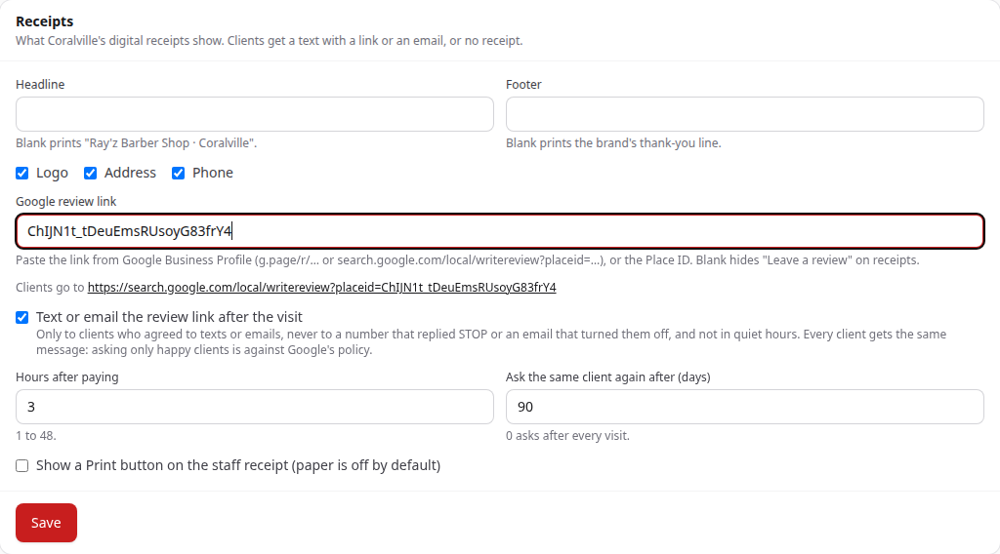

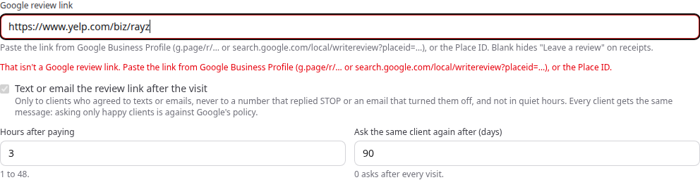 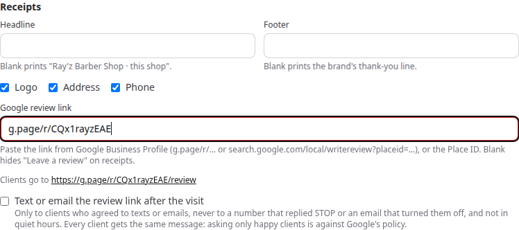

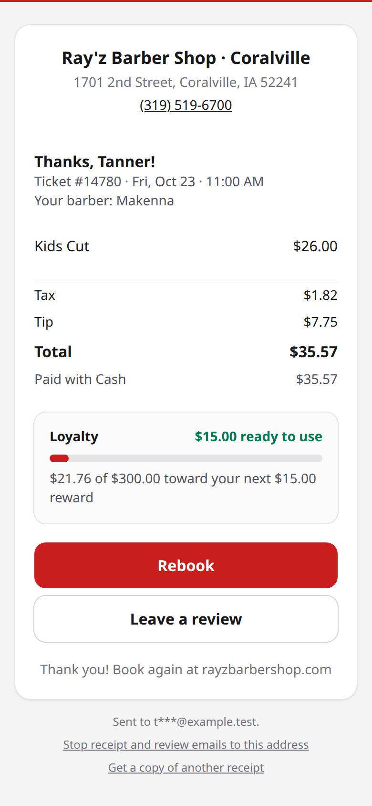

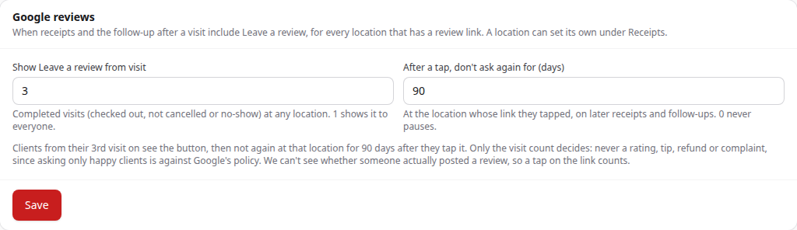

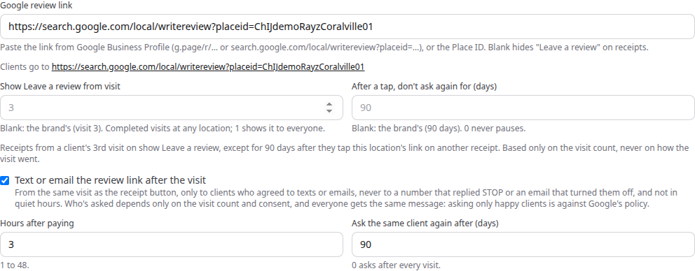

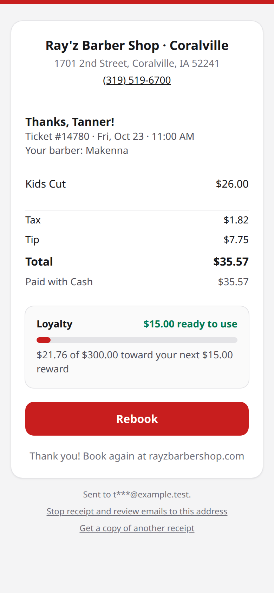 

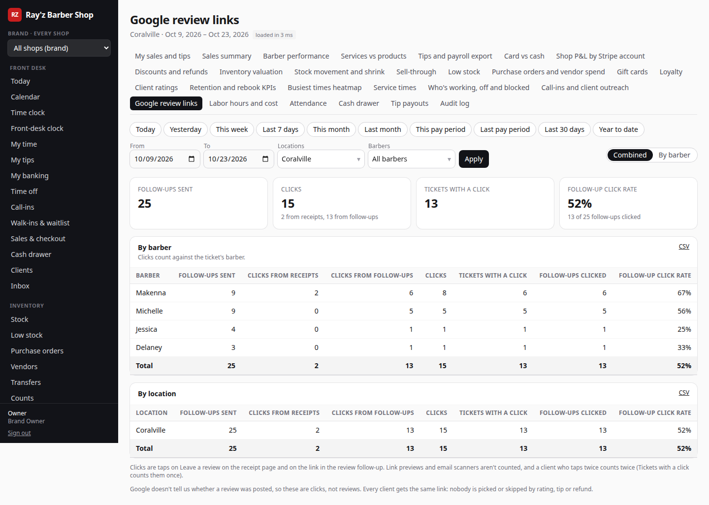

### Card payments: per-location banking (Stripe Connect)

Ray'z is the platform on one Stripe account. Each shop's **payments mode** decides where its card money settles: its own **connected account** (`connected`, the default), the brand's own account (`brand`), or nowhere (`cash_only`). The [owner's guide](#banking-per-location) covers the choice; this is how it works.

- **One routing decision.** `chargeRoute` in `src/server/payments/connect.ts` picks the route for every card charge, and `chargeCard` in `src/server/payments/processor.ts` is the only place a PaymentIntent is created. Services, add-ons, products, tips, surcharges and gift cards sold at the POS are all in the sale's one charge, so they all follow the route. Reader payments do too.
  - **Own account:** a destination charge (`on_behalf_of` plus `transfer_data.destination`). The shop is the merchant on the statement, and the platform keeps an application fee equal to the processing cost: 2.9% + 30¢ keyed or online, and 2.7% + 5¢ on the reader. Set `CONNECT_FEE_KEYED` or `CONNECT_FEE_TERMINAL` (for example `2.9%+30`) to change them. The payment row stores `stripe_account_id`, `stripe_transfer_id`, `application_fee_cents` and `settlement = 'connected'`.
  - **Brand account:** a plain platform charge with the shop's `statement_descriptor_suffix`, recorded with `settlement = 'platform'` and Stripe's fee in `processor_fee_cents`. The shop is still on every row, so its sales, refunds and fees report on their own.
  - **Cash only, or own account not ready:** refused before anything is charged (`payment_failed` with reason `cash_only` or `payments_not_ready`). The POS greys out Card and says why.
- **Refunds follow the money.** A refund reverses the transfer (`reverse_transfer`) when the payment went to a connected account, and is a plain refund when it settled in the brand's. That's decided by the payment, not the shop's current mode, so switching a shop never misroutes an old refund. Processing fees aren't returned.
- **Readers.** Each shop gets a Stripe Terminal Location, created on first use from its address. Readers register to it with their registration code (`terminal.readers.create`), and checkout refuses a reader that isn't the shop's own and records which reader took each payment (`payments.terminal_reader_id`).
- **Clients and saved cards live on the platform** as Stripe Customers, so one saved card pays at any shop, on either kind of account. That side is built by the mobile workstream.
- **Go-live.** The checklist's Payments and banking step is done when the shop is on the brand's account, cash only, or its own account has `charges_enabled`. Payouts can lag. **Open cash-only for now** waives it once, without changing the mode.
- **Webhooks.**
  - The platform webhook (`/api/stripe/webhook`) books refunds made in Stripe's dashboard at the payment's shop, whichever account it settled in, logs disputes against that shop, and records the brand account's own `payout.*` as brand payouts.
  - The Connect webhook (`/api/stripe/connect`) takes `account.updated`, `capability.updated`, `account.external_account.*`, `account.application.deauthorized` and `payout.*` from shops' accounts. It stores the status flags, what's due and the payout schedule, and records payouts against the shop. Events for accounts that aren't ours are acknowledged and ignored.
  - A paid payout is itemized from its balance transactions (gross, fees including our application fee, refunds), and the result is stored on `shop_payouts`.
- **Permissions.**
  - `payments.banking` covers starting or continuing onboarding, opening a shop's Stripe dashboard, changing the mode or the statement descriptor, and choosing anything but the defaults in the wizard. Only the Brand Owner has it by default, and only the Brand Owner can grant or remove it (`OWNER_GRANTS`); a Brand Admin can't, even to themselves.
  - `payments.accounts` (Brand Owner and Brand Admin) covers viewing status, refreshing it, and owner entities.
  - Registering readers needs `settings.shop`, and the Payouts page needs the Shop P&L report.
  - Every change is audited: `payments.mode`, `payments.statement_descriptor`, `payments.terminal_location`, `reader.register`, `shop.receipt`, and the go-live and create entries with the mode.
- **Owners.** Every shop belongs to an owner entity, either the brand or a franchisee. A franchisee can own several shops. Owners are managed under Location setup.
- **Shop P&L by Stripe account** (`/admin/reports/shop-accounts`) shows each shop's account (or "Brand account"), grouped and subtotalled by owner, with:
  - card charges, card takings after refunds, tips, surcharge and refunds
  - processing fees, and what the accounts received. Brand-account takings are counted at their shop, not as unrouted.
  - payouts paid and in transit, with every payout's gross, fees and refunds
  - cash and gift cards taken outside Stripe
- **Payouts** (`/admin/payouts`) has the same numbers per account, plus the brand account's pooled payouts, each account's payout schedule, and every deposit itemized.
- **Without Stripe keys,** each shop on its own account gets a simulated account (`sim_acct_…`) and a stand-in for the hosted onboarding page. Readers register as `sim_tmr_…` to a `sim_tml_…` location. The seed gives every shop an onboarded simulated account, routes its card history there, and makes daily payouts, itemized. Brand-account sales get brand payouts. Simulated accounts are refused once real keys are set, so every shop goes through Stripe's onboarding then. Reader-driven collection (`terminal.readers.processPaymentIntent`) is still simulated at the POS.

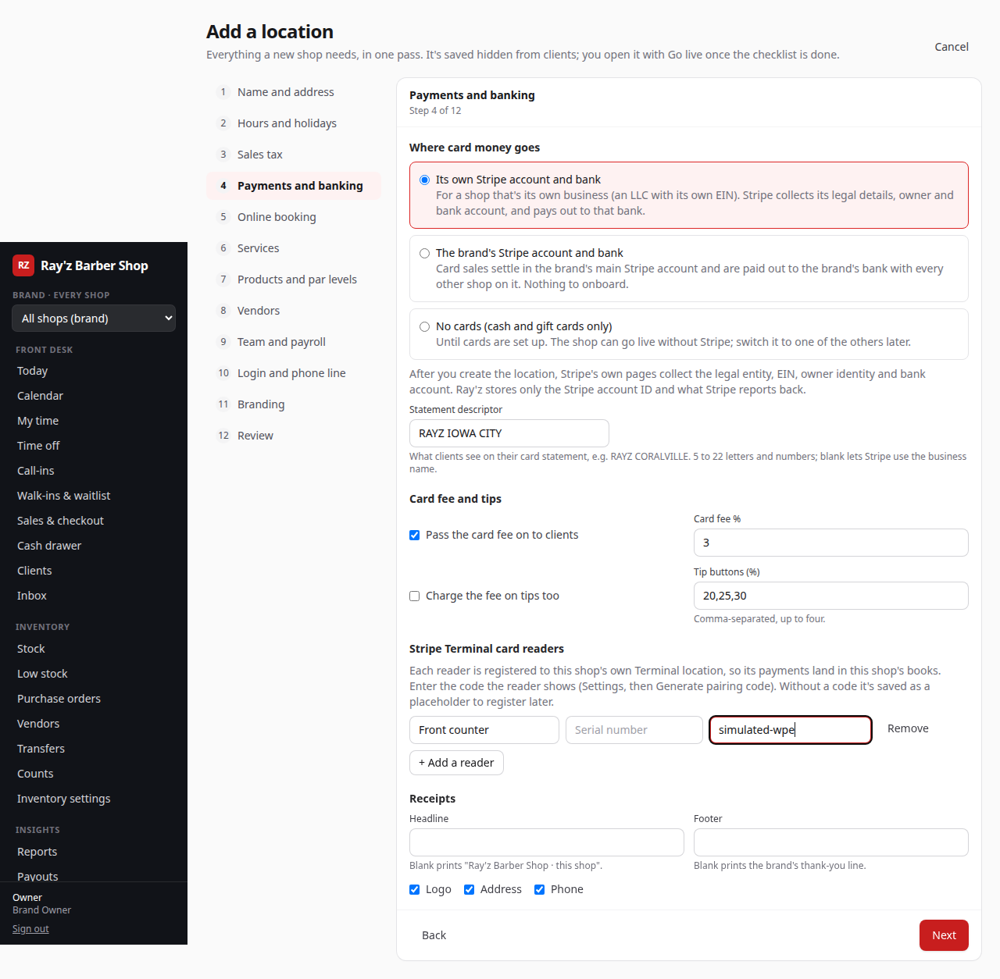

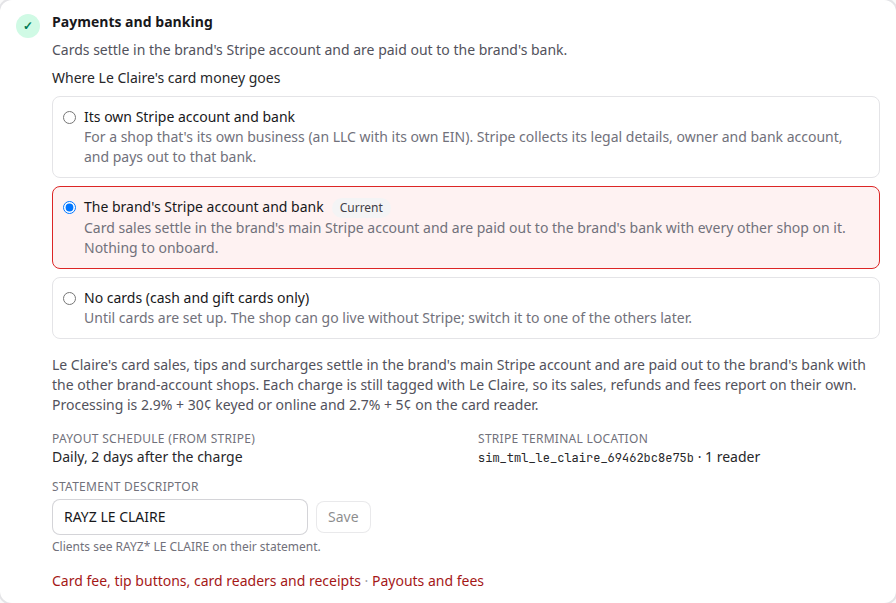

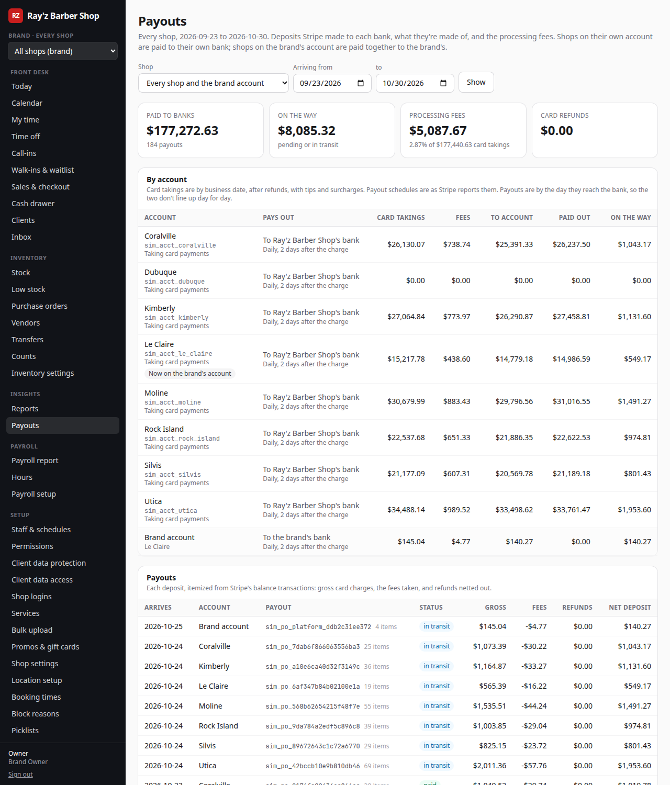

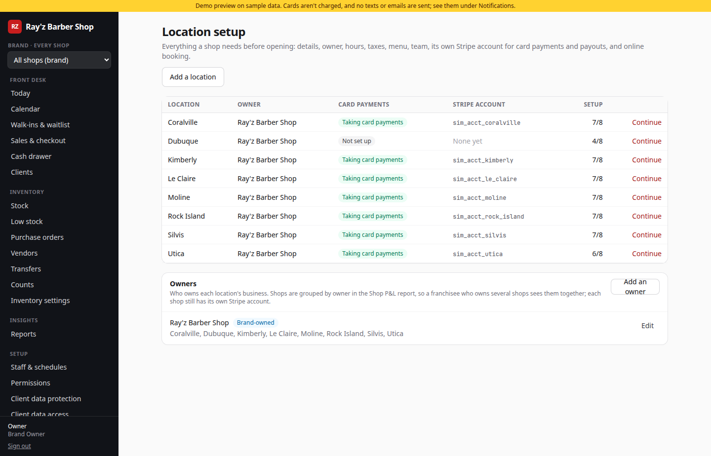

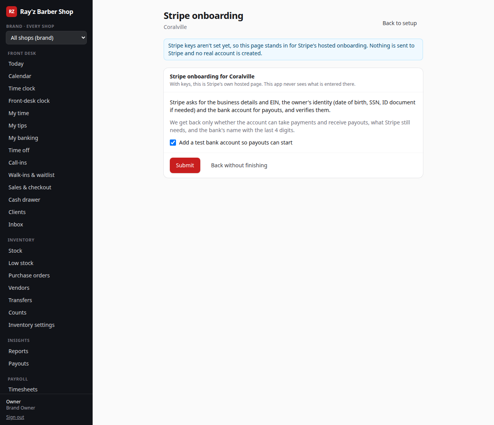

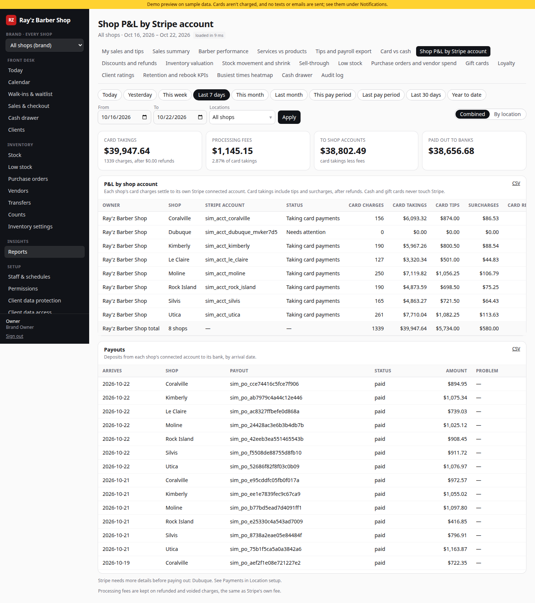

<a id="processor-hosted-data"></a>
### Processor-hosted data

Ray'z is a processor-hosted integration. Cards, bank accounts, debit cards, SSNs, TINs, EINs, dates of birth for identity checks and ID documents are entered only on Stripe's own surfaces: Connect onboarding and the Express dashboards (shops and employees), the Payment Element (keyed cards, cards only), and Terminal readers. No page has a field for them. The owner-facing summary is [What we store and what Stripe stores](#what-we-store).

What still guards against them arriving by mistake:
- **Logs and errors:** `src/instrumentation.ts` wraps every `console` method at server start (the worker too), so whatever Next, a library or our code logs is scrubbed first, including error messages, stacks, causes and properties. `src/lib/sensitive.ts` holds the rules:
  - keys such as `routing_number`, `account_number`, `ssn_last_4`, `id_number`, `tax_id`, `dob`, `card_number`, `cvc`, in any casing, lose their values;
  - card numbers (13 to 19 digits, spaced or not, passing the Luhn check), SSNs (`123-45-6789`, `123 45 6789`) and EINs (`12-3456789`) in any text become `[card number removed]`, `[SSN removed]` or `[EIN removed]`.
- **The audit log:** `audit()` scrubs its details.
- **The database:** migration `core_0035` applies the same rules in SQL, in a trigger on every free-text column: notes, reasons, message bodies, subjects, audit details, client custom fields, import errors (which keep the original CSV row) and punch edits. It covers every writer, the mobile API and the importer included. Rows from before the migration were scrubbed once, and one `privacy.scrub_existing` audit entry counts them. Backups are copies of the database, so they hold only scrubbed data from then on.
- **No error tracker or analytics is installed.** If one is added, run its events through `scrub()` first (DEPLOY.md).
- **Tax forms:** Stripe Connect tax reporting files shops' 1099-K forms and delivers them in their Express dashboards. Employees' tips are W-2 wages, so their accounts are left out of 1099 reporting.
- **PCI SAQ A:** keyed cards go only through Stripe's iframe (`allowedPaymentMethodTypes: ["card"]`). In production, checkout pages send a Content-Security-Policy that allows scripts and frames only from Ray'z and Stripe and stops other sites framing them.

Allowed on purpose: the vendor's **account number** (the shop's customer number at a supplier, printed on purchase orders; vendor audits record it as `supplierAccount`) and the client's **birthday** (for greetings, never identity checks).

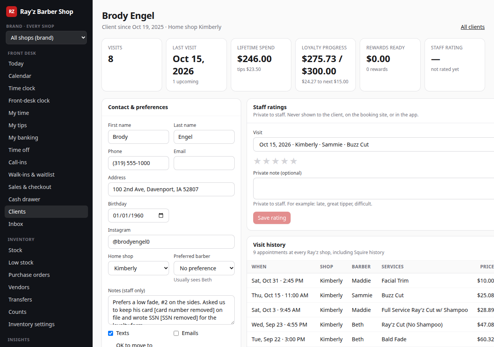

Limits: a bare run of digits that isn't a card number can't be told from an order number. That includes a 9-digit SSN or routing number typed without dashes, or a 10 to 12 digit bank account number. The rules are a backstop. The real control is that nobody is ever asked for these numbers.

`tests/sensitive.test.ts` checks the rules, the log scrubbing, and that no column in the schema or any migration (and no JSON property in the schema) is one of these fields. `tests/db/sensitive-data.test.ts` plants real-looking values through Stripe webhooks (an employee's and a shop's account, a payout failure), client notes and custom fields, an inbound text, a Squire import, a queued message, an audit entry and a failing server action. It then greps every row of every table, every JSON column, the captured logs, the webhook responses, the banking views and every `/api/v1` GET response and the OpenAPI document. It also checks that every free-text column has the trigger and that the SQL and app rules agree.

### Inventory, vendors, and purchase orders

Stock is kept per shop in a ledger, and buying is done with purchase orders sent straight to vendors. Everything lives under **Inventory** in the nav: **Stock**, **Low stock**, **Purchase orders**, **Vendors**, **Transfers**, **Counts**, and **Inventory settings**.

**The stock ledger** (`inventory_ledger`, `src/server/inventory/ledger.ts`)

- Every stock change is an append-only ledger row with a kind, the change, the balance after it, the unit cost, who made it, and a link to what caused it: the ticket, purchase order receipt, transfer, or count.

| Kind | Change | Comes from |
| --- | --- | --- |
| `sale` | Subtracts | Checking out a retail item |
| `refund` | Adds back | A refund with "restock" ticked |
| `void` | Adds back | Voiding a same-day ticket |
| `receive` | Adds | Receiving a delivery against a purchase order |
| `transfer_out` / `transfer_in` | Subtracts at one shop, adds at the other | Sending and receiving a transfer |
| `adjust` | Either way | A manual adjustment, which needs a reason: damage, theft, count correction, used in service or back bar, found, or other |
| `stocktake` | Either way | Posting a cycle count or full stocktake |
| `upload` | Either way | A stock column in a [bulk upload](#bulk-catalog-upload) |
| `opening` | Sets the start | The opening balance when the ledger was introduced |

- **On-hand can't drift.** A database trigger moves `shop_products.stock` by exactly each ledger row's amount, and the database refuses any other write to stock, as well as any edit or delete of a ledger row. Mistakes are fixed with a new entry. The migration turned the old adjustment rows into ledger entries and added an opening entry wherever the shelf didn't match them. The `inventory_drift` view lists any shop product whose stock differs from its ledger total; it's always empty, and the tests check it after every scenario.
- **Concurrent sales are safe.** Posting locks the stock rows first, so two registers selling the last bottle at the same moment can't both take it.
- **Negative stock** is set per shop in **Inventory settings**: **Block** refuses a sale, transfer, or adjustment that would take on-hand below zero, and **Warn** allows it and shows a warning. Shops default to Block; the seed sets Moline to Warn as an example. Corrections to a counted number are always allowed.
- **Quantities shown per product per shop:**
  - On hand.
  - Committed: on open tickets, plus transfers being picked.
  - Available: on hand minus committed.
  - On order: approved, sent, or partly received purchase orders.
  - In transit from another shop.
  - Projected: available plus on order and in transit.
  - Stock value at cost.
- The **Stock** page shows these for one shop, with stock at cost, the low count, and what's coming in. People who can adjust stock can take out, add, or set a product to a count from there, with a reason. In the all-shops view the page is a matrix across every shop. A product's page shows its ledger at each shop.
- **Audited.** Every ledger post, setting change, purchase order step, transfer, and count is in the audit log with the user.

**Par levels and low stock**

- Each product has a **reorder point** and a **par** (target) level. The brand sets the defaults (**Inventory settings → Brand levels**, which needs access to every shop) and each shop can override either one. A product is low when its available stock is at or below the reorder point.
- **Low stock** (`/admin/inventory/low-stock`) lists everything at or below its reorder point with its available, on-order, and in-transit quantities and the vendor. Next to that list are **suggested orders** per shop and vendor, and **Create purchase orders** turns the ticked ones into drafts. The dashboard has a low-stock card that links here.
- **Alerts:** the cron job emails each shop's alert address (or the shop email) when products newly go low, once per product until it's restocked above the reorder point. Managers can send alerts now from the Low stock page. Alerts go through the notification queue, so they show in the outbox.

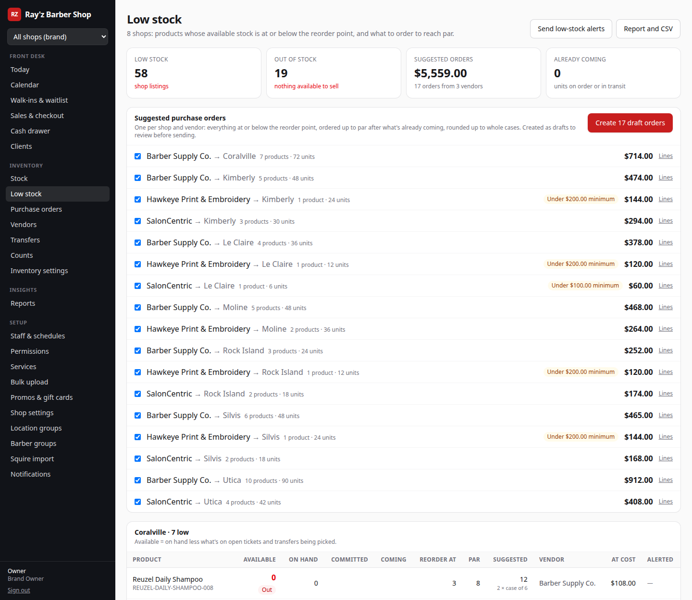

**Vendors** (`/admin/vendors`)

- A vendor has a name, contact person, email, phone, address, account number, payment terms, lead time, minimum order, notes, and whether to attach a CSV to emailed orders. Vendors can be turned off without losing their history.
- Products link to one or more vendors, each with the vendor's SKU, case pack, and cost. One vendor is marked **preferred** per product, and suggestions use it. Without a preferred vendor, suggestions use the cheapest one.
- The vendor page shows open orders, spend in the last 90 days, and the vendor's full purchase order history.

**Purchase orders** (`/admin/purchase-orders`)

- **Suggested orders.** For each shop and vendor, every product whose projected stock is at or below its reorder point is ordered up to par, at least one over the reorder point, and rounded **up to whole case packs**. Projected stock counts what's already on order or in transit, and products already on a draft are left out, so nothing is ordered twice. An order under the vendor's minimum is flagged.
- **Multi-shop.** In the all-shops view, someone with access to several shops can create the drafts for every shop in one step. That gives one purchase order per shop and vendor, linked as a batch.
- **The editor** changes quantities (with the case count shown), unit costs, the vendor's SKU, the expected date, and notes, and can add any product the vendor sells. It also shows each line's on hand, on order, and par. Editing an approved order puts it back to draft.
- **Statuses:** draft, approved, sent, partially received, received, and cancelled. A partly received order can also be **closed short** when the rest won't come; it's marked received and stops counting as on order.
- **Approval.** Orders above the brand's **approval limit** (**Inventory settings**, set by the Brand Owner; the seed uses $500) must be approved by someone with `po.approve` before they can be sent. Orders under the limit are approved as they're sent. With no limit, approval is never required.
- **Sending** needs `po.send`. **Email** sends the vendor a message with the order as a **PDF**, plus a **CSV** if the vendor wants one or the sender ticks it. Email goes through the pluggable email provider, which is stubbed and **off until it's configured**, so the outbox at **Notifications** shows exactly what the vendor would get, attachments included. **Placed another way** (phone, the vendor's portal) records a reference instead. The PDF and CSV can be downloaded from the order at any time.
- **Receiving** needs `po.receive`. Staff enter what actually arrived, which can be all, some, or none of each line, and the price actually charged. Each delivery is its own receipt. Stock comes in through the ledger as `receive` entries, the shop's cost moves to the weighted average of old and new stock, and a changed price can be saved as the vendor's new cost. The order becomes partially received or received.
- **History.** Each order shows when it was created, approved, sent (and to whom), received, and closed, and by whom. Every receipt is listed with its lines.

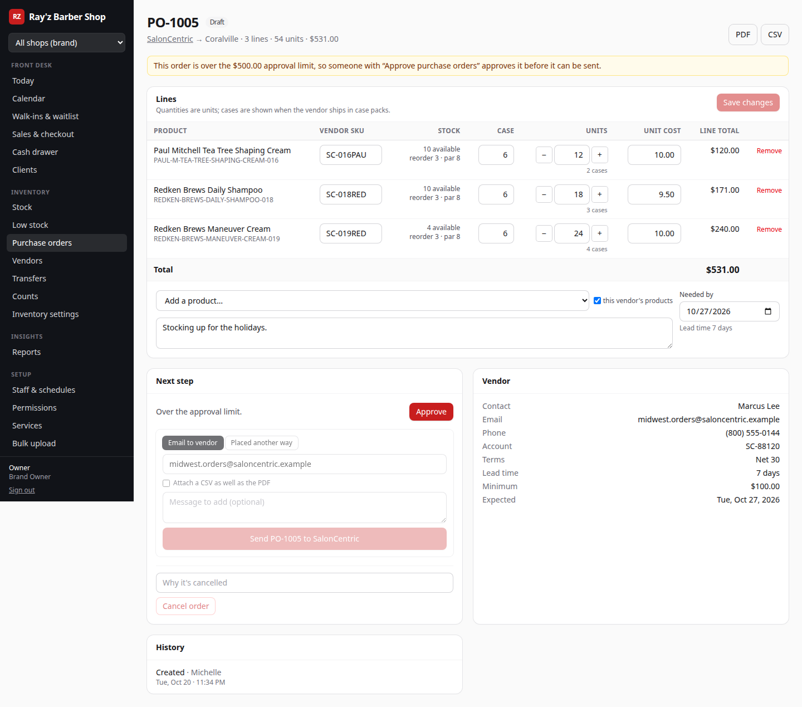

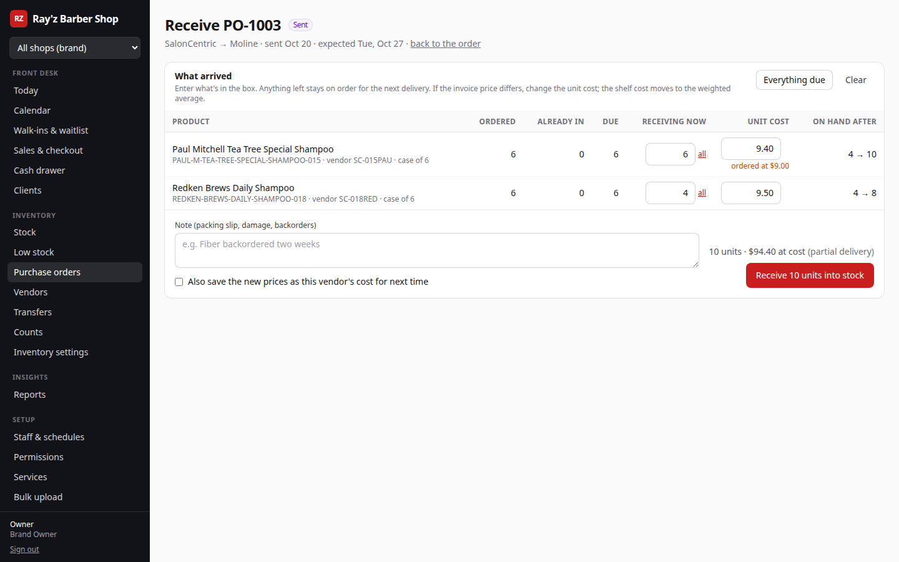

**Transfers** (`/admin/inventory/transfers`)

- A transfer is created at the shop sending the stock, which needs access to that shop only. The receiving shop can be any shop in the brand. While it's being picked, its quantities count as committed at the sending shop.
- **Send** subtracts the stock at the sending shop (`transfer_out`), and the receiving shop sees it as in transit. **Receive**, done at the receiving shop, adds what actually arrived (`transfer_in`). Anything short is recorded as lost in transit.

**Counts** (`/admin/inventory/counts`)

- A **cycle count** covers a category or chosen products. A **full stocktake** covers everything the shop carries, and uncounted items can be zeroed when it's posted.
- The count sheet is **blind** by default: expected quantities are hidden until "Show expected" is clicked. Progress can be saved and finished later.
- Posting writes one `stocktake` entry per difference, measured against on-hand at the moment of posting, so sales made during the count are accounted for. The **variance report** shows on hand at the start and at posting, counted, the variance, and its value at cost.

**Permissions.** Each action has its own permission, and each can be granted per role or per person (see [Roles and permissions](#roles-and-permissions)).

| Permission | What it allows | Default roles |
| --- | --- | --- |
| `inventory.manage` | Par levels, reorder points, shop inventory settings, low-stock alerts | Managers and up |
| `inventory.adjust` | Manual adjustments with a reason | Managers and up |
| `inventory.transfer` | Create and send transfers | Managers and up |
| `inventory.stocktake` | Cycle counts and full stocktakes | Managers and up, Front Desk |
| `vendors.manage` | Add and edit vendors and their products | Regional Manager and up |
| `po.create` | Create and edit purchase orders | Managers and up |
| `po.approve` | Approve orders above the approval limit | Regional Manager and up |
| `po.send` | Send orders to vendors | Managers and up |
| `po.receive` | Receive deliveries, and receive transfers | Managers and up, Front Desk |

Every permission is checked on the server, within the person's shops. Changing the approval limit or the brand default levels also needs access to every shop.

**Inventory reports** (each is its own report permission, with CSV export, and runs per shop, for selected shops, or for all shops):

- **Inventory valuation:** units, value at cost and at retail, and margin by category; then each product's on hand, cost, value, and what's on order. For a past end date, it shows the stock as of that day.
- **Stock movement and shrink:** opening plus every kind of movement (received, sold, returned, transfers, damaged, theft, back bar, found, count variance) equals closing, per product. Shrink is shown in units and at cost, including anything lost in transit. A ledger-entries table lists every change in the range with who made it.
- **Sell-through:** opening, received, sold, and closing per product, with the sell-through rate, units sold per day, days of cover, net sales, cost of goods, and margin.
- **Low stock:** everything at or below its reorder point now, with available, coming in, and the suggested order in whole cases.
- **Purchase orders and vendor spend:** per vendor, the orders sent, amount ordered, receipts, amount received at what the vendor charged, the cost variance against the order price, what's still on order, the fill rate, and the days to deliver. Then every purchase order in the range.

Products have a SKU (unique, case-insensitive), an optional barcode (8 to 14 digits, unique), a brand-level cost and price, and per-shop price overrides. Prices, stock, and new items can be loaded in bulk; see [Bulk catalog upload](#bulk-catalog-upload).

### Notifications

- Every booking queues a confirmation plus 24-hour and 2-hour reminders in the `notification_jobs` table. Cancelling or rescheduling an appointment cancels its pending reminders.
- The queue is drained by `/api/cron/notifications` (Vercel Cron, every 5 minutes, see `vercel.json`) or by `pnpm worker` locally. Draining uses `SKIP LOCKED`, retries with backoff, and gives up after 5 attempts.
- Providers are pluggable (`src/server/notifications/providers.ts`) and **off by default**. When sending is off, due jobs are marked "suppressed" so you can see exactly what would have been sent at **Notifications**.
- Appointment statuses include `no_show` and `cancelled`.
- The same queue carries **purchase orders emailed to vendors** (with the PDF and CSV attached) and **low-stock alerts** to each shop, which the cron job checks on every run. The outbox shows them with their attachments and links to the purchase order.

### Reports, payroll, KPIs

- **Sales reports** per shop or brand-wide:
  - Gross, discounts, refunds, net services, net products, tax, tips, and card fees.
  - Card (credit/debit) against cash and gift card.
  - Breakdowns by barber and by shop, plus daily and monthly totals.
- Date presets cover today, this week, this month, the current or last pay period, last 30 days, and year to date, and you can pick any custom range. Every table exports to CSV. A cell that starts with `=`, `+`, `-`, `@`, or a tab is prefixed with `'`, so a client named "=HYPERLINK(…)" can't run as a formula in Excel. Negative numbers are left alone.
- **Payroll tips:** bi-weekly periods that end on Saturdays, anchored on Sat 2026-10-03. Tips are broken out per barber and per shop, split into card, cash, and gift card, with refunded tips netted out, and export to CSV.
- **Payroll Report and iSolved files** (see [Payroll](#payroll)).
- **KPIs Squire doesn't have:**
  - Rebook rate: the next appointment was booked by the end of the visit plus 24 hours. Imported visits whose next booking has no booking time in Squire are left out rather than counted as not rebooked.
  - Retention against the previous window of the same length.
  - New versus returning clients, measured within the report's shops (a first visit to Coralville is new there even if the client has been to Moline), with new-to-brand shown alongside.
  - No-show and cancellation counts with their dollar value.
  - A day-by-hour heatmap of when the shop is busiest.
- Reports are fast. They're indexed SQL aggregates run in parallel, and the page shows its own load time. On the seeded data (about 8 weeks across 8 shops), a brand-wide year-to-date report loads in about 90 ms and 30 days in about 40 ms.

### Payroll

Replaces Charles's payroll workbook. The full rules are in [docs/payroll-report-spec.md](docs/payroll-report-spec.md); what's wrong in the workbook today is in [docs/payroll-workbook-discrepancies.md](docs/payroll-workbook-discrepancies.md).

- **Payroll → Report** computes every row exactly as the workbook's Locations sheet does: checked on 33 real rows and 293 cells, 0 differences. Every total is the sum of its rows, so the workbook's short, circular and missing totals don't carry over. To the right of the workbook's columns it adds:
  - **O.T. Pay**: 1.5 × base rate × OT hours.
  - **Training Pay**: at the training rate. This is a setting.
  - **Labor Cost**.

  The Locations view shows Employee Cost as Labor Cost. A drill-down per person shows each formula with their numbers, their FT/PT status and their week-by-week hours at every shop.
- **Cross-shop overtime:** hours over 40 in a Sun–Sat workweek, across every shop of the same FEIN (default Ray'z Inc.), split between shops by share of hours. It works across pay periods, across Dubuque's separate calendar and through DST weeks.
- **Pay groups:** one per shop, each with its own calendar. The main shops are on period 23 = 10/18–10/31 (check Fri 11/6). Dubuque's period 01 was 10/4–10/17 (check 10/23).
- **Reconciliation gate:** approve-and-lock is blocked while any total is a cent off the sum of its rows, or off the export's column sums, and the mismatch is shown on screen. Anomalies (owner rows, typed values, missing Employee Numbers, training hours while Q11 is open) are listed but never block.
- **iSolved files:** after approve-and-lock, one xlsx per shop, in exactly the workbook tab's columns, headers, earning codes and formatting (cell types, number formats, fonts, fills). OT goes out as hours only; iSolved applies the rate. Tips already paid out in cash or by Stripe stay in `E_Cash Tips Recd_Dollars` as tips received, so they're taxed but not paid again. Only when someone's tips are paid through payroll does an extra column appear (**Payroll → Setup**, default `E_Tips Paid In Payroll_Dollars`, to be confirmed by Charles); see [Tip payouts](#tip-payouts). Values are unrounded unless the 2-decimal half-up setting is turned on (off, pending Charles). Charles uploads them by hand through iSolved's Timecard Import. There's no iSolved API.
- **Payroll → Hours** takes time entries (worked, training, PTO) by hand or from a shift CSV. Worked hours from the [time clock](#time-clock-and-timesheets) land here on their own, with source `clock`; hours entered by hand still count alongside them. **Payroll → Setup** holds the settings, pay groups and calendars, iSolved profiles (Employee Number, iSolved name, Key as text, row order) and rates.
- Permissions: `payroll.run` (prepare, enter hours, download) and `payroll.approve` (lock). Both are brand-only; Brand Owner and Brand Admin have them.
- Seeded:
  - 8 weeks of clock punches from everyone's schedules, which derive the clocked hours. Barbers who work at several shops produce cross-shop OT.
  - Synthetic Employee Numbers and an owner row at $0.
  - Training, a PTO day and a typed NetComm override. Sign in as `owner@rayz.test` and open **Payroll → Payroll report**.
- Against the real workbook (kept outside the repo): `npx tsx scripts/payroll-golden.ts <workbook.xlsx> [--totals] [--write <dir outside the repo>]`. It prints only cell addresses and counts unless `--totals` is given.

### Time clock and timesheets

Everyone is paid hourly. This reverses the earlier "no clock-in" decision.

- **Punching:** clock in, start a break, end a break, clock out.
  - **On a phone:** **Time clock** (`/admin/clock`, `timeclock.punch`). Multi-shop barbers pick the shop they're at today from their own shops.
  - **At the front desk:** **Front-desk clock** (`/admin/clock/kiosk`, `timeclock.kiosk`) on a registered device. Staff tap their name and type a personal 4–6 digit PIN. The PIN is stored as a bcrypt hash, and five wrong tries lock it for 5 minutes.
  - Every punch is tied to its shop and records how it was made (device, GPS, network or manager), its distance from the shop, the IP address, the device and an optional photo.
- **Proving you're at the shop** is set per shop, as any one of:
  - the shop's registered device (an httpOnly cookie holding a random token that's stored only as a hash);
  - GPS within a radius of the shop's coordinates, which fails when the phone's accuracy is worse than 250 m;
  - the shop's public IP addresses or CIDR ranges, which is how "on the shop Wi-Fi" shows up to a server.

  A refused punch says why and saves nothing. A shop with no methods ticked accepts any punch from its team.
- **Rules:**
  - Late, early-in, early-out and stayed-late flags are set against that day's schedule at that shop, outside the grace minutes (brand default 5, and each shop can override it).
  - Clocking in during approved time off asks first, then flags the punch.
  - A missing clock-out is flagged a set time after the scheduled end, or after 12 hours with no schedule. The flag goes on Today for managers with `timesheet.edit`, and the shop's managers get an email once. Someone still on the clock isn't counted as a missed punch until then.
  - Breaks of 30 minutes or more are unpaid and shorter ones are paid rest breaks. The threshold can be changed, and so can an optional automatic meal deduction on long shifts. Paid hours become time entries, so overtime, payroll, tips and the Payroll Report all use the clock.
  - Overtime is the existing payroll rule: over 40 hours in a Sun–Sat week across shops of the same FEIN (federal FLSA), with optional daily OT. Iowa and Illinois rules are to be confirmed, so both are settings.
  - Overnight shifts split their hours at local midnight into the right day, week and period. DST nights count real elapsed time, and the punch editor asks which 1:30 on the fall-back night.
- **On the calendar, live:**
  - Each barber's column in the day calendar shows a status badge: **Clocked in**, **On break**, **Clocked out** or **Not in yet**, or the other shop when they're clocked in there.
  - Worked time (clock-in to clock-out) runs as a green strip down the column's left edge next to the scheduled shift.
  - Red flags mark a late clock-in against the scheduled start, a start that has passed with no clock-in, an early clock-out and a missed punch.
  - Today's calendar checks for new punches and booking changes every 15 seconds while the tab is open, and redraws without a reload. Today refreshes every 30 seconds.
- **Clock events write real block-outs** (`time_blocks` rows with `source = 'clock'`), the same model as a manual block:
  - **Break:** starting a break blocks from that moment with the reason picked on the phone or kiosk (Break by default; Lunch counts as lunch). It lasts the planned length if one was picked, otherwise the shop's default (30 min). While the break runs on, the block keeps reaching 15 minutes past now. Ending the break trims it to the actual end.
  - **Clocked out:** clocking out before the scheduled end (beyond the grace minutes) blocks from the clock-out to the end of that stretch of the shift. Clocking back in trims it to the clock-in.
  - **Not in yet** (off by default; a shop setting): from the scheduled start until the clock-in, drawn as a softer shade. Only for people who used the clock in the last 30 days, and never over time off. The clock-in trims it.
  - Each block is marked **from the time clock** (⏱) and linked to the punch it came from and the punch that ended it. It's keyed to the punch, so editing, adding or voiding a punch moves, trims, reopens or removes the same block, in the same transaction.
  - They use the reasons' colors, privacy and the block permissions. They take the time out of online booking and staff booking alike, appear in who's off, who's blocked and **Reports → Who's working, off and blocked**, and flag clients booked in them.
  - **Manager override** (`blocks.others`, in the block's panel on the calendar): set new times, **Remove block** (the clock won't write it again) or **Back to the clock times**. Each one needs a reason and goes in the audit log with before and after. A block set by a manager stays put through punch edits until it's put back. Barbers can't change or remove clock blocks, on the calendar or in My time; they correct the punch.
  - A client booked in a block gets a red ring, and the panel offers **Reassign or rebook**. That opens `/admin/call-ins?block=…`, which starts a call-in on the block itself and adds any clients booked into it later. Cancelling that call-in leaves the block to the clock.
- **Clients never see clock status:** the slots just aren't there, and the reason stays "No openings on this day". An early clock-in opens the time from the clock-in to the scheduled start; this needs both the shop's setting and the barber's own permission, and the slots step back from the scheduled start on the barber's grid.
- **Alerts:**
  - **Not clocked in:** a barber who hasn't clocked in at the shop by the shop's minutes before their first client (10 by default). It only applies to people who used the clock in the last 30 days, so shops that don't use the clock aren't flagged.
  - **Clients in a clock block:** clients booked over a break, after an early clock-out or before a late clock-in.
  - Both show on Today, and the shop's managers with `calendar.manage` get each one by email once (`clock_late_in`, `clock_affected`).
  - The email goes from the 5-minute cron (which also moves open blocks on), and right after the punch for clients in a clock block.
  - Today's open-chair time leaves out clock blocks and counts time opened early. Who's in today shows clock status, past start, late, left early and missed punches.
  - The waitlist alert skips barbers who are on a break or clocked out, and marks those not clocked in yet.
- **Timesheets** (`/admin/timesheets`):
  - Per person and shop for each bi-weekly period ending Saturdays (anchored 2026-10-03), shown day by day and week by week.
  - Scheduled against actual hours. Mid-period, it compares against the schedule through today.
  - Regular, overtime and break hours (paid and unpaid), with each shift's flags, how it was punched and its photos.
  - Barbers see only their own (`timesheet.own`). Managers see their shops.
- **Edits** (`timesheet.edit`): edit, add or void a punch. Every edit needs a reason. Each one is written to an append-only edit log (the database refuses updates and deletes) and to the audit log, with before and after. It clears that timesheet's approvals and re-derives the hours. Nobody but the owner edits their own punches.
- **Approvals and the lock:**
  - The employee signs off, then a manager approves (`timesheet.approve`, never their own). A manager who approves without the employee's sign-off must leave a note, and missed punches block both steps.
  - **Lock the period** works only after the period has ended and every timesheet with hours is approved.
  - A locked period takes no punches, edits, added hours or sign-offs. Payroll's approve-and-lock also locks it, and reopening needs the owner or `payroll.run` plus a reason.
- **Full time and part time:** full time means averaging over 32 hours a week; at or under is part time.
  - Timesheets shows each person's rolling average over 4, 8, 12 or 13 full weeks, with the status and last week's hours.
  - The threshold and the look-back the alert uses are in **Payroll → Setup**.
  - A nightly check (3 AM, from the notifications cron) records each crossing once, emails the managers and shows it on Today.
- **Payroll export** (`payroll.export`):
  - Per period, per employee and shop: regular, OT, total and break hours (and unpaid break), PTO, training, card and cash tips, and service and product sales.
  - Two CSVs: a generic one with every field and a totals row, and an iSolved-friendly layout. The iSolved columns are a "Header = field" list under Time clock setup, since the template still needs confirming.
  - Employee Numbers come from the iSolved profiles. Every download is audited without the numbers. Nothing connects to iSolved.
- **Reports:**
  - **Labor hours and cost** gives hours, OT, sales per labor hour, labor cost (hourly rate × hours, OT at the multiplier) and labor % of sales, per shop, per barber or both. Rates and cost need `payroll.rates`; without it the report shows hours only.
  - **Attendance** covers late and early-out counts and minutes, early-ins, missed punches, forgotten clock-outs, and scheduled days with no punch and no time off.
  - Both work for one, several or all shops and barbers.
- **Permissions**, à la carte:
  - `timeclock.punch`: everyone.
  - `timeclock.kiosk`: front desk and managers.
  - `timesheet.own`: everyone.
  - `timesheet.edit` and `timesheet.approve`: managers.
  - `payroll.rates` and `payroll.export`: Brand Owner and Brand Admin until granted.
- **Seeded:**
  - Eight weeks of punches from the schedules, with meal and rest breaks, some late and early, and one forgotten clock-out (Lindsay at Utica).
  - Coralville checks device or GPS (150 m) with an optional photo. Every other shop takes any punch.
  - One front-desk device per shop. Its token is unusable, so register a real one from the browser.
  - Every person's PIN is `2468` (or `SEED_CLOCK_PIN`).
  - Shop coordinates are approximate, city-level, and need confirming.
- **Tests:**
  - `tests/time-clock.test.ts` (unit): punch pairing and every pairing problem, breaks paid and unpaid, the meal deduction, overnight and both DST nights, the geofence and network checks, the schedule flags, overtime math, the rolling 32-hour FT/PT calculation, and the export layout and totals.
  - `tests/db/time-clock.test.ts`:
    - Punching: breaks, each shop's check, time off and late flags, and a shift over a period boundary.
    - The front-desk clock: the PIN lockout and the device.
    - Edits: the reason, the edit and audit logs, the append-only edit log, cleared approvals and no self-edits.
    - Approvals and the period lock.
    - Export: totals, routes and permissions.
    - Alerts: forgotten clock-outs and FT crossings.
    - Page access and rate gating.
  - `tests/clock-live.test.ts` (unit): each status, the late, past-start, early-out and missed flags, early time and its slot grid, which clients a clock block affects, the not-clocked-in timing, the call-in link and the settings' defaults.
  - `tests/clock-blocks.test.ts` (unit): the blocks worked out from punches. Planned and default break lengths, running on, trimming and the end punch, clock-out during a break, early clock-out to the end of the stretch (split shifts, other shops, the grace), Not in yet (off by default, time off, never came), the keys, and the roll-on.
  - `tests/db/clock-live.test.ts`: one day at Coralville in time order.
    - The not-clocked-in alert stays quiet until 10 minutes before the first client, then shows on Today and emails managers once. It clears when she clocks in.
    - A break writes a Break block over the overlapping slots, online and at the desk. The calendar and Today flag the client booked in it with the rebook link, the managers are emailed, and ending the break trims the block.
    - An early clock-out writes a Clocked out block to the end of the shift. The client after it is flagged, and clocking back in trims it.
    - Online availability never mentions the clock.
  - `tests/db/clock-blocks.test.ts`: Not in yet created, then trimmed to and linked to the clock-in; the break reason and planned length (Lunch, 20 min, in who's blocked); running on without an audit entry each time; trimmed at the break end; editing, voiding and adding punches move, reopen, trim or remove the same block; Clocked out trimmed by a clock-in and put back when it's voided; barbers denied everywhere; a manager's override audited and kept through punch edits, then reset; a release that isn't written again; the call-in on the block; and shop scoping.

### Tip payouts

Tips are paid to employees nightly, a few days later, weekly, with payroll, or on demand, in cash from the drawer or by Stripe to their own debit card or bank. A manager approves every batch, and every tip still reaches payroll and iSolved for tax reporting.

- **The tip ledger** (`tip_ledger`) has one entry per tip on a payment, per employee, shop and ticket: card, cash and gift card tips. A tip split between barbers (see [Customer screen at checkout](#customer-screen-at-checkout)) is one entry per barber for their share, and a tip refund on it is split the same way.
  - A refund or void that gives tip back adds a negative entry against the same ticket, with its share of the card fee.
  - A manager's adjustment is its own entry with a reason. Entries are never edited: the database refuses changes to amounts, people or dates.
  - The ledger is filled from payments and refunds inside checkout and refunds, and again before every batch and from the cron, so dashboard refunds and anything else are picked up. Imported Squire history is left out, as payroll leaves it out.
  - Card tips show **Pending settlement** until the shop's delay has passed since the sale, then **Available**. Cash and gift card tips, and refunds, count at once. Then **In a payout** and **Paid out**.
  - **Card fee netting** (off by default, per shop): take each card tip's share of the processing fee out of the payout. Whether that's allowed and how it's reported needs the accountant or a lawyer to confirm, and the setting says so.
  - The migration records every tip rung up before tip payouts as already paid, outside the platform, so history is never paid again.
- **Schedules**, per shop under **Tip payout settings**:
  - **End of night:** the closing manager builds and approves the night's batch from **Cash drawer**, before counting. Card tips have no delay by default.
  - **Daily on a delay:** each day the cron builds a draft through yesterday, taking card tips once they're N days old (2 by default).
  - **Weekly:** a draft on the shop's chosen weekday.
  - **With payroll only:** no batches. Tips go to iSolved with the pay period.
  - **Manual** (the default): a manager builds a batch when they want.
- **Methods:** the brand allows any of the three. Each employee picks one on **My banking** if the brand lets them; otherwise the shop's default applies.
  - **Cash from the drawer:** after approval, the payout waits on **Cash drawer**. The employee takes the cash and confirms on the shop's device with their time clock PIN or by typing their name. It's recorded against today's drawer and comes off the expected cash. The drawer can't be closed while an approved cash payout is waiting, and a payout can't be paid from a closed drawer.
  - **Stripe Connect:** each employee sets up a Stripe Express account on Stripe's hosted page from **My banking** (below), so the app never sees or stores bank details. On approval the payout is taken from the shop's connected Stripe account (or the brand's, for shops on the brand account), transferred to the employee's account, and paid to their card or bank. **Instant payout** is offered where the brand allows it and Stripe says the card is eligible; its fee (1.5%, at least $0.50, set with `TIP_INSTANT_FEE`) is shown before they choose and on the payout. Someone picking Stripe without a ready account is paid in cash instead, or held if cash isn't allowed.
  - **Through payroll:** their tips are left out of batches and go to iSolved as tips paid in payroll.
- **Controls:**
  - **Tip payouts** (`/admin/tips`) shows what's available and pending per employee, and each batch. A batch shows one payout per employee with every ticket in it, linked to the sale.
  - **Hold**, **Adjust** and **Take out of batch** each need a reason and go in the audit log, and nobody adjusts their own tips. Cancelling a batch needs a reason too. Held or removed tips go into the next batch.
  - **Paying a tip twice is prevented** at every step. A batch only claims entries no payout has, under row locks. A database trigger refuses moving an entry to another payout, or taking it off one that's approved, sent or paid. Each employee has one payout per batch, rebuilding the draft reuses it, and Stripe calls carry an idempotency key per payout.
  - **Reconciliation:** Stripe's `payout.paid` marks a payout paid. `payout.failed`, `payout.canceled` or `transfer.reversed` marks it failed, reverses the money, releases its tips for the next batch and emails the employee and the shop. `account.updated`, `capability.updated` and `account.external_account.*` keep each employee's account status and payout destination current. Cash payouts are part of the drawer's expected cash, and the close stores them.
- **My banking** (`/admin/my-banking`, `tips.own`): each employee's payout method and Stripe payout account.
  - **Setup is on Stripe's pages.** **Set up Stripe payouts** (and later **Add what Stripe needs**) opens Stripe's hosted Express onboarding (an Account Link), where Stripe collects identity, tax and bank or debit card details. **Change my card or bank** opens their Stripe Express dashboard. Embedded Connect components aren't used: the hosted pages need no extra frontend dependency and keep every sensitive field on Stripe's domain.
  - **What the app keeps** (`staff_payout_accounts`): the Stripe account id, its status flags, what Stripe still needs and by when, and the payout destination as Stripe returns it: bank account or card, the bank name or card brand, and the last 4 digits. Never a full account, routing or card number, SSN or ID; a test checks the schema has no column for one.
  - **Status:** **Not set up** until Stripe's onboarding is finished; **Action needed** while Stripe asks for anything (Stripe may keep paying until its deadline, and the page says so); **Pending verification** while Stripe checks what was sent; **Ready** once payouts are on. What Stripe needs is listed in plain words with the deadline.
  - **Notices:** when Stripe asks for more, the employee is emailed (or texted without an email) once per new request, with a link to My banking. A change of payout destination (added, changed or removed, from Stripe's webhooks or the dashboard) or of payout method sends a **security notice** by email and text, and is audited (`tips.destination_changed` with the old and new type, name and last 4; `tips.method` with the old and new method). Status changes are audited as `tips.account_state`. The page lists this history.
  - **Managers** see only each person's method, status and last 4: a **Payout accounts** card on Tip payouts, and the status and last 4 on each Stripe payout in a batch. Nothing else about the account reaches them.
  - **Simulator** (no Stripe keys): setup finishes at once with Stripe's test Visa debit card (••5556), and **Change my card or bank** switches between it and a test bank account (••6789), sending the same notices.
- **Employees** (`/admin/my-tips`): tips today, pending settlement, ready for payout, in a payout and paid out; how they're paid, with their Stripe status, linking to My banking; every payout with its fee; and two weeks of tips per ticket (or 60 days). They're emailed when a payout is sent or fails, or texted if they have no email.
- **Payroll and iSolved:** every tip is still in the pay period's Tips column, whether it was paid in cash, by Stripe or not yet.
  - Tips paid outside payroll go out as `E_Cash Tips Recd_Dollars` (received, so taxed but not paid again). The Payroll Report adds **Tips paid separately** and **Tips paid out** columns.
  - Tips paid through payroll get an extra iSolved column, which only appears when someone has them (default header `E_Tips Paid In Payroll_Dollars`, a setting under **Payroll → Setup** until Charles confirms it). Approve-and-lock marks them paid in a payroll payout, so no batch can pay them again, and refuses if they changed since the report was built.
- **Reports → Tip payouts** (`report.tip_payouts.view` and `.export`): per shop and employee, tips, refunds and adjustments, paid in cash, by Stripe, through payroll or before tip payouts, card fees taken, and what's still unpaid; then every payout.
- **Permissions**, à la carte: `tips.own` (everyone), `tips.approve` (managers: build, approve, hold, adjust, pay cash) and `tips.settings` (brand-only: Brand Owner and Brand Admin).
- **Seeded:** history before the last two days is recorded as paid before tip payouts. Coralville pays cash at drawer close and Moline daily, two days after the tip. Makenna has chosen Stripe and finished the simulator's setup, paid to the test Visa debit card ••5556.
- **Tests:**
  - `tests/tips.test.ts` (unit): ledger math with full and partial refunds, a negative balance carried to the next batch, adjustments and the fee share; delayed availability and each status; batch cutoffs and schedules; settings, methods and the instant fee.
  - `tests/db/tips.test.ts`: the ledger from card and cash sales, refunds and voids, and that it's append-only; Moline's two-day delay; double-payout prevention (the trigger, a rebuilt batch, paying twice); holds and adjustments with reasons; the Coralville drawer (close refused while cash waits, PIN and name acknowledgment, the expected cash, the stored total, the notification); a Stripe payout with the instant fee; `payout.paid`, `payout.failed`, `transfer.reversed` `account.updated` and `account.external_account.*` webhooks; and the payroll export with tips already paid and tips paid through payroll.
  - `tests/payroll-engine.test.ts`: the iSolved columns with tips already paid.
  - `tests/banking-status.test.ts` (unit): the four banking statuses, Stripe's requirements in plain words, and that only the type, last 4 and name of a destination are kept.
  - `tests/db/tips.test.ts`, banking status flow: not set up, pending verification, action needed (one notice per new request), ready; a bank account then a card added and removed through `account.updated` and `account.external_account.*`, each audited with a security notice and nothing but the last 4 stored; the method change notice; and the managers' summary holding only method, status and last 4.

### Service times

- **Capture:** checking in is the arrival (a walk-in arrives when it's added). **Start** puts the customer in the chair and **Finish** ends the service. Taking payment ends it if nobody tapped Finish, and records the checkout either way. Every stamp records who did it.
- **Where:** Start and Finish are in the calendar's appointment panel, on each row of the barber's **Up next** list, and on the checkout screen. Up next offers Start only to customers who are checked in or due within 30 minutes. Barbers can start and finish only their own appointments.
- **Corrections:** in the appointment panel, anyone with `service_times.correct` can fix the arrival, start and finish times (shop time on the appointment's day). A reason is required, and the old times are logged. Flagged times (over 3× or under 0.25× the booked length, or a timer left running) are left out of averages until a manager chooses **Count it anyway**. Any time can be left out of averages.
- **Reports → Service times:** average, median and count per barber, service and shop; the gap from the booked time; % on time (±5 min), over and under; wait time; a weekly trend; filters and CSV. Barbers see only their own times. Where a barber's times consistently differ from the booking length (at least 8 cuts, off by at least 5 min or 15%), the report suggests a new length. **Use N min** saves it as that barber's override (needs `scheduling.timing`).
- Seeded: Makenna runs long and Delaney runs short, so there are suggestions to try. A few timers were left running.

### Staff time: lunch, blocks and time off

- **My time** (`/admin/my-time`, built for a phone): barbers block their own time.
  - **Take lunch now** blocks 30 minutes from this minute.
  - **Block time** adds a block from a start and a length, with a reason from the list (Lunch, Break, Bank, Doctor...) and an optional note.
  - **Recurring** repeats a block on chosen days (e.g. lunch every weekday 12:00–12:30), with **Skip** for one day and **Stop repeating**.
  - **Request time off** covers one day, a range or part of one day, at one shop or all of their shops, with a reason (Vacation, Sick, Doctor...) and an optional note.
  - The page also lists upcoming blocks and the barber's requests with their status.
  - Blocks and time off are shaded on the calendar (↻ marks a recurring one) and come off online availability at once.
- **Reasons** (`/admin/block-reasons`, needs `blocks.reasons`): every block and time off entry has one, plus an optional note (up to 200 characters).
  - The brand's list starts as Lunch, Break, Bank, Doctor, Personal, Vacation, Sick, Training and Meeting. Managers add, rename, recolor, reorder and archive reasons. A rename carries to existing entries; an archived reason stays on old entries but can't be picked.
  - Each reason has a color and is for blocks, time off or both. **Counts as lunch** applies the lunch limit (Lunch). **No notice needed** skips the minimum notice (Sick).
  - **Private** (Doctor and Sick to start): people without `blocks.private` see just "Blocked", or "Time off", in neutral gray with no note. The barber always sees their own. The masking is done on the server, so the label and note never reach their browser.
  - The day and week calendars write the reason on the shaded block in its color, with the note on longer blocks; hovering or tapping shows the full note. The week view (**Week** on the calendar) shows one barber's seven days.
  - Customers booking online never see a reason: the time just isn't offered.
  - Upgrading (migration `core_0024_block_reasons`) maps existing entries by category and reason text. An old entry whose text matches no reason keeps that text as its label, in gray, and isn't private.
- **Recurring blocks** are written ahead about a year (380 days). The notifications cron, or `pnpm worker`, keeps extending them. Removing one occurrence skips that day only.
- **Approval:**
  - The brand sets **automatic** or **manager** approval, and a shop can override it. Moline is seeded as automatic.
  - Automatic approval happens only when nothing is booked in the time; otherwise the request waits for a manager.
  - A pending request is held from online booking, but the desk can still book into it.
  - The barber gets an email when a request is decided, and sees the decision on My time and the dashboard.
- **Booked appointments are never dropped:**
  - A block or request over bookings lists them and needs **anyway** to save.
  - Approving lists the affected appointments on the **Time off** page. A manager can **Move to another barber** (barbers free at the same time are marked) or **Ask client to reschedule**. The second option texts or emails the client a link to pick a new time, and the booking stays until they do.
- **Time off** (`/admin/time-off`) per shop:
  - requests waiting for a decision;
  - approved time off coming up, with its affected appointments;
  - a month calendar (approved solid, pending dashed);
  - who's off that month;
  - recently decided requests;
  - the rules.
- **Rules**, per brand with shop overrides: approval mode, longest lunch (60 min), longest block (120 min), and minimum notice (7 days; reasons with **No notice needed**, like Sick, can be the same day). Time at several shops follows the strictest shop. People with `blocks.others` aren't held to the block limits.
- **Permissions**, each set separately:
  - `blocks.own`: block your own time.
  - `blocks.others`: block anyone's time at your shops.
  - `timeoff.request`: request time off.
  - `timeoff.approve`: approve requests at your shops, never your own, though the Brand Owner may. All-shop time off for a barber who also works elsewhere needs access to every shop.
  - The audit log records every block, series, request, decision, move, reschedule ask, rules change and reason list edit, with the entry's reason and note. Private ones show as "Blocked" or "Time off" and aren't searchable for people without `blocks.private`.
  - `blocks.private`: see private reasons and notes. `blocks.reasons`: edit the reasons list. Both start with shop and regional managers and brand admins.
- **Who's in:**
  - The day calendar shows **Off today** with the hours and reason.
  - The dashboard has a **Who's in today** card: working, partly off, off, and lunch and blocks, each with its reason. Barbers see **My day** instead.
  - The **Time off** page's month calendar and who's off list show each entry's reason in its color, with the note.
  - **Reports → Who's working, off and blocked** shows, per day, shop and barber: status, scheduled hours, time off and blocks with their reasons and notes, and bookings, plus hours **by reason**, with CSV.
- **Seeded:**
  - Makenna has a recurring lunch from Tuesday to Saturday, 12:30–1:00.
  - Jessica has a pending week of vacation.
  - Mackenzie has a pending day at Moline. It's held for a manager because she has bookings that day.
  - Jen has an approved vacation day next week, with bookings still on it.
  - A Coralville barber has an approved afternoon off today.
  - Makenna has a denied request, and Sara has an automatically approved sick day.
  - Every sample entry has a reason, e.g. Makenna's product training block, and the afternoon off today is a Doctor visit (private), so the front desk sees just "Time off".

### Call-ins and the shop line (Twilio)

When a barber calls in sick or can't make it, the shop marks it, sees every client booked in the time, and moves them, sends a rebook link, or calls them automatically. Every text and call goes from the shop's own Twilio number, and replies land in a per-shop inbox.

- **Marking a call-in** (**Call-ins**, `/admin/call-ins`):
  - Pick the barber, **Sick**, **Emergency** or **Other** (with a time off reason), and **Rest of the day**, **Whole days** (one or a range) or **Part of a day**, at one of their shops or all of them, with an optional staff-only note.
  - It writes a time off block with the reason, so the calendar shows it ("Off this day: Makenna (Sick, all day)") and the time comes off online booking at once. Sick and Emergency follow the reason's privacy (Sick is private, so people without `blocks.private` see "Time off").
  - Every booked, confirmed, checked-in or in-service appointment in the time is listed on the call-in's page. Nothing goes to clients until someone sends outreach. A second call-in overlapping the first is refused. **Cancel call-in** removes the time off, stops open links and drops anything not yet sent.
- **Outreach per appointment**, or one option with **Apply to all**. Each appointment is suggested the best option it can take:
  - **Move to a free barber:** the same services at the same time with a barber free then, at the same shop first (their preferred barber if free). Another shop only when the client's profile has **OK to move to another shop when their barber calls in**; that books a new appointment there and cancels the old one. The client gets a text and email saying who they're with now, with **Reply 1 to keep it, 2 to cancel** and a link to pick another time or barber. If nobody is free, a rebook link goes instead.
  - **Text and email a rebook link:** a sorry message with their original time, the earliest opening with another barber ("Reply 1 for Fri, Oct 23 at 2:30 PM with Michelle"), and a secure link. The link opens a page with their services and add-ons kept, open times with any barber or one they pick, and **I'd rather cancel**.
  - **Automated call** (Twilio Voice, text-to-speech): the sorry message, then **press 1** to get the rebook link by text, **press 2** to be connected to the shop, **press 9** to stop these calls. Voicemail is detected, and a message with the shop's number is left (plus the link by text if they take texts).
  - Clients are never told why their barber is out.
- **Replies:** "1" takes the time offered (or keeps the new barber), "2" cancels, and anything else lands in the shop's **Inbox** unread. If the time offered was taken meanwhile, they're texted a fresh link.
- **Inbox** (`/admin/inbox`, `inbox.view`): one thread per shop and number, with every automated text, reply and note (STOP, "Replied 1: moved to…"). Staff reply from the shop's number. Numbers are shown under the client data protection rules (masked for the front desk and barbers), and rebook links are cut out of staff screens (`/r/•••`), since a link works for whoever holds it. A reply needs the client's SMS opt-in or a text from them in the last 24 hours.
- **Calls to the shop's number:** they ring the shop phone, showing the shop's Twilio number, so staff never see the caller's. A missed call, or a call outside opening hours, gets one auto-text (at most one per number every 12 hours) with the booking link, or their rebook link if a call-in appointment is waiting. Calls are logged on the client's profile when the number matches one client (**Calls and texts** card). **Call through shop line** on the profile rings the shop first and then bridges the client, so neither side sees the other's number.
- **Tracking:** each appointment shows not contacted, notified, delivered, rebooked, declined, no response or can't reach, with every text, email and call, its delivery, the offer and the next follow-up. After **Follow up after** hours (3) with no answer, the rebook link or call is retried once with a fresh link; after another wait with no answer, it's flagged for staff, with a count on **Today**. **Handled another way** records a phone call or walk-in and clears the flag.
- **Rules** (brand, on the Call-ins page with `settings.brand`): follow-up wait, quiet hours (9 PM to 8 AM America/Chicago; texts and calls in them wait until the end), and how long rebook links last (72 hours). Opt-ins are respected: rebook texts need SMS opt-in, emails need email opt-in, and STOP, START and 9 on a call are recorded per number (`contact_opt_outs`) and checked again at send time.
- **Rebook links** are 256-bit random tokens; only their SHA-256 is stored. Each is tied to one appointment, expires, stops working once used, and a newer link for the same appointment replaces the older one. Unknown and tampered links get the same "This link doesn't work" page, so a guess learns nothing; expired, replaced and closed links say they've stopped working and give the shop's number.
- **Permissions:** `callins.mark` (any barber at your shops), `callins.mark_own` (yourself only; Brand Admin by default, so barbers don't mark themselves unless a role gives it), `callins.outreach` (move clients and send texts and emails), `callins.voice` (automated calls), and `inbox.view`. Managers get all of them except `callins.mark_own`; the front desk gets outreach and the inbox, not automated calls. All are audited.
- **Report:** **Reports → Call-ins and client outreach** (`call_ins`): call-ins, appointments hit, kept or rebooked, and needs staff; by barber, by outreach option, and every call-in with how its appointments ended, with CSV.
- **Twilio is off until it's set up**, behind the same provider interface as the rest of notifications:
  - `NOTIFICATIONS_SMS_PROVIDER` and `NOTIFICATIONS_VOICE_PROVIDER` are `disabled` (the default: queued and shown as suppressed), `console`, `simulator` or `twilio`. `twilio` without `TWILIO_ACCOUNT_SID` and `TWILIO_AUTH_TOKEN` behaves like `disabled`. Texts go from the shop's Twilio number (**Shop settings → Twilio number**), else `TWILIO_MESSAGING_SERVICE_SID`, else `TWILIO_FROM`. `DEMO_MODE=true` keeps everything off.
  - Webhooks, all verified with Twilio's `X-Twilio-Signature`: point each shop number's messaging webhook at `/api/twilio/sms` and its voice webhook at `/api/twilio/voice`. The app sets the others on each message and call: `/api/twilio/sms/status`, `/api/twilio/voice/dial`, `/api/twilio/voice/outreach`, `/api/twilio/voice/outreach/gather`, `/api/twilio/voice/status` and `/api/twilio/voice/bridge`.
  - **Simulator** (**Notifications → Call and text simulator**, `notifications.send`, off once Twilio is live): with both providers set to `simulator`, be the client. Text a shop's number as any inbox conversation or number ("1", "2", STOP, anything), call it (answered or missed), and answer automated call-in calls (presses 1, 2 or 9, voicemail, no answer). It runs the same handlers as the webhooks and shows what the caller would hear, and lists every text from the shop numbers with live links.
  - Before going live, register the numbers for A2P 10DLC (brand and campaign) in the Twilio console; unregistered long-code texts are filtered by carriers.
- **Seeded:** each shop has a test Twilio number (`+1319555090x`). Sign in as `michelle@rayz.test`, open **Call-ins**, and mark Makenna for a day she has bookings.

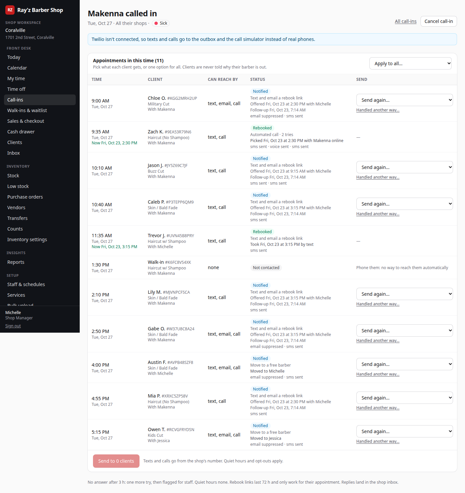

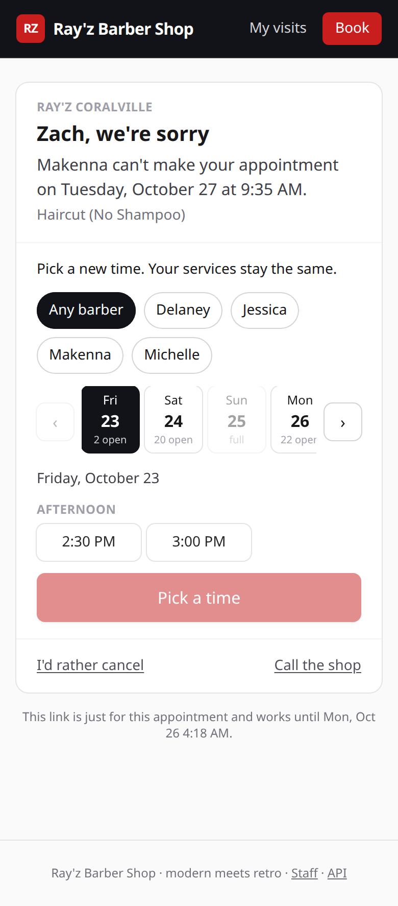

### Reports à la carte

Each report is its own page with **two permissions of its own**: `report.<key>.view` and `report.<key>.export`. Both can be set per role and per person, so someone can see the Sales summary without being able to download it, or get just one report and nothing else.

| Report | Key | What's in it |
| --- | --- | --- |
| My sales and tips | `my_sales` | The signed-in person's own tickets, services, products, and tips |
| Sales summary | `sales_summary` | Gross to net, tax, tips, fees, by shop, by day and by month |
| Barber performance | `sales_by_barber` | Per barber: service and product sales, card and cash tips, discounts, refunds, average ticket; appointments, walk-ins, no-shows, cancellations, rebook rate, retention, new vs returning clients; hours booked vs available; ratings given |
| Services vs products | `services_vs_products` | Each category and item, with quantity, net, and share |
| Tips and payroll export | `tips_payroll` | Bi-weekly tips per barber, card/cash/gift card |
| Card vs cash | `card_vs_cash` | Tender mix: credit, debit, cash, gift card, card fees |
| Discounts and refunds | `discounts_refunds` | Who discounted what and why, and every refund and void with its reason |
| Inventory valuation | `inventory` | On hand by shop and SKU, value at cost and retail, margin by category, on order; as of any past date |
| Stock movement and shrink | `inventory_movement` | Opening to closing by movement kind, shrink at cost, and every ledger entry |
| Sell-through | `sell_through` | Received against sold, sell-through rate, days of cover, cost of goods and margin |
| Low stock | `low_stock` | Everything at or below its reorder point, with the suggested order |
| Purchase orders and vendor spend | `purchasing` | Spend by vendor, cost variance, fill rate, days to deliver, every purchase order |
| Gift cards | `gift_cards` | Issued, redeemed, outstanding balances |
| Loyalty | `loyalty` | Rewards issued, redeemed, and reversed by refunds |
| Client ratings | `client_ratings` | Lowest- and highest-rated clients per shop |
| Retention and rebook KPIs | `kpis` | Rebook rate, retention, new vs returning, no-shows |
| Busiest times heatmap | `heatmap` | Visits by weekday and hour |
| Who's working, off and blocked | `staffing` | Per day, shop and barber: working, partly off or off, scheduled hours, time off and blocks with their reasons, and bookings; hours by reason |
| Call-ins and client outreach | `call_ins` | Call-ins by shop and barber, the appointments they hit, and how each ended: moved, rebooked, declined, no response, flagged |
| Google review links | `google_reviews` | Review follow-ups sent and clicks on each location's Google review link (from receipts and follow-ups), by barber and by location |
| Labor hours and cost | `labor` | Clocked hours and OT, sales per labor hour; with `payroll.rates`, hourly rate, labor cost and labor % of sales |
| Attendance | `attendance` | Late, left early, early in, missed punches, forgotten clock-outs, and scheduled days with no punch |
| Cash drawer | `cash_drawer` | Drawer closes with expected, counted, and variance |
| Tip payouts | `tip_payouts` | Tips earned, refunded and adjusted per shop and employee, how they were paid (cash, Stripe, payroll, before tip payouts) and what's still unpaid, then every payout |
| Audit log | `audit_log` | Every audited change, filterable |

- **Only permitted reports appear.** The **Reports** hub and its tabs list only the reports you can view, and the nav item is hidden if you can view none. The server checks the view permission on every report page and the export permission on every CSV download (`/admin/reports/export`, which also serves the payroll and audit log exports, and the client ratings export), so typing a URL gets a "no access" page or a 403.
- **Shop-scoped.** A report only ever shows the shops in your access. Asking for any other shop by URL is refused (see [Reports across locations](#reports-across-locations)).
- Exporting needs viewing too: removing the view permission takes export away with it.
- The on-screen report and its CSV come from the same loader (`src/server/report-data.ts`), so they always match.

<a id="custom-reports"></a>
### Custom reports

**Reports → Custom reports** (`/admin/reports/custom`) builds your own reports from a field picker, saves them, shares them, emails them on a schedule and puts their totals in the Morning Dashboard. **Customers** is the first data source. Sales, appointments, staff, inventory, tips and campaigns are listed as coming next, and each one plugs into the same definition, engine, sharing, schedule and exports.

- **Building:** pick the source, then add columns from the field picker (search, grouped as client, contact, profile, visits, spend, loyalty and gift cards, marketing, custom fields). Drag columns (or use the arrows) to reorder them, rename a header, and pick a total for each: sum, average, count, lowest or highest, whichever suits the field. Rows are every client the report reaches, or only those who visited in the dates. Filter with the same filters as the client list and the Campaign Center segment builder, sort by up to three fields, group by up to two with subtotals, show only the group lines (summary), and add a grand total. Dates take the same presets as the other reports (or custom dates, or all time); locations and barbers take the usual pickers, groups included. The preview refreshes as you change it, 50 rows a page.
- **Customer fields:** name, first and last name, nickname, client number; phone, email, address, city, zip, birthday; tags, staff rating, home location, primary barber, source, client since; first and last visit, visits, average days between visits (the median), comes in, days since last visit, next expected visit, visit status, no-shows, cancellations; total and average spend, paid tickets, tips, services and products bought; loyalty rewards available, gift cards and their balance, coupons redeemed; appointment and marketing opt-ins (text, email, push), Campaign Center messages received and clicked, Google review clicks; and every custom client field. Visits, spend, coupons and marketing counts cover the report's dates, locations and barbers. The rest describe the client as they are now.
- **Who sees what:** every column follows **Client data**. A hidden detail is greyed out in the picker with the reason. A masked one is shown masked, as on the client profile, and can only be counted. City, zip and the average rating are what a masked address or rating still shows, so they work in full. Spend, tips and gift cards need **Look up any client in the brand**, like the money filters. Without that permission a report lists only clients you've served. Without **See every barber's numbers** it covers only your own visits. Locations are always cut to your access, and a Brand Admin or the owner covers every shop.
- **Saving and sharing:** save a report as **Only me**, **Shared with roles** (pick the roles), or **Brand template** (everyone with custom reports; only people with access to all shops can make templates). Someone else's report opens read-only over your own locations and barbers, with a note when it was cut down; you can change the dates and **Duplicate** it to make your own. Owners edit and delete their reports, and brand-wide builders also look after shared reports and templates. Saving, duplicating, deleting and exporting are audited.
- **Schedule:** daily, weekly (a weekday) or monthly (day 1 to 28) at a time of day, to up to 50 staff with an email address at your shops, each of whom must be able to open the report. Each person gets their own copy, run under their own access: the totals in the email and, if they may export it, a CSV, Excel or PDF file. Otherwise the email says why there's no file. The notifications cron sends them (every 5 minutes), once per report, person and day (`saved_report_sends`), even if runs overlap. The file is removed from the outbox once sent, and the outbox never offers a scheduled report's file for download.
- **Morning Dashboard:** **Show in my Morning Dashboard** adds the report's totals (never client rows) to the page and the morning email of its owner and its scheduled recipients, under **Your custom reports**, each as they may see it.
- **Exports:** CSV, Excel and PDF of the whole report (up to 25,000 rows; the file says when it stopped), with group lines and totals. A customer report is a client list, so exporting it (or getting it as an email attachment) needs **Custom reports: export** *and* **Export the client list**, which only [brand-level roles](#contact-lockdown) or an [export grant](#contact-access) give. Each export is logged in the client data access log with the clients and fields it held. Cells that look like spreadsheet formulas are neutralised.
- **Message these clients:** with **Campaign Center: create**, a customer report opens a new blast with its filters, locations and barbers filled in. Rows "visited in the dates" become a last-visit filter when the dates run to today. Columns, grouping and sorting don't carry over, and the blast still goes only to clients who agreed to marketing.
- **Permissions** (à la carte, per role and per person): **Custom reports: open saved reports** (`report_builder.view`), **build, save, share and schedule reports** (`report_builder.build`), **export to CSV, Excel and PDF** (`report_builder.export`; needs one of the other two). Brand Admin, Regional Manager and Shop Manager get all three. Filters need **Use advanced client filters**.
- **The engine** (`src/server/report-builder/engine.ts`) builds one query from a fixed SQL fragment per whitelisted field. A saved definition holds field keys only; unknown keys are refused, and every value (ids, dates, custom field ids) is a bound parameter. Totals and group subtotals are computed in the database over every matching row, then the page is cut. Masking is applied after the query with the viewer's Client data policy, and hidden details are never selected. Only the facts a report uses are joined in. Migration `core_0047_report_builder` adds indexes on sales and appointments by client and on clients by created date and preferred barber. Looking at a page only goes in the client data access log (and counts toward the lookup limits) when it shows protected details.
- Tests: `tests/report-builder.test.ts` (fields and the totals they allow, field use per Client data level, definitions and their problems, dates, cell formatting, the flat table for exports, schedules, the blast filter) and `tests/db/report-builder.test.ts` (totals against SQL, dates, locations, barbers and reach, masking and hidden fields, money fields, filters against the client list's, groups and summaries, whitelisting, sharing, duplicating, templates, scope cut-down, exports and their permissions and logs, scheduled sends once per day with each person's access, the outbox, the Morning Dashboard section, pages per person). `tests/db/tenant.test.ts` checks that another shop's manager can't open a private report.

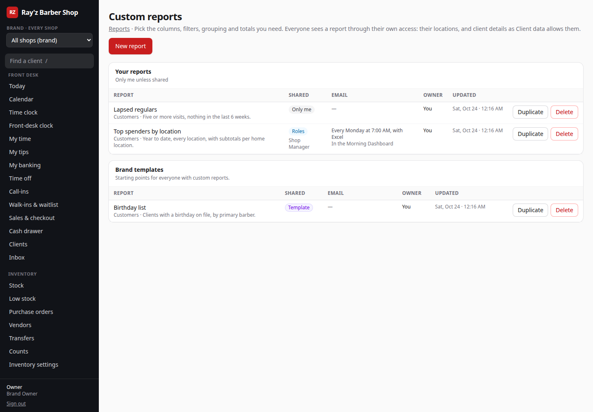

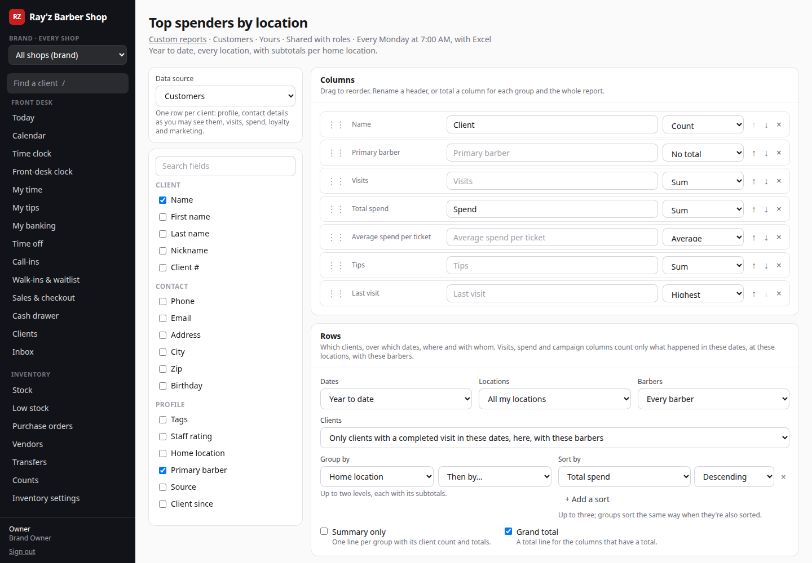 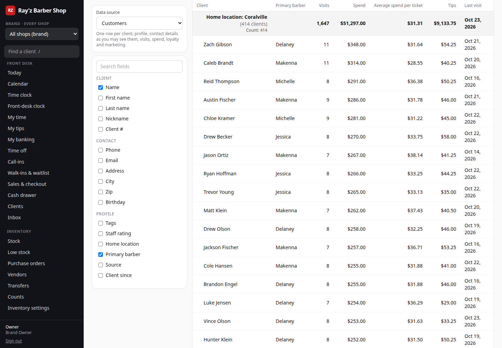

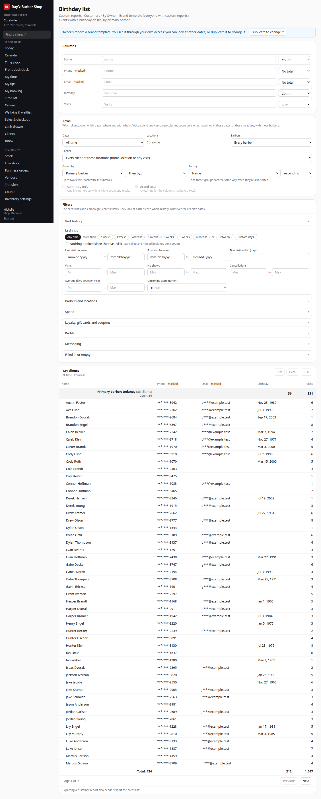

<a id="rayz-assistant"></a>
### Rayz Assistant

**Ask Rayz** opens a chat panel on every staff page: the brand portal, shop logins and each person's own login. It answers questions about the business (sales by location or barber, comparisons and trends, utilization, lapsed clients, stock and purchase orders, tips, payroll hours, campaigns) and "how do I…" questions about the app.

- **Answers come from the reports, never from SQL.** The model gets tools, not the database:
  - `run_report` runs any report the person can view through the same loaders as the report pages and CSVs (`REPORT_LOADERS`), over dates, locations, barbers and the by-location or by-barber view.
  - `customer_report` builds a client list with the report builder's engine (filters such as last visit, visit counts, spend and not booked, plus columns, grouping and totals).
  - `help` gives the steps for one of 26 how-to topics.
  - `client_notes` reads one client's notes ("What's Marcus's usual cut?"), exactly as the person could read them on the profile: only clients they reach, masked notes as a count, private notes only with **See and write private manager notes**. Each look is logged as a client view.
  - `draft_po` and `draft_blast` prepare a purchase order or a Campaign Center blast.
  - Each answer shows the numbers in a card with a link to the report it came from. A client list adds **Open in the report builder to save it** (the builder opens with the definition filled in, ready to save, share or schedule) and **Message these clients** (a new blast with its segment).
- **Same permissions as the person:**
  - The model is only offered tools and reports the person has. The audit log and client ratings are never offered.
  - Locations and barbers it names are checked against the person's own. Anything else is refused ("Moline isn't one of your locations"), and "all" means all of theirs.
  - A barber gets only their own numbers. A shop login is held to its shop. Client lists need **Custom reports: build**, and spend and tips need **Look up any client in the brand**, as in the builder.
  - Fields **Client data** hides from the person are left out of the tool's choices altogether. Phone, email, address, birthday, notes and custom fields are never offered as client-list columns, even to the owner, and contact columns are dropped from report text before the model sees it. Client notes reach the model only through `client_notes`, and never hold contact details.
  - Everything sent to the model (the question, report text, history) goes through `scrub()`, so card numbers or bank details typed into a question never reach the model, the database or the audit log. The app holds no card, bank or identity data in any case.
  - The system prompt names the person, role and locations, never an id.
- **Drafts wait for Confirm:** a purchase order or blast is only drafted. The card lists what it will do, and nothing is created until the person presses **Confirm**. Confirm checks the permission (**Purchase orders: create** or **Campaign Center: create**), the role toggle and the brand's **May draft** setting again, and works for an hour. A confirmed blast is saved as a draft and never sent. Only the person who asked sees or confirms their drafts.
- **Audit and limits:** every question (`assistant.question`), tool call with its arguments and outcome (`assistant.tool`), refusal for the limit (`assistant.rate_limited`) and draft decision (`assistant.action_confirmed`, `cancelled`, `failed`) is in the audit log. Each person gets 6 questions a minute and 100 a day by default. Conversations are kept per person and are private to them.
- **Provider** (`src/server/assistant/providers.ts`):
  - `ASSISTANT_PROVIDER` is `openai`, `anthropic`, `stub` or `off`. Unset, it uses whichever key is set (`OPENAI_API_KEY`, then `ANTHROPIC_API_KEY`), and the built-in demo outside production. `ASSISTANT_MODEL` overrides the model (defaults `gpt-4.1-mini` and `claude-sonnet-4-5`).
  - OpenAI calls send `store: false`. For zero data retention, ask OpenAI and Anthropic to turn it on for the key's organization (see [DEPLOY.md](DEPLOY.md)).
  - No user ids are sent. Provider errors are logged by status only.
  - The demo routes questions to tools by keyword and runs them for real, so scoping, cards, drafts and the audit log all work without a key.
- **Settings:** **Setup → Rayz Assistant** (`assistant.settings`, brand-only; Brand Admin has it):
  - switch it on or off for everyone and per role (new roles start on);
  - set the per-minute and per-day limits;
  - choose whether it may draft blasts and purchase orders.
  - The page shows the provider and model (never the key), its retention setting, and the last 7 days' questions and tool calls.
- **Code:** `src/domain/assistant.ts` (settings, cards, system prompt, the demo's router), `src/domain/assistant-help.ts` (how-to topics, limited to pages the person can open), `src/server/assistant/` (providers, tools, the audited run loop and drafts), `src/app/admin/assistant/` (the panel and settings page). Migration `core_0048_assistant` adds `brand_settings.assistant`, the conversations, messages and drafts tables (scrubbed by trigger), and `assistant.settings` for Brand Admin.
- Tests: `tests/assistant.test.ts` (settings, the demo's routing, help, the system prompt, the OpenAI and Anthropic request bodies, provider choice) and `tests/db/assistant.test.ts` (permission scoping). The DB tests cover:
  - tools per role, and reports the person can't view;
  - another location refused;
  - barbers outside the person's locations;
  - a barber held to their own numbers, and a shop login to its shop;
  - no contact details or hidden fields in model context, and card numbers scrubbed;
  - drafts confirmed only by their owner, with the permission checked again;
  - blasts saved as drafts;
  - audit entries;
  - help limited to the person's pages;
  - toggles, limits and private conversations.

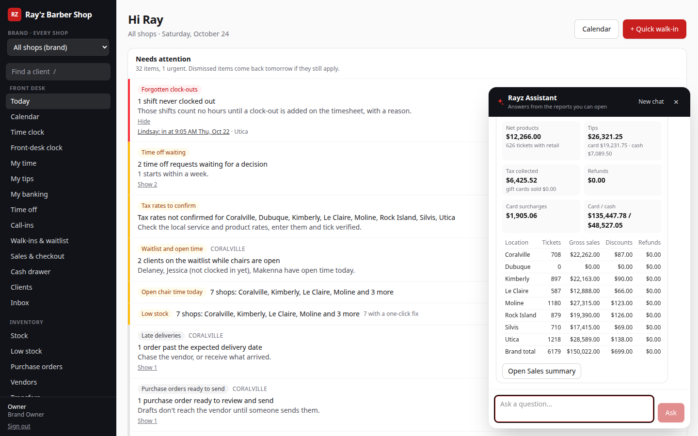 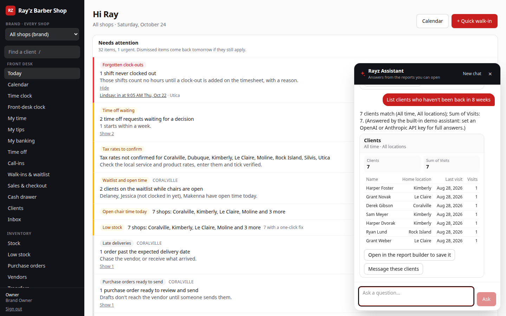

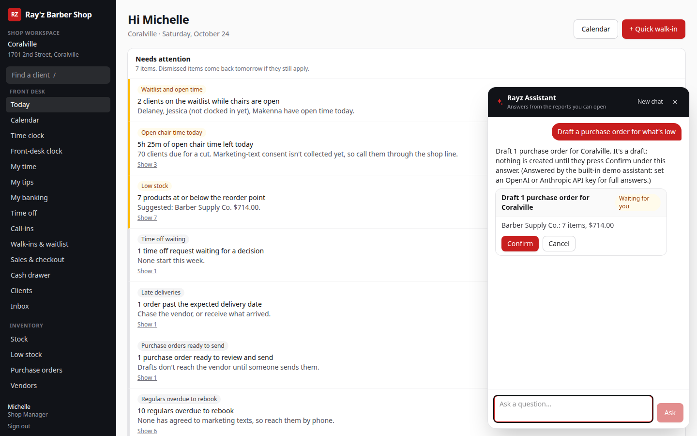 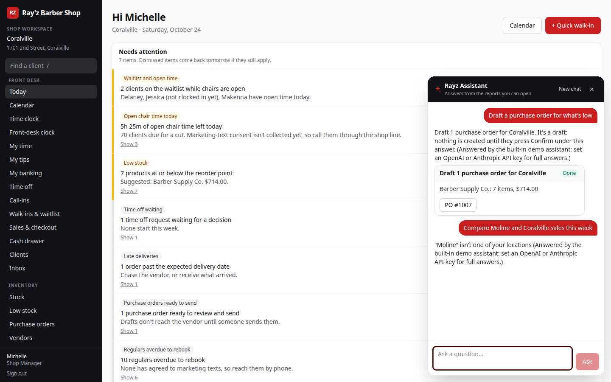

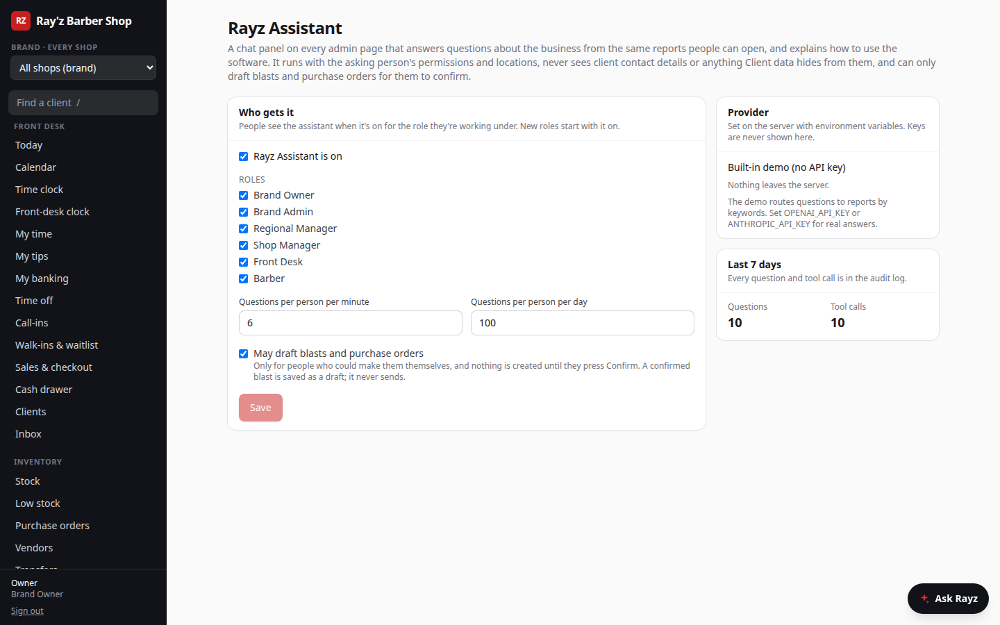 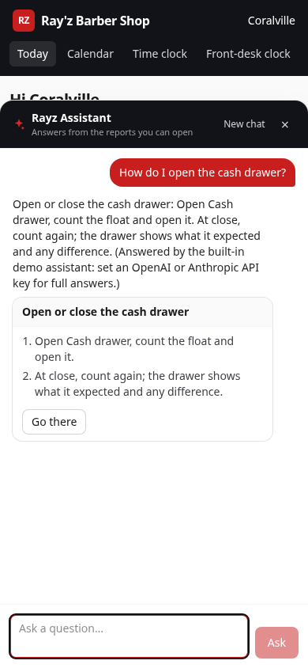

### Reports across locations

Every report, plus payroll, client ratings, and the audit log, runs over **one shop, any set of shops, or all shops**, picked from the **Locations** menu on the report:

- **All shops**: every shop you have access to.
- **Saved groups**, such as Quad Cities, Iowa shops, or Illinois shops.
- **Pick shops**: tick any combination.

When more than one shop is selected, a **Combined / By location** switch picks the layout:

- **Combined** shows one set of numbers for everything selected.
- **By location** shows each shop side by side:
  - Summary tables get a column per shop and a total column: "Brand total" when every shop is selected, otherwise "Total (N shops)".
  - Lists get a Location column, a **subtotal per shop** (shops with no activity show zeros rather than disappearing), and the total row.
  - Rates such as average ticket, rebook rate, and attach rate are recomputed for each subtotal and total, not added up.
  - Counts of distinct clients (retention, new vs returning, loyalty members) aren't additive: a client seen at two shops counts once at each and once in the total. The table says so.

**Barbers who work at several shops.** Sales, tips, refunds, and payroll go to the shop where each ticket was rung up, not the barber's home shop. Barber performance and payroll add a **Barbers at more than one shop** table with the barber's row at each shop and their combined total underneath. Payroll lists a barber once per shop per period, which is how each shop pays them out. The combined payroll view merges those rows into one line per barber, with a Locations column.

**CSV follows the view.**

- Combined downloads have no Location column.
- By-location downloads put the Location in the first column of every row and keep the subtotal and total rows. A summary table downloads as one row per shop plus the total row.
- The file name ends in `-by-location`.

**Saved location groups** (**Setup → Location groups**, `/admin/location-groups`) are created and edited by people with the `locations.manage` permission (Brand Owner and Brand Admin by default). It also needs access to every shop, since a group can include any shop in the brand.

- A group needs a unique name and at least two shops.
- Creating, editing, and deleting a group are audited.
- Anyone with a report can use a group as a filter. They see only the shops in it that they have access to, and a note says how many shops were left out.

**Access.** The menu lists only your shops. Asking for a shop you don't have access to, by URL or in a CSV link, is refused with a "no access" page or a 403. It isn't quietly dropped. Brand-level audit entries (with no shop) appear only to people with access to every shop.

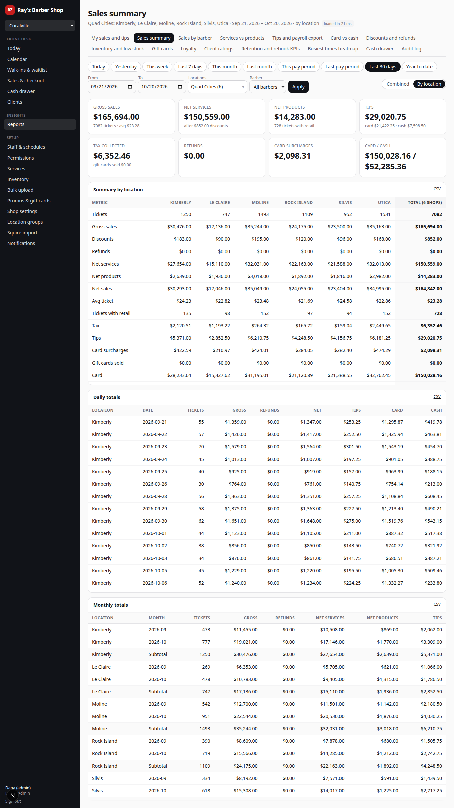

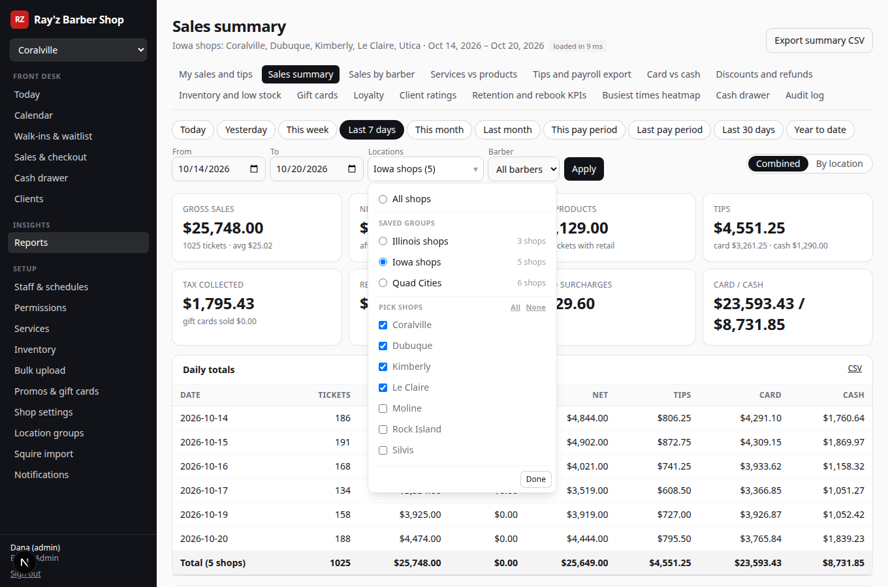

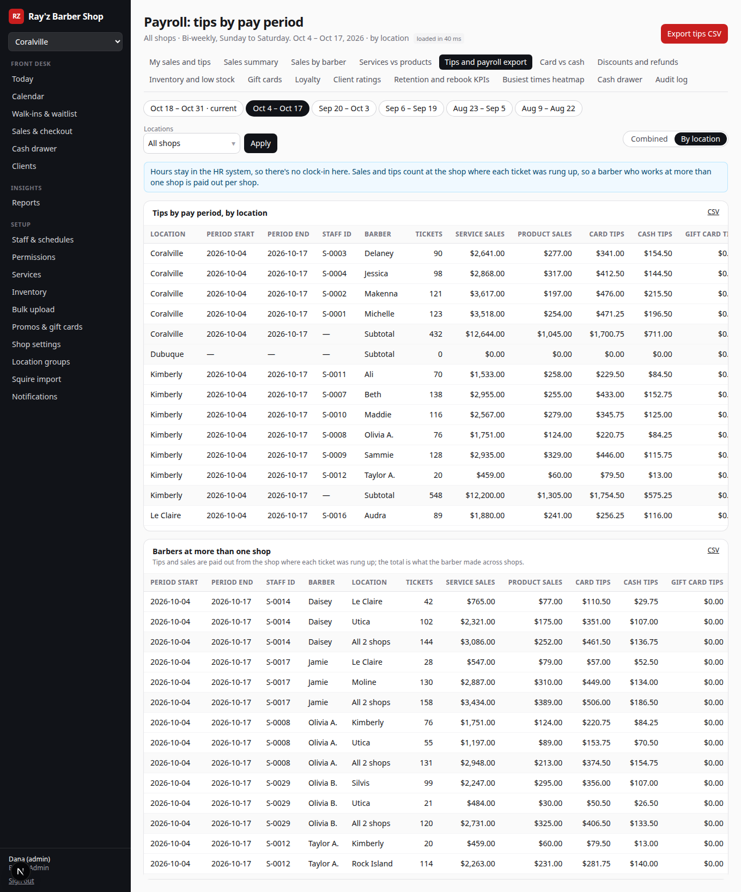

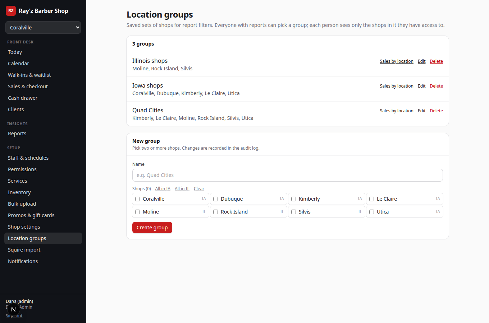

### Reports by barber

Every report that can be broken down by staff (my sales, sales summary, barber performance, services vs products, tips and payroll, card vs cash, discounts and refunds, KPIs, the heatmap, client ratings, and the payroll page) has a **Barbers** menu next to Locations:

- **All barbers**: everyone at the selected shops. This is the only choice that also counts tickets with no barber on them (retail-only sales), shown as a **No barber** row.
- **Saved groups**, such as Floaters or Senior barbers.
- **Pick barbers**: tick one barber or any combination, with a search box. Barbers at the selected shops come first, then your other shops, then former barbers, so past reports can still name them.

The layout switch has four choices, and works with the location filter:

| View | What it shows |
| --- | --- |
| Combined | One set of numbers for every selected barber and shop |
| By location | A column (or subtotal) per shop, as in [Reports across locations](#reports-across-locations) |
| By barber | A row per barber with a column per metric, then the total row |
| By location and barber | Each barber under each shop they worked at, a **subtotal per shop**, then the total row. For example: Jamie and Amanda at Moline and Silvis, broken out by barber and by shop |

- A single barber is never broken out by barber; the view is combined (or by location).
- The total row is labelled "Total (2 barbers, 2 shops)" and the like, or "Brand total" when every shop and barber is selected.
- Lists (daily totals, items, discounts, payroll, the refund log) put a Barber column in front and add a subtotal for each barber with more than one row.
- The barber performance report has three tables (sales and tips; appointments and clients; time and ratings), plus **Barbers at more than one shop** when anyone selected worked at two or more of the selected shops.

**How each number is counted.**

- Service credit, tips, discounts, and refunds go to the barber on the ticket, at the shop where it was rung up. A tip split between barbers at checkout goes to each barber for their share. A refund counts on the day it was issued, so a barber can show a negative day.
- Card and cash tips come from how each ticket was paid, net of refunded tips. Total tips also include tips paid by gift card.
- Appointments count everything that started in the range. Walk-ins are appointments with the walk-in source.
- **Hours booked** is the scheduled length of appointments that weren't cancelled or no-shows. **Hours available** is the barber's weekly schedule at each shop on each date, less shop closures and their time off (blocks at that shop or at every shop). **Utilization** is booked over available. Availability uses current schedules, so a past range uses today's.
- New vs returning and retention are measured within the same barber and shop: a client's first visit with Jamie is new for Jamie even if they've seen Amanda before. These distinct-client counts don't add up across barbers or shops, so each subtotal and total is counted on its own. Every other count and amount adds up exactly; tests check that per-barber numbers sum to each shop and to the brand.
- **Ratings given** are the client ratings the barber left, at the shop of the visit, with their average stars.

**Names.** Barbers appear only by their display label (first name, or a label like "Olivia A." set by an admin), on screen and in CSVs. Surnames never appear in reports.

**Who sees what.** Report access follows the à la carte permissions above, and one more: `reports.all_staff` lets someone see other barbers' numbers. Brand Admin, Regional Manager, Shop Manager, and Front Desk have it by default; Barber doesn't.

- Without it, every report shows only your own numbers, the Barbers menu is replaced by a note, and asking for anyone else by URL or CSV link gets a 403 ("You can only see your own numbers").
- **My sales** is always your own tickets, whatever the URL says.
- A barber sees barber reports only if their role or a per-person override grants that report. Makenna, for example, sees only My sales until someone grants her Barber performance, and then she sees only her own row.
- With `reports.all_staff`, you can pick barbers who work at any of your shops. Others are refused with a 403, not dropped.

**Saved barber groups** (**Setup → Barber groups**, `/admin/barber-groups`) need the `barber_groups.manage` permission (Brand Owner and Brand Admin by default) and access to every shop, since a group can include barbers from any shop.

- A group needs a unique name and at least two barbers. The editor has "Add everyone at 2+ shops" and "Add everyone at…" shortcuts, plus search.
- Creating, editing, and deleting a group are audited.
- Each group has a **Barber performance** link that opens the report for that group across all shops, by location and barber.
- Anyone who can see all staff can use a group as a filter. They see only the barbers in it who work at their shops, and a note says how many were left out.

**CSV follows the view.** Each table's CSV is the on-screen table, cell for cell: the Location and Barber columns, the subtotal and total rows, and hours to two decimals. File names end in `-by-location`, `-by-barber`, or `-by-location-and-barber`. Tests compare every table's CSV with the screen in all four views.


### Shop workspaces

One codebase and one database, but each shop works like its own system. The brand login is the umbrella over all of them.

- **Shop logins.** Every shop has a shared sign-in for its front desk (`moline@rayz.test` and so on), next to that shop's personal manager and barber logins. A shop login is scoped to exactly one shop, is never bookable, and shows "shared shop login" in the sidebar. **Setup → Shop logins** (`/admin/shop-logins`, permission `logins.manage`, held by Brand Admin and Regional Manager) lists each shop in your access with its address and logins. From there you can create a login (its password is shown once), disable or re-enable it, and reset its password. Resetting or disabling signs out every session that login has open. A regional manager manages logins only for their own shops and can't give a login a role above their own. Every change is audited against the shop.
- **What a shop user sees.** Only their shop: its calendar, appointments, walk-ins, POS, cash drawer, inventory, purchase orders, transfers and counts, staff and schedules, the settings they may change, notifications, and reports. Other shops don't appear in the shop switcher, report location filters, barber filters, or staff lists. The sidebar shows the shop's own name and address.
- **Other shops in shared records.** Where an operational record has to mention another shop, it's named generically: a barber's booking elsewhere shows as "At another shop" on the calendar, and a gift card bought elsewhere as "Another Ray'z shop".
- **Client history follows the client.** Clients are brand-wide, and any shop user who can look up a client sees their full visit history at every shop: date, shop, barber, services, and amounts, plus purchases, loyalty, and their staff rating (see [Clients](#clients-brand-wide)). Other shops' appointment notes, staff rating notes, and tickets stay closed: a ticket number from another shop isn't a link, and the ticket itself is not found. Shop users find other shops' clients by exact phone, email, or full name to book them, and can't browse, export, or merge the brand-wide list.
- **Staff assigned to several shops.** A person sees only the shops they're assigned to, and can hold a **different role at each** (for example Kat: barber at Moline and Silvis, Shop Manager at Rock Island). When their permissions differ between shops they work in one shop at a time, with that shop's permissions; the switcher offers only their shops and no combined view. Inside Rock Island Kat sees Rock Island's drawer, promos, and tickets; Moline's records are not found there, and back in Moline she's a barber again. People with the same role at every shop (like the regional manager) keep the combined "All my shops" view.
- **Brand logins.** Owner and admin start over **every shop** with combined reports (and side-by-side "by location" views), and can switch into any one shop's view and back ("Brand · viewing one shop"). They manage the catalog and pricing, permissions, vendors, bulk uploads, and every shop's logins. Regional managers are scoped to the shops they're given.
- **One accepted exception:** the transfer form lists every shop as a destination, because stock can be sent to a sister shop. Only shop names are listed, and the receiving shop sees the transfer once it's sent.

**Enforcement is on the server, in one place.** `src/server/tenant.ts` is the tenant guard:

- `inShops()` filters list queries to the caller's shops.
- `assertShop()` refuses a shop that came from a form or the URL.
- `inTenant()` and `requireInTenant()` check a record ID against its shop (or both shops, for a transfer). A record outside the workspace is reported as **not found**, exactly like one that doesn't exist, so IDs from another shop reveal nothing.

Every dynamic admin page, route handler (PO PDFs, email attachments), and server action that takes a record ID goes through it. A unit test fails if a dynamic admin URL doesn't, apart from five brand-level records (clients, products, vendors, roles, import runs) listed with reasons. Report exports refuse a shop outside your access with 403. Queue processing from the admin is limited to your shops, and every queued message carries its shop: the database refuses a message without one, except sign-in codes. Postgres row-level security isn't used because the app connects through a pooled role; the guard plays that part.

**Tested** (`tests/db/tenant.test.ts`). The test seeds Coralville with canary records carrying unique strings: a client, a barber who works only there, visits, a sale and a void, ratings, a PO and its email, a count, a transfer, a drawer, a text message, a promo, a gift card, a walk-in, a time block, and an audit entry. Moline and Rock Island get marker records too (an appointment, a promo, a ticket, and a drawer note each). Then the Moline shop login, Moline's manager, the regional manager, and Kat (once inside Rock Island, once inside Moline) each:

- open every admin page, with and without Coralville in the query string;
- open every dynamic URL with Coralville's IDs;
- download every report, ratings, and catalog export, and the PO and attachment routes;
- call the customer API with a staff session;
- call 59 server actions aimed at Coralville's records.

No canary may appear anywhere except the canary client's visit history, and Kat must not see the markers of the shop she isn't working in. Every action must be refused as not found or outside their access, and Coralville's rows must be unchanged. The brand owner sees every canary, so their absence is meaningful. The suite also checks:

- **Cross-shop history:** every login above sees the Coralville visit's shop, barber, service, and price on the client's profile, but not its notes, rating notes, or ticket link.
- **Multi-shop staff:** Kat's switcher offers exactly her three shops, refuses Coralville and "all", and her permissions follow the shop she's in. Her manager actions work at Rock Island and are refused against Moline's records. Changing her assignments or per-shop roles applies on her next request, needs permission to manage people, and is audited.
- **Search, jobs and logins:** exact versus partial client search, queue processing, and creating, resetting, and disabling shop logins.


A client's visit history at every shop, seen from the Moline desk (the Rock Island visit with Kat is listed with its barber, service, and price):


Kat inside Rock Island, as its Shop Manager, and her assigned shops with a role at each:


<a id="shop-login"></a>
### The shop login, against Squire's

Squire's single-shop (kiosk) login does the day's work at one shop. Ours covers the same ground and is tighter wherever a shared login could leak data or money.

| Squire shop login | Here |
| --- | --- |
| Appointments: side by side, week, block time, add | Calendar day and week views, blocks with reasons, quick walk-in |
| Waiting list | **Walk-ins & waitlist** (`/admin/walk-ins`) |
| Clients, locate duplicates | Clients with masked contact details; duplicates and merge stay brand-only |
| Retention report, acquisition channels | **Client retention** and **Acquisition channels** reports |
| Staff list with clock in/out | **Front-desk clock** (`/admin/clock/kiosk`) with personal PINs; no staff contact details |
| Services list | Services, read-only at the shop |
| Leaderboard, sales by service/product/barber, commission, appointments, deposits, time track | **Leaderboard**, Sales summary, Barber performance, Services vs products, Tips and payroll, Labor hours, Attendance and the rest |
| Saved End of Day, TIPS, Iowa monthly tax, quarterly taxes, gross/net, employee summary, total collected | **Saved reports** on the reports hub, with a sales tax shortcut for each state the brand has shops in |
| Register, cash drawer with a $300 default and balance history | Checkout; the drawer opens with a counted balance (each shop's default, $300 to start), records cash paid in and out, and shows the **balance history** through the day |
| Daily summary with reassign, receipt, refund | Sales for the day; tickets can be **reassigned**, receipts resent, refunded or voided (refunds, voids and reassigning need a manager's PIN) |
| Custom charge, gift cards | Gift cards; price override on a line (no open-amount custom charge yet) |
| Shop details and per-barber booking settings | Shop settings, **gated part by part**; per-barber booking intervals under Booking times |
| AI phone agent ("Operator") with dollars booked, calls answered, book rate, minutes saved | The **phone operator** on the Twilio line and its report (a keypad menu, not a conversational AI) |
| Customer handoff toggle | The customer screen at checkout, per shop |

**Tighter than Squire.**

- **Client contact is masked, with no export.** Squire's shop login shows each client's full phone and email and has a Download all clients button. A shop login here sees client phone, email, address and birthday **masked at most**, whatever its role's Client data rules say; the brand can hide them completely under **Client data protection → Shop logins**. Only a [contact access grant](#contact-access) from brand management lifts the cap for phone, email and address. Without one, a shop login can never reveal a masked detail or export or download clients, and it can never merge duplicates or export a non-client report, even if its role or an override says it may (`SHOP_LOGIN_NEVER` in `src/domain/permissions.ts`, applied when access is loaded).
- **Staff contact is masked.** Staff phone numbers and emails need **See staff phone numbers and email addresses** (`staff.contact`, managers and up). Everyone else sees them masked (`m***@rayz.test`, `***-***-4321`) on staff profiles, the permissions pages and the Morning Dashboard list, and can't change them. People always see their own. Shop logins never get it.
- **Refunds, voids and reassigning need a manager's PIN.** At a shop login, or for anyone without the permission, the ticket asks for a manager and their time clock PIN. The server checks that the manager may refund (or reassign) at that shop; wrong PINs count toward the manager's clock lockout. The refund, void or reassignment records who approved it, and the audit log names both people.
- **Shop settings are gated per part.** Details, hours and closures, booking rules, checkout (card readers, receipts, customer screen, drawer opening balance) and the phone line each have their own permission. "Edit every shop setting" still covers them all. The page locks the parts someone can't change, and the server refuses any changed field outside their parts, naming it.
- **A barber filter on every report** that has a barber in it, including the new ones, the gift card and cash drawer reports (cash and gift cards taken on each barber's tickets) and staffing. Reports about the shop itself (stock, purchasing, shop accounts, loyalty, the audit log) say so.

**The new Shop Login role.** New shop logins get **Shop Login** by default: the calendar, waitlist, checkout and the drawer, clients with masked contact details, the front-desk clock, Inbox, We have openings and view-only reports for its shop, with a 10% discount cap. Existing shop logins keep their role until it's changed (DEPLOY.md step 18).

**Cash drawer.** **Open the drawer** with what was counted into it; it defaults to the shop's opening balance (set under Shop settings → Cash drawer). During the day, record **paid in** and **paid out** with what each was for. **Balance history** lists the opening, every cash sale, cash refund, cash tip payout and paid in or out with the running balance, and the close with its over or short. A drawer opened with a count keeps that opening at close, and paid in and out are taken into account. Moves after the close are refused.

**Reassigning a ticket.** A paid ticket moves to another barber with a reason: the ticket, the lines the old barber was on, their tip share and their tips. Unpaid tips move as they are. Tips already paid out stay on the old barber's history with an adjustment taking them back, and the new barber gets them on the next payout. Not once the pay period is locked, and not for imported Squire tickets.

**New reports** (each with the location and barber filters, the four views and CSV):

- **End of day:** sales, tax, tips and tenders by location, each barber, refunds with who approved them, and each day's drawer (for ranges up to a week).
- **Leaderboard:** barbers ranked by service sales, product sales, productivity, average ticket, new clients or tickets with retail; the leader and runner-up on each; top services and products with who sold the most.
- **Sales tax by state:** taxable and non-taxable sales and tax by state and month or quarter, with refunds taken off in the period they happened. Each state's filing schedule is set under Shop settings → Sales tax filing, by people who edit tax rates with access to every shop (Iowa monthly to start, others quarterly).
- **Client retention:** clients with 1, 2 or 3+ visits in the period before (the quarter before, for a quarter) who came back, split into existing and new clients, with those who went to another barber or shop.
- **Acquisition channels:** new clients by how they found us, how they first booked, and how many came back for a second visit.
- **Phone operator:** calls in, answered by staff or by the operator, what callers pressed, booking links texted, bookings and dollars booked within 7 days, book rate and staff minutes saved.

**Saved reports** on the reports hub open a report with its range and options set: End of day, Yesterday's close, Tips, Gross and net sales, Employee summary, Total collected, Leaderboard, Quarterly retention, and one sales tax shortcut per state on that state's schedule ("Iowa monthly sales tax"). Each shows only to people who may open the report. Quarter presets (This quarter, Last quarter) are on every report.

**Phone operator.** Turned on per shop under Shop settings → Phone operator (it needs the shop's Twilio number). It answers when the shop is closed or nobody picks up, or first on every call. The caller hears a menu: **1** texts them a booking link, **2** reads the hours, **3** rings the shop while it's open; pressing nothing texts the link as before. STOP still wins. A booking by the same number at the same shop within 7 days counts toward the call. Try it in the call simulator. It's a keypad menu, not a voice AI: nothing the caller says is recorded or sent anywhere.


**Tested:** `tests/shop-login.test.ts` (the caps, staff contact, settings parts, drawer timeline, phone operator script and metrics, sales tax periods, quarter presets, saved reports) and `tests/db/shop-login.test.ts` (drawer open, moves, close and history; refund and reassign with and without a manager's PIN, and the tips moving; shop-login caps and the client cap; staff contact masked and kept on save; per-part settings; the phone operator flow and report; the new reports at the shop login). The report-total tests cover the six new reports.

### Roles and permissions

**Permissions** (`/admin/permissions`) is where the brand decides who can do what. It has three parts.

- **Roles.** Seven editable templates ship with the app: **Brand Owner, Brand Admin, Regional Manager, Shop Manager, Front Desk, Shop Login, and Barber**. Add as many **custom roles** as you like, either blank or copied from another role.
  - The role editor groups the 101 feature permissions (front desk, point of sale, clients, Campaign Center, catalog and inventory, staff, custom reports, settings and data) with a toggle each, plus a **report matrix** with a View and an Export switch for every report. Each role also has a discount limit (Front Desk defaults to 10%) and a default shop scope for new hires.
  - Built-in roles can be **reset** to their template. A custom role can be deleted once nobody has it.
  - Brand Owner always has every permission, including ones added later, and can't be edited.
- **People.** Each person has one role, plus optional **overrides** that grant or take away single permissions on top of it (shown as "Role default / Allow / Deny"), and their own discount limit. The page shows their effective permissions and what differs from the role.
- **Shop access.** Each person has a scope: **all shops**, **selected shops**, or **one shop**. Everything they see and do is limited to their assigned shops: the shop picker, calendar, sales, staff, inventory, and reports. Access is separate from where a barber is bookable, so a regional manager can oversee shops without being on their schedule. With selected shops, each shop can carry its own role (**Role at Moline**: main role, Shop Manager, and so on); personal overrides apply at every shop. Brand Owner can't be a role at one shop.

**Rules**, all enforced on the server and covered by tests:

- Only the **Brand Owner** can grant Brand Owner, change a Brand Owner's access, or hold **brand-level settings** (the loyalty program, Sunday hours, new shops). Those can't be given by override. The last Brand Owner can't be demoted.
- Nobody can grant a permission they don't have, set a discount limit above their own, or change their own access.
- Roles apply at every shop, so only people with access to all shops can edit roles. Someone with limited shops can only manage people wholly inside their shops, and can only give access to those shops.
- You can't edit, reset the password of, or deactivate someone who has access you don't.
- **Brand-only permissions** change records every shop shares: the catalog (`catalog.manage`), vendors, client merges, the client export, client data protection settings, bulk imports, locations, and barber groups. They take effect only with access to all shops. A role or override can include them, but for someone scoped to some shops they're off, and the editors mark them **All shops only**.
- **Brand-level roles** are Brand Owner, Brand Admin, and custom roles the Brand Owner ticks **Brand-level role** on (only the Brand Owner can tick or untick it, and built-in shop and staff roles can't be made brand-level). Only they can hold the permissions that take client lists or full contact details out of the system: **Export the client list**, **Campaign Center: export**, the **Client ratings** export, **Run the Squire import**, and **Client data protection** settings. Saving them into a shop or staff role, or granting one as an override to someone who isn't a brand-level person with all shops, is refused for everyone, the Brand Owner included; the editors mark them **Brand-level only** and disable them (`BRAND_LEVEL_ONLY` in `src/domain/permissions.ts`). The brand's exception for shop-level people is a [contact access grant](#contact-access), not a role. See [Contact details stay in the system](#contact-lockdown).

**Enforcement.** Shop scope is part of every check (see [Shop workspaces](#shop-workspaces)). Every admin page calls `guardPage()`, which checks the page's required permissions from one table (`PAGE_ACCESS` in `src/domain/navigation.ts`) and renders a "no access" page otherwise. Every server action calls `authorize()` with the permission it needs, and every route handler (CSV exports, templates, error files) goes through `routeStaff()`, which returns 401 or 403. Nav items you can't use are hidden, but hiding is cosmetic: the server checks again. A unit test fails the build if a page, action file, or route under `/admin` has no guard, and a DB test signs in as each of the six demo logins and loads **every admin page**, checking the outcome against that login's permissions.

**Audited.** Creating, editing, resetting, and deleting a role, and every change to a person's role, overrides, discount limit, or shops, is in the audit log, with the permissions granted and removed listed by name.

Existing staff were migrated automatically: brand admins became Brand Owner, shop managers became Shop Manager with access to the shop they managed, and barbers became Barber with access to their shops.


<a id="users"></a>
### Users (self-serve brand portal accounts)

**Setup → Users** (`/admin/users`, needs **Manage roles and permissions**) is where the brand manages everyone who signs in to the brand portal. Shop logins stay under **Setup → Shop logins**.

- **Invite.** Name, email, role, locations (all or selected), optional **Require two-step sign-in**, and **Remote access**. They're emailed a link to `/invite/<token>` where they set a password (10+ characters) and, if required, scan a QR code into an authenticator app and type a code. The link works once, for 7 days. Only a SHA-256 hash of the token is stored, and the copy of the email kept in the outbox has the link removed. If the email can't be sent (no email provider yet, or it failed), the link is shown once to the person who sent the invite so they can pass it on. Resend (which ends the old link) and cancel are on the user's page.
- **Permissions.** Each user has a role (a template of permissions across every module: reports, Campaign Center, client fields and exports, inventory and purchase orders, settings, staff, payroll and time clock, tip payouts, banking and Stripe, Rayz Assistant, the locations wizard) plus permissions added or taken away just for them, a location scope (all or selected, with a role per location), and a discount limit. Roles like Owner (Brand Owner), Regional Manager, Shop Manager and Front Desk are templates the Brand Owner can edit; **New role** creates more. See [Roles and permissions](#roles-and-permissions).
- **Remote access** is a per-user switch: with it on, the person can sign in away from a shop when [sign-in restrictions](#sign-in-restrictions) are on (`access.remote`, set as a personal override).
- **Edit, deactivate, remove.** The user's page (`/admin/users/<id>`) edits the name, label and sign-in email, turns two-step sign-in on or off, resets it (they set it up again next sign-in), and deactivates (signed out everywhere, kept on the books, can be reactivated) or removes them. Removing signs them out, clears their email, password, authenticator and PIN, ends their invites and contact access grants, and keeps their history: past tickets, appointments, payroll and the audit log still show their name.
- **Two-step sign-in.** RFC 6238 codes (6 digits, 30 seconds, one step of clock drift either way) from any authenticator app. After the password, sign-in asks for the code; someone required to use it who hasn't set it up is shown the QR code there and then. A code works once, and 5 wrong codes lock the code step for 15 minutes. The authenticator key is stored encrypted (AES-256-GCM, key derived from `AUTH_SECRET`).
- **Can't be locked out.** There's always a Brand Owner who can sign in: the last one can't be deactivated, removed or moved to another role (an invited owner who hasn't signed up doesn't count). Nobody can change their own account, give a role or permission they don't hold, or manage someone with access they don't have. Someone with appointments coming up can't be deactivated or removed until they're moved.
- **Audited.** Every invite, resend, cancel, sign-up, profile change, two-step change or reset, remote access change, deactivation, reactivation and removal is in the audit log (`user.*`), along with the role and permission changes above. The user's page shows their account history.
- **Tested:** `tests/users.test.ts` (the RFC 6238 test vectors, drift and replay, encryption, password rules and every lockout rule) and `tests/db/users.test.ts` (an invite end to end with the link kept out of the outbox, sign-up with an authenticator, sign-in with a code, replay and lockout, requiring and resetting two-step, the remote access switch, deactivating, the last owner, removing, and the pages).


<a id="sign-in-restrictions"></a>
### Sign-in restrictions

A location can keep its staff from signing in anywhere but the shop. **Setup → Sign-in security** (`/admin/sign-in-security`) lists every location. The same rule is on **Shop settings → Where staff can sign in** and in the Add Location wizard's **Login, sign-in and phone line** step. Setting a rule needs `network.settings`, which is brand-only and is held by the Brand Owner and Brand Admin.

- **Per location:** an on/off switch and a list of **allowed IPs**, one per line or comma-separated. Each entry is a single address (`203.0.113.7`) or a CIDR range (`203.0.113.0/24`, IPv6 too). Ranges wider than IPv4 `/16` or IPv6 `/32` are refused. **Use my current IP** adds the address you're connecting from, as the server sees it. Saving warns you if the rule would lock you out of that location.
- **What it needs:** the shop's network, an approved device, either one, or both. "Either" suits a shop whose address changes now and then.
- **What it covers:** every staff and shop login with access to that location, and every request, not only sign-in. The middleware (`src/middleware.ts`, Node runtime) checks each `/admin` page, server action and download, so the POS, the calendar, the time clock, client records and reports all follow it. `getStaffContext` checks again for each shop a session may touch. Staff with no admin access are held to the shops they work at. Client booking and the mobile API are for clients, so they aren't affected.
- **Several shops:** someone who can reach some of their shops from here keeps those and loses the rest for that request. A brand-wide manager who loses any shop is treated as scoped to the shops they can reach, so their brand-only permissions are off until they're back at an allowed place. Someone who can't reach any of their shops is refused. If they were signed in, they're signed out and sent to sign-in with **"Sign-in is only allowed from the shop."** Server actions and downloads get a 403 with the same message.
- **Who's exempt:** the **Can access remotely** permission (`access.remote`). It's on for Brand Admin by default and off for every other role. Give it to a role, a role at one shop, or one person (for example a chosen manager) under **Permissions**. The Brand Owner is always exempt. The page lists who has it.
- **Client IP:** read only from headers a trusted proxy wrote (`src/lib/client-ip.ts`, the only place that reads them). On Vercel that's `x-real-ip`, which Vercel's edge sets. Self-hosted, `TRUSTED_PROXY_HOPS` says how many proxies sit in front of the app, and the client is that many entries from the end of `x-forwarded-for`, so an address a client adds itself is ignored. With neither, the address is unknown and a location that needs its network refuses the request. The time clock's network check uses the same reading.

**Trusted devices**, for shops with dynamic IPs, at locations set to need a device, "either" or "both":

- A blocked sign-in at such a location offers **Ask for approval**, with a name for the device ("Front desk iPad"). A manager of that shop (`devices.approve`, on for Shop and Regional Managers and Brand Admin) or the brand approves or declines it on **Sign-in security**. Nobody approves their own request. A manager signed in on the shop's own computer can also approve **This device** directly.
- An approved browser holds a signed cookie (`rayz_trusted_device`, `httpOnly`, 400 days). The database keeps only its SHA-256 hash, one row per shop, with who asked, from where, who approved it and when it was last used. **Revoke** stops it on its next request. The request link after a block is a signed 15-minute ticket, so nobody can ask on someone else's behalf.

**Blocked sign-ins are logged.** Each blocked sign-in or signed-in request is a `network.blocked` audit entry per location. It records who, the IP, the time, the location, what was missing, the page, the device and the browser. A sign-in that went ahead without some shops is `network.limited`. A page and its prefetches within a minute are one entry. **Sign-in security** lists them for the shops you manage, and so does the audit log. **Alerts** (on by default) email the Brand Owner and brand-wide holders of `network.settings`, at most once an hour per person and location. Changes to a rule (`network.rule`, with before and after), the alert setting, and every device request, approval, decline and revoke are audited too.

Migration `core_0036_network_access` adds the rules (off for every shop), the devices table and the three permissions. Tests: `tests/network-access.test.ts` covers the rules, ranges and client IP. `tests/db/network-access.test.ts` covers the middleware, sessions, sign-in, partial access, exemptions, devices, logging and alerts.


### Bulk catalog upload

**Bulk upload** (`/admin/catalog`) loads retail products, services, and add-ons from a CSV or Excel file.

- **Templates:** download a CSV or an XLSX template. The XLSX adds an Instructions sheet that explains every column, including the per-shop columns for your shops. Columns are `type`, `sku`, `name`, `category`, `maker`, `brand_cost`, `price`, `duration_min`, `tax_category`, `barcode`, `active`, `low_stock_threshold`, plus `price_<shop>` and `stock_<shop>` for each shop (for example `price_coralville`, `stock_rock_island`). Common header variants like "Item", "UPC", or "Cost" are recognised.
- **Preview first.** Every upload is a dry run until you confirm. The preview shows counts (new, updated, unchanged, errors, stock changes), and for each row what will change, from what to what, at which shop, with errors and warnings in plain words: a bad price, a duplicate SKU or barcode in the file, a barcode that already belongs to another item, a missing name for a new item, stock on a service. Saving applies only the rows without errors; the rest are listed in a downloadable error file with the original columns, ready to fix and re-upload.
- **Update by SKU.** SKUs are matched case-insensitively. Re-uploading a file updates the existing items and never creates duplicates, and blank cells mean "leave as is". Shops on the brand price follow a brand price change; a shop with its own price keeps it unless the file sets `price_<shop>`.
- **Push to shops.** Pick all shops or just some. New items are added to those shops, plus any shop that has a column in the file. Stock changes are posted to the stock ledger as `upload` entries, so on-hand stays the ledger's total.
- **Stock-only mode.** People with inventory permission but not catalog permission can upload stock counts and low-stock levels for products their shops already carry. Prices and other columns are ignored with a warning, and unknown SKUs are refused.
- **Safe:** shop columns outside your access block the upload. Uploads are serialised with a database lock and re-checked inside the transaction, files are capped at 5 MB and 5,000 rows, and every item created or changed gets its own audit entry, plus one for the upload as a whole.
- **Export:** download the whole catalog as CSV in the same format, with columns for your shops. Edit it and upload it back.


### Loyalty (brand-wide)

- Every $300 of **net service spend** (after discounts, before tax) earns a $15 reward. Products, tips, tax, and gift card sales don't count. Refunds and voids put progress back and revoke an unspent reward the ticket earned.
- Balance updates lock the account row, and a reward can only be redeemed once, even from two shops at the same moment. A reward that would discount nothing (say, a products-only ticket) isn't used up.
- The redemption rules and expiry are configuration, not code (**Settings**, Brand Owner only). Settings include the threshold, reward amount, reward expiry (default 365 days), optional progress expiry, what rewards can be spent on, and whether rewards stack with promos. One reward per visit.
- Imported Squire tickets never earn loyalty here; the imported loyalty balance already includes them.
- Rewards show up as one-tap chips at checkout. Balances appear on the client page, on the receipt, and in the customer API (`GET /api/v1/me/loyalty`).

### Clients (brand-wide)

- **One client record across all eight shops.** Booking, walk-ins, sign-in, the import, and New client all use the same match order:
  1. Squire client ID;
  2. email with a compatible name;
  3. phone with a compatible name.

  A compatible first name is the same name, a common nickname (Mike/Michael), or a prefix of at least three letters; last names must not contradict. A contact with no name to compare only matches when exactly one client has it. A database lock serializes find-or-create, so two bookings at the same moment can't create two records.

- Families sharing a phone stay separate people. Signing in by code on a shared phone asks which profile you are instead of picking one.
- **Duplicates and merge** (**Clients → Duplicates**, needs the merge permission), built for cleaning up after a Squire import. Candidates share a phone or email, or have the same or a typo-close name (Jonathon / Jonathan) backed by a birthday, zip, phone last 4, or a record with no contact at all. Each pair gets a score and the signals behind it. Pairs whose birthdays or first names differ are kept apart as "something differs" (often a parent and child on one phone). The page groups pairs (likely, same name, close spelling, shared contact), marks the side that came from Squire, and has an **Imported from Squire** filter. You can:
  - merge a pair either way;
  - mark it **Not the same person**, so it isn't offered again;
  - tick several pairs and **Merge selected**. Each keeps the record with more visits, then the older one, and pairs that share a client chain together.

  Merging moves everything that points at the client onto the kept record: appointments, tickets, gift cards, rewards, staff ratings, Squire IDs, coupons, marketing sends and unsubscribes, message threads, tags (once), the photo, and referrals. Tables are found from the database catalog, so later tables move too. Loyalty progress is combined (issuing a reward if the total crosses $300). Notes are joined and blank fields are filled; consent stays yes only if both records said yes. Every merge and dismissal is audited.
- **Profile:** visit count, no-shows, cancellations, last visit, and lifetime spend come from SQL over the client's whole history, net of refunds. They cover every Ray'z shop, in a shop workspace too. Lifetime spend includes Squire visits that have no imported ticket. The profile also shows the full visit history at every shop with shop, barber, services, and prices, plus purchases, home shop, preferred barber, loyalty, notes, and consent. Staff ratings and their notes show for the viewer's own shops; the average covers every shop.
- **Search**: see [Client search, filters and saved searches](#client-search-filters-and-saved-searches). Without "look up any client", people can open the full profile only of a client they've served. How much of each detail they see (phone, email, address, and so on) is set under [Client data protection](#client-data-protection).
- **Identity:** every client has a client number (C10001 and up), an optional nickname, a photo, where they heard about Ray'z (a picklist under Lookups), and who referred them (with the list of clients they referred). **Show loyalty card** on the profile shows a QR code, `RAYZ1-<number>-<signature>`. The desk scans it into any search box to find the client at any shop. The signature is an HMAC, so a card can't be made up for a number. Photos are only served to people who see photos and can reach the client.
- Client notes show on the calendar panel and the POS ticket.
- **Consent:** SMS and email opt-in default to no. Each booking sends an explicit choice, an explicit no always sticks, and a missing answer keeps what's on file. Reminder texts and the waitlist "you're up" text are only sent to clients who opted in.
- Every walk-in becomes a client, even without a phone.

### Time between visits

How often a client comes in, everywhere it's useful: their profile, their own account page, the client list, segments, custom reports, rebook reminders and the assistant. One definition in `src/domain/visit-cadence.ts`, with a SQL twin in `src/server/visit-cadence.ts` (`cadenceCtes`) that a test holds to the same answers.

- **Visits** are the distinct local days (America/Chicago) with a completed appointment, at any Ray'z shop. Two appointments on one day count once; cancellations and no-shows don't count.
- **Average time between visits** is the median of the gaps between the last 11 visit days (10 gaps), so a five-month break or a quick touch-up doesn't move it. With gaps of 21, 21, 150, 21 and 21 days it's 21 days; the plain average would be 47. It shows from the second visit day.
- **Shown as** "Every N days" under two weeks, otherwise in half weeks ("Every 3.5 weeks").
- **Next expected visit** is the last visit plus the average, rounded to a day.
- **Status:**
  - **On track** until 3 days before the next expected visit, and whenever they have something booked.
  - **Due** from then until a week after it (a quarter of the gap for gaps over four weeks).
  - **Overdue** after that.
- **Where it shows:**
  - **Client profile:** a **Time between visits** card with the average, last visit and days since, next expected visit, how many visits it reads, and the status badge. Clients who've seen two or more barbers also get a table with the average with each barber.
  - **Customer's account page** (`/account`): **Your cut rhythm** with the same facts, "Booked" when they have an appointment, and a booking link when they're due. The page works it out from the visit list the customer API returns (their latest 20 past appointments), since the API's shape belongs to the mobile app. The app gets it once the API returns it; see NOTES-SYNC.
  - **Client list:** a **Comes in** column with the status badge (the next expected date on hover). The CSV export has days between visits, next expected visit and visit status.
- **Filters** (client list, Campaign Center segments, report builder): **Usual days between visits** (min and max) and **Next visit** (on track, due, overdue). Saved segments that used the old average-days filter keep their numbers and now read the median.
- **Custom reports:** **Average days between visits** (now the median), **Comes in**, **Days since last visit**, **Next expected visit** and **Visit status**. Like the other visit fields they cover the report's dates, locations and barbers, so a report for one barber gives each client's rhythm with that barber.
- **Rebook reminders** go out the campaign's **Days before they're due** (3 by default) before the next expected visit, so with the default they go when the status turns due. They need two visit days, a usual gap between a week and four months, and nothing booked. Today's "Regulars overdue to rebook" and open-chair picks use the same average.
- **Assistant:** the five report fields are queryable, and `customer_report` takes `visitStatus` and a min/max days between visits, so "Which clients are overdue for a cut?" lists overdue clients with their rhythm and next expected visit.
- Tests: `tests/visit-cadence.test.ts` (median, same-day visits, the 10-gap window, labels, status edges, per barber) and `tests/db/visit-cadence.test.ts` (SQL against TypeScript, the list column and filters, the profile card, report fields scoped to a barber, rebook timing, Today's rebook list, the assistant's fields).

### Client badges

Small coloured pills that tell staff something about a client at a glance, each with an icon and a tooltip that says why ("At risk: Visits are stretching: their last gap was 5.5 weeks against their usual 3 weeks."). The catalog, rules and who-sees-what are pure code in `src/domain/badges.ts`. The engine and cache are in `src/server/badges.ts`.

- **Built-in badges (35):**
  - **Customer rewards** (see Customer badges below): Gold, Silver, Bronze, We miss you, Streak, Referral champion.
  - **Visit timing:** On track, Due, Overdue (from the time between visits above), Lapsed (no visit in 16 weeks and nothing booked), At risk (their last gap is 150% or more of their usual one, and at least a week longer).
  - **New and returning:** New client (no visits yet, or the first one is today), 2nd visit, Win-back (booked or back after lapsing).
  - **Value:** VIP (top 10% of 12-month net spend), Loyal regular (10+ visits), Reward ready, Gift card (balance left), Coupon (an unused code).
  - **Celebrations:** Birthday this week, Birthday this month, Anniversary (a year or more since their first visit, this week).
  - **Booking behavior:** No-show risk (2 in 12 months, or a third of their appointments), Late cancels (2 within 24 hours), Always books with {barber} (80% of the last 10 visits), Switched barbers (recently, after being a regular with another), Books online (75% of bookings).
  - **Barber change:** Barber left (their usual barber is no longer active).
  - **Feedback and products:** Low rating (staff rate them under 3 stars), Review clicked, Product buyer, Never bought product.
  - **Profile and marketing:** Missing info (no phone, email or agreement to appointment messages), Opted out (of marketing texts, emails or app notifications), Referral source, Referrer.
- **Where they show:**
  - client profile (header);
  - day calendar (icons on the block, action badges first; full badges in the drawer);
  - checkout/POS (under the client);
  - client list (under the name);
  - search results (header search, booking, POS, walk-ins).
- **Brand portal (Setup → Client badges, permission `badges.settings`, brand-level only, Brand Admin by default):**
  - a master switch;
  - each badge on or off;
  - every threshold above;
  - a matrix of which roles see which badge;
  - custom badges;
  - the cache's state, with a **Recompute** button.
- **Who sees which:**
  - A badge shows only if the brand has it on and every role the person is working under allows it.
  - Sensitive badges (VIP) start on for brand-level roles only; the brand turns them on for other roles.
  - Money badges (VIP, Gift card) also need "every client" (`clients.view_all`), like the spend filters.
  - Badges never give away a detail hidden from the person:
    - Birthday this week needs the full birthday; Birthday this month, the month.
    - Always books with, Switched barbers and Barber left need the preferred barber at least masked. The barber is named only for people who see it in full.
    - Low rating needs ratings.
    - Missing info needs phone and email at least masked.
  - Tooltips carry no contact details at all.
- **Custom badges:** a name, icon, colour and explanation, built from any client filter the segment builder has (spend, visits, services, tags, loyalty, birthday month, cadence…), up to 30. The filter must be one the person saving it could run, and a badge shows only to people who could run its filter themselves. A custom badge can't be built from other badges.
- **Filters:** **Has any of these badges** on the client list, in the report builder (plus a **Badges** column) and in Campaign Center segments, so a blast can go to every "At risk" client. Only badges the person sees can be filtered on.
- **Today and the Morning Dashboard:**
  - Today's **Up next** shows the action badges (2nd visit, birthdays, at risk, reward ready).
  - A **Your clients today** / **Today's clients** card counts today's booked clients by badge: "3 at-risk clients", "1 client on their 2nd visit". For a barber, these are their own book.
  - The Morning Dashboard's Today section opens with the same counts for the recipient's locations ("2 at-risk clients booked today"), in the email, PDF and text.
- **Engine and cache:**
  - Each client's badges are cached in `client_badges` (keys, the facts each tooltip needs, a hash, the day computed).
  - A Vercel Cron (`/api/cron/badges`, every 30 minutes from 06:10 to 08:40 UTC, which is overnight in Iowa, `CRON_SECRET`) recomputes missing or stale rows in batches of 500, within a 4-minute budget. Each run carries on where the last stopped. Rows whose badges didn't change are only re-dated.
  - Checkout recomputes the client straight after the sale.
  - A page that finds missing or stale rows works out up to 200 while it waits.
  - Changing a threshold or a custom badge marks every row stale. Turning badges on or off, or changing who sees them, needs no recompute.
  - The VIP line (the least a top spender spent) is worked out once per run, and cached for 10 minutes.
  - Badge filters read the cache, so they're as of the last nightly run or the client's last checkout.
- **Migration:** `core_0052_client_badges` (`brand_settings.badges`, `custom_badges` with the sensitive-text scrub on its name and explanation, `client_badges` with a GIN index on keys, and `badges.settings` for Brand Admin).
- **Tests:**
  - `tests/badges.test.ts`: every rule, visibility by role, money and data level, custom badges, tooltips, settings that tolerate bad values, no sensitive keys in the cache.
  - `tests/db/badges.test.ts`: the cache and the nightly job's budget, the refresh at checkout, who sees what as settings change, stale marking, the client list and report filters, custom badges end to end, the profile, search, calendar, Today and the Morning Dashboard, and the cron route's secret.

### Customer badges (gamified)

Customers see some badges too: in their account (`/account`), on the booking site when signed in, and through the API for the app. They see their own wording, the day they earned each badge, and progress meters. Domain: `src/domain/customer-badges.ts`. Server: `src/server/customer-badges.ts`.

- **Gamified badges:**
  - **Gold, Silver, Bronze** (Great Client): 10, 6 and 3 visits, with no no-shows in the last 12 months. The no-shows allowed are a setting. A client holds only their highest tier.
  - **We miss you** (red, a frowning face): no haircut in 8 weeks (a setting) and nothing booked. It comes with a **Book now** to their home location and barber. Booking clears it at once, because booking, cancelling and no-shows recompute the client; cancelling brings it back.
  - **Streak:** their last 5 appointments kept, on time. Arriving more than 10 minutes late, a no-show or a late cancel ends it.
  - **Referral champion:** 3 referrals.
  - Birthday, Anniversary, Reward available and Reviewer (the Review clicked badge) are also shown to customers by default.
- **Visibility:** each badge is staff-only or customer-visible. The brand sets this in the **Customers see** column of Setup → Client badges.
  - The badges above start customer-visible. Every other badge, including No-show risk, Late cancels, VIP, Missing info and At risk, starts staff-only.
  - Low rating, How they found us, No product yet, and any custom badge built on staff ratings can never be shown to customers.
  - Custom badges start staff-only.
  - A badge that's off is off for customers too.
- **What a customer gets:** each badge's id, name, icon, colour (tone and hex), earned date, a line in the second person, and a call to action on We miss you. Progress meters cover the next tier ("2 more visits to Gold"), a streak and Referral champion. Nothing staff wrote or judged is included.
- **Messages (Badge news):**
  - When a customer earns or loses a badge they can see, they can get a message. The brand ticks **Earned** and **Lost** per badge; by default, earning a tier, We miss you, a streak or Referral champion sends a message, and losing one doesn't. We miss you clearing and birthdays ending never send one.
  - Messages go out as the Campaign Center automation **Badge news**. It's manual: only the badge engine triggers it. Each location turns it on, with the brand's wording and `{badge}` / `{badge_message}` merge fields.
  - That gives it marketing consent per channel, the brand's weekly and monthly caps, quiet hours, unsubscribe links, dedupe and the report. On top, its own cap is at most one badge message per client every 7 days, which is a setting.
  - Changes are noted in `client_badge_notices` when a client's badges are recomputed. A client's first computation notes nothing, and losing a lower tier on the way up isn't news. They're sent every 15 minutes (`/api/cron/campaign-center`), after the nightly badge run, and by the local worker. Notices nobody could send within 3 days are dropped.
- **API:** `GET /me/badges` (bearer). The handler is `src/server/customer-badges-api.ts`, with the OpenAPI path and schema in `CUSTOMER_BADGES_OPENAPI`. The web account page calls it at `/api/account/badges`; the app's `/api/v1/me/badges` is the mobile agent's to mount (see NOTES-SYNC).
- **Migration:** `core_0053_customer_badges`. It adds `client_badges.since` (the earned day per badge) and `.progress`, the `client_badge_notices` table, and widens the custom badge tone check for orange.
- **Tests:** `tests/customer-badges.test.ts` covers the visibility rules, the customer view (no staff-only badges or wording), progress meters, the rules, the message settings, the Badge news automation and the OpenAPI schema. `tests/db/customer-badges.test.ts` covers the endpoint, earned dates, the brand's settings, booking and cancelling, and Badge news with consent, caps, locations and staff-only badges.

### Family accounts

A parent or guardian's profile can have child profiles, up to the brand's limit (6 by default). Domain: `src/domain/family.ts`. Server: `src/server/family.ts`, `family-booking.ts`, `family-ticket.ts`, `family-import.ts` and `family-api.ts`.

- **Brand settings** (Setup → Shop settings → Family accounts, `brand_settings.family`):
  - the most children per account (0 turns family accounts off);
  - loyalty per **household** (a child's visits earn on the parent's card, the default) or **individual** (each person's own card);
  - the age a child can get their own account (13 by default).
- **A child profile** has a first name, an optional last name (the parent's by default), a birthday or an age, a photo, notes (sensory needs, style preferences) and a preferred barber. Each child keeps their own visit history, time between visits, badges, rating, and cut notes and photos.
- **No login or contact details for children.** The `customers_family_guard` trigger clears a child's phone, email and consent on every write, and refuses a child of a child. Reminders, receipts, review asks, call-in outreach and marketing for a child go to the parent, under the parent's consent, and still greet the child by name (`src/server/household-contact.ts`). Marketing caps and blasts count per household.
- **Booking:**
  - **Looking a family up:** at booking (calendar), check-in (walk-ins) and the POS, a search by phone or name lists each parent with their children underneath (`FamilyPickList`, `groupFamilies`). Each person can be picked on their own. A child the search matched sits under their parent and is highlighted, and the parent is never cut off by the result limit. The lookup follows the client privacy rules: children show by first name (and age when the searcher sees birthdays), under the parent's masked phone.
  - **Who it's for** is multi-select: the parent, one child, or several (`togglePartyMember`). The first one picked takes the chosen time and service. Everyone else picks their own service, and goes at the same time with another barber or right after, or takes a time from the slot finder (see [Family booking groups](#family-booking-groups)). **+ Add a child** sits in the picker and adds the new child to the selection. At walk-ins, everyone picked is checked in.
  - **Online** (`/book`), the guest confirms their phone with a texted code (`/api/v1/auth/otp/*`) before anything about the account shows, so typing someone else's number reveals nothing. A shared phone asks who's booking; a new number asks for a name and consents. Then the family list shows with Add a child. **Not you?** signs out. **Book without a code** stays just for the guest and never shows the family.
  - It's all or nothing: when someone can't be seated, nothing is booked and nothing is sent. Booking also works through the API.
  - With the `clients.family` permission staff can add or edit children at booking or check-in, and switch which family member is in the chair.
- **Checkout:** one family ticket. The POS offers the household's other appointments at the shop today; adding one brings its services, tagged to that appointment and its barber. The parent pays once, and the tip splits per barber by their services. Every visit on the ticket closes, and a void or refund reopens them and reverses each person's loyalty. See [Combined checkout](#combined-checkout-linked-and-family-appointments) for sending to checkout, combining any tickets, split payment and tips per barber.
- **Reports and search:**
  - The KPIs gain **Kids' cuts** and **Kids seen**. A child who later got their own account still counts as a kid for the visits before that.
  - The client filters gain **Has kids** and **Is a child**; the report builder gains Is a child, Parent and Kids.
  - Searching a child's name finds the parent too, right after the child.
- **Badges:** **Family** on a parent (customer-visible by default), and **Kid** on a child (staff-only). The parent sees each child's customer-visible badges in their account.
- **The parent's account:** `/account` has a My family section to add, edit or remove a child, see their visits, cadence, badges and upcoming appointments, book for the family, and give a child aged 13 or over their own account.
- **Staff:** the client profile has a family card: the parent's link, the children, add, edit, take off the account, attach an existing client, and own account.
- **Own account at 13+:** the same record, so every visit, badge, rating, note and photo stays. It gets its own phone or email and consent and leaves the parent's account; loyalty earned on the household card stays with the parent.
- **Squire:** after a clients import, kid rows are linked to their parent when the file says who the parent is (a parent client ID, a parent phone, or a family ID with a child column). Anything the file can't settle is listed, and **Clients → Duplicates** can attach a shared-phone record as the other's child. Merges refuse a parent and their own child.
- **API:** `GET /me/family`, `POST /me/family/children`, `PATCH /me/family/children/{id}`, `POST …/{id}/remove`, `POST …/{id}/split` and `POST /me/family/bookings` (bearer, parent only). The OpenAPI fragment is `FAMILY_OPENAPI`. The web account page calls them at `/api/account/family/...`; the app's `/api/v1/me/family` routes are the mobile agent's to mount (see NOTES-SYNC).
- **Migration:** `core_0054_family_accounts`.
- **Tests:** `tests/family.test.ts` covers the settings, ages, seating, who-it's-for selection, grouping search results into families, the Squire family plan, badges, filters, report fields and the OpenAPI paths. `tests/db/family.test.ts` covers the limit and the contact guard, the parent's contact, family booking, the family ticket and tip split, both loyalty modes with a void, the kids KPI, the has-kids filter, child-name search, a phone lookup listing the kids under the masked phone, Squire links, attach and merge guards, own account, badges and the endpoints.

### Family booking groups

A parent online or in the app, or the desk, books the parent and up to 6 children in one booking. Each person has their own service and add-ons and, optionally, a barber they asked for. Domain (pure): `src/domain/booking-group.ts`. Server: `src/server/booking-groups.ts`.

- **The slot finder** (`groupOptions`) offers three plans for the day, up to 3 options each, and says why when a plan has none:
  - **Back to back, same barber:** one barber takes everyone in turn, with no more than 30 minutes idle between people.
  - **At the same time, several barbers:** everyone starts together, or within 15 minutes when barbers' grids differ. Each barber takes one person (a bipartite matching).
  - **Mixed, everyone done soonest:** any combination that finishes the whole group first.

  Every option shows the total window, from the first start to the last finish, and who sits where. A barber's seats never touch each other's prep, cleanup and gap, the same rule the database's exclusion constraints enforce. Seven people with seven barbers plan in a few milliseconds.
- **Where it shows:**
  - **Online** (`/book`), picking two or more people replaces "same time or right after" with the finder for the chosen day, from the time picked.
  - **On the calendar**, the new-booking panel's **Find times** button does the same for the desk, with the desk's view of openings.
  - **The app** uses `POST /me/family/booking-options`.
- **One booking group, all or nothing.** Everyone is created in one transaction, linked by `appointments.group_id` to a `booking_groups` row. When a seat is taken mid-checkout nobody is booked. A named plan is retried once at the same times with another barber for anyone who didn't ask for one. Otherwise the answer is a 409 with the day's `alternatives`, which the wizard, the calendar and the app show in place. Two families racing for the same seats: exactly one gets them, the other has nothing. The same request sent twice with one `Idempotency-Key` books once.
- **One set of messages.** There's one confirmation, one 24h and 2h reminder pair and one cancel or reschedule text for the group. They go to the parent and name everyone ("Ray (Dana, Milo) and Jess (Ava)", "everyone done by 4:45"). They sit on the first person's appointment and move to the next one if that person is cancelled alone.
- **One link: `/g/{code}`.** It shows everyone's times, barbers and services, the total window and the deposit. **Move everyone** picks a day and an option from the finder, and the move happens in one go. Seats inside the group's own time count as free, so people can swap. **Cancel everyone** closes at the shop's cutoff before the first person's time. Each person keeps their `/a/{code}` link to change just themselves, and that page links back to the group. The parent's account lists upcoming family bookings.
- **At the shop.** The calendar marks grouped appointments with a link icon, in both the day and week views. The appointment panel has a family booking box:
  - **Check in all** for everyone at once;
  - **One ticket**, the parent's, with each person's services tagged to their barber so the tip splits per barber;
  - **A ticket each**;
  - **No-show** for everyone not yet arrived;
  - **Cancel all**;
  - **Take deposit**.

  Family walk-ins seated together are linked into a group too.
- **Deposits and no-shows, per group** (Shop settings → Family accounts):
  - A deposit for groups of at least N people, 0 for none.
  - Whether a whole-group no-show or a late cancel keeps it.

  The desk takes it on a ticket, and it's held as credit: a gift card with source `deposit`. Checkout for anyone in the group offers **Apply deposit**. A whole-group no-show, or a late cancel when the brand keeps deposits, forfeits it once for the group. Cancelling in time leaves it due back, and a deposit never taken is waived. Taking a deposit online waits on the app's saved-card flow.
- **Reports** count each child's cut on its own (Kids' cuts, Kids seen), whether they paid on one ticket or apart.
- **API:** `POST /me/family/booking-options`, `POST|GET /me/family/booking-groups`, `GET …/{code}`, `POST …/{code}/cancel`, `POST …/{code}/options` and `POST …/{code}/reschedule`, all in `FAMILY_OPENAPI`. The web uses them at `/api/account/family/...`; the app's `/api/v1` routes are the mobile agent's to mount (see NOTES-SYNC).
- **Migration:** `core_0055_booking_groups`.
- **Tests:** `tests/booking-group.test.ts` covers the three planners, holds and gaps, `after`, overlapping starts, the 7-person performance, reasons, the window, same-times retry, the deposit rule and the schemas. `tests/db/booking-groups.test.ts` covers:
  - options, and one confirmation set;
  - a taken seat booking nobody, with alternatives, and the same-times retry;
  - two families racing, and an idempotent double send;
  - reminders moving when the first person is cancelled;
  - group cancel (cutoff, parent only) and group move with a seat swap;
  - check-in, the combined ticket with the per-barber tip split, and each child's cut counted;
  - split tickets;
  - the deposit held and applied, the no-show forfeit, and waived or due back;
  - walk-in linking;
  - the endpoints.

### Combined checkout (linked and family appointments)

One ticket for several people and barbers. Domain (pure): `src/domain/combined-checkout.ts`. Server: `src/server/combined-checkout.ts`, with paying in `checkout.ts`.

- **Sending to checkout.**
  - **Send to checkout** on the appointment panel and on Up next (a barber for their own client, anyone with `checkout.any` for any). A visit in a booking group joins the group's one open ticket, opened for the parent when nobody's there yet. Otherwise it gets its own ticket. The service's finish is recorded then, so the average cut time is the barber's and not the family's wait for payment. Two barbers sending two children at the same moment land on one ticket (the group row is locked).
  - **Send group to checkout** on the family booking box puts everyone still booked on one ticket, combining any tickets the group already had into it, paid by the parent.
  - **Sales → Checkout queue** lists today's open tickets with who's on each and how many are ready, ready tickets first. The panel shows "Sent to checkout · 2 of 3 on the ticket ready".
- **Combining at checkout.** The POS **People on this ticket** card shows each person, their barber and whether they're ready.
  - **Add ticket** searches today's open tickets at the shop by number or by any client's name on them, family or not (walk-in siblings, friends), and **Combine** brings their people and lines over, each line still tagged to its person and barber (coupons held on their bookings come along). A ticket combined away is voided with "Combined into ticket #N" and links to it. The household's other appointments today are still offered as **Add to ticket**.
  - **Own ticket** splits one person back off with their lines, and **Split everyone** gives everyone their own ticket again.
  - A ticket that's handed off to the customer screen, has taken a payment, is a group deposit's, or is at another shop can't be combined. Two combines over the same tickets: one wins and the other is told. A screen opened before someone was combined in or split off can't pay the ticket ("Review it again").
- **The combined ticket.**
  - Lines are grouped by person, then barber; each line has a **For** picker.
  - **One payment, or Split payment:** up to 6 payments in cash or card, each with who paid (anyone on the ticket, or a short name like "Grandma"). **Split evenly** and **Rest** fill the amounts. The tip goes on as few payments as it can, largest first, and each credit card carries its own surcharge. Cards are charged one by one; if one is declined, those already charged are refunded and the ticket stays open.
  - **Tips:** one total split by each barber's services (as before), split evenly, or **Each barber** with a line per barber. The customer screen offers the same, and a tip typed per barber goes to that barber to the cent.
  - **One digital receipt** itemized by person and barber, with who paid each tender. The sale page and the refund form are grouped the same way.
  - **Coupons and loyalty** apply to the whole ticket: a coupon held by anyone's booking on it, and a reward owned by anyone on it, are offered.
  - **Refunds per line item.** A refunded line comes back off the barber who did it.
- **Attribution.** Each line keeps its person (`sale_items.appointment_id`) and barber (`sale_items.staff_id`). Reports and payroll credit service lines to their own barber through the `sale_line_moves` view (barber totals, service counts, average ticket, commission, item mix), the same way tips use `tip_split_moves`. Every visit on the ticket closes, and each child's cut counts on its own.
- **Migration:** `core_0056_combined_checkout`. It adds `appointments.checkout_ready_at` and `checkout_ready_by`, `sales.merged_into_sale_id`, `payments.payer_customer_id` and `payer_label` (40 characters, cleaned of anything like a card number), `checkout_handoffs.tip_by_staff`, and the `sale_line_moves` view.
- **Tests:** `tests/combined-checkout.test.ts` covers the split-tender plan, even splits, payer labels, per-barber tips, grouping by person, readiness and the combine rules. `tests/db/combined-checkout.test.ts` covers:
  - two barbers sending a group's children at once, and each cut's time;
  - the desk sending the whole group, and a group ticket started from a child's;
  - combining and splitting walk-in tickets from different households;
  - racing combines, and a stale screen refused;
  - cash and two cards by different payers, exact per-barber tips, reports and payroll per barber, the receipt by person, and a line refunded off its own barber;
  - a declined second card undone;
  - a child's coupon and someone else's reward on the combined ticket.

  `tests/db/handoff.test.ts` covers tipping each barber on the customer screen.

### Client notes (brand-wide)

Notes follow the client to every location. Whoever sees the client, at any shop they visit, sees their notes, as far as their permissions and **Client data protection** allow.

- **Three kinds,** on the client's profile (and a child's profile) under **Client notes**:
  - **Profile notes**, which can be pinned. Pinned notes show on the appointment block and panel on the calendar, the barber's **Up next** on Today, walk-in check-in and checkout. The profile's notes field is the client's main pinned profile note, so it keeps its entry rules.
  - **Cut notes** per visit: guard numbers, style and products used, with up to 4 before and after photos, optionally tied to the visit. The latest one shows wherever pinned notes do, and checkout offers **Add cut note for this visit**.
  - **Private manager notes**, only for people with **See and write private manager notes** (managers by default, never a shop login).
- **Who wrote it:** each note shows the author's first name, the location and the date ("Makenna · Coralville · Oct 24, 2026"), and "edited by" when someone else changed it. Imported notes say "Squire".
- **Permissions** (Roles → Clients): **See client notes** and **Write client notes**, which also edits or removes their own (every role starts with both; custom roles too, since they saw the profile's notes field before), **Edit, pin or remove anyone's client notes** (at their shops; managers) and **See and write private manager notes**. A barber reaches the notes of clients they've served or who are booked in their column; managers and the desk reach any client. Client data protection's **Client notes** level still applies: masked shows only how many notes are on file, hidden shows none.
- **No contact details in notes.** Typing something that looks like a phone number or email shows a warning, and it's replaced with "[phone removed]" or "[email removed]" when saved. The database does the same for every writer (the importer, the API, the profile), and the migration cleaned existing notes.
- **Squire importer:** client notes become the pinned profile note and appointment notes become that visit's cut note, dated the visit. Re-importing doesn't duplicate them.
- **API and assistant:** `GET`/`POST /api/staff/clients/{id}/notes`, `PATCH /api/staff/notes/{id}` and `POST /api/staff/notes/{id}/remove` with a staff session, ready for the staff app (`CLIENT_NOTES_OPENAPI`). The assistant's `client_notes` tool answers "What's his usual cut?" with the same scoping.
- **Merging** two clients keeps every note and one profile record note.
- **Code:** `src/domain/client-notes.ts` (kinds, contact patterns, visibility and edit rules), `src/server/client-notes.ts`, `src/server/client-notes-api.ts`, `src/app/admin/customers/[id]/notes-card.tsx`, `src/components/client-notes-brief.tsx`. Migration `core_0057_client_notes`.
- **Tests:** `tests/client-notes.test.ts` (redaction, cut details, visibility and edit rules, credit, the assistant's routing) and `tests/db/client-notes.test.ts`, which covers:
  - the record note and redaction by trigger;
  - cut, pinned and private notes, and who may write each;
  - a Moline barber seeing Coralville notes once the client is in her column, and the Moline manager seeing the private note;
  - editing, pinning and removing, and the record note's entry rules;
  - photos and the photo route;
  - masked and hidden notes;
  - the staff API;
  - the Squire importer;
  - the calendar, checkout and the profile;
  - the assistant, and merging.

### Client search, filters and saved searches

- **One search everywhere:** the client list, the **Find a client** box at the top of the brand portal sidebar (press `/`), booking on the calendar, the POS, and walk-in check-in. A returning walk-in is picked from the results instead of being created again. Results show the first name and last initial, nickname, photo, rating, client number, masked phone, the last visit (date and shop), the usual barber, and what matched.
- **What it matches:**
  - names (first, last, nickname) in any order, with typos ("Dominque Fairwether");
  - a phone number in any format, or its last 4, alone or after a name ("jordan 4321");
  - an email, the client ID or number, or a scanned loyalty card;
  - a gift card, coupon code, ticket number (`#1234`), appointment code, or Squire ID;
  - a birthday, an address or part of it, a zip or town, notes, and tags.

  A prefix picks one reading: `zip:`, `town:`, `tag:`, `note:`, `phone:`, `email:`, `gift:`, `coupon:`, `squire:`, `client:`, `ticket:`, `birthday:`.
- **Search follows what you can see.**
  - A detail you see in full can be searched by any part.
  - A masked one only by what the mask shows: the last 4 of a phone, the zip and town of an address, the month of a birthday.
  - A hidden one only by the exact whole value, matched on a SHA-256 lookup hash kept by a database trigger. Results never show it, and there's no partial or prefix match to walk it out letter by letter.
- **Who it reaches:**
  - Partial terms find the searcher's own clients (their shops', or for barbers the clients they've cut).
  - A whole identifier (phone, email, card, gift card, coupon, Squire ID) finds any Ray'z client, so they can be booked anywhere.
  - Tickets and appointments are found only at the searcher's shops.

  Every search is in the data-access log: where it came from, what kinds matched and how many, never the term. It counts toward the unusual-lookup alert and pause, which apply to everyone but the Brand Owner (Brand Admins too).
- **Advanced filters** on the client list and in Campaign Center segments: one set of filters for both, needing "Use advanced client filters".
  - **Visit history:** last or first visit date range or days ago, visit count, no-shows, cancellations, usual days between visits, next visit status (on track, due, overdue; see [Time between visits](#time-between-visits)), upcoming appointment.
  - **People and places:** primary, recent or any barber; home and visited locations.
  - **Spend:** services and products bought, total and average spend, tips.
  - **Loyalty and gift cards:** loyalty balance, gift card, coupons redeemed (any or specific promos).
  - **Profile:** rating, tags (any, all, none), birthday month or within N days, age range, zip, city, within N miles of a location, source, referred, created date.
  - **Messaging:** SMS and email opt-in, marketing consent per channel, review link clicked, campaigns received or clicked.
  - **Filled in or empty:** any field.

  Filters follow the same visibility rules: age needs the whole birthday, zip and city need at least a masked address, and money needs every client. A refused filter says why instead of quietly applying. The panel's filters travel in the URL. **Message these clients** opens a new blast with the same filters, and **Export these** exports exactly what's listed.
- **Distance:** "within N miles" uses the shop's coordinates, or its zip center, and the client's zip center. Load zip centers with `pnpm tsx scripts/load-zip-points.ts <Census ZCTA gazetteer .txt>` (see DEPLOY.md). The seed loads the demo shops' zips.
- **Saved searches** ("Save client searches and share them"): private, for one location, or for the whole brand (brand-wide staff only). Only the owner can delete one, or a brand-wide manager who sees every client can delete a shared one.
- **Exports** stay with the Brand Owner unless they grant "Export the client list" to a brand-level role; it isn't part of the Brand Admin floor, and shop and staff roles can never have it.
- **Brand Admins always see everything:** every client detail at full, at every location, and the client-list, Campaign Center and report permissions. Rules can't lower that, by role or by person. Shops and staff get the subsets the brand grants per role and location.

**Tests:**
- `tests/client-search.test.ts`: every reading of a term, what masked and hidden details allow, signed loyalty cards, filter refusals and contradictions, upcoming birthdays across the year end and Feb 29, the URL form, duplicate scoring and bulk merge plans.
- `tests/db/client-search.test.ts`:
  - typo-tolerant names in any order, nicknames, a name plus last 4, phones in any format, and every identifier and code;
  - a hidden phone found only whole and never shown, masked emails and hidden addresses, reach by shop, and access-log entries without the term;
  - the client list's filters, a refused filter, the filtered export;
  - saved searches by visibility, the photo route, a walk-in attached to a returning client;
  - a merge that keeps unsubscribes, coupons, tags, the photo and referrals, and the Squire duplicates: grouping, dismissal, and bulk merge keeping the record with more visits.
- `tests/db/client-privacy.test.ts`: Brand Admins always see every detail; rules on them are refused.

### Client ratings (staff only)

- **Rate a visit, 1 to 5 stars,** with an optional private note (up to 500 characters: "late", "great tipper", "difficult"). Rate from the receipt right after checkout, or from **Staff ratings** on the client profile, which lists the client's recent visits. Each rating belongs to one visit (an appointment, or a walk-in ticket with no appointment). Each staff member gets one rating per visit, and rating the same visit again changes it.
- **Who can do what:**
  - Rating needs the rate permission. People who can see every rating (managers by default) can rate any visit at their shops. Everyone else can rate only visits they served: they had the appointment or rang up the ticket. Only completed, in-progress, and no-show visits and paid tickets can be rated.
  - People who can see every rating see every rating and note at their shops. Everyone else sees the average and count, plus only the ratings they gave themselves.
  - Only the person who gave a rating can edit it. The author or someone with the moderate permission (Brand Owner and Brand Admin by default) can remove it, so an admin can moderate without rewriting someone else's words.
- **The profile** shows the average, the number of ratings, a 1-to-5 star breakdown, and the history: stars, note, who rated, when, the shop, and the visit, with a link to the ticket. The visit history has a Rating column.
- **Star badge** (for example "★ 4.3 (7)", red below 3, amber below 4, green otherwise) next to the client's name on the day calendar block and side panel, at checkout (POS and receipt), and in client search on the calendar, the POS, and the client list. Unrated clients show no badge.
- **Clients list:** filter by rated, low (below 3), high (4 and up), or unrated, and sort by highest or lowest rating.
- **Report** (**Reports → Client ratings**, needs that report's view permission): for each shop, the lowest- and highest-rated clients by their average from ratings given at that shop, with the count, the last rated date, and the latest note. Filters cover the period (all time, 12 months, 90 days) and a minimum number of ratings. A shop with few rated clients splits them between the two lists, so nobody appears in both. Everyone sees only their own shops. Exporting to CSV needs the report's export permission.
- **Audited:** every create, edit, and removal is in the audit log with the shop, the client, and the before and after stars and note.
- **Never shown to customers.** Ratings live in their own table, `client_ratings`, and no customer-facing code reads it. Tests check this two ways. A static check walks the import graph of `/api/v1`, the public pages, and the API client and fails if any of them can reach the ratings code or table. A DB test signs in as a rated client and calls every `GET` under `/api/v1`, plus booking, profile update, sign-in, and the OpenAPI document. It asserts that no star count, the word "rating", or the private note appears anywhere.
- Merging duplicate clients carries their ratings over. The database rejects stars outside 1 to 5, a note over 500 characters, and a rating with no visit.

### Client data protection

The goal is to keep staff from taking client details with them to start their own business, without getting in the way of their work. The brand decides how much of each client detail every role and person sees, and the server enforces it.

**Levels.** Each client field is **Hidden**, **Masked**, or **Full** for each viewer. This covers phone, email, address, birthday, client notes, preferred barber, ratings, and any custom field the brand adds (the seed adds Instagram).

- A masked phone shows as `***-***-4321` and a masked email as `j***@gmail.com`. A masked address keeps only the city, state, and ZIP (`***, Moline, IL 61265`), and a masked birthday only the month (`Jul **`). Masked notes show "On file", and other masked text shows only its first letter. Masked ratings show the average stars, with no individual ratings or notes.
- A hidden field isn't sent at all: no label, no placeholder, no value.

**Defaults**, used wherever the brand hasn't set a rule:

| Role | Phone | Email | Address | Birthday | Notes, preferred barber, ratings | Custom fields |
| --- | --- | --- | --- | --- | --- | --- |
| Brand Owner, Brand Admin | Full | Full | Full | Full | Full | Full |
| Regional Manager, Shop Manager | Masked | Masked | Masked | Full | Full | Full |
| Front Desk | Masked | Masked | Hidden | Masked | Full | Masked |
| Barber | Masked | Hidden | Hidden | Masked | Full | Hidden |
| Custom roles | Masked | Masked | Hidden | Masked | Full | Hidden |

The Brand Owner always sees everything and can't be restricted.

**Setting it.** The rules live under **Setup → Client data protection** (`/admin/client-data`). It needs the `clients.privacy` permission, which Brand Owner and Brand Admin hold by default and which only brand-level roles with access to all shops can hold.

- **By role:** a role-by-field grid. **Brand defaults** sets a role's level at every shop; pick a shop to override a role there only. A cell without a rule shows the level it inherits, faded.
- **For one person:** a rule for one person, at every shop or at one shop.
- **Which rule wins:** the person's rule at that shop, then their brand-wide rule, then the role's rule at that shop, then the role's brand default, then the built-in default. Someone in the combined "All my shops" view gets the strictest level among those shops.
- **What someone sees:** pick a person to see the resulting level of every field at each of their shops.
- **Custom client fields:** add a field (it starts hidden from barbers and masked for the front desk), or turn one off and back on. Each field gets its own column in the grid and its own input on the client profile.
- **Guards:** only the Brand Owner can change rules that apply to themselves or their own role, and nobody can give anyone a level above what they see themselves. Phone, email and address can't be set to **Full** for a shop or staff role or anyone who isn't a brand-level person; the grid greys that option out. Every rule change is in the audit log with the field, who it's for, where, and the old and new level.

**Enforced on the server, everywhere.** Masking happens in the query results before a page renders or an action returns, so a hidden or masked value never reaches that person's browser. The same policy (`src/server/client-privacy.ts`) covers:

- the client list, search, duplicates, and profile;
- the calendar (blocks, side panel, and client search), walk-ins, the POS, sales, and receipts;
- the notification outbox, where the recipient of a client message is masked;
- the audit log, where details are redacted and can't be searched for a value the reader doesn't see;
- the client ratings report and its CSV;
- the client export, the import preview, and the import's skipped-rows file;
- the customer API, which only ever returns the signed-in customer's own details.

Editing a client changes only the fields the editor sees in full, and saving keeps the fields they can't see.

**Entering details.** Whether someone can enter a detail is set apart from whether they can see it. The protection grid has three settings, **Can see**, **Can add** (fill a detail that's empty), and **Can edit** (change one that's already on file), and each is set by role or person, brand-wide or per shop, with the same "which rule wins" order. Someone working at several shops needs every one of them to allow it. By default everyone can add any detail, the front desk and managers can edit them, and barbers and custom roles can edit only notes.

- Staff enter phone, email, address, birthday, notes, and custom fields when creating a client, booking on the calendar, adding a walk-in, or adding a new client at checkout. A field the person can't add isn't offered.
- Replacing a detail they can't see in full doesn't show the old value. The field reads **Saved, hidden by policy** with a **Replace** button. What they type stays visible until they save. After that, and after a reload, it shows only the masked form or nothing.
- Action responses send back only the masked or hidden form of a saved detail, never the value that was typed.
- When an edit is refused, the check never compares the new value with one the person can't see, so it can't be used to guess a value.

**Staff can still do their job.**

- **Search** by a client's full phone number or email finds them for booking without showing the number. Partial digits or a partial email only match when that person sees the field in full. Name search works as before.
- **Calls and texts go through the shop line.** **Call through shop line** and **Text** on the profile and the calendar panel go through the system (`clients.message`, held by every built-in role). The server looks up the number and hands it to the voice or SMS provider, so the number is never shown. Texts need the client's SMS opt-in. Each call and text is in the audit log.
- **Reminders still send.** Reminder and waitlist texts are addressed on the server to the real number.
- **Reveal with a reason.** People with `clients.reveal` (Brand Admin, Regional Manager, and Shop Manager by default) can show one masked detail by giving a reason of at least four characters. It's shown once, and every reveal records who, when, which client, which field, and the reason. Hidden fields and ratings can't be revealed, and phone, email and address are revealed only to brand-level people: at shop level there's no **Reveal** next to them and the server refuses one.

**Against taking the list.**

- **Exporting clients** is its own permission, `clients.export`. Only the Brand Owner has it by default (not Brand Admin), and only brand-level roles with access to all shops can be given it. **Clients → Export CSV** includes only the columns the exporter may see, with masked values masked. Every export is audited with the client IDs and columns. The ratings CSV, the import skipped-rows file, and report CSVs are audited too.
- **Copy, drag, and print are blocked** on the client list and the duplicates page. Screenshots still work, so this only slows down bulk copying.
- **Lookup limits.** Opening many client profiles, or running many searches, within a short window raises an alert. The defaults are 25 profiles or 150 searches in 10 minutes. Brand admins are emailed and the alert shows in the data-access report. Past a second limit (50 profiles or 300 searches), that person's lookups pause until the window passes. The Brand Owner is never paused. All four numbers and the window are editable on the protection page.

<a id="contact-lockdown"></a>
**Contact details stay in the system unless the brand grants them.** The owner's rule, enforced on the server whatever a role, an override or a Client data rule says:

- **By default, shop logins and every shop or staff role** (Regional Manager, Shop Manager, Front Desk, Shop Login, Barber, and custom roles that aren't brand-level) see a client's phone, email and address **masked at most** (`***-***-4321`, `j***@gmail.com`, `***, Moline, IL 61265`), never in full. The brand can still hide them. They can't reveal them, and they never export or download a client list: the client CSV, Campaign Center contacts, the client ratings CSV, a customer custom report (on screen, emailed or downloaded), the import's skipped-rows file and the data-access log all answer 403, and their audit log CSV leaves out client entries.
- **Roles and overrides can't lift it.** Full contact rules and the client-list permissions are refused for shop and staff roles and the people in them, even from the Brand Owner. **Brand-level people** (Brand Owner, Brand Admins, and people in a brand-level role the Brand Owner creates, with access to all shops, never a shop login) see contact details in full and export as their role allows.
- <a id="contact-access"></a>**Contact access grants** (**Setup → Client data protection → Contact access**, `/admin/client-data/contact-access`). Brand management can make an exception for **one person** (a staff member or a shop login) or **a whole location** (everyone signed in there, shop logins included), with two separate grants:
  - **See full contact details:** phone, email and address in full wherever that person's Client data rules let them see the field (a hidden field stays hidden), and reveals.
  - **Export client lists:** the client CSV, plus the client ratings, customer custom report and Campaign Center exports for the ones the person can already view.
  - Each grant has an optional end date and a note, and can be revoked at any time (it stops on the next page load). Revoked and expired grants stay listed with who gave and ended them. The page also lists every client-list export of the last 30 days, by anyone, from the client data access log.
  - **Who can grant:** brand-level people with **Client data protection** (`clients.privacy`), and only what they have themselves: full contact needs full contact, export needs **Export the client list**. Every grant and revoke is in the audit log (`client_contact.grant`, `client_contact.revoke`) and every export in the client data access log.
- **Work still gets done.** Typing a client's whole phone number or email finds them without showing it; partial digits don't. Calls, texts, reminders and openings blasts go through the system to the real number.
- **Where it's enforced:** the contact ceiling sits inside every client policy (`contactCeiling` in `src/domain/client-privacy.ts`, applied by `makePolicy`), so pages, searches, exports, receipts and custom reports all get the masked form; `clientListDenied` guards every client-list download; `BRAND_LEVEL_ONLY` permissions are stripped from anyone who isn't brand-level (`effectiveAccess`) and from every shop login (`SHOP_LOGIN_NEVER`). Grants are added back afterwards in `accessFor` (`grantPermissions` in `src/domain/contact-grants.ts`), as `clients.contact_full` (a permission no role or override can hold) and the export permissions. They never count as the holder's own when that person grants access to someone else.
- **Tested:** `tests/db/client-contact-lockdown.test.ts` writes full contact rules and every client-list permission straight into the database for a shop login, a shop manager, a regional manager, the front desk and two barbers, then checks their policies, pages, every download, reveals, search and the shop line, and that every role and override grant is refused, even from the Brand Owner. `tests/db/contact-grants.test.ts` checks the default, then gives each grant to one person and to a location (shop login included, nobody elsewhere), checks full details and the client download then work and are logged, that revoking and an end date in the past put the lockdown back, that a grant never counts as the holder's own to give on, who may grant what, and the Contact access page. `tests/client-contact-lockdown.test.ts` and `tests/contact-grants.test.ts` cover the rules for every template and scope.

**Client data access report** (**Setup → Client data access**, `/admin/client-data/access`). It shows open alerts with an Acknowledge button, then each person's totals over the period: profiles opened, reveals, exports, searches, calls and texts, and times paused. Below that is every lookup, with the time, person, what they did, which field, the client, the reason, and the shop. You can filter by period, person, kind, or client, and download a CSV, which is itself audited.

**Tested.** `tests/client-privacy.test.ts` covers masking, the defaults, which rule wins, the change guards, and the contact ceiling. `tests/db/client-privacy.test.ts` seeds a client whose every detail is a unique marker string. Then it signs in as a barber, the front desk, a shop manager, and a brand admin limited by personal rules, and checks the following:

- None of their pages show a hidden or masked marker: client list and search, profile, duplicates, calendar, walk-ins, POS, receipt, notifications, the audit log, and the ratings report. Their action results (calendar search, reveal, saving a client) and CSVs (client export, ratings, the audit report, the import preview and its errors file) don't show one either, while the masked forms do appear.
- The owner sees every marker.
- Search by the full number or email matches, and a partial one doesn't.
- Calls and texts go through, and are refused without opt-in or outside the person's shops. Reminders go to the real number.
- Every reveal and export is audited with the person, the client, and the field. Reveals are refused without the permission, for a hidden field, or without a reason.
- A per-shop rule applies only at that shop.
- Lookup limits raise alerts, email the brand admins, then pause. The owner is exempt.

`tests/db/client-entry.test.ts` signs in as restricted users who enter a phone on the profile, the new-client form, the calendar, walk-ins, and at checkout. Each time, the phone saves correctly, and both the action response and the reloaded page show only its masked or hidden form. It also checks that add and edit rules are enforced and that the portal's guards apply to them.


A barber's view of a client: masked phone and birthday, no email, address, or Instagram, and a call placed through the shop line:


Who can edit details already on file, and the front desk's view of a client whose address is saved but hidden from them:


### Campaign Center

Brand-level campaigns and coupons, switched on and worded per location, at `/admin/campaign-center`. Nav: **Campaign Center → We have openings, Campaigns, Blasts, My lapsed clients, Settings**; coupons are under **Promos & gift cards**; the reports are **Reports → Campaign Center** (`/admin/reports/campaign-center`), **Reports → Lapsed clients by barber** (`/admin/reports/lapsed-clients`) and **Reports → We have openings** (`/admin/reports/openings`).

**Who can do what.** Six permissions in the role editor's **Campaign Center** group. Migration `core_0041_marketing` gave the first four to roles under their first names; `core_0042_campaign_center` renames them in every role and per-person override and keeps what each person could do; `core_0043_lapsed_campaigns` adds the fifth; `core_0045_openings` adds **We have openings** and makes everything else brand-only by default: it takes view, create, send, own lapsed clients, `promos.manage` and the Campaign Center and lapsed-client reports out of the Regional and Shop Manager roles, and gives them, Front Desk and shop logins We have openings and its report. A brand that wants managers to keep more grants it back in the role editor or per person.

| Permission | What it allows | Who has it |
|---|---|---|
| **Campaign Center: We have openings** (`campaign_center.openings`) | Tell a barber's regulars and recent clients the barber has open times (below), with counts only | Brand Admin, Regional Manager, Shop Manager, Front Desk (so shop logins) |
| **Campaign Center: view** (`campaign_center.view`) | See campaigns and blasts at their shops, with counts | Brand Admin. Brand only unless granted |
| **Campaign Center: create** (`campaign_center.create`) | Write their shops' own wording and settings, pick coupons, draft blasts to their shops and send tests. With access to all shops: also the brand's version of each campaign, blasts to every location, and **Settings** | Brand Admin. Brand only unless granted |
| **Campaign Center: send** (`campaign_center.send`) | Switch campaigns on or off at their shops, and send, schedule or cancel blasts. With access to all shops: also approve locations' openings | Brand Admin. Brand only unless granted |
| **Campaign Center: export** (`campaign_center.export`, all shops only) | Download contact lists | Brand Owner only, unless granted |
| **Campaign Center: own lapsed clients** (`campaign_center.own_clients`) | See their own lapsed clients (first name and last initial, never phone or email) and send them "From your barber" | Brand Admin. Others only when the brand turns it on for the role or the person |

- Create and send are separate. Someone with only create can write a blast but not send it. Someone with only send can send a draft or switch a campaign on but can't change its wording. Discarding a draft needs create; cancelling a scheduled blast needs send.
- A manager's blast can only target their own shops, and a blast that includes other shops is read-only for them ("This blast goes to shops outside yours").
- Settings are shown read-only to anyone without create and access to all shops.
- Staff see counts, never contact lists.
- Inside the code the module keeps its first name: `src/server/marketing/`, `src/domain/marketing.ts`, the `marketing_*` tables and the `marketing` notification kind. "Marketing" in the UI is the legal category (marketing consent, marketing texts and emails), not the module.
- The export (`/admin/campaign-center/export`, all clients who agreed to marketing, or one campaign's recipients) shows phone and email the way **Client data** settings let the exporter see them. Every export is audited with the clients it contained.

**We have openings** (Campaign Center → We have openings, `/admin/campaign-center/openings`; Campaign Center: We have openings):
- **First come, first served, per barber.** The location picks one or several barbers and the days: today or tomorrow by default, or up to three of the next seven. Each barber tile shows their open times today and tomorrow, pulled from online booking for the barber's most booked service.
- **Who gets it:** the barber's regulars (2+ completed visits with them at the location in a year) and recent clients (a visit with them in the last 60 days, set by the brand), who agreed to marketing and have nothing booked. Optional **last visit over N weeks**. Longest since their last visit first, up to the brand's maximum per blast (150). A client of two barbers in one send gets only the first.
- **The message** is the brand's wording: "Hi {first_name}, {barber} at {shop} has openings {day}. First come, first served: {book_link} Reply STOP to opt out." by text, or an email, or both (the client's channel). `{day}` reads "today", "tomorrow", "today and tomorrow" or "on Thu, Oct 29", as of when it arrives.
- **Counts only.** The preview shows the open times, how many would get it by text and by email, how many are held back and why, and the message with a sample name. Nobody sending it sees names, numbers or emails, and there's no list to export.
- **The link** (`/book/{shop}/openings/{id}`) shows the barber's live open times on those days and refreshes every 15 seconds; booked times drop off. A time opens the booking page on that time. When the last one goes it says **All booked, join the waitlist** (first name, mobile, optional day). The location sees the first names waiting and can **Text them: a time opened** with the link.
- **Rules:** consent, unsubscribes, quiet hours (9 PM to 9 AM: a send then waits, and leaves out days that will have passed) and the weekly and monthly caps, plus **one openings message per client per 7 days** (brand setting), from any location.
- **Limits and approval** (Campaign Center → Settings → We have openings; brand only): openings blasts per location per day (3) and per 7 days (12), each barber counting as one; per-location overrides; and **brand approval**. With approval on, a send waits for someone with Campaign Center: send and access to all shops, who approves (its times and clients are pulled again then, and it expires if the times are gone or the days passed) or turns it down with a note. The location can withdraw it while it waits.
- **Report** (Reports → We have openings; `report.openings.view`, CSV with `.export`): one row per blast with the barber, days, who sent it, status, open times at send, messages, clicks, click rate, bookings (recipients who booked with that barber, at that location, on those days, after the message), fill rate and the waitlist. Locations see their own; the brand sees all.

**Coupons** (Promos & gift cards → Coupons; `promos.manage`, brand only unless granted):
- **Types:** percent off, dollars off, or a free add-on, service or product. The free item is taken off at its price when it's on the ticket, and online booking adds it for the client.
- **Rules:**
  - which services or products it applies to (blank means the whole ticket, or services only);
  - which locations (blank means all; a manager can only pick their own);
  - minimum spend before discounts, and start and end dates (checked against the ticket's day);
  - how many uses in total and per client;
  - first visit only (earlier walk-in tickets count as visits);
  - whether it stacks with other coupons and manual discounts;
  - whether it applies automatically.
- **Codes:** one shared code, or single-use codes (one per client, issued by a campaign, with an optional "valid for N days").
- **Locked after use:** once a coupon has been redeemed or has issued codes, its code and code type stay as they are.
- **At checkout:**
  - The POS takes a code, and the ticket starts with any coupon held from the online booking ("From online booking") and any shared coupon that applies automatically for this client ("Applied automatically").
  - Each redemption is recorded inside checkout's transaction, with the limits checked again under a lock, so two tills can't both take the last use.
  - Refunds and voids give the use back.
- **Loyalty:** coupons lower net service spend, so loyalty is earned on what the client actually paid for services.
- **Online booking:** `/book/{shop}` has a coupon box, filled in from a campaign link (`?coupon=`). The coupon is checked and shown as "Free Beard Trim", "$5 off" and so on, held on the appointment, and applied when the ticket is opened. A coupon that no longer works by then is shown on the ticket with the reason. Checks are limited to 20 per 10 minutes per client IP (the trusted-proxy IP, see `TRUSTED_PROXY_HOPS`).

**Automated campaigns** (Campaign Center → Campaigns): ten campaigns, each switched on per location, off by default, plus **From your barber**, which barbers send by hand (below).

| Campaign | Who gets it | Default |
|---|---|---|
| Birthday | Clients with a birthday coming up | 7 days before |
| We miss you | No visit since | 42 days |
| Win-back | No visit since | 90 days |
| Thanks for your first visit | After the client's first visit | 24 hours after |
| Visit milestone | After the client's Nth visit | 10th visit |
| Missed appointment follow-up | After a no-show | 3 hours after |
| Rebook reminder | Before their next expected visit: last visit plus their [usual time between visits](#time-between-visits) | 3 days before |
| New barber or location | When a barber starts or a location opens: clients of that location and of locations within the radius (by the shops' coordinates; client addresses aren't used) | 15 miles, within 14 days of starting |
| Fill slow days | The barber's regulars (2+ visits with them in a year, nothing booked), when the barber's next day from noon is under the set utilization | 50% utilization, at most 20 clients per barber |
| Finish your booking | Clients who started an online booking and didn't finish (matched by sign-in, phone or email) | 60 minutes after |

- **Wording and channels:** each campaign has a text, an email (subject and body) and an app push (title and body), and a channel order.
- **Merge fields:** `{first_name}`, `{shop}`, `{barber}` (first name), `{book_link}`, `{coupon_code}` and `{expiry}`.
- **Coupon:** a campaign can carry one. A single-use coupon issues each client their own code.
- **Per location:** **Own wording** and **Own settings** override only the fields that differ from the brand's.
- **Test send:** sends the campaign to yourself, by text or email.
- **Missed runs:** a campaign that missed a day catches up for 14 days, and each client gets each occasion once (one birthday a year, one lapse per last visit, and so on).

**Blasts** (Campaign Center → Blasts): one-off text, email or push.
- **Segment builder:**
  - locations;
  - **last visit:** quick filters "more than 2 / 3 / 4 / 5 / 6 / 8 / 12 weeks ago", **Between…** a range in weeks or days (e.g. 3 to 4 weeks ago), or custom days. The quick filters also tick **Nothing booked since their last visit**, so it's clients who really lapsed; a cancelled or missed booking doesn't count as booked;
  - **barbers**, matched by the client's **primary barber** (the preferred barber on their profile, or the barber of their last visit when none is set), their **most recent barber**, or **any visit** with the barber. Primary is offered only to people whose client-data settings show preferred barbers;
  - visit count and spend (min and max);
  - services or products bought;
  - birthday months and rating, each only for those whose client-data settings show them;
  - loyalty balance and tags (set on the client page, `clients.edit`);
  - the channel they agreed to.
- **Preview and send:**
  - The count updates as the filters change: how many opted-in clients would get it, how many match, how many can be reached on each channel, and a few first names.
  - **Test send**, **Save draft**, **Schedule** for a date and time, or **Send now** after a confirmation.
  - A scheduled blast can be cancelled until it goes out.
- **Results:** a sent blast shows queued and skipped counts with the reasons ("No marketing consent", "Weekly limit reached", …).

**Lapsed sequences** (Campaign Center → Campaigns → **Lapsed sequences**, `/admin/campaign-center/sequences/{id}`; create writes them, send switches them on or off):
- **Several steps in one campaign**, each at its own point after the last visit with its own text, email and push and an optional coupon. A new sequence starts with four: 2 weeks, a friendly reminder with no coupon or link; 3 weeks, a reminder with the booking link; 4 weeks, a coupon; 6 weeks and on, a bigger coupon. Up to six steps, at least a week apart.
- **Each client gets the step for how long it's been**, once per lapse. A client 30 days out gets the 4-week step, not all three before it. The last step lasts until **Stop after** (default 120 days), so switching one on doesn't text every client who left years ago.
- **A client leaves the sequence as soon as they book** (any booking after their last visit, not cancelled and not a no-show). If they cancel, they're back in. When they come back and lapse again, they start over.
- **Per barber and per location:** pick locations and, optionally, barbers, matched by primary or most recent barber. Every message is signed with the client's barber's first name (`{barber}`), and the link books with that barber when they're bookable online at that location; otherwise it's signed "your barber" and the link opens the location's booking page.
- **No double messages:** "We miss you" and win-back skip clients a sequence already wrote to since their last visit.
- **Live preview:** opted-in and lapsed clients at each step right now, and how many are due on the next run.
- **Same rules as everything else:** consent, quiet hours, caps, single-use codes, test sends per step, and a location manager only for their own locations.

**My lapsed clients** (`/admin/campaign-center/my-clients`; Campaign Center: own lapsed clients):
- A barber's own lapsed clients: those whose primary barber they are (most recent barber if preferred barbers are hidden from them), 2 weeks to a year since the last visit with nothing booked since, at their locations, grouped by week bucket.
- Each row shows the first name and last initial, location, last visit, weeks since, visits, and how they'd get the message (text, email or push), never the phone number or email.
- **Send** sends the brand's **From your barber** message (Campaign Center → Campaigns), signed with the barber's first name and booking with them, to the clients picked. It goes through the system like any campaign: only to clients who agreed, outside quiet hours, within the caps, once per lapse.
- A location turns it on with the campaign's switch there. The brand sets the minimum days since the last visit (default 14) and how many clients a barber can message a day (default 25). Every send is audited.

**Lapsed clients by barber** (Reports; `report.lapsed_clients.view`, CSV with `.export`; a barber sees only their own row):
- Each barber's lapsed clients by week bucket (2–3, 3–4, 4–5, 5–6, 6–8, 8–12 and 12+ weeks) as of the end of the period, by primary barber and the location of the last visit.
- Lapsed messages sent in the period (sequences, "We miss you", win-back and From your barber), clients messaged, how many rebooked within the attribution window, and the rebook rate. Also by campaign and step.

**Consent and compliance** (Campaign Center → Settings; Campaign Center: create, with access to all shops):
- **Marketing consent is separate from appointment texts and emails.** It's read from the customer app's columns (`sms_marketing_opt_in`, `email_marketing_opt_in`, `push_marketing` and `customer_devices`, PR #8). Core never writes them. Until they exist nobody qualifies, so nothing goes out.
- **Always wins:** a STOP (`contact_opt_outs`), an unsubscribe, or a deleted client.
- **Texts (Twilio, A2P 10DLC):**
  - A campaign's text has to say how to opt out ("Reply STOP to opt out." in every default) and stay under 320 characters with sample values filled in.
  - STOP turns marketing texts off and cancels any that are waiting. START undoes it.
  - HELP is answered with the brand's HELP text (from Settings), unless `TWILIO_ADVANCED_OPT_OUT=1`, where Twilio answers.
- **Emails (CAN-SPAM):**
  - Every email has the brand's postal address and a one-click unsubscribe link (`/m/{token}/unsubscribe`).
  - No marketing email is sent until the address is set.
  - Unsubscribes are per channel and match by client, email or phone.
- **Quiet hours:** default 9 PM to 9 AM in each location's time zone. A message due then waits in the queue until quiet hours end.
- **Frequency caps per client:**
  - Defaults are 2 a week and 6 a month, across every campaign and blast.
  - Today's open-chair and rebook texts count toward them.
- **Links:**
  - Each message's link is `/m/{token}`. It counts the click (not link previews or mail scanners), then opens the location's booking page with the barber, service and coupon filled in.
  - The token says nothing about the client.

**Reporting** (Reports → Campaign Center; `report.campaign_center.view`, CSV with `.export`):
- **Measures:** sends, delivered, clicks, bookings, redemptions, attributed revenue, cost, ROI, unsubscribes and unsubscribe rate.
- **Grouping:** by campaign, location and barber.
- **Attribution:** a booking, paid ticket or redemption within the attribution window (default 7 days) counts toward the latest message the client got before it (last touch).
- **Cost:** message costs per channel are set in Settings.

**Engine:**
- `/api/cron/campaign-center` (Vercel Cron, every 15 minutes, `CRON_SECRET`) and `pnpm worker` queue what's due, then drain the queue.
- Every message is one `marketing_sends` row with a unique key (campaign, client, occasion), written under a per-client lock, so a second run, or two at once, never sends twice.
- In dev, providers are stubs: texts `console` or `simulator`, email `console`, and push `console`, `simulator` or the `expo` stub (`NOTIFICATIONS_PUSH_PROVIDER`). The demo shows everything as suppressed in **Notifications**.

**Tests:**
- `tests/coupons.test.ts`: discounts, free items, stacking and rules.
- `tests/marketing.test.ts`: templates, merge fields, every trigger's timing, quiet hours, caps, channels and segments, the weeks filters, sequence steps and the report's buckets.
- `tests/db/marketing.test.ts`:
  - coupons at checkout and booking, limits under concurrency, refunds, loyalty;
  - consent, idempotency, quiet hours, caps;
  - STOP, START and HELP, unsubscribe and clicks;
  - every campaign's audience, blasts and scope, the coupon editor and booking drafts;
  - create and send kept apart, brand-wide create for the brand's version and Settings;
  - the report, the export, and the rename migration on roles and overrides;
  - barber matching (primary, most recent, any) and nothing booked since;
  - lapsed sequences: the step by weeks since, once per lapse, leaving on booking and coming back on a cancel, the barber's signature and link, no overlap with "We miss you", create and send kept apart;
  - My lapsed clients without contact details, only their own clients, the location switch and the daily limit;
  - the lapsed report's buckets and rebook rate, and the migration's grants.
- `tests/openings.test.ts`: the `{day}` wording, the days allowed, limits, per-location rules and settings fallbacks. `tests/permissions.test.ts`: locations get only We have openings.
- `tests/db/openings.test.ts`: as the Coralville shop login, the preview without names or contacts, who gets it and by which channel, the 7-day cap, quiet hours, the daily limit, approval (approve, turn down, withdraw, expire), the live page and waitlist, and the report.


 


 


 


 


 

### Squire importer

- **Admin → Import**, or the `pnpm import:squire` CLI. Import the five Squire exports in this order: clients, appointments, transactions, loyalty, gift cards.
  - **Clients:** name, phone (any format), email, notes (they become the client's pinned profile note, credited "Squire", with any phone number or email taken out), Squire ID, client-since, home shop, preferred barber, SMS and email opt-in.
  - **Appointments:** past visits with shop, barber, services, add-ons, prices, and status (completed, no-show, cancelled), plus upcoming bookings. A visit's notes become its cut note, dated the visit. Barbers who've left are created as inactive staff so their history keeps its name. Walk-ins with no client stay unlinked.
  - **Transactions:** purchases, tips, tax, and totals, linked to their visit. Voided tickets are kept as voided.
  - **Loyalty** progress and rewards, and **gift card** balances (with where the card was used).
- Every file gets a **dry run** first: rows are validated inside transactions that are rolled back. Real runs commit in batches of 500 rows.
- After each run you get a **reconciliation summary**: clients created, updated, and merged; appointments by status, with upcoming and former barbers; tickets imported, voided, and linked to visits. Skipped rows are counted by reason, and each run has a **downloadable error file** of skipped rows with their original columns, so they can be fixed and re-imported. The import page also shows live totals of what's in the database.
- Re-running a file is safe: rows are matched by Squire ID, corrected fields (a fixed phone, a changed consent) land on the existing record, loyalty replaces the imported balance instead of adding to it, and future bookings that would double-book a barber are skipped and reported.
- Imported history feeds reports, KPIs, and the client profile, and never double counts: imported tickets don't earn loyalty and aren't part of a drawer close, and a Squire visit with a linked ticket is counted once.
- `samples/squire/` has small example files. `samples/squire/realistic/` is a messy, deterministic export of about 200 clients, 635 appointments, and 478 tickets (missing emails, phones in mixed formats, the same person at two shops, families sharing a phone, placeholder and nameless rows, former barbers), with the expected reconciliation in `expected.json`. The DB tests import it and check every person against the ground truth.

---

## Improvements over Squire

These were built in response to the owner's request: "mimic Squire, but make it better wherever possible."

**Fewer clicks at the front desk**

- **Quick walk-in:** a name, a service chip, and **Seat now** books the first free barber in about three taps. Squire needs a full appointment form.
- **One-tap rebook at checkout:** tap "2/3/4/6 wk" before charging. It books the same barber at the same time and shows it on the receipt. Squire's Smart Rebooking is a separate follow-up flow.
- **Fast tips:** percent presets show their dollar amounts, and $5/$10/$15/$20 and "No tip" are one tap each.
- **Hand to customer:** the client tips, signs, picks a receipt and pays on the same iPad or phone, locked to their ticket, and tips shared by two barbers are split for them in the ledger, reports and payroll.
- **Cash and card totals side by side.** The tender buttons show the debit and credit totals before the card is chosen, so the client knows the fee up front.
- **Quick tender:** suggested cash amounts and live change due.
- **Checkout from the calendar:** one click opens a ticket pre-filled with the booked services, client, and barber.

**Clearer screens**

- The day calendar shows when a barber is *at another shop*, not just "unavailable". Blocks show their reason, there's a live now line, and status counts sit at the top.
- The dashboard compares today with the same weekday last week and flags low stock, unverified tax rates, and notifications being off.
- Low stock turns into ready-to-send purchase orders per vendor and shop, rounded to case packs, in one click.
- Receipts are digital: a branded page on the client's phone with Rebook and Leave a review, updated by itself after a refund or void, and resendable from the client's history.

**Faster, deeper reports**

- Squire's reports were slow. These load in well under a second brand-wide and display their own load time.
- Brand-wide, per-shop, and per-barber views come from the same screen with one-click presets and CSV export on every table.
- New KPIs Squire doesn't report: rebook rate, retention, new versus returning, a day-by-hour heatmap, and no-show and cancellation value.
- A payroll tip export by bi-weekly period with card, cash, and gift card splits.

**Safer data and operations**

- The database guarantees no cross-shop double-booking.
- Tax rates and card fees are per shop, admin-only, audited, and range-checked by the database. The card fee can never exceed 3%.
- Every money-affecting action is in an append-only audit log.
- Stock comes from an append-only ledger the database enforces, so on-hand can't drift and every unit is explained.
- The importer always dry-runs first, and re-running it is safe. Every run ends with a reconciliation summary and a downloadable file of skipped rows.
- One brand-wide client record with a duplicates screen and merge, and a profile with the whole Squire history, lifetime spend, and loyalty in one place.
- Private staff ratings per visit, with a star badge wherever the client's name appears at the front desk and a lowest- and highest-rated report by shop. Each rating is tied to a visit and an author, and every change is audited. Tests prove ratings never reach the customer API.
- Booking URLs never contain surnames. Squire's personal booking links do.
- A shop login is tighter than Squire's ([details](#shop-login)): client phone, email and address aren't shown in full at shop level, for shop logins or any shop or staff role, and there's no client download at the shop, unless the brand grants it to a person or location ([details](#contact-lockdown)); staff contact details are masked; refunds and moving a ticket to another barber need a manager's PIN; each part of Shop settings has its own permission; and every report has a barber filter.
- Duplicate first names get unique IDs and admin-set labels instead of guesswork.
- An API-first booking backend is ready for a mobile app.

---

## Booking API and the mobile app

The owner plans an iOS/Android customer app. The booking side is API-first so that app can be built against what already exists.

- **Base path `/api/v1`**, JSON over HTTPS. The spec is at `/api/v1/openapi.json` and readable docs at `/docs/api`. Breaking changes would go in `/api/v2`, with v1 kept running.
- **Public endpoints (no auth):**
  - `GET /shops`, `GET /shops/{shop}`, `/services`, `/barbers`
  - `GET /shops/{shop}/available-days`, `GET /shops/{shop}/availability`
  - `POST /appointments` (guest booking)
  - `GET /appointments/{code}`, `POST /appointments/{code}/cancel`, `POST /appointments/{code}/reschedule`
- **Customer auth for mobile:**
  1. `POST /auth/otp/start` sends a one-time code by SMS or email.
  2. `POST /auth/otp/verify` returns `{ accessToken, refreshToken }`. The access token is a JWT valid for 1 hour and is sent as `Authorization: Bearer …`; the refresh token lasts 60 days. When several clients share that phone or email (a family), it returns `chooseProfile: true` with a short-lived `selectionToken` and the first names; the app then calls `POST /auth/otp/complete` with the chosen profile.
  3. `POST /auth/refresh` rotates the refresh token. Re-using an old refresh token revokes every session for that customer, which is the standard defense against stolen tokens.
  4. `POST /auth/logout` revokes the session.
- **Signed-in endpoints:** `GET /me`, `GET /me/appointments`, `GET /me/loyalty`. Booking while signed in links the appointment to the account.
- Errors share one shape: `{ error: { code, message, details? } }`. CORS is open on every v1 endpoint. That's safe because auth is a Bearer token, never a cookie. Times are ISO 8601 with offsets, and shop-local dates are `YYYY-MM-DD` in America/Chicago.
- The public web booking UI (`/book/{shop}`, `/a/{code}`, `/account`) uses the same endpoints through `src/lib/api-client.ts`, so the mobile app gets exactly what the website gets.

---

## What's stubbed or simulated

- **SMS and email providers.** Sending is **off by default** (`src/server/notifications/providers.ts`). That includes purchase orders emailed to vendors and low-stock alerts: they're queued and shown in the outbox with their attachments, but nothing leaves until a provider is configured. Setting `NOTIFICATIONS_*_PROVIDER=console` logs messages instead, and `simulator` (texts and calls) feeds the call and text simulator. Twilio texts and calls are built (see [Call-ins and the shop line](#call-ins-and-the-shop-line-twilio)) but haven't been tried against a real Twilio account: that needs `TWILIO_ACCOUNT_SID`, `TWILIO_AUTH_TOKEN`, a number per shop and A2P 10DLC registration. Resend and Postmark email are still stubs and need a verified sending domain (marketing should use Postmark's broadcast stream). App push for marketing (`NOTIFICATIONS_PUSH_PROVIDER`) is `disabled` by default, with `console`, `simulator` and an `expo` stub.
- **Calls through the shop line.** **Call through shop line** rings the shop's phone from its Twilio number, then bridges the client (`/api/twilio/voice/bridge`), so neither side sees the other's number. Without Twilio, the call goes to the outbox and is logged under **Calls and texts** on the client's profile.
- **Stripe without keys.** With no `STRIPE_SECRET_KEY`, a built-in simulator with the same interface runs, using Stripe's published test card IDs (`pm_card_visa`, `pm_card_visa_debit`, and so on), so the POS works end to end offline. Adding test keys (`STRIPE_SECRET_KEY`, `NEXT_PUBLIC_STRIPE_PUBLISHABLE_KEY`, `STRIPE_WEBHOOK_SECRET`, `STRIPE_CONNECT_WEBHOOK_SECRET`) switches to real Stripe test mode: destination charges to each connected account, plain charges for shops on the brand's account, Stripe-hosted onboarding, Terminal Locations and reader registration, Elements for keyed cards, the webhook for dashboard refunds, disputes and the brand's payouts, and the Connect webhook for account status, payout schedules and shops' payouts. `STRIPE_STATEMENT_PREFIX` (optional, default `RAYZ`) is the brand's descriptor prefix. Connect must be turned on for the platform account first ([dashboard.stripe.com/test/connect](https://dashboard.stripe.com/test/connect)). For Cloud Agents, add them under Cursor Dashboard → Cloud Agents → Secrets.
- **Employees' Stripe accounts for tip payouts.** Without Stripe keys, **Set up Stripe payouts** on **My banking** finishes at once with a simulated account and a test debit card (and **Change my card or bank** switches to a test bank account), and approved payouts are marked paid straight away. With keys, it's a real Express account and Stripe's hosted onboarding; payout and account events need the Connect webhook (see [DEPLOY.md](DEPLOY.md)).
- **Stripe Terminal.** The card reader flow is simulated. You pick a test card where a reader would read one, and on the customer screen with tips on the reader, the tip where the reader would ask for it. Real hardware needs a Terminal location, a connection token endpoint, and a reader pairing screen. The reader's tip buttons are already pushed to the shop's Terminal configuration when Stripe keys are set.
- **3-D Secure.** The keyed-card flow doesn't handle `requires_action` yet. That's fine for in-person keyed entry, but it's needed before taking any card-not-present payment.
- **Tax rates.** The seeded rates are placeholders (IA 7%; IL 0% on services and 8.75% on products) and every shop is marked "unverified". The accountant must confirm each shop's rates before go-live.
- **Rayz Assistant without a key.** With no `OPENAI_API_KEY` or `ANTHROPIC_API_KEY` (and not in production), a built-in demo stands in for the language model. It picks a tool by keyword and runs it for real, so answers are report summaries rather than written replies. See [Rayz Assistant](#rayz-assistant).
- **OTP abuse protection.** One-time codes expire after 10 minutes and are single-use, but per-number rate limiting isn't built yet.

## Data caveats

- **Shop hours** come from Squire for each shop. Dubuque's "every day 9–6" is Squire's placeholder; it's kept Monday–Saturday because all shops close Sundays.
- **Dubuque** has no barbers or services in Squire, its state is listed as "AL" (a typo; seeded as IA), and it has a personal email. The email and phone are left blank. It's seeded with the brand-default prices for the core services so it's ready when staff are hired.
- **Barber schedules are samples.** Squire doesn't expose shifts. The shops each barber is listed at come from Squire; the weekdays they work are made up. Managers should set real hours in **Staff & schedules** before cutover.
- **Floaters:** Casey is listed at 7 shops but only has sales at Le Claire, so the sample schedule puts Casey only at Le Claire. Leilah had Coralville sales but is no longer listed, so she's seeded as inactive. Charles ($60 in 90 days, likely an owner or test account) is seeded as not bookable.
- **Duplicate names** are seeded as "Olivia A."/"Olivia B." and "Taylor A."/"Taylor B." Admins can rename these labels.
- **Loyalty type:** Squire's earlier note said "transaction based", but the saved setting is "Value based": $300 spent earns $15, excluding products and tips. This build implements the dollar-based rule, which matches both the brief and Squire's saved setting.
- **Clients are brand-wide**, as in Squire: one client record across all shops, and loyalty is brand-wide. Shop managers can look up and edit any client so they can serve them (every edit is audited), but sales, reports, and the calendar are scoped to their shop. The client list defaults to clients whose home shop is this one or who've visited it.
- **Re-importing after cutover:** the clients file carries Squire's contact details and consent, so re-running it after go-live overwrites changes made here with Squire's values. Re-running loyalty after rewards have been spent here re-issues them. Run both one final time at cutover, then stop.
- **Booking time:** Squire doesn't always export when a booking was made. Rows without it are marked unknown and left out of the rebook rate.
- **Sample history:** the appointments, sales, clients, and gift cards in the seed are generated so the reports have something to show. The real history arrives through the importer.

---

## Architecture

- **Next.js 15 (App Router) + React 19 + Tailwind v4.** Staff pages are server components that call server actions. Every server action re-checks the session, role, and shop scope.
- **Postgres + Drizzle ORM.** The schema is in `src/db/schema.ts` and migrations are in `drizzle/`. Money is integer cents everywhere. Tax and fee rates are `numeric`.
- **Pure domain modules** in `src/domain/` (availability, checkout totals, payroll periods, loyalty) have no I/O and are unit-tested heavily. Server services are in `src/server/` and the API is in `src/app/api/v1/`.
- **Auth:**
  - Staff use an httpOnly JWT session cookie (12 hours) plus a shop-selection cookie. Middleware gates `/admin`, and on a device handed to a client it holds every page to that ticket's customer screen (`rayz_handoff` cookie; see [Customer screen at checkout](#customer-screen-at-checkout)).
  - Customers use OTP, then a Bearer access token plus a rotating refresh token.
  - Permissions are loaded fresh from the database on every request (role plus overrides, in `src/server/auth/access.ts`), so a change takes effect on the person's next click without signing out. Pages use `guardPage()`, server actions `authorize()`, and route handlers `routeStaff()`; see [Roles and permissions](#roles-and-permissions).
  - Shop scoping is enforced in the server layer on every query; anyone without access to every shop only ever queries the shop IDs in their access.
- **Time:** everything is stored as `timestamptz` and computed in `America/Chicago` with Luxon. Business dates for sales and payroll are shop-local.
- **Job queue:** the Postgres `notification_jobs` table, drained with `FOR UPDATE SKIP LOCKED` by Vercel Cron or `pnpm worker`. No extra infrastructure is needed; it can move to a dedicated queue (Inngest, QStash) later if volume calls for it.

```
src/
  app/(public)/      customer booking site (shop picker, /book/[shop], /a/[code], /account, /docs/api)
  app/admin/         staff app (calendar, walk-ins, checkout, sales, drawer, reports, payroll, setup pages)
  app/api/v1/        versioned booking API (+ openapi.json)
  app/api/cron/      notification queue drain, low-stock alerts and Campaign Center campaigns (Vercel Cron)
  domain/            pure logic: availability, checkout, payroll, loyalty, inventory (levels, suggested orders, receiving), PO documents
  server/            data services: booking, calendar, checkout, reports, loyalty, importer, notifications, auth, payments
  server/marketing/  the Campaign Center: campaigns, audiences, consent, the send engine, tracked links and the report
  server/inventory/  stock ledger, stock levels, adjustments and alerts, vendors and purchase orders, transfers, counts, inventory reports
  db/                Drizzle schema + client
scripts/             migrate, seed (real shops/services/prices + sample history), worker, import CLI
tests/               unit tests; tests/db = integration tests against real Postgres
samples/squire/      example Squire CSV exports for the importer
```

## Deploying (Vercel + Neon or Supabase)

[DEPLOY.md](DEPLOY.md) has the exact steps, for both a private demo preview on sample data and production.

- `pnpm vercel-build` (which Vercel runs) applies migrations, then builds. With `DEMO_MODE=true` it also loads the sample data into an empty database; without it, it never seeds.
- `DEMO_MODE=true` keeps a hosted demo safe: the payment simulator or Stripe test keys only, no texts, emails, or calls (they show in the outbox), customer sign-in codes on screen, one-click demo logins, and a banner on every page.
- `vercel.json` runs the functions in `cle1` (Cleveland, next to Neon's US East 2) and schedules `/api/cron/notifications` every 5 minutes and `/api/cron/campaign-center` every 15. Vercel sends `CRON_SECRET` as a Bearer token. A 5-minute cron needs Vercel Pro.
- Keep separate demo, staging, and production databases, and turn on Neon point-in-time restore or Supabase daily backups.

## Cutover plan

**Before the parallel run**

- Confirm tax rates per shop with the accountant.
- Enter real barber schedules.
- Import Squire clients, appointments, transactions, loyalty balances, and gift card balances, in that order, dry-running each file first. Check the reconciliation summary against Squire's own client and appointment counts, and fix and re-import rows from the error file.
- Train Coralville staff, which takes about 30 minutes. The flows mirror Squire.

**Weeks 1–4: parallel run at Coralville**

- Squire stays the system of record. Coralville books and checks out in **both** systems, or at minimum every Squire ticket is mirrored here.
- Notifications stay **off** here so customers don't get double texts.
- Each day, compare the drawer close, card totals, and tips per barber with Squire, and log any differences.
- Each week, re-import future bookings from Squire so the calendar matches. Re-running is safe: bookings already imported (matched by Squire appointment ID) are skipped. That also means a booking cancelled or moved in Squire after it was imported has to be cancelled or moved here by hand.
- **Exit criteria:** two consecutive weeks where totals match to the cent; staff prefer it, or are at least comfortable; the payroll tip export is accepted by whoever runs iSolved.

**Coralville go-live**

- Final Squire import of future bookings and balances, done after close.
- Switch Coralville's website booking link to `/book/coralville`.
- Turn on notifications.
- Squire stays read-only for 30 days for lookups.

**Then shop by shop**

- Suggested order: Kimberly and Utica (the shared floaters), then Le Claire, Moline, Rock Island, Silvis, and Dubuque when it opens.
- Run one or two shops a week with a shorter 1-week check at each. Floaters work at several shops, so cut over shops that share barbers in the same week to avoid managing a barber's day in two systems.
- Barber personal booking links in Squire contain surnames. Replace them with the new first-name links (`/book/{shop}?barber={slug}`).
- Cancel Squire after the last shop has run cleanly for one full pay period.

## Next steps

- Real Stripe Terminal readers: a location, connection tokens, reader pairing, and reading the tip back from the reader's PaymentIntent (the tip buttons are already synced to the reader's configuration).
- Marketing consent: the open-chair and rebook texts on Today and every Campaign Center campaign and blast are built, but wait on the marketing consent columns from PR #8 (`sms_marketing_opt_in`, `email_marketing_opt_in`, `push_marketing`, `customer_devices`).
- Real email and push providers for the Campaign Center and the Morning Dashboard (Postmark or Resend, sending the HTML part and the PDF; Expo push).
- Shops outside Central time: today a shop in another zone can be saved but not opened.
- More custom report sources: sales, appointments, staff, inventory, tips and campaigns are listed in the builder but not yet built. Each needs its whitelisted fields and their SQL in `src/server/report-builder/engine.ts`; the definitions, sharing, schedules and exports already take any source.
- Deferred by decision: separate charges and tip transfers instead of destination charges (I10); the Q11/C2 training flag stays off; merging PR #8; `DEMO_MODE` in production (it would break the Vercel demo).
- Customer card-on-file and deposits or no-show fees, if the shop wants them (Squire had none). This requires 3DS.
- OTP rate limiting and bot protection on public booking.
- Barber photos and bios on booking pages, using first-name image files.
- Barcode scanning for counts and receiving, and vendor price lists by upload.
- A real email provider for vendor purchase orders, and reading the vendor's confirmation back.
- Memberships (Squire's unlimited plans were disabled, so they're not built).
- The mobile app against `/api/v1`, plus push notifications (add an `/me/devices` endpoint).
