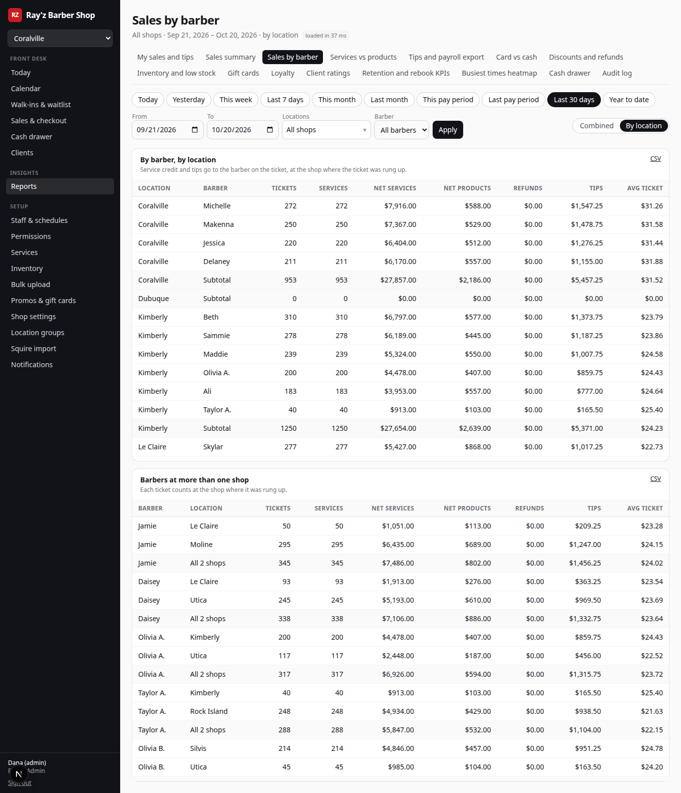

# Ray'z Barber Shop platform

Booking, front desk, POS, and reporting for Ray'z Barber Shop's 8 locations (Coralville, Kimberly, Le Claire, Moline, Rock Island, Dubuque, Silvis, Utica). It replaces Squire. The core flows (online booking, the day calendar, checkout) follow Squire's so staff feel at home, and the UI is built to need fewer clicks. Every place where it does better than Squire is listed under [Improvements over Squire](#improvements-over-squire).

**Status: phases 1a, 1b, and 1c are all complete for v1.** The end-to-end path works on seeded data. A customer books online. The manager sees the booking on the Coralville day calendar and checks it out with a tip on a Stripe test credit card (the 3% credit fee is disclosed). The sale then shows up in reports, payroll tips, and the client's loyalty progress. What's simulated or stubbed is listed under [What's stubbed](#whats-stubbed-or-simulated).

| Phase | Scope | Status |
| --- | --- | --- |
| 1a | Online booking, schedules, day calendar, notifications (stubbed), Squire importer, versioned booking API | Done |
| 1b | POS (services, retail, tips, discounts, promos, gift cards, refunds/voids), drawer close, inventory, audit log | Done |
| 1c | Sales reports, CSV exports, bi-weekly payroll tips, KPIs, loyalty | Done |

Screenshots of the key screens are in the PR description.

---

## Quick start

**Prerequisites:** Node 20+, pnpm 9+, and Postgres 16. The `btree_gist` extension is required; it ships with Postgres, Neon, and Supabase.

```bash
# Postgres via Docker (or use a local install / Neon / Supabase)
docker run -d --name rayz-pg -p 5432:5432 -e POSTGRES_USER=rayz -e POSTGRES_PASSWORD=rayz -e POSTGRES_DB=rayz postgres:16
docker exec rayz-pg createdb -U rayz rayz_test   # for pnpm test:db

pnpm install
cp .env.example .env          # then set AUTH_SECRET to a long random string
pnpm db:reset                 # runs migrations + seeds real shops/services and ~8 weeks of sample history
pnpm dev                      # http://localhost:3000
```

`pnpm db:reset` wipes and reseeds the database. `SEED_HISTORY_DAYS` (default 56) controls how much sample history is generated.

### Logins (seeded; password `rayz2026!`)

| Who | Email | Role and shops | Sees |
| --- | --- | --- | --- |
| Owner | `owner@rayz.test` | Brand Owner, every shop | Everything, including brand-level settings (loyalty, Sunday hours) and granting Brand Owner |
| Admin | `admin@rayz.test` | Brand Admin, every shop | Everything except brand-level settings; manages roles and permissions |
| Regional | `regional@rayz.test` | Regional Manager, Moline and Rock Island | Manager tools and every report, for those two shops only |
| Michelle | `michelle@rayz.test` | Shop Manager, Coralville | Manager tools and Coralville's reports |
| Front desk | `frontdesk@rayz.test` | Front Desk, Coralville | Calendar, walk-ins, checkout for every barber, the drawer, discounts up to 10%, and two reports (view only) |
| Makenna | `makenna@rayz.test` | Barber, Coralville | Her own calendar column, appointments, clients, and sales |

What each role can do is editable under **Permissions** (see [Roles and permissions](#roles-and-permissions)).

Staff sign in at `/login`. Customers don't need an account to book. They can optionally sign in at `/account` with a one-time code. In development, the code is shown on screen because `AUTH_DEV_CODES=true`.

Handy demo data:

- The gift card `DEMO-GIFT-2500` has $25.00 on it.
- The promo code `WELCOME5` takes $5 off services.
- Client "Jordan" (phone `319-555-0100`) has $290 of loyalty progress, so their next $33 haircut earns a $15 reward.

### Try the full flow

1. Go to `/` and pick **Coralville**. Choose a service, add-ons, "Any barber", and a time, then enter a name and phone. The confirmation page lives at `/a/{code}`, and the customer can cancel or reschedule there until 30 minutes before the appointment.
2. Sign in as `michelle@rayz.test`. Open **Calendar** and go to the booked day, then click the appointment and choose **Check out**.
3. On the POS, tap a tip (20/25/30%, $5/$10/$15/$20, or custom). Choose **Card**, use the card reader, and pick "Visa (credit)". The 3% credit surcharge is added and disclosed; debit cards pay no fee. Optionally tap **4 wk** to rebook the client, then click **Charge**.
4. The receipt shows taxes with their rates, the tip, the fee, the payment, and loyalty progress. Sign in as `owner@rayz.test` and check **Reports** (Sales summary), **Tips and payroll export**, and the client's page under **Clients**.
5. As `admin@rayz.test`, open **Permissions**, edit the Front Desk role, or open a person to give them a one-off permission or change their shops. Under **Bulk upload**, download the template, fill in a few rows, and preview the upload before saving it.

### Other commands

```bash
pnpm test          # unit tests: availability/DST, checkout totals, payroll, loyalty, permission rules, upload parsing, report views
pnpm test:db       # integration tests against TEST_DATABASE_URL (migrates + seeds it first), incl. every page/action/route per login
                   # and per-location totals adding up to multi-location and brand totals (refunds, multi-shop barbers)
pnpm lint && pnpm typecheck
pnpm build && pnpm start
pnpm worker        # local stand-in for the cron job that drains the reminder queue (every 30s; --once for one pass)
pnpm import:squire clients samples/squire/clients.csv            # dry run
pnpm import:squire clients samples/squire/clients.csv --commit   # write
pnpm import:squire appointments appts.csv --errors=skipped.csv   # also write skipped rows to a CSV
npx tsx scripts/make-squire-fixture.ts   # regenerate samples/squire/realistic (deterministic)
```

---

## What's done

### Customer booking (web + API)

- The flow goes shop, then service plus add-ons, then barber or "Any barber", then a time slot, then contact details. There's a confirmation page and a manage page with cancel and reschedule. Online changes close at the 30-minute mark itself, and the page and the API agree on that.
- Online and API bookings must start on one of the offered times (the shop's slot grid). Staff booking from the calendar can pick any minute.
- Booking URLs carry only an opaque appointment code and the barber's public slug (first name plus a number, e.g. `makenna-3549`), never a surname.
- Barbers appear by their **display label** (e.g. "Olivia A.", "Taylor B."), and each has a unique staff ID (`S-0007`).
- Dubuque has no barbers. It shows as "Opening soon", its booking page explains why, and the API returns empty lists rather than errors.
- Slot math runs in `America/Chicago` with Luxon and is DST-safe; the spring-forward and fall-back days are covered by tests. "Any barber" spreads bookings to the least-booked barber.
- **No double-booking, ever.** The app checks every shop's appointments and schedules, and a Postgres exclusion constraint (`appointments_no_double_booking`) rejects any overlapping booking for the same barber, even across shops and even if app code is bypassed. The constraint includes the shop's buffer between appointments (stored on each appointment when it's booked). Booked, confirmed, checked-in, and in-service appointments hold the chair; a completed one frees it, so a cut that finishes early opens the rest of its slot.
- A time staff type that doesn't exist (2:30 AM on a spring-forward morning) is refused instead of being moved an hour.
- **Versioned REST API at `/api/v1`** with an OpenAPI 3.1 spec at `/api/v1/openapi.json` and readable docs at `/docs/api`. It covers shops, services, barbers, availability (day and month views), booking, appointment lookup, cancel, reschedule, customer auth, profile, "my appointments", and loyalty balance. The public web booking UI calls this same API. See [Booking API and the mobile app](#booking-api-and-the-mobile-app).

### Front desk

- **Day calendar** (per shop): a column per barber who's scheduled or has appointments that day.
  - Time the barber isn't working is shaded, and blocked time (lunch, appointments, etc.) shows hatched with its reason.
  - Time the barber spends at *another* shop shows as "At Moline".
  - A red line marks the current time, the view refreshes every minute, and there are status counts at the top.
  - Click an appointment to confirm, check in, start, check out, mark a no-show, cancel, or restore it. Click an empty slot to book (search an existing client or add one) or to block time.
  - Barbers see only their own column.
- **Walk-ins and waitlist:**
  - Quick-add a walk-in with a name, optional phone, service chip, and barber chip, then either **Seat now** (it books the first free barber immediately) or add them to the waitlist.
  - The waitlist shows time waited against the quoted wait, with **Seat**, **Text "you're up"**, and **Left** actions.
- **Today dashboard:** today's numbers against the same day last week, who's up next, low stock, per-shop totals in brand view, and reminders about unverified taxes or notifications being off.

### Schedules and staff

- Each barber has a weekly schedule *per shop*, can work at several shops, and has days off and time off with a reason. Someone with the schedules permission can block time only for barbers who work at their shops; an all-shops day off is allowed for a barber whose shops are all theirs, and anyone with access to every shop can do it for anyone.
- Shops are closed Sundays. Only the Brand Owner can open a shop on a Sunday or change its Sunday hours.
- Saving a schedule that overlaps the barber's hours at another shop is refused with a clear message.
- Duplicate first names are handled with unique staff IDs plus admin-set display labels. Saving a duplicate active label is refused, and the error suggests an alternative.
- Who can do what is set by roles, per-person overrides, and shop access, all under **Permissions**. See [Roles and permissions](#roles-and-permissions).

### Catalog, POS, and money

- A **brand master catalog** of services and add-ons, with per-shop price and duration overrides and per-shop enable/disable. The real Squire prices for each shop are seeded, and Squire's disabled items (design add-ons, memberships) are seeded as disabled.
- **POS** (`/admin/checkout/{id}`):
  - Services, add-ons, and retail items.
  - Tip presets per shop, flat tip buttons, or a custom amount.
  - Promo codes, loyalty rewards, and manual discounts (needs the discount permission and a reason, and is capped at the person's discount limit, e.g. 10% for Front Desk).
  - Gift cards: sell them, check the balance, redeem them as partial payment.
  - Cash with quick-tender buttons and change due, or card through the reader (simulated Stripe Terminal) or keyed in (Stripe Elements).
  - One-tap rebook after payment.
- **Totals are computed by one pure function** (`src/domain/checkout.ts`) that both the POS screen and the server use. The server prices every service, add-on, and product from the shop's menu and ignores prices sent by the browser. Someone with the price override permission (managers by default) can override a line's price with a reason; the override is stored next to the menu price and audited. It refuses the charge if the totals don't match what the cashier saw.
- **Double-submits are safe.** The ticket is locked before the card is charged, a second submit waits and then sees the ticket already paid, and the app only ever refunds a charge that the same request created.
- **Taxes:** each shop has separate service and product rates stored in the database, so nothing is hard-coded. Only people with the tax permission can edit them (Brand Owner and Brand Admin by default), and every change is audited. Every service and product has a tax category (service, product, or exempt) that picks which rate applies; exempt items are never taxed. The seeded rates are placeholders marked "unverified" (see [Data caveats](#data-caveats)).
- **Credit card fee:** optional, set per shop, and the default is 3%. A database check caps it at 3%. It's applied only when Stripe reports the card's funding as `credit`; debit, prepaid, gift card, and cash pay no fee. The fee is disclosed before charging, on the POS, and on the receipt.
- **Refunds and voids:** need the refund permission, and a reason is required. A refund picks the lines (with quantity), the tip, and optionally the card fee; tax follows the lines. It can restock items and goes back to the original tender. Refunding a gift card sale voids the card. If part of it has been spent, a full-ticket refund gives back only what's left on it, and a fully spent card can't be refunded. Refunds reverse loyalty progress and revoke a reward the ticket earned. Voids are same-day only and are blocked once the drawer is closed.
- **Refunds issued in the Stripe dashboard** reach the books through the webhook (`charge.refunded`) and run the same reversal as a refund from the POS.
- **Split tender:** a gift card plus one cash or card payment. Paying the remainder half in cash and half on a card isn't supported yet.
- **End-of-day drawer:** a denomination counter, expected against counted cash with the variance, and history.
- **Audit log** records sales, voids, refunds, discounts, price, tax, and fee changes, schedule edits, imports, client ratings, settings changes, permission changes, and every item a bulk upload creates or changes, including before and after values where it matters. Entries are append-only.
- **Card data never touches our server.** Elements tokenizes cards in the browser and Terminal reads them on the device; we store only brand, last 4, funding, and Stripe IDs, which keeps us in SAQ-A scope.

### Inventory

- Per shop: cost, price, stock, and low-stock threshold, with margin shown. Stock adjustments are recorded with a reason (receive, count, or damage).
- Selling an item decrements stock, and a void or a refund with restock puts it back.
- People with access to every shop also get a matrix view of stock across all of them.
- Products have a SKU (unique, case-insensitive), an optional barcode (8 to 14 digits, unique), a brand-level cost and price, and per-shop price overrides. Prices, stock, and new items can be loaded in bulk; see [Bulk catalog upload](#bulk-catalog-upload).

### Notifications

- Every booking queues a confirmation plus 24-hour and 2-hour reminders in the `notification_jobs` table. Cancelling or rescheduling an appointment cancels its pending reminders.
- The queue is drained by `/api/cron/notifications` (Vercel Cron, every 5 minutes, see `vercel.json`) or by `pnpm worker` locally. Draining uses `SKIP LOCKED`, retries with backoff, and gives up after 5 attempts.
- Providers are pluggable (`src/server/notifications/providers.ts`) and **off by default**. When sending is off, due jobs are marked "suppressed" so you can see exactly what would have been sent at **Notifications**.
- Appointment statuses include `no_show` and `cancelled`.

### Reports, payroll, KPIs

- **Sales reports** per shop or brand-wide:
  - Gross, discounts, refunds, net services, net products, tax, tips, and card fees.
  - Card (credit/debit) against cash and gift card.
  - Breakdowns by barber and by shop, plus daily and monthly totals.
- Date presets cover today, this week, this month, the current or last pay period, last 30 days, and year to date, and you can pick any custom range. Every table exports to CSV. A cell that starts with `=`, `+`, `-`, `@`, or a tab is prefixed with `'`, so a client named "=HYPERLINK(…)" can't run as a formula in Excel. Negative numbers are left alone.
- **Payroll tips:** bi-weekly periods that end on Saturdays, anchored on Sat 2026-10-03. Tips are broken out per barber and per shop, split into card, cash, and gift card, with refunded tips netted out, and export to CSV. There's no clock-in; hours stay in iSolved.
- **KPIs Squire doesn't have:**
  - Rebook rate: the next appointment was booked by the end of the visit plus 24 hours. Imported visits whose next booking has no booking time in Squire are left out rather than counted as not rebooked.
  - Retention against the previous window of the same length.
  - New versus returning clients, measured within the report's shops (a first visit to Coralville is new there even if the client has been to Moline), with new-to-brand shown alongside.
  - No-show and cancellation counts with their dollar value.
  - A day-by-hour heatmap of when the shop is busiest.
- Reports are fast. They're indexed SQL aggregates run in parallel, and the page shows its own load time. On the seeded data (about 8 weeks across 8 shops), a brand-wide year-to-date report loads in about 90 ms and 30 days in about 40 ms.

### Reports à la carte

Each report is its own page with **two permissions of its own**: `report.<key>.view` and `report.<key>.export`. Both can be set per role and per person, so someone can see the Sales summary without being able to download it, or get just one report and nothing else.

| Report | Key | What's in it |
| --- | --- | --- |
| My sales and tips | `my_sales` | The signed-in person's own tickets, services, products, and tips |
| Sales summary | `sales_summary` | Gross to net, tax, tips, fees, by shop, by day and by month |
| Sales by barber | `sales_by_barber` | Services, products, tips, tickets, and average ticket per barber |
| Services vs products | `services_vs_products` | Each category and item, with quantity, net, and share |
| Tips and payroll export | `tips_payroll` | Bi-weekly tips per barber, card/cash/gift card |
| Card vs cash | `card_vs_cash` | Tender mix: credit, debit, cash, gift card, card fees |
| Discounts and refunds | `discounts_refunds` | Who discounted what and why, and every refund and void with its reason |
| Inventory and low stock | `inventory` | Stock by shop and SKU, value at cost, received, sold, damaged, low stock |
| Gift cards | `gift_cards` | Issued, redeemed, outstanding balances |
| Loyalty | `loyalty` | Rewards issued, redeemed, and reversed by refunds |
| Client ratings | `client_ratings` | Lowest- and highest-rated clients per shop |
| Retention and rebook KPIs | `kpis` | Rebook rate, retention, new vs returning, no-shows |
| Busiest times heatmap | `heatmap` | Visits by weekday and hour |
| Cash drawer | `cash_drawer` | Drawer closes with expected, counted, and variance |
| Audit log | `audit_log` | Every audited change, filterable |

- **Only permitted reports appear.** The **Reports** hub and its tabs list only the reports you can view, and the nav item is hidden if you can view none. The server checks the view permission on every report page and the export permission on every CSV download (`/admin/reports/export`, which also serves the payroll and audit log exports, and the client ratings export), so typing a URL gets a "no access" page or a 403.
- **Shop-scoped.** A report only ever shows the shops in your access. Asking for any other shop by URL is refused (see [Reports across locations](#reports-across-locations)).
- Exporting needs viewing too: removing the view permission takes export away with it.
- The on-screen report and its CSV come from the same loader (`src/server/report-data.ts`), so they always match.

### Reports across locations

Every report, plus payroll, client ratings, and the audit log, runs over **one shop, any set of shops, or all shops**, picked from the **Locations** menu on the report:

- **All shops**: every shop you have access to.
- **Saved groups**, such as Quad Cities, Iowa shops, or Illinois shops.
- **Pick shops**: tick any combination.

When more than one shop is selected, a **Combined / By location** switch picks the layout:

- **Combined** shows one set of numbers for everything selected.
- **By location** shows each shop side by side:
  - Summary tables get a column per shop and a total column: "Brand total" when every shop is selected, otherwise "Total (N shops)".
  - Lists get a Location column, a **subtotal per shop** (shops with no activity show zeros rather than disappearing), and the total row. The barber report lists each barber under their shop, with the shop's subtotal.
  - Rates such as average ticket, rebook rate, and attach rate are recomputed for each subtotal and total, not added up.
  - Counts of distinct clients (retention, new vs returning, loyalty members) aren't additive: a client seen at two shops counts once at each and once in the total. The table says so.

**Barbers who work at several shops.** Sales, tips, refunds, and payroll go to the shop where each ticket was rung up, not the barber's home shop. Sales by barber and payroll add a **Barbers at more than one shop** table with the barber's row at each shop and their combined total underneath. Payroll lists a barber once per shop per period, which is how each shop pays them out. The combined payroll view merges those rows into one line per barber, with a Locations column.

**CSV follows the view.**
- Combined downloads have no Location column.
- By-location downloads put the Location in the first column of every row and keep the subtotal and total rows. A summary table downloads as one row per shop plus the total row.
- The file name ends in `-by-location`.

**Saved location groups** (**Setup → Location groups**, `/admin/location-groups`) are created and edited by people with the `locations.manage` permission (Brand Owner and Brand Admin by default). It also needs access to every shop, since a group can include any shop in the brand.
- A group needs a unique name and at least two shops.
- Creating, editing, and deleting a group are audited.
- Anyone with a report can use a group as a filter. They see only the shops in it that they have access to, and a note says how many shops were left out.

**Access.** The menu lists only your shops. Asking for a shop you don't have access to, by URL or in a CSV link, is refused with a "no access" page or a 403. It isn't quietly dropped. Brand-level audit entries (with no shop) appear only to people with access to every shop.





### Roles and permissions

**Permissions** (`/admin/permissions`) is where the brand decides who can do what. It has three parts.

- **Roles.** Six editable templates ship with the app: **Brand Owner, Brand Admin, Regional Manager, Shop Manager, Front Desk, and Barber**. Add as many **custom roles** as you like, either blank or copied from another role.
  - The role editor groups the 32 feature permissions (front desk, point of sale, clients, catalog and inventory, staff, settings and data) with a toggle each, plus a **report matrix** with a View and an Export switch for every report. Each role also has a discount limit (Front Desk defaults to 10%) and a default shop scope for new hires.
  - Built-in roles can be **reset** to their template. A custom role can be deleted once nobody has it.
  - Brand Owner always has every permission, including ones added later, and can't be edited.
- **People.** Each person has one role, plus optional **overrides** that grant or take away single permissions on top of it (shown as "Role default / Allow / Deny"), and their own discount limit. The page shows their effective permissions and what differs from the role.
- **Shop access.** Each person has a scope: **all shops**, **selected shops**, or **one shop**. Everything they see and do is limited to those shops: the shop picker, calendar, sales, clients' visits, staff, inventory, and reports. Access is separate from where a barber works, so a regional manager can oversee shops without being on their schedule.

**Rules**, all enforced on the server and covered by tests:

- Only the **Brand Owner** can grant Brand Owner, change a Brand Owner's access, or hold **brand-level settings** (the loyalty program, Sunday hours, new shops). Those can't be given by override. The last Brand Owner can't be demoted.
- Nobody can grant a permission they don't have, set a discount limit above their own, or change their own access.
- Roles apply at every shop, so only people with access to all shops can edit roles. Someone with limited shops can only manage people wholly inside their shops, and can only give access to those shops.
- You can't edit, reset the password of, or deactivate someone who has access you don't.

**Enforcement.** Every admin page calls `guardPage()`, which checks the page's required permissions from one table (`PAGE_ACCESS` in `src/domain/navigation.ts`) and renders a "no access" page otherwise. Every server action calls `authorize()` with the permission it needs, and every route handler (CSV exports, templates, error files) goes through `routeStaff()`, which returns 401 or 403. Nav items you can't use are hidden, but hiding is cosmetic: the server checks again. A unit test fails the build if a page, action file, or route under `/admin` has no guard, and a DB test signs in as each of the six demo logins and loads **every admin page**, checking the outcome against that login's permissions.

**Audited.** Creating, editing, resetting, and deleting a role, and every change to a person's role, overrides, discount limit, or shops, is in the audit log, with the permissions granted and removed listed by name.

Existing staff were migrated automatically: brand admins became Brand Owner, shop managers became Shop Manager with access to the shop they managed, and barbers became Barber with access to their shops.


### Bulk catalog upload

**Bulk upload** (`/admin/catalog`) loads retail products, services, and add-ons from a CSV or Excel file.

- **Templates:** download a CSV or an XLSX template. The XLSX adds an Instructions sheet that explains every column, including the per-shop columns for your shops. Columns are `type`, `sku`, `name`, `category`, `maker`, `brand_cost`, `price`, `duration_min`, `tax_category`, `barcode`, `active`, `low_stock_threshold`, plus `price_<shop>` and `stock_<shop>` for each shop (for example `price_coralville`, `stock_rock_island`). Common header variants like "Item", "UPC", or "Cost" are recognised.
- **Preview first.** Every upload is a dry run until you confirm. The preview shows counts (new, updated, unchanged, errors, stock changes), and for each row what will change, from what to what, at which shop, with errors and warnings in plain words: a bad price, a duplicate SKU or barcode in the file, a barcode that already belongs to another item, a missing name for a new item, stock on a service. Saving applies only the rows without errors; the rest are listed in a downloadable error file with the original columns, ready to fix and re-upload.
- **Update by SKU.** SKUs are matched case-insensitively. Re-uploading a file updates the existing items and never creates duplicates, and blank cells mean "leave as is". Shops on the brand price follow a brand price change; a shop with its own price keeps it unless the file sets `price_<shop>`.
- **Push to shops.** Pick all shops or just some. New items are added to those shops, plus any shop that has a column in the file. Stock changes are recorded as inventory adjustments with the reason "upload".
- **Stock-only mode.** People with inventory permission but not catalog permission can upload stock counts and low-stock levels for products their shops already carry. Prices and other columns are ignored with a warning, and unknown SKUs are refused.
- **Safe:** shop columns outside your access block the upload. Uploads are serialised with a database lock and re-checked inside the transaction, files are capped at 5 MB and 5,000 rows, and every item created or changed gets its own audit entry, plus one for the upload as a whole.
- **Export:** download the whole catalog as CSV in the same format, with columns for your shops. Edit it and upload it back.


### Loyalty (brand-wide)

- Every $300 of **net service spend** (after discounts, before tax) earns a $15 reward. Products, tips, tax, and gift card sales don't count. Refunds and voids put progress back and revoke an unspent reward the ticket earned.
- Balance updates lock the account row, and a reward can only be redeemed once, even from two shops at the same moment. A reward that would discount nothing (say, a products-only ticket) isn't used up.
- The redemption rules and expiry are configuration, not code (**Settings**, Brand Owner only). Settings include the threshold, reward amount, reward expiry (default 365 days), optional progress expiry, what rewards can be spent on, and whether rewards stack with promos. One reward per visit.
- Imported Squire tickets never earn loyalty here; the imported loyalty balance already includes them.
- Rewards show up as one-tap chips at checkout. Balances appear on the client page, on the receipt, and in the customer API (`GET /api/v1/me/loyalty`).

### Clients (brand-wide)

- **One client record across all eight shops.** Booking, walk-ins, sign-in, the import, and New client all use the same match order:
  1. Squire client ID;
  2. email with a compatible name;
  3. phone with a compatible name.

  A compatible first name is the same name, a common nickname (Mike/Michael), or a prefix of at least three letters; last names must not contradict. A contact with no name to compare only matches when exactly one client has it. A database lock serializes find-or-create, so two bookings at the same moment can't create two records.
- Families sharing a phone stay separate people. Signing in by code on a shared phone asks which profile you are instead of picking one.
- **Duplicates and merge** (**Clients → Duplicates**, needs the merge permission): candidates share a phone or email. Merging moves appointments, tickets, gift cards, rewards, staff ratings, and Squire IDs onto the kept record and combines loyalty progress (issuing a reward if the total crosses $300). It joins the notes and fills blank contact fields; consent stays yes only if both records said yes. Every merge is audited.
- **Profile:** visit count, no-shows, cancellations, last visit, and lifetime spend come from SQL over the client's whole history, net of refunds. Lifetime spend includes Squire visits that have no imported ticket. The profile also shows the full visit history with shop, barber, services, and prices, plus home shop, preferred barber, loyalty, gift cards, notes, and consent.
- **Search** by name, phone (any format or the last 4+ digits), or email uses trigram indexes. People who can look up any client (managers and front desk by default) search the whole brand. Everyone else's search covers clients who've visited their shops, and they can open the full profile only of a client they've served. Phone numbers and emails need the contact permission; without it the phone is masked to its last 4 digits and the email is hidden.
- Client notes show on the calendar panel and the POS ticket.
- **Consent:** SMS and email opt-in default to no. Each booking sends an explicit choice, an explicit no always sticks, and a missing answer keeps what's on file. Reminder texts and the waitlist "you're up" text are only sent to clients who opted in.
- Every walk-in becomes a client, even without a phone.

### Client ratings (staff only)

- **Rate a visit, 1 to 5 stars,** with an optional private note (up to 500 characters: "late", "great tipper", "difficult"). Rate from the receipt right after checkout, or from **Staff ratings** on the client profile, which lists the client's recent visits. Each rating belongs to one visit (an appointment, or a walk-in ticket with no appointment). Each staff member gets one rating per visit, and rating the same visit again changes it.
- **Who can do what:**
  - Rating needs the rate permission. People who can see every rating (managers by default) can rate any visit at their shops. Everyone else can rate only visits they served: they had the appointment or rang up the ticket. Only completed, in-progress, and no-show visits and paid tickets can be rated.
  - People who can see every rating see every rating and note at their shops. Everyone else sees the average and count, plus only the ratings they gave themselves.
  - Only the person who gave a rating can edit it. The author or someone with the moderate permission (Brand Owner and Brand Admin by default) can remove it, so an admin can moderate without rewriting someone else's words.
- **The profile** shows the average, the number of ratings, a 1-to-5 star breakdown, and the history: stars, note, who rated, when, the shop, and the visit, with a link to the ticket. The visit history has a Rating column.
- **Star badge** (for example "★ 4.3 (7)", red below 3, amber below 4, green otherwise) next to the client's name on the day calendar block and side panel, at checkout (POS and receipt), and in client search on the calendar, the POS, and the client list. Unrated clients show no badge.
- **Clients list:** filter by rated, low (below 3), high (4 and up), or unrated, and sort by highest or lowest rating.
- **Report** (**Reports → Client ratings**, needs that report's view permission): for each shop, the lowest- and highest-rated clients by their average from ratings given at that shop, with the count, the last rated date, and the latest note. Filters cover the period (all time, 12 months, 90 days) and a minimum number of ratings. A shop with few rated clients splits them between the two lists, so nobody appears in both. Everyone sees only their own shops. Exporting to CSV needs the report's export permission.
- **Audited:** every create, edit, and removal is in the audit log with the shop, the client, and the before and after stars and note.
- **Never shown to customers.** Ratings live in their own table, `client_ratings`, and no customer-facing code reads it. Tests check this two ways. A static check walks the import graph of `/api/v1`, the public pages, and the API client and fails if any of them can reach the ratings code or table. A DB test signs in as a rated client and calls every `GET` under `/api/v1`, plus booking, profile update, sign-in, and the OpenAPI document. It asserts that no star count, the word "rating", or the private note appears anywhere.
- Merging duplicate clients carries their ratings over. The database rejects stars outside 1 to 5, a note over 500 characters, and a rating with no visit.

### Squire importer

- **Admin → Import**, or the `pnpm import:squire` CLI. Import the five Squire exports in this order: clients, appointments, transactions, loyalty, gift cards.
  - **Clients:** name, phone (any format), email, notes, Squire ID, client-since, home shop, preferred barber, SMS and email opt-in.
  - **Appointments:** past visits with shop, barber, services, add-ons, prices, and status (completed, no-show, cancelled), plus upcoming bookings. Barbers who've left are created as inactive staff so their history keeps its name. Walk-ins with no client stay unlinked.
  - **Transactions:** purchases, tips, tax, and totals, linked to their visit. Voided tickets are kept as voided.
  - **Loyalty** progress and rewards, and **gift card** balances (with where the card was used).
- Every file gets a **dry run** first: rows are validated inside transactions that are rolled back. Real runs commit in batches of 500 rows.
- After each run you get a **reconciliation summary**: clients created, updated, and merged; appointments by status, with upcoming and former barbers; tickets imported, voided, and linked to visits. Skipped rows are counted by reason, and each run has a **downloadable error file** of skipped rows with their original columns, so they can be fixed and re-imported. The import page also shows live totals of what's in the database.
- Re-running a file is safe: rows are matched by Squire ID, corrected fields (a fixed phone, a changed consent) land on the existing record, loyalty replaces the imported balance instead of adding to it, and future bookings that would double-book a barber are skipped and reported.
- Imported history feeds reports, KPIs, and the client profile, and never double counts: imported tickets don't earn loyalty and aren't part of a drawer close, and a Squire visit with a linked ticket is counted once.
- `samples/squire/` has small example files. `samples/squire/realistic/` is a messy, deterministic export of about 200 clients, 635 appointments, and 478 tickets (missing emails, phones in mixed formats, the same person at two shops, families sharing a phone, placeholder and nameless rows, former barbers), with the expected reconciliation in `expected.json`. The DB tests import it and check every person against the ground truth.

---

## Improvements over Squire

These were built in response to the owner's request: "mimic Squire, but make it better wherever possible."

**Fewer clicks at the front desk**

- **Quick walk-in:** a name, a service chip, and **Seat now** books the first free barber in about three taps. Squire needs a full appointment form.
- **One-tap rebook at checkout:** tap "2/3/4/6 wk" before charging. It books the same barber at the same time and shows it on the receipt. Squire's Smart Rebooking is a separate follow-up flow.
- **Fast tips:** percent presets show their dollar amounts, and $5/$10/$15/$20 and "No tip" are one tap each.
- **Cash and card totals side by side.** The tender buttons show the debit and credit totals before the card is chosen, so the client knows the fee up front.
- **Quick tender:** suggested cash amounts and live change due.
- **Checkout from the calendar:** one click opens a ticket pre-filled with the booked services, client, and barber.

**Clearer screens**

- The day calendar shows when a barber is *at another shop*, not just "unavailable". Blocks show their reason, there's a live now line, and status counts sit at the top.
- The dashboard compares today with the same weekday last week and flags low stock, unverified tax rates, and notifications being off.
- Receipts list every tax rate, the card fee with its disclosure, the tender with card funding, and loyalty progress.

**Faster, deeper reports**

- Squire's reports were slow. These load in well under a second brand-wide and display their own load time.
- Brand-wide, per-shop, and per-barber views come from the same screen with one-click presets and CSV export on every table.
- New KPIs Squire doesn't report: rebook rate, retention, new versus returning, a day-by-hour heatmap, and no-show and cancellation value.
- A payroll tip export by bi-weekly period with card, cash, and gift card splits.

**Safer data and operations**

- The database guarantees no cross-shop double-booking.
- Tax rates and card fees are per shop, admin-only, audited, and range-checked by the database. The card fee can never exceed 3%.
- Every money-affecting action is in an append-only audit log.
- The importer always dry-runs first, and re-running it is safe. Every run ends with a reconciliation summary and a downloadable file of skipped rows.
- One brand-wide client record with a duplicates screen and merge, and a profile with the whole Squire history, lifetime spend, and loyalty in one place.
- Private staff ratings per visit, with a star badge wherever the client's name appears at the front desk and a lowest- and highest-rated report by shop. Each rating is tied to a visit and an author, and every change is audited. Tests prove ratings never reach the customer API.
- Booking URLs never contain surnames. Squire's personal booking links do.
- Duplicate first names get unique IDs and admin-set labels instead of guesswork.
- An API-first booking backend is ready for a mobile app.

---

## Booking API and the mobile app

The owner plans an iOS/Android customer app. The booking side is API-first so that app can be built against what already exists.

- **Base path `/api/v1`**, JSON over HTTPS. The spec is at `/api/v1/openapi.json` and readable docs at `/docs/api`. Breaking changes would go in `/api/v2`, with v1 kept running.
- **Public endpoints (no auth):**
  - `GET /shops`, `GET /shops/{shop}`, `/services`, `/barbers`
  - `GET /shops/{shop}/available-days`, `GET /shops/{shop}/availability`
  - `POST /appointments` (guest booking)
  - `GET /appointments/{code}`, `POST /appointments/{code}/cancel`, `POST /appointments/{code}/reschedule`
- **Customer auth for mobile:**
  1. `POST /auth/otp/start` sends a one-time code by SMS or email.
  2. `POST /auth/otp/verify` returns `{ accessToken, refreshToken }`. The access token is a JWT valid for 1 hour and is sent as `Authorization: Bearer …`; the refresh token lasts 60 days. When several clients share that phone or email (a family), it returns `chooseProfile: true` with a short-lived `selectionToken` and the first names; the app then calls `POST /auth/otp/complete` with the chosen profile.
  3. `POST /auth/refresh` rotates the refresh token. Re-using an old refresh token revokes every session for that customer, which is the standard defense against stolen tokens.
  4. `POST /auth/logout` revokes the session.
- **Signed-in endpoints:** `GET /me`, `GET /me/appointments`, `GET /me/loyalty`. Booking while signed in links the appointment to the account.
- Errors share one shape: `{ error: { code, message, details? } }`. CORS is open on every v1 endpoint. That's safe because auth is a Bearer token, never a cookie. Times are ISO 8601 with offsets, and shop-local dates are `YYYY-MM-DD` in America/Chicago.
- The public web booking UI (`/book/{shop}`, `/a/{code}`, `/account`) uses the same endpoints through `src/lib/api-client.ts`, so the mobile app gets exactly what the website gets.

---

## What's stubbed or simulated

- **SMS and email providers.** Twilio and Resend are interface stubs (`src/server/notifications/providers.ts`) and sending is **off by default**. Setting `NOTIFICATIONS_*_PROVIDER=console` logs messages instead. Going live needs Twilio A2P 10DLC registration and a verified sending domain.
- **Stripe without keys.** With no `STRIPE_SECRET_KEY`, a built-in simulator with the same interface runs, using Stripe's published test card IDs (`pm_card_visa`, `pm_card_visa_debit`, and so on), so the POS works end to end offline. Adding test keys (`STRIPE_SECRET_KEY`, `NEXT_PUBLIC_STRIPE_PUBLISHABLE_KEY`, `STRIPE_WEBHOOK_SECRET`) switches to real Stripe test mode: PaymentIntents, Elements for keyed cards, and the webhook for dashboard refunds and disputes. For Cloud Agents, add them under Cursor Dashboard → Cloud Agents → Secrets.
- **Stripe Terminal.** The card reader flow is simulated. You pick a test card where a reader would read one. Real hardware needs a Terminal location, a connection token endpoint, and a reader pairing screen.
- **3-D Secure.** The keyed-card flow doesn't handle `requires_action` yet. That's fine for in-person keyed entry, but it's needed before taking any card-not-present payment.
- **Tax rates.** The seeded rates are placeholders (IA 7%; IL 0% on services and 8.75% on products) and every shop is marked "unverified". The accountant must confirm each shop's rates before go-live.
- **OTP abuse protection.** One-time codes expire after 10 minutes and are single-use, but per-number rate limiting isn't built yet.

## Data caveats

- **Shop hours** come from Squire for each shop. Dubuque's "every day 9–6" is Squire's placeholder; it's kept Monday–Saturday because all shops close Sundays.
- **Dubuque** has no barbers or services in Squire, its state is listed as "AL" (a typo; seeded as IA), and it has a personal email. The email and phone are left blank. It's seeded with the brand-default prices for the core services so it's ready when staff are hired.
- **Barber schedules are samples.** Squire doesn't expose shifts. The shops each barber is listed at come from Squire; the weekdays they work are made up. Managers should set real hours in **Staff & schedules** before cutover.
- **Floaters:** Casey is listed at 7 shops but only has sales at Le Claire, so the sample schedule puts Casey only at Le Claire. Leilah had Coralville sales but is no longer listed, so she's seeded as inactive. Charles ($60 in 90 days, likely an owner or test account) is seeded as not bookable.
- **Duplicate names** are seeded as "Olivia A."/"Olivia B." and "Taylor A."/"Taylor B." Admins can rename these labels.
- **Loyalty type:** Squire's earlier note said "transaction based", but the saved setting is "Value based": $300 spent earns $15, excluding products and tips. This build implements the dollar-based rule, which matches both the brief and Squire's saved setting.
- **Clients are brand-wide**, as in Squire: one client record across all shops, and loyalty is brand-wide. Shop managers can look up and edit any client so they can serve them (every edit is audited), but sales, reports, and the calendar are scoped to their shop. The client list defaults to clients whose home shop is this one or who've visited it.
- **Re-importing after cutover:** the clients file carries Squire's contact details and consent, so re-running it after go-live overwrites changes made here with Squire's values. Re-running loyalty after rewards have been spent here re-issues them. Run both one final time at cutover, then stop.
- **Booking time:** Squire doesn't always export when a booking was made. Rows without it are marked unknown and left out of the rebook rate.
- **Sample history:** the appointments, sales, clients, and gift cards in the seed are generated so the reports have something to show. The real history arrives through the importer.

---

## Architecture

- **Next.js 15 (App Router) + React 19 + Tailwind v4.** Staff pages are server components that call server actions. Every server action re-checks the session, role, and shop scope.
- **Postgres + Drizzle ORM.** The schema is in `src/db/schema.ts` and migrations are in `drizzle/`. Money is integer cents everywhere. Tax and fee rates are `numeric`.
- **Pure domain modules** in `src/domain/` (availability, checkout totals, payroll periods, loyalty) have no I/O and are unit-tested heavily. Server services are in `src/server/` and the API is in `src/app/api/v1/`.
- **Auth:**
  - Staff use an httpOnly JWT session cookie (12 hours) plus a shop-selection cookie. Middleware gates `/admin`.
  - Customers use OTP, then a Bearer access token plus a rotating refresh token.
  - Permissions are loaded fresh from the database on every request (role plus overrides, in `src/server/auth/access.ts`), so a change takes effect on the person's next click without signing out. Pages use `guardPage()`, server actions `authorize()`, and route handlers `routeStaff()`; see [Roles and permissions](#roles-and-permissions).
  - Shop scoping is enforced in the server layer on every query; anyone without access to every shop only ever queries the shop IDs in their access.
- **Time:** everything is stored as `timestamptz` and computed in `America/Chicago` with Luxon. Business dates for sales and payroll are shop-local.
- **Job queue:** the Postgres `notification_jobs` table, drained with `FOR UPDATE SKIP LOCKED` by Vercel Cron or `pnpm worker`. No extra infrastructure is needed; it can move to a dedicated queue (Inngest, QStash) later if volume calls for it.

```
src/
  app/(public)/      customer booking site (shop picker, /book/[shop], /a/[code], /account, /docs/api)
  app/admin/         staff app (calendar, walk-ins, checkout, sales, drawer, reports, payroll, setup pages)
  app/api/v1/        versioned booking API (+ openapi.json)
  app/api/cron/      notification queue drain (Vercel Cron)
  domain/            pure logic: availability, checkout, payroll, loyalty
  server/            data services: booking, calendar, checkout, reports, loyalty, importer, notifications, auth, payments
  db/                Drizzle schema + client
scripts/             migrate, seed (real shops/services/prices + sample history), worker, import CLI
tests/               unit tests; tests/db = integration tests against real Postgres
samples/squire/      example Squire CSV exports for the importer
```

## Deploying (Vercel + Neon or Supabase)

1. Create a Neon (or Supabase) Postgres database. Use the **pooled** connection string for `DATABASE_URL`. Set `MIGRATE_DATABASE_URL` to the direct, unpooled string for migrations.
2. Run migrations with `MIGRATE_DATABASE_URL=… pnpm db:migrate`. Don't run the seed in production; load real data with the importer instead.
3. Import the repo into Vercel. Set the environment variables:
   - `AUTH_SECRET` (long and random)
   - `AUTH_DEV_CODES=false` (production builds never return sign-in codes regardless)
   - `CRON_SECRET` (required: without it the cron endpoint refuses every request)
   - `APP_BASE_URL`
   - the Stripe keys
   - `NOTIFICATIONS_*_PROVIDER` (leave as `disabled` until cutover)
4. `vercel.json` already schedules `/api/cron/notifications` every 5 minutes. Vercel sends `CRON_SECRET` as a Bearer token.
5. Point a Stripe webhook at `/api/stripe/webhook` (`charge.refunded`, `charge.dispute.created`).
6. Keep separate **staging** and **production** projects and databases. Turn on Neon point-in-time restore or Supabase daily backups.
7. Create the real staff accounts (**Staff & schedules**), confirm each shop's tax rates, and tick "verified".

## Cutover plan

**Before the parallel run**

- Confirm tax rates per shop with the accountant.
- Enter real barber schedules.
- Import Squire clients, appointments, transactions, loyalty balances, and gift card balances, in that order, dry-running each file first. Check the reconciliation summary against Squire's own client and appointment counts, and fix and re-import rows from the error file.
- Train Coralville staff, which takes about 30 minutes. The flows mirror Squire.

**Weeks 1–4: parallel run at Coralville**

- Squire stays the system of record. Coralville books and checks out in **both** systems, or at minimum every Squire ticket is mirrored here.
- Notifications stay **off** here so customers don't get double texts.
- Each day, compare the drawer close, card totals, and tips per barber with Squire, and log any differences.
- Each week, re-import future bookings from Squire so the calendar matches. Re-running is safe: bookings already imported (matched by Squire appointment ID) are skipped. That also means a booking cancelled or moved in Squire after it was imported has to be cancelled or moved here by hand.
- **Exit criteria:** two consecutive weeks where totals match to the cent; staff prefer it, or are at least comfortable; the payroll tip export is accepted by whoever runs iSolved.

**Coralville go-live**

- Final Squire import of future bookings and balances, done after close.
- Switch Coralville's website booking link to `/book/coralville`.
- Turn on notifications.
- Squire stays read-only for 30 days for lookups.

**Then shop by shop**

- Suggested order: Kimberly and Utica (the shared floaters), then Le Claire, Moline, Rock Island, Silvis, and Dubuque when it opens.
- Run one or two shops a week with a shorter 1-week check at each. Floaters work at several shops, so cut over shops that share barbers in the same week to avoid managing a barber's day in two systems.
- Barber personal booking links in Squire contain surnames. Replace them with the new first-name links (`/book/{shop}?barber={slug}`).
- Cancel Squire after the last shop has run cleanly for one full pay period.

## Next steps

- Real Stripe Terminal readers: a location, connection tokens, reader pairing, and on-reader tipping.
- Twilio and Resend providers; opt-in and opt-out (STOP) handling; a no-show follow-up text; rebook nudges for lapsed clients, replacing Squire Engage automations.
- Customer card-on-file and deposits or no-show fees, if the shop wants them (Squire had none). This requires 3DS.
- OTP rate limiting and bot protection on public booking.
- Barber photos and bios on booking pages, using first-name image files.
- Purchase orders and vendor reorder suggestions from the low-stock list.
- Memberships (Squire's unlimited plans were disabled, so they're not built).
- Payroll: send the tip export straight to iSolved if it has an import format.
- The mobile app against `/api/v1`, plus push notifications (add an `/me/devices` endpoint).
