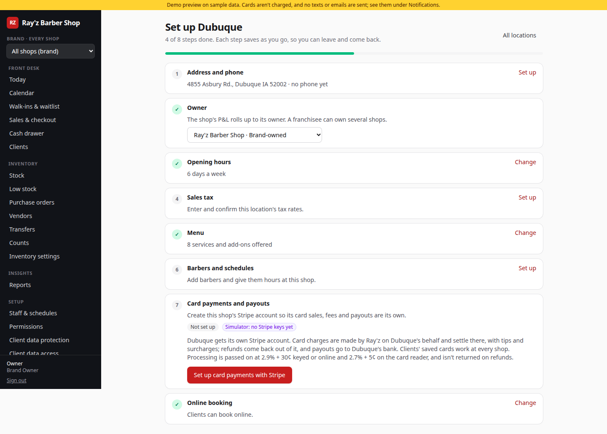
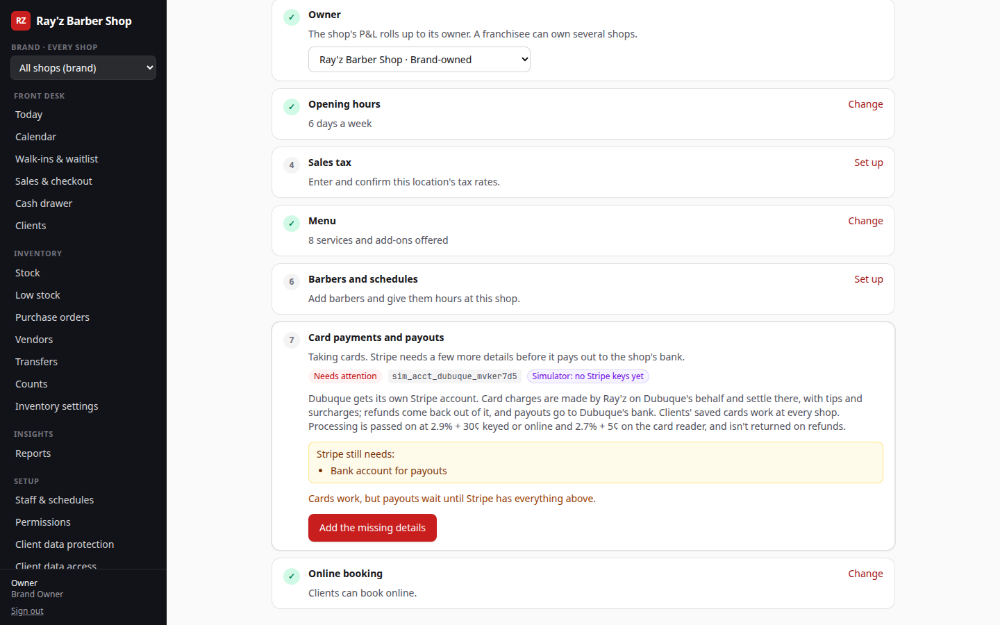
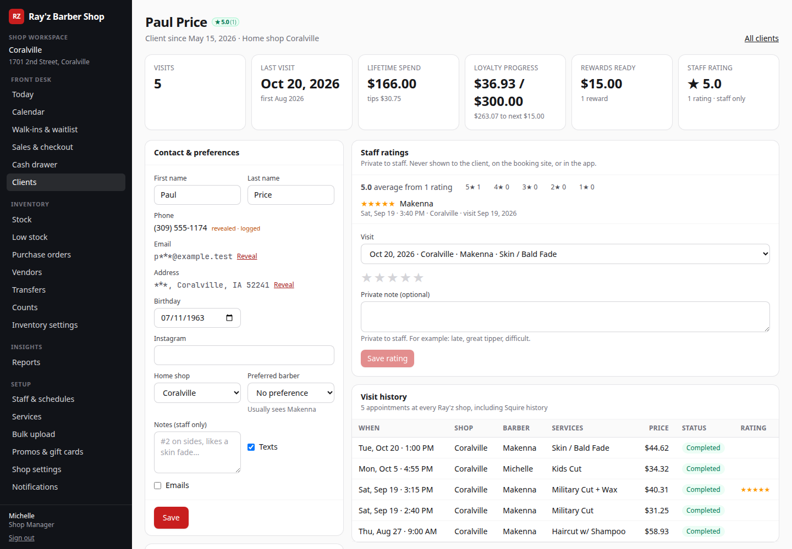

# Ray'z Barber Shop platform

Booking, front desk, POS, and reporting for Ray'z Barber Shop's 8 locations (Coralville, Kimberly, Le Claire, Moline, Rock Island, Dubuque, Silvis, Utica). It replaces Squire. The core flows (online booking, the day calendar, checkout) follow Squire's so staff feel at home, and the UI is built to need fewer clicks. Every place where it does better than Squire is listed under [Improvements over Squire](#improvements-over-squire).

**Status: phases 1a, 1b, and 1c are all complete for v1.** The end-to-end path works on seeded data. A customer books online. The manager sees the booking on the Coralville day calendar and checks it out with a tip on a Stripe test credit card (the 3% credit fee is disclosed). The sale then shows up in reports, payroll tips, and the client's loyalty progress. What's simulated or stubbed is listed under [What's stubbed](#whats-stubbed-or-simulated).

| Phase | Scope | Status |
| --- | --- | --- |
| 1a | Online booking, schedules, day calendar, notifications (stubbed), Squire importer, versioned booking API | Done |
| 1b | POS (services, retail, tips, discounts, promos, gift cards, refunds/voids), drawer close, inventory, audit log | Done |
| 1c | Sales reports, CSV exports, bi-weekly payroll tips, KPIs, loyalty | Done |
| Inventory | Stock ledger per shop, par levels and low-stock alerts, vendors, purchase orders (suggest, approve, email, receive), transfers, counts, inventory reports | Done |
| Shop workspaces | A login per shop, each shop its own workspace on one database; brand logins over all of them; client history visible at every shop; a role per assigned shop for multi-shop staff; isolation enforced by a central tenant guard and tested | Done |
| Client data protection | Hidden, masked, or full for every client field by role and person, brand-wide or per shop, enforced on the server everywhere; calls and texts through the shop line; reveal with a reason; client export as its own permission; lookup limits with alerts; a data-access report | Done |

Screenshots of the key screens are in the PR description.

---

## Quick start

**Prerequisites:** Node 20+, pnpm 9+, and Postgres 16. The `btree_gist` extension is required; it ships with Postgres, Neon, and Supabase.

```bash
# Postgres via Docker (or use a local install / Neon / Supabase)
docker run -d --name rayz-pg -p 5432:5432 -e POSTGRES_USER=rayz -e POSTGRES_PASSWORD=rayz -e POSTGRES_DB=rayz postgres:16
docker exec rayz-pg createdb -U rayz rayz_test   # for pnpm test:db

pnpm install
cp .env.example .env          # then set AUTH_SECRET to a long random string
pnpm db:reset                 # runs migrations + seeds real shops/services and ~8 weeks of sample history
pnpm dev                      # http://localhost:3000
```

`pnpm db:reset` wipes and reseeds the database. `SEED_HISTORY_DAYS` (default 56) controls how much sample history is generated.

To put a demo online for the owner (Vercel and Neon, sample data, mock payments and messages), follow [DEPLOY.md](DEPLOY.md).

### Logins (seeded; password `rayz2026!`)

| Who | Email | Role and shops | Sees |
| --- | --- | --- | --- |
| Owner | `owner@rayz.test` | Brand Owner, every shop | Everything, including brand-level settings (loyalty, Sunday hours) and granting Brand Owner |
| Admin | `admin@rayz.test` | Brand Admin, every shop | Everything except brand-level settings; manages roles and permissions |
| Regional | `regional@rayz.test` | Regional Manager, Moline and Rock Island | Manager tools and every report, for those two shops only |
| Michelle | `michelle@rayz.test` | Shop Manager, Coralville | Manager tools and Coralville's reports |
| Front desk | `frontdesk@rayz.test` | Front Desk, Coralville | Calendar, walk-ins, checkout for every barber, the drawer, discounts up to 10%, and two reports (view only) |
| Makenna | `makenna@rayz.test` | Barber, Coralville | Her own calendar column, appointments, clients, and sales (My sales shows only her own numbers) |
| Morgan | `manager.moline@rayz.test` | Shop Manager, Moline | Manager tools and Moline's reports, inside the Moline workspace |
| Kat | `kat@rayz.test` | Barber at Moline and Silvis, Shop Manager at Rock Island | Works one shop at a time under that shop's role; the switcher offers only her three shops |
| Shop logins | `coralville@rayz.test`, `kimberly@rayz.test`, `le-claire@rayz.test`, `moline@rayz.test`, `rock-island@rayz.test`, `dubuque@rayz.test`, `silvis@rayz.test`, `utica@rayz.test` | Front Desk, that one shop | The shared front-desk sign-in for that shop's workspace (see [Shop workspaces](#shop-workspaces)) |

What each role can do is editable under **Permissions** (see [Roles and permissions](#roles-and-permissions)). How much of each client's details they see is set separately under **Client data protection**: by default barbers, the front desk, and managers see contact details masked or hidden (see [Client data protection](#client-data-protection)).

Staff sign in at `/login`. Customers don't need an account to book. They can optionally sign in at `/account` with a one-time code. In development, the code is shown on screen because `AUTH_DEV_CODES=true`.

Handy demo data:

- The gift card `DEMO-GIFT-2500` has $25.00 on it.
- The promo code `WELCOME5` takes $5 off services.
- Client "Jordan" (phone `319-555-0100`) has $290 of loyalty progress, so their next $33 haircut earns a $15 reward.
- Families share one phone: the Hayes family at Coralville (`319-555-0201`), the Nguyens at Moline (`309-555-0202`), and the Carters at Kimberly (`563-555-0203`), each booked back to back with one barber in the coming days. They show up on **Clients → Duplicates** as a shared phone, and signing in at `/account` with that phone asks which of them it is.

### Try the full flow

1. Go to `/` and pick **Coralville**. Choose a service, add-ons, "Any barber", and a time, then enter a name and phone. The confirmation page lives at `/a/{code}`, and the customer can cancel or reschedule there until 30 minutes before the appointment.
2. Sign in as `michelle@rayz.test`. Open **Calendar** and go to the booked day, then click the appointment and choose **Check out**.
3. On the POS, tap a tip (20/25/30%, $5/$10/$15/$20, or custom). Choose **Card**, use the card reader, and pick "Visa (credit)". The 3% credit surcharge is added and disclosed; debit cards pay no fee. Optionally tap **4 wk** to rebook the client, then click **Charge**.
4. The receipt shows taxes with their rates, the tip, the fee, the payment, and loyalty progress. Sign in as `owner@rayz.test` and check **Reports** (Sales summary), **Tips and payroll export**, and the client's page under **Clients**.
5. As `admin@rayz.test`, open **Permissions**, edit the Front Desk role, or open a person to give them a one-off permission or change their shops. Under **Bulk upload**, download the template, fill in a few rows, and preview the upload before saving it.
6. As `owner@rayz.test` with **All shops** selected, open **Inventory → Low stock**, tick a few suggested orders, and click **Create purchase orders**. Open one over $500 (the seeded PO-1005 at Coralville is one), approve it, and **Send** it by email; the PDF and CSV show up under **Notifications**. Then **Receive** part of it at a different price, and check the product's ledger and **Reports → Stock movement and shrink**.
7. Sign in as `moline@rayz.test`. The sidebar says **Shop workspace** with Moline's name and address, and every page (calendar, sales, drawer, stock, reports) covers Moline only. Search **Clients** for a Coralville client's full phone number to book them; a partial search won't find them. Then sign in as `regional@rayz.test` and open **Setup → Shop logins** to create a login for Moline or reset the Moline desk's password.
8. Sign in as `makenna@rayz.test` and open one of her clients: the phone and birthday are masked, email and address aren't there, and **Call through shop line** places the call without showing the number. As `michelle@rayz.test`, click **Reveal** next to a phone and give a reason. As `owner@rayz.test`, open **Setup → Client data protection** to change what a role or person sees (try **What someone sees**), and **Setup → Client data access** to see both lookups and the reveal with its reason.
9. As `owner@rayz.test`, open **Setup → Shop settings** and use **Open a new location**. Location setup opens for the new shop. Under **Card payments and payouts**, click **Set up card payments with Stripe**. Without keys, a stand-in for Stripe's onboarding opens. Submit it without the bank account to see "Needs attention", then add the bank account. Under **Owners**, add a franchisee and move two shops to it. Then open **Reports → Shop P&L by Stripe account**.

### Other commands

```bash
pnpm test          # unit tests: availability/DST, checkout totals, payroll, loyalty, permission rules, client data masking and rules, upload parsing, report views,
                   # suggested orders (par, reorder point, case packs), receiving plans, PO PDF and CSV
pnpm test:db       # integration tests against TEST_DATABASE_URL (migrates + seeds it first), incl. every page/action/route per login
                   # and per-location totals adding up to multi-location and brand totals (refunds, multi-shop barbers);
                   # stock ledger math across sales, refunds, voids, receiving, transfers and concurrent sales, partial receiving,
                   # and inventory and purchasing permissions; shop isolation (tests/db/tenant.test.ts): canary records at
                   # Coralville never reach Moline's logins through any page, URL, export, API route, action, job or login flow;
                   # client data protection (tests/db/client-privacy.test.ts): hidden and masked details never reach restricted
                   # roles' pages, action results or CSVs, and every reveal, export, call and text is audited;
                   # entering details (tests/db/client-entry.test.ts): a restricted user's saved phone comes back only masked or hidden
pnpm lint && pnpm typecheck
pnpm build && pnpm start
pnpm worker        # local stand-in for the cron job that drains the reminder queue (every 30s; --once for one pass)
pnpm import:squire clients samples/squire/clients.csv            # dry run
pnpm import:squire clients samples/squire/clients.csv --commit   # write
pnpm import:squire appointments appts.csv --errors=skipped.csv   # also write skipped rows to a CSV
npx tsx scripts/make-squire-fixture.ts   # regenerate samples/squire/realistic (deterministic)
```

---

## What's done

### Customer booking (web + API)

- The flow goes shop, then service plus add-ons, then barber or "Any barber", then a time slot, then contact details. There's a confirmation page and a manage page with cancel and reschedule. Online changes close at the 30-minute mark itself, and the page and the API agree on that.
- Online and API bookings must start on one of the offered times (the shop's slot grid). Staff booking from the calendar can pick any minute.
- Booking URLs carry only an opaque appointment code and the barber's public slug (first name plus a number, e.g. `makenna-3549`), never a surname.
- Barbers appear by their **display label** (e.g. "Olivia A.", "Taylor B."), and each has a unique staff ID (`S-0007`).
- Dubuque has no barbers. It shows as "Opening soon", its booking page explains why, and the API returns empty lists rather than errors.
- Slot math runs in `America/Chicago` with Luxon and is DST-safe; the spring-forward and fall-back days are covered by tests. "Any barber" spreads bookings to the least-booked barber.
- **No double-booking, ever.** The app checks every shop's appointments and schedules, and a Postgres exclusion constraint (`appointments_no_double_booking`) rejects any overlapping booking for the same barber, even across shops and even if app code is bypassed. The constraint includes the shop's buffer between appointments (stored on each appointment when it's booked). Booked, confirmed, checked-in, and in-service appointments hold the chair; a completed one frees it, so a cut that finishes early opens the rest of its slot.
- A time staff type that doesn't exist (2:30 AM on a spring-forward morning) is refused instead of being moved an hour.
- **Versioned REST API at `/api/v1`** with an OpenAPI 3.1 spec at `/api/v1/openapi.json` and readable docs at `/docs/api`. It covers shops, services, barbers, availability (day and month views), booking, appointment lookup, cancel, reschedule, customer auth, profile, "my appointments", and loyalty balance. The public web booking UI calls this same API. See [Booking API and the mobile app](#booking-api-and-the-mobile-app).

### Front desk

- **Day calendar** (per shop): a column per barber who's scheduled or has appointments that day.
  - Time the barber isn't working is shaded, and blocked time (lunch, appointments, etc.) shows hatched with its reason.
  - Time the barber spends at *another* shop shows as "At Moline".
  - A red line marks the current time, the view refreshes every minute, and there are status counts at the top.
  - Click an appointment to confirm, check in, start, check out, mark a no-show, cancel, or restore it. Click an empty slot to book (search an existing client or add one) or to block time.
  - Barbers see only their own column.
- **Walk-ins and waitlist:**
  - Quick-add a walk-in with a name, optional phone, service chip, and barber chip, then either **Seat now** (it books the first free barber immediately) or add them to the waitlist.
  - The waitlist shows time waited against the quoted wait, with **Seat**, **Text "you're up"**, and **Left** actions.
- **Today dashboard:** today's numbers against the same day last week, who's up next, low stock, per-shop totals in brand view, and reminders about unverified taxes or notifications being off.

### Schedules and staff

- Each barber has a weekly schedule *per shop*, can work at several shops, and has days off and time off with a reason. Someone with the schedules permission can block time only for barbers who work at their shops; an all-shops day off is allowed for a barber whose shops are all theirs, and anyone with access to every shop can do it for anyone.
- Shops are closed Sundays. Only the Brand Owner can open a shop on a Sunday or change its Sunday hours.
- Saving a schedule that overlaps the barber's hours at another shop is refused with a clear message.
- Duplicate first names are handled with unique staff IDs plus admin-set display labels. Saving a duplicate active label is refused, and the error suggests an alternative.
- Who can do what is set by roles, per-person overrides, and shop access, all under **Permissions**. See [Roles and permissions](#roles-and-permissions).

### Booking times

**Setup → Booking times** controls which start times are offered and how long each booking holds the chair.

- **Slot intervals,** where the most specific setting wins: a barber at one shop, then the barber, then the shop, then the brand. The choices are 15, 20 or 30 minutes, or a custom value. A barber's starts are on their own grid, and the whole booking has to fit inside their working hours.
- **Service timing:**
  - a duration step (lengths come in multiples of it)
  - a booking increment (a gray blending that starts only on the half hour, say)
  - prep and cleanup buffers
- **Durations per barber,** for every shop or for one. For example, Casey's specialty fade takes 40 minutes everywhere.
- **The day calendar** draws each barber's own grid. A row toggle switches between each barber's grid and a shop-wide 15, 30 or 60. Prep and cleanup are shaded. Drag an appointment to move it.
- **Staff bookings** follow the grid, unless the person has the squeeze-in permission. A squeeze-in is logged.
- **The database** never lets service times overlap. Buffers can't overlap either, unless the booking was squeezed in.
- **Changing an interval** only changes new availability. Existing bookings keep their times.
- Covered by `tests/db/slot-timing.test.ts`: mixed grids, multi-shop barbers, interval changes under existing bookings, buffers, add-ons, squeeze-in, and the DST Sundays.


### Catalog, POS, and money

- A **brand master catalog** of services and add-ons, with per-shop price and duration overrides and per-shop enable/disable. The real Squire prices for each shop are seeded, and Squire's disabled items (design add-ons, memberships) are seeded as disabled.
- **POS** (`/admin/checkout/{id}`):
  - Services, add-ons, and retail items.
  - Tip presets per shop, flat tip buttons, or a custom amount.
  - Promo codes, loyalty rewards, and manual discounts (needs the discount permission and a reason, and is capped at the person's discount limit, e.g. 10% for Front Desk).
  - Gift cards: sell them, check the balance, redeem them as partial payment.
  - Cash with quick-tender buttons and change due, or card through the reader (simulated Stripe Terminal) or keyed in (Stripe Elements).
  - One-tap rebook after payment.
- **Totals are computed by one pure function** (`src/domain/checkout.ts`) that both the POS screen and the server use. The server prices every service, add-on, and product from the shop's menu and ignores prices sent by the browser. Someone with the price override permission (managers by default) can override a line's price with a reason; the override is stored next to the menu price and audited. It refuses the charge if the totals don't match what the cashier saw.
- **Double-submits are safe.** The ticket is locked before the card is charged, a second submit waits and then sees the ticket already paid, and the app only ever refunds a charge that the same request created.
- **Taxes:** each shop has separate service and product rates stored in the database, so nothing is hard-coded. Only people with the tax permission can edit them (Brand Owner and Brand Admin by default), and every change is audited. Every service and product has a tax category (service, product, or exempt) that picks which rate applies; exempt items are never taxed. The seeded rates are placeholders marked "unverified" (see [Data caveats](#data-caveats)).
- **Credit card fee:** optional, set per shop, and the default is 3%. A database check caps it at 3%. It's applied only when Stripe reports the card's funding as `credit`; debit, prepaid, gift card, and cash pay no fee. The fee is disclosed before charging, on the POS, and on the receipt.
- **Refunds and voids:** need the refund permission, and a reason is required. A refund picks the lines (with quantity), the tip, and optionally the card fee; tax follows the lines. It can restock items and goes back to the original tender. Refunding a gift card sale voids the card. If part of it has been spent, a full-ticket refund gives back only what's left on it, and a fully spent card can't be refunded. Refunds reverse loyalty progress and revoke a reward the ticket earned. Voids are same-day only and are blocked once the drawer is closed.
- **Refunds issued in the Stripe dashboard** reach the books through the webhook (`charge.refunded`) and run the same reversal as a refund from the POS.
- **Split tender:** a gift card plus one cash or card payment. Paying the remainder half in cash and half on a card isn't supported yet.
- **End-of-day drawer:** a denomination counter, expected against counted cash with the variance, and history.
- **Audit log** records sales, voids, refunds, discounts, price, tax, and fee changes, schedule edits, imports, client ratings, settings changes, permission changes, every stock movement, purchase order step, transfer, and count, and every item a bulk upload creates or changes, including before and after values where it matters. Entries are append-only.
- **Card data never touches our server.** Elements tokenizes cards in the browser and Terminal reads them on the device; we store only brand, last 4, funding, and Stripe IDs, which keeps us in SAQ-A scope.

### Card payments: one Stripe account per shop (Stripe Connect)

Ray'z is the merchant of record on one platform Stripe account. Each shop gets its own **connected account**, so each shop has its own P&L.

- **Every card charge is a destination charge to the shop where the service happened.** It uses `on_behalf_of` plus `transfer_data.destination`. That shop's revenue, tips, surcharge and refunds land in its own account, and its payouts go to its own bank. `chargeCard` in `src/server/payments/processor.ts` is the only place a PaymentIntent is created.
- **Clients and saved cards live on the platform** as Stripe Customers, so one saved card pays at any shop. That side is built by the mobile workstream. The POS passes the Customer through when it has one.
- **Processing fees.** The platform keeps an application fee equal to the shop's processing cost: 2.9% + 30¢ keyed or online, and 2.7% + 5¢ on the reader. Set `CONNECT_FEE_KEYED` or `CONNECT_FEE_TERMINAL` (for example `2.9%+30`) to change them. Refunds pull the money back from the shop's account (`reverse_transfer`) and don't return the fee.
- **A shop that isn't onboarded can't take cards.** Checkout says so, offers cash or a gift card, and points to Location setup. A disconnected account is refused the same way.
- **Location setup** (`/admin/setup`) is a step-by-step checklist for opening a shop: address, owner, hours, sales tax, menu, barbers, card payments, and online booking. Creating a shop opens it.
  - The payments step creates the shop's Express account and sends the person to **Stripe-hosted onboarding**: business details, the representative's identity, and the bank account. When they come back, the step shows what Stripe still needs. Each later click makes a fresh link, because links are single-use.
  - Account status comes from a separate Connect webhook (`/api/stripe/connect`, events `account.updated`, `account.application.deauthorized` and `payout.*`). The status is one of: Not set up, Onboarding not finished, Stripe is reviewing, Needs attention, Taking card payments, or Disconnected.
  - Setting up accounts needs the `payments.accounts` permission. The Brand Owner and Brand Admin have it.
- **Owners.** Every shop belongs to an owner entity, either the brand or a franchisee. A franchisee can own several shops, and each shop still has its own Stripe account. Owners are managed under Location setup.
- **Shop P&L by Stripe account** (`/admin/reports/shop-accounts`) shows each shop's connected account, grouped and subtotalled by owner, with:
  - card charges, card takings after refunds, tips, surcharge and refunds
  - processing fees, and what the account received
  - payouts paid and in transit, with every payout listed
  - cash and gift cards taken outside Stripe
- **Without Stripe keys,** each shop gets a simulated account (`sim_acct_…`) and a stand-in for the hosted onboarding page. The seed gives every shop an onboarded simulated account, routes its card history there, and makes daily payouts. Simulated accounts are refused once real keys are set, so every shop goes through Stripe's onboarding then.








### Inventory, vendors, and purchase orders

Stock is kept per shop in a ledger, and buying is done with purchase orders sent straight to vendors. Everything lives under **Inventory** in the nav: **Stock**, **Low stock**, **Purchase orders**, **Vendors**, **Transfers**, **Counts**, and **Inventory settings**.

**The stock ledger** (`inventory_ledger`, `src/server/inventory/ledger.ts`)

- Every stock change is an append-only ledger row with a kind, the change, the balance after it, the unit cost, who made it, and a link to what caused it: the ticket, purchase order receipt, transfer, or count.

| Kind | Change | Comes from |
| --- | --- | --- |
| `sale` | Subtracts | Checking out a retail item |
| `refund` | Adds back | A refund with "restock" ticked |
| `void` | Adds back | Voiding a same-day ticket |
| `receive` | Adds | Receiving a delivery against a purchase order |
| `transfer_out` / `transfer_in` | Subtracts at one shop, adds at the other | Sending and receiving a transfer |
| `adjust` | Either way | A manual adjustment, which needs a reason: damage, theft, count correction, used in service or back bar, found, or other |
| `stocktake` | Either way | Posting a cycle count or full stocktake |
| `upload` | Either way | A stock column in a [bulk upload](#bulk-catalog-upload) |
| `opening` | Sets the start | The opening balance when the ledger was introduced |

- **On-hand can't drift.** A database trigger moves `shop_products.stock` by exactly each ledger row's amount, and the database refuses any other write to stock, as well as any edit or delete of a ledger row. Mistakes are fixed with a new entry. The migration turned the old adjustment rows into ledger entries and added an opening entry wherever the shelf didn't match them. The `inventory_drift` view lists any shop product whose stock differs from its ledger total; it's always empty, and the tests check it after every scenario.
- **Concurrent sales are safe.** Posting locks the stock rows first, so two registers selling the last bottle at the same moment can't both take it.
- **Negative stock** is set per shop in **Inventory settings**: **Block** refuses a sale, transfer, or adjustment that would take on-hand below zero, and **Warn** allows it and shows a warning. Shops default to Block; the seed sets Moline to Warn as an example. Corrections to a counted number are always allowed.
- **Quantities shown per product per shop:**
  - On hand.
  - Committed: on open tickets, plus transfers being picked.
  - Available: on hand minus committed.
  - On order: approved, sent, or partly received purchase orders.
  - In transit from another shop.
  - Projected: available plus on order and in transit.
  - Stock value at cost.
- The **Stock** page shows these for one shop, with stock at cost, the low count, and what's coming in. People who can adjust stock can take out, add, or set a product to a count from there, with a reason. In the all-shops view the page is a matrix across every shop. A product's page shows its ledger at each shop.
- **Audited.** Every ledger post, setting change, purchase order step, transfer, and count is in the audit log with the user.

**Par levels and low stock**

- Each product has a **reorder point** and a **par** (target) level. The brand sets the defaults (**Inventory settings → Brand levels**, which needs access to every shop) and each shop can override either one. A product is low when its available stock is at or below the reorder point.
- **Low stock** (`/admin/inventory/low-stock`) lists everything at or below its reorder point with its available, on-order, and in-transit quantities and the vendor. Next to that list are **suggested orders** per shop and vendor, and **Create purchase orders** turns the ticked ones into drafts. The dashboard has a low-stock card that links here.
- **Alerts:** the cron job emails each shop's alert address (or the shop email) when products newly go low, once per product until it's restocked above the reorder point. Managers can send alerts now from the Low stock page. Alerts go through the notification queue, so they show in the outbox.


**Vendors** (`/admin/vendors`)

- A vendor has a name, contact person, email, phone, address, account number, payment terms, lead time, minimum order, notes, and whether to attach a CSV to emailed orders. Vendors can be turned off without losing their history.
- Products link to one or more vendors, each with the vendor's SKU, case pack, and cost. One vendor is marked **preferred** per product, and suggestions use it. Without a preferred vendor, suggestions use the cheapest one.
- The vendor page shows open orders, spend in the last 90 days, and the vendor's full purchase order history.

**Purchase orders** (`/admin/purchase-orders`)

- **Suggested orders.** For each shop and vendor, every product whose projected stock is at or below its reorder point is ordered up to par, at least one over the reorder point, and rounded **up to whole case packs**. Projected stock counts what's already on order or in transit, and products already on a draft are left out, so nothing is ordered twice. An order under the vendor's minimum is flagged.
- **Multi-shop.** In the all-shops view, someone with access to several shops can create the drafts for every shop in one step. That gives one purchase order per shop and vendor, linked as a batch.
- **The editor** changes quantities (with the case count shown), unit costs, the vendor's SKU, the expected date, and notes, and can add any product the vendor sells. It also shows each line's on hand, on order, and par. Editing an approved order puts it back to draft.
- **Statuses:** draft, approved, sent, partially received, received, and cancelled. A partly received order can also be **closed short** when the rest won't come; it's marked received and stops counting as on order.
- **Approval.** Orders above the brand's **approval limit** (**Inventory settings**, set by the Brand Owner; the seed uses $500) must be approved by someone with `po.approve` before they can be sent. Orders under the limit are approved as they're sent. With no limit, approval is never required.
- **Sending** needs `po.send`. **Email** sends the vendor a message with the order as a **PDF**, plus a **CSV** if the vendor wants one or the sender ticks it. Email goes through the pluggable email provider, which is stubbed and **off until it's configured**, so the outbox at **Notifications** shows exactly what the vendor would get, attachments included. **Placed another way** (phone, the vendor's portal) records a reference instead. The PDF and CSV can be downloaded from the order at any time.
- **Receiving** needs `po.receive`. Staff enter what actually arrived, which can be all, some, or none of each line, and the price actually charged. Each delivery is its own receipt. Stock comes in through the ledger as `receive` entries, the shop's cost moves to the weighted average of old and new stock, and a changed price can be saved as the vendor's new cost. The order becomes partially received or received.
- **History.** Each order shows when it was created, approved, sent (and to whom), received, and closed, and by whom. Every receipt is listed with its lines.


**Transfers** (`/admin/inventory/transfers`)

- A transfer is created at the shop sending the stock, which needs access to that shop only. The receiving shop can be any shop in the brand. While it's being picked, its quantities count as committed at the sending shop.
- **Send** subtracts the stock at the sending shop (`transfer_out`), and the receiving shop sees it as in transit. **Receive**, done at the receiving shop, adds what actually arrived (`transfer_in`). Anything short is recorded as lost in transit.

**Counts** (`/admin/inventory/counts`)

- A **cycle count** covers a category or chosen products. A **full stocktake** covers everything the shop carries, and uncounted items can be zeroed when it's posted.
- The count sheet is **blind** by default: expected quantities are hidden until "Show expected" is clicked. Progress can be saved and finished later.
- Posting writes one `stocktake` entry per difference, measured against on-hand at the moment of posting, so sales made during the count are accounted for. The **variance report** shows on hand at the start and at posting, counted, the variance, and its value at cost.

**Permissions.** Each action has its own permission, and each can be granted per role or per person (see [Roles and permissions](#roles-and-permissions)).

| Permission | What it allows | Default roles |
| --- | --- | --- |
| `inventory.manage` | Par levels, reorder points, shop inventory settings, low-stock alerts | Managers and up |
| `inventory.adjust` | Manual adjustments with a reason | Managers and up |
| `inventory.transfer` | Create and send transfers | Managers and up |
| `inventory.stocktake` | Cycle counts and full stocktakes | Managers and up, Front Desk |
| `vendors.manage` | Add and edit vendors and their products | Regional Manager and up |
| `po.create` | Create and edit purchase orders | Managers and up |
| `po.approve` | Approve orders above the approval limit | Regional Manager and up |
| `po.send` | Send orders to vendors | Managers and up |
| `po.receive` | Receive deliveries, and receive transfers | Managers and up, Front Desk |

Every permission is checked on the server, within the person's shops. Changing the approval limit or the brand default levels also needs access to every shop.

**Inventory reports** (each is its own report permission, with CSV export, and runs per shop, for selected shops, or for all shops):

- **Inventory valuation:** units, value at cost and at retail, and margin by category; then each product's on hand, cost, value, and what's on order. For a past end date, it shows the stock as of that day.
- **Stock movement and shrink:** opening plus every kind of movement (received, sold, returned, transfers, damaged, theft, back bar, found, count variance) equals closing, per product. Shrink is shown in units and at cost, including anything lost in transit. A ledger-entries table lists every change in the range with who made it.
- **Sell-through:** opening, received, sold, and closing per product, with the sell-through rate, units sold per day, days of cover, net sales, cost of goods, and margin.
- **Low stock:** everything at or below its reorder point now, with available, coming in, and the suggested order in whole cases.
- **Purchase orders and vendor spend:** per vendor, the orders sent, amount ordered, receipts, amount received at what the vendor charged, the cost variance against the order price, what's still on order, the fill rate, and the days to deliver. Then every purchase order in the range.

Products have a SKU (unique, case-insensitive), an optional barcode (8 to 14 digits, unique), a brand-level cost and price, and per-shop price overrides. Prices, stock, and new items can be loaded in bulk; see [Bulk catalog upload](#bulk-catalog-upload).

### Notifications

- Every booking queues a confirmation plus 24-hour and 2-hour reminders in the `notification_jobs` table. Cancelling or rescheduling an appointment cancels its pending reminders.
- The queue is drained by `/api/cron/notifications` (Vercel Cron, every 5 minutes, see `vercel.json`) or by `pnpm worker` locally. Draining uses `SKIP LOCKED`, retries with backoff, and gives up after 5 attempts.
- Providers are pluggable (`src/server/notifications/providers.ts`) and **off by default**. When sending is off, due jobs are marked "suppressed" so you can see exactly what would have been sent at **Notifications**.
- Appointment statuses include `no_show` and `cancelled`.
- The same queue carries **purchase orders emailed to vendors** (with the PDF and CSV attached) and **low-stock alerts** to each shop, which the cron job checks on every run. The outbox shows them with their attachments and links to the purchase order.

### Reports, payroll, KPIs

- **Sales reports** per shop or brand-wide:
  - Gross, discounts, refunds, net services, net products, tax, tips, and card fees.
  - Card (credit/debit) against cash and gift card.
  - Breakdowns by barber and by shop, plus daily and monthly totals.
- Date presets cover today, this week, this month, the current or last pay period, last 30 days, and year to date, and you can pick any custom range. Every table exports to CSV. A cell that starts with `=`, `+`, `-`, `@`, or a tab is prefixed with `'`, so a client named "=HYPERLINK(…)" can't run as a formula in Excel. Negative numbers are left alone.
- **Payroll tips:** bi-weekly periods that end on Saturdays, anchored on Sat 2026-10-03. Tips are broken out per barber and per shop, split into card, cash, and gift card, with refunded tips netted out, and export to CSV.
- **Payroll Report and iSolved files** (see [Payroll](#payroll)).
- **KPIs Squire doesn't have:**
  - Rebook rate: the next appointment was booked by the end of the visit plus 24 hours. Imported visits whose next booking has no booking time in Squire are left out rather than counted as not rebooked.
  - Retention against the previous window of the same length.
  - New versus returning clients, measured within the report's shops (a first visit to Coralville is new there even if the client has been to Moline), with new-to-brand shown alongside.
  - No-show and cancellation counts with their dollar value.
  - A day-by-hour heatmap of when the shop is busiest.
- Reports are fast. They're indexed SQL aggregates run in parallel, and the page shows its own load time. On the seeded data (about 8 weeks across 8 shops), a brand-wide year-to-date report loads in about 90 ms and 30 days in about 40 ms.

### Payroll

Replaces Charles's payroll workbook. The full rules are in [docs/payroll-report-spec.md](docs/payroll-report-spec.md); what's wrong in the workbook today is in [docs/payroll-workbook-discrepancies.md](docs/payroll-workbook-discrepancies.md).

- **Payroll → Report** computes every row exactly as the workbook's Locations sheet does: checked on 33 real rows and 293 cells, 0 differences. Every total is the sum of its rows, so the workbook's short, circular and missing totals don't carry over. To the right of the workbook's columns it adds:
  - **O.T. Pay**: 1.5 × base rate × OT hours.
  - **Training Pay**: at the training rate. This is a setting.
  - **Labor Cost**.

  The Locations view shows Employee Cost as Labor Cost. A drill-down per person shows each formula with their numbers, their FT/PT status and their week-by-week hours at every shop.
- **Cross-shop overtime:** hours over 40 in a Sun–Sat workweek, across every shop of the same FEIN (default Ray'z Inc.), split between shops by share of hours. It works across pay periods, across Dubuque's separate calendar and through DST weeks.
- **Pay groups:** one per shop, each with its own calendar. The main shops are on period 23 = 10/18–10/31 (check Fri 11/6). Dubuque's period 01 was 10/4–10/17 (check 10/23).
- **Reconciliation gate:** approve-and-lock is blocked while any total is a cent off the sum of its rows, or off the export's column sums, and the mismatch is shown on screen. Anomalies (owner rows, typed values, missing Employee Numbers, training hours while Q11 is open) are listed but never block.
- **iSolved files:** after approve-and-lock, one xlsx per shop, in exactly the workbook tab's columns, headers, earning codes and formatting (cell types, number formats, fonts, fills). OT goes out as hours only; iSolved applies the rate. Values are unrounded unless the 2-decimal half-up setting is turned on (off, pending Charles). Charles uploads them by hand through iSolved's Timecard Import. There's no iSolved API.
- **Payroll → Hours** takes time entries (worked, training, PTO) by hand or from a shift CSV. **Payroll → Setup** holds the settings, pay groups and calendars, iSolved profiles (Employee Number, iSolved name, Key as text, row order) and rates.
- Permissions: `payroll.run` (prepare, enter hours, download) and `payroll.approve` (lock). Both are brand-only; Brand Owner and Brand Admin have them.
- Seeded:
  - 8 weeks of clocked hours from everyone's schedules. Barbers who work at several shops produce cross-shop OT.
  - Synthetic Employee Numbers and an owner row at $0.
  - Training, a PTO day and a typed NetComm override. Sign in as `owner@rayz.test` and open **Payroll → Payroll report**.
- Against the real workbook (kept outside the repo): `npx tsx scripts/payroll-golden.ts <workbook.xlsx> [--totals] [--write <dir outside the repo>]`. It prints only cell addresses and counts unless `--totals` is given.

### Reports à la carte

Each report is its own page with **two permissions of its own**: `report.<key>.view` and `report.<key>.export`. Both can be set per role and per person, so someone can see the Sales summary without being able to download it, or get just one report and nothing else.

| Report | Key | What's in it |
| --- | --- | --- |
| My sales and tips | `my_sales` | The signed-in person's own tickets, services, products, and tips |
| Sales summary | `sales_summary` | Gross to net, tax, tips, fees, by shop, by day and by month |
| Barber performance | `sales_by_barber` | Per barber: service and product sales, card and cash tips, discounts, refunds, average ticket; appointments, walk-ins, no-shows, cancellations, rebook rate, retention, new vs returning clients; hours booked vs available; ratings given |
| Services vs products | `services_vs_products` | Each category and item, with quantity, net, and share |
| Tips and payroll export | `tips_payroll` | Bi-weekly tips per barber, card/cash/gift card |
| Card vs cash | `card_vs_cash` | Tender mix: credit, debit, cash, gift card, card fees |
| Discounts and refunds | `discounts_refunds` | Who discounted what and why, and every refund and void with its reason |
| Inventory valuation | `inventory` | On hand by shop and SKU, value at cost and retail, margin by category, on order; as of any past date |
| Stock movement and shrink | `inventory_movement` | Opening to closing by movement kind, shrink at cost, and every ledger entry |
| Sell-through | `sell_through` | Received against sold, sell-through rate, days of cover, cost of goods and margin |
| Low stock | `low_stock` | Everything at or below its reorder point, with the suggested order |
| Purchase orders and vendor spend | `purchasing` | Spend by vendor, cost variance, fill rate, days to deliver, every purchase order |
| Gift cards | `gift_cards` | Issued, redeemed, outstanding balances |
| Loyalty | `loyalty` | Rewards issued, redeemed, and reversed by refunds |
| Client ratings | `client_ratings` | Lowest- and highest-rated clients per shop |
| Retention and rebook KPIs | `kpis` | Rebook rate, retention, new vs returning, no-shows |
| Busiest times heatmap | `heatmap` | Visits by weekday and hour |
| Cash drawer | `cash_drawer` | Drawer closes with expected, counted, and variance |
| Audit log | `audit_log` | Every audited change, filterable |

- **Only permitted reports appear.** The **Reports** hub and its tabs list only the reports you can view, and the nav item is hidden if you can view none. The server checks the view permission on every report page and the export permission on every CSV download (`/admin/reports/export`, which also serves the payroll and audit log exports, and the client ratings export), so typing a URL gets a "no access" page or a 403.
- **Shop-scoped.** A report only ever shows the shops in your access. Asking for any other shop by URL is refused (see [Reports across locations](#reports-across-locations)).
- Exporting needs viewing too: removing the view permission takes export away with it.
- The on-screen report and its CSV come from the same loader (`src/server/report-data.ts`), so they always match.

### Reports across locations

Every report, plus payroll, client ratings, and the audit log, runs over **one shop, any set of shops, or all shops**, picked from the **Locations** menu on the report:

- **All shops**: every shop you have access to.
- **Saved groups**, such as Quad Cities, Iowa shops, or Illinois shops.
- **Pick shops**: tick any combination.

When more than one shop is selected, a **Combined / By location** switch picks the layout:

- **Combined** shows one set of numbers for everything selected.
- **By location** shows each shop side by side:
  - Summary tables get a column per shop and a total column: "Brand total" when every shop is selected, otherwise "Total (N shops)".
  - Lists get a Location column, a **subtotal per shop** (shops with no activity show zeros rather than disappearing), and the total row.
  - Rates such as average ticket, rebook rate, and attach rate are recomputed for each subtotal and total, not added up.
  - Counts of distinct clients (retention, new vs returning, loyalty members) aren't additive: a client seen at two shops counts once at each and once in the total. The table says so.

**Barbers who work at several shops.** Sales, tips, refunds, and payroll go to the shop where each ticket was rung up, not the barber's home shop. Barber performance and payroll add a **Barbers at more than one shop** table with the barber's row at each shop and their combined total underneath. Payroll lists a barber once per shop per period, which is how each shop pays them out. The combined payroll view merges those rows into one line per barber, with a Locations column.

**CSV follows the view.**

- Combined downloads have no Location column.
- By-location downloads put the Location in the first column of every row and keep the subtotal and total rows. A summary table downloads as one row per shop plus the total row.
- The file name ends in `-by-location`.

**Saved location groups** (**Setup → Location groups**, `/admin/location-groups`) are created and edited by people with the `locations.manage` permission (Brand Owner and Brand Admin by default). It also needs access to every shop, since a group can include any shop in the brand.

- A group needs a unique name and at least two shops.
- Creating, editing, and deleting a group are audited.
- Anyone with a report can use a group as a filter. They see only the shops in it that they have access to, and a note says how many shops were left out.

**Access.** The menu lists only your shops. Asking for a shop you don't have access to, by URL or in a CSV link, is refused with a "no access" page or a 403. It isn't quietly dropped. Brand-level audit entries (with no shop) appear only to people with access to every shop.


### Reports by barber

Every report that can be broken down by staff (my sales, sales summary, barber performance, services vs products, tips and payroll, card vs cash, discounts and refunds, KPIs, the heatmap, client ratings, and the payroll page) has a **Barbers** menu next to Locations:

- **All barbers**: everyone at the selected shops. This is the only choice that also counts tickets with no barber on them (retail-only sales), shown as a **No barber** row.
- **Saved groups**, such as Floaters or Senior barbers.
- **Pick barbers**: tick one barber or any combination, with a search box. Barbers at the selected shops come first, then your other shops, then former barbers, so past reports can still name them.

The layout switch has four choices, and works with the location filter:

| View | What it shows |
| --- | --- |
| Combined | One set of numbers for every selected barber and shop |
| By location | A column (or subtotal) per shop, as in [Reports across locations](#reports-across-locations) |
| By barber | A row per barber with a column per metric, then the total row |
| By location and barber | Each barber under each shop they worked at, a **subtotal per shop**, then the total row. For example: Jamie and Amanda at Moline and Silvis, broken out by barber and by shop |

- A single barber is never broken out by barber; the view is combined (or by location).
- The total row is labelled "Total (2 barbers, 2 shops)" and the like, or "Brand total" when every shop and barber is selected.
- Lists (daily totals, items, discounts, payroll, the refund log) put a Barber column in front and add a subtotal for each barber with more than one row.
- The barber performance report has three tables (sales and tips; appointments and clients; time and ratings), plus **Barbers at more than one shop** when anyone selected worked at two or more of the selected shops.

**How each number is counted.**

- Service credit, tips, discounts, and refunds go to the barber on the ticket, at the shop where it was rung up. A refund counts on the day it was issued, so a barber can show a negative day.
- Card and cash tips come from how each ticket was paid, net of refunded tips. Total tips also include tips paid by gift card.
- Appointments count everything that started in the range. Walk-ins are appointments with the walk-in source.
- **Hours booked** is the scheduled length of appointments that weren't cancelled or no-shows. **Hours available** is the barber's weekly schedule at each shop on each date, less shop closures and their time off (blocks at that shop or at every shop). **Utilization** is booked over available. Availability uses current schedules, so a past range uses today's.
- New vs returning and retention are measured within the same barber and shop: a client's first visit with Jamie is new for Jamie even if they've seen Amanda before. These distinct-client counts don't add up across barbers or shops, so each subtotal and total is counted on its own. Every other count and amount adds up exactly; tests check that per-barber numbers sum to each shop and to the brand.
- **Ratings given** are the client ratings the barber left, at the shop of the visit, with their average stars.

**Names.** Barbers appear only by their display label (first name, or a label like "Olivia A." set by an admin), on screen and in CSVs. Surnames never appear in reports.

**Who sees what.** Report access follows the à la carte permissions above, and one more: `reports.all_staff` lets someone see other barbers' numbers. Brand Admin, Regional Manager, Shop Manager, and Front Desk have it by default; Barber doesn't.

- Without it, every report shows only your own numbers, the Barbers menu is replaced by a note, and asking for anyone else by URL or CSV link gets a 403 ("You can only see your own numbers").
- **My sales** is always your own tickets, whatever the URL says.
- A barber sees barber reports only if their role or a per-person override grants that report. Makenna, for example, sees only My sales until someone grants her Barber performance, and then she sees only her own row.
- With `reports.all_staff`, you can pick barbers who work at any of your shops. Others are refused with a 403, not dropped.

**Saved barber groups** (**Setup → Barber groups**, `/admin/barber-groups`) need the `barber_groups.manage` permission (Brand Owner and Brand Admin by default) and access to every shop, since a group can include barbers from any shop.

- A group needs a unique name and at least two barbers. The editor has "Add everyone at 2+ shops" and "Add everyone at…" shortcuts, plus search.
- Creating, editing, and deleting a group are audited.
- Each group has a **Barber performance** link that opens the report for that group across all shops, by location and barber.
- Anyone who can see all staff can use a group as a filter. They see only the barbers in it who work at their shops, and a note says how many were left out.

**CSV follows the view.** Each table's CSV is the on-screen table, cell for cell: the Location and Barber columns, the subtotal and total rows, and hours to two decimals. File names end in `-by-location`, `-by-barber`, or `-by-location-and-barber`. Tests compare every table's CSV with the screen in all four views.


### Shop workspaces

One codebase and one database, but each shop works like its own system. The brand login is the umbrella over all of them.

- **Shop logins.** Every shop has a shared sign-in for its front desk (`moline@rayz.test` and so on), next to that shop's personal manager and barber logins. A shop login is scoped to exactly one shop, is never bookable, and shows "shared shop login" in the sidebar. **Setup → Shop logins** (`/admin/shop-logins`, permission `logins.manage`, held by Brand Admin and Regional Manager) lists each shop in your access with its address and logins. From there you can create a login (its password is shown once), disable or re-enable it, and reset its password. Resetting or disabling signs out every session that login has open. A regional manager manages logins only for their own shops and can't give a login a role above their own. Every change is audited against the shop.
- **What a shop user sees.** Only their shop: its calendar, appointments, walk-ins, POS, cash drawer, inventory, purchase orders, transfers and counts, staff and schedules, the settings they may change, notifications, and reports. Other shops don't appear in the shop switcher, report location filters, barber filters, or staff lists. The sidebar shows the shop's own name and address.
- **Other shops in shared records.** Where an operational record has to mention another shop, it's named generically: a barber's booking elsewhere shows as "At another shop" on the calendar, and a gift card bought elsewhere as "Another Ray'z shop".
- **Client history follows the client.** Clients are brand-wide, and any shop user who can look up a client sees their full visit history at every shop: date, shop, barber, services, and amounts, plus purchases, loyalty, and their staff rating (see [Clients](#clients-brand-wide)). Other shops' appointment notes, staff rating notes, and tickets stay closed: a ticket number from another shop isn't a link, and the ticket itself is not found. Shop users find other shops' clients by exact phone, email, or full name to book them, and can't browse, export, or merge the brand-wide list.
- **Staff assigned to several shops.** A person sees only the shops they're assigned to, and can hold a **different role at each** (for example Kat: barber at Moline and Silvis, Shop Manager at Rock Island). When their permissions differ between shops they work in one shop at a time, with that shop's permissions; the switcher offers only their shops and no combined view. Inside Rock Island Kat sees Rock Island's drawer, promos, and tickets; Moline's records are not found there, and back in Moline she's a barber again. People with the same role at every shop (like the regional manager) keep the combined "All my shops" view.
- **Brand logins.** Owner and admin start over **every shop** with combined reports (and side-by-side "by location" views), and can switch into any one shop's view and back ("Brand · viewing one shop"). They manage the catalog and pricing, permissions, vendors, bulk uploads, and every shop's logins. Regional managers are scoped to the shops they're given.
- **One accepted exception:** the transfer form lists every shop as a destination, because stock can be sent to a sister shop. Only shop names are listed, and the receiving shop sees the transfer once it's sent.

**Enforcement is on the server, in one place.** `src/server/tenant.ts` is the tenant guard:

- `inShops()` filters list queries to the caller's shops.
- `assertShop()` refuses a shop that came from a form or the URL.
- `inTenant()` and `requireInTenant()` check a record ID against its shop (or both shops, for a transfer). A record outside the workspace is reported as **not found**, exactly like one that doesn't exist, so IDs from another shop reveal nothing.

Every dynamic admin page, route handler (PO PDFs, email attachments), and server action that takes a record ID goes through it. A unit test fails if a dynamic admin URL doesn't, apart from five brand-level records (clients, products, vendors, roles, import runs) listed with reasons. Report exports refuse a shop outside your access with 403. Queue processing from the admin is limited to your shops, and every queued message carries its shop: the database refuses a message without one, except sign-in codes. Postgres row-level security isn't used because the app connects through a pooled role; the guard plays that part.

**Tested** (`tests/db/tenant.test.ts`). The test seeds Coralville with canary records carrying unique strings: a client, a barber who works only there, visits, a sale and a void, ratings, a PO and its email, a count, a transfer, a drawer, a text message, a promo, a gift card, a walk-in, a time block, and an audit entry. Moline and Rock Island get marker records too (an appointment, a promo, a ticket, and a drawer note each). Then the Moline shop login, Moline's manager, the regional manager, and Kat (once inside Rock Island, once inside Moline) each:

- open every admin page, with and without Coralville in the query string;
- open every dynamic URL with Coralville's IDs;
- download every report, ratings, and catalog export, and the PO and attachment routes;
- call the customer API with a staff session;
- call 59 server actions aimed at Coralville's records.

No canary may appear anywhere except the canary client's visit history, and Kat must not see the markers of the shop she isn't working in. Every action must be refused as not found or outside their access, and Coralville's rows must be unchanged. The brand owner sees every canary, so their absence is meaningful. The suite also checks:

- **Cross-shop history:** every login above sees the Coralville visit's shop, barber, service, and price on the client's profile, but not its notes, rating notes, or ticket link.
- **Multi-shop staff:** Kat's switcher offers exactly her three shops, refuses Coralville and "all", and her permissions follow the shop she's in. Her manager actions work at Rock Island and are refused against Moline's records. Changing her assignments or per-shop roles applies on her next request, needs permission to manage people, and is audited.
- **Search, jobs and logins:** exact versus partial client search, queue processing, and creating, resetting, and disabling shop logins.


A client's visit history at every shop, seen from the Moline desk (the Rock Island visit with Kat is listed with its barber, service, and price):


Kat inside Rock Island, as its Shop Manager, and her assigned shops with a role at each:


### Roles and permissions

**Permissions** (`/admin/permissions`) is where the brand decides who can do what. It has three parts.

- **Roles.** Six editable templates ship with the app: **Brand Owner, Brand Admin, Regional Manager, Shop Manager, Front Desk, and Barber**. Add as many **custom roles** as you like, either blank or copied from another role.
  - The role editor groups the 46 feature permissions (front desk, point of sale, clients, catalog and inventory, staff, settings and data) with a toggle each, plus a **report matrix** with a View and an Export switch for every report. Each role also has a discount limit (Front Desk defaults to 10%) and a default shop scope for new hires.
  - Built-in roles can be **reset** to their template. A custom role can be deleted once nobody has it.
  - Brand Owner always has every permission, including ones added later, and can't be edited.
- **People.** Each person has one role, plus optional **overrides** that grant or take away single permissions on top of it (shown as "Role default / Allow / Deny"), and their own discount limit. The page shows their effective permissions and what differs from the role.
- **Shop access.** Each person has a scope: **all shops**, **selected shops**, or **one shop**. Everything they see and do is limited to their assigned shops: the shop picker, calendar, sales, staff, inventory, and reports. Access is separate from where a barber is bookable, so a regional manager can oversee shops without being on their schedule. With selected shops, each shop can carry its own role (**Role at Moline**: main role, Shop Manager, and so on); personal overrides apply at every shop. Brand Owner can't be a role at one shop.

**Rules**, all enforced on the server and covered by tests:

- Only the **Brand Owner** can grant Brand Owner, change a Brand Owner's access, or hold **brand-level settings** (the loyalty program, Sunday hours, new shops). Those can't be given by override. The last Brand Owner can't be demoted.
- Nobody can grant a permission they don't have, set a discount limit above their own, or change their own access.
- Roles apply at every shop, so only people with access to all shops can edit roles. Someone with limited shops can only manage people wholly inside their shops, and can only give access to those shops.
- You can't edit, reset the password of, or deactivate someone who has access you don't.
- **Brand-only permissions** change records every shop shares: the catalog (`catalog.manage`), vendors, client merges, the client export, client data protection settings, bulk imports, locations, and barber groups. They take effect only with access to all shops. A role or override can include them, but for someone scoped to some shops they're off, and the editors mark them **All shops only**.

**Enforcement.** Shop scope is part of every check (see [Shop workspaces](#shop-workspaces)). Every admin page calls `guardPage()`, which checks the page's required permissions from one table (`PAGE_ACCESS` in `src/domain/navigation.ts`) and renders a "no access" page otherwise. Every server action calls `authorize()` with the permission it needs, and every route handler (CSV exports, templates, error files) goes through `routeStaff()`, which returns 401 or 403. Nav items you can't use are hidden, but hiding is cosmetic: the server checks again. A unit test fails the build if a page, action file, or route under `/admin` has no guard, and a DB test signs in as each of the six demo logins and loads **every admin page**, checking the outcome against that login's permissions.

**Audited.** Creating, editing, resetting, and deleting a role, and every change to a person's role, overrides, discount limit, or shops, is in the audit log, with the permissions granted and removed listed by name.

Existing staff were migrated automatically: brand admins became Brand Owner, shop managers became Shop Manager with access to the shop they managed, and barbers became Barber with access to their shops.


### Bulk catalog upload

**Bulk upload** (`/admin/catalog`) loads retail products, services, and add-ons from a CSV or Excel file.

- **Templates:** download a CSV or an XLSX template. The XLSX adds an Instructions sheet that explains every column, including the per-shop columns for your shops. Columns are `type`, `sku`, `name`, `category`, `maker`, `brand_cost`, `price`, `duration_min`, `tax_category`, `barcode`, `active`, `low_stock_threshold`, plus `price_<shop>` and `stock_<shop>` for each shop (for example `price_coralville`, `stock_rock_island`). Common header variants like "Item", "UPC", or "Cost" are recognised.
- **Preview first.** Every upload is a dry run until you confirm. The preview shows counts (new, updated, unchanged, errors, stock changes), and for each row what will change, from what to what, at which shop, with errors and warnings in plain words: a bad price, a duplicate SKU or barcode in the file, a barcode that already belongs to another item, a missing name for a new item, stock on a service. Saving applies only the rows without errors; the rest are listed in a downloadable error file with the original columns, ready to fix and re-upload.
- **Update by SKU.** SKUs are matched case-insensitively. Re-uploading a file updates the existing items and never creates duplicates, and blank cells mean "leave as is". Shops on the brand price follow a brand price change; a shop with its own price keeps it unless the file sets `price_<shop>`.
- **Push to shops.** Pick all shops or just some. New items are added to those shops, plus any shop that has a column in the file. Stock changes are posted to the stock ledger as `upload` entries, so on-hand stays the ledger's total.
- **Stock-only mode.** People with inventory permission but not catalog permission can upload stock counts and low-stock levels for products their shops already carry. Prices and other columns are ignored with a warning, and unknown SKUs are refused.
- **Safe:** shop columns outside your access block the upload. Uploads are serialised with a database lock and re-checked inside the transaction, files are capped at 5 MB and 5,000 rows, and every item created or changed gets its own audit entry, plus one for the upload as a whole.
- **Export:** download the whole catalog as CSV in the same format, with columns for your shops. Edit it and upload it back.


### Loyalty (brand-wide)

- Every $300 of **net service spend** (after discounts, before tax) earns a $15 reward. Products, tips, tax, and gift card sales don't count. Refunds and voids put progress back and revoke an unspent reward the ticket earned.
- Balance updates lock the account row, and a reward can only be redeemed once, even from two shops at the same moment. A reward that would discount nothing (say, a products-only ticket) isn't used up.
- The redemption rules and expiry are configuration, not code (**Settings**, Brand Owner only). Settings include the threshold, reward amount, reward expiry (default 365 days), optional progress expiry, what rewards can be spent on, and whether rewards stack with promos. One reward per visit.
- Imported Squire tickets never earn loyalty here; the imported loyalty balance already includes them.
- Rewards show up as one-tap chips at checkout. Balances appear on the client page, on the receipt, and in the customer API (`GET /api/v1/me/loyalty`).

### Clients (brand-wide)

- **One client record across all eight shops.** Booking, walk-ins, sign-in, the import, and New client all use the same match order:
  1. Squire client ID;
  2. email with a compatible name;
  3. phone with a compatible name.

  A compatible first name is the same name, a common nickname (Mike/Michael), or a prefix of at least three letters; last names must not contradict. A contact with no name to compare only matches when exactly one client has it. A database lock serializes find-or-create, so two bookings at the same moment can't create two records.

- Families sharing a phone stay separate people. Signing in by code on a shared phone asks which profile you are instead of picking one.
- **Duplicates and merge** (**Clients → Duplicates**, needs the merge permission): candidates share a phone or email. Merging moves appointments, tickets, gift cards, rewards, staff ratings, and Squire IDs onto the kept record and combines loyalty progress (issuing a reward if the total crosses $300). It joins the notes and fills blank contact fields; consent stays yes only if both records said yes. Every merge is audited.
- **Profile:** visit count, no-shows, cancellations, last visit, and lifetime spend come from SQL over the client's whole history, net of refunds. They cover every Ray'z shop, in a shop workspace too. Lifetime spend includes Squire visits that have no imported ticket. The profile also shows the full visit history at every shop with shop, barber, services, and prices, plus purchases, home shop, preferred barber, loyalty, notes, and consent. Staff ratings and their notes show for the viewer's own shops; the average covers every shop.
- **Search** by name, phone (any format or the last 4+ digits), or email uses trigram indexes. Brand-wide staff who can look up any client search the whole brand. In a shop workspace, search covers that shop's clients (home shop or a visit there), plus any brand client by an **exact** phone, email, or full name, so the desk can book them; partial searches and the client list never show other shops' clients. Without "look up any client", people can open the full profile only of a client they've served. How much of each detail they see (phone, email, address, and so on) is set under [Client data protection](#client-data-protection).
- Client notes show on the calendar panel and the POS ticket.
- **Consent:** SMS and email opt-in default to no. Each booking sends an explicit choice, an explicit no always sticks, and a missing answer keeps what's on file. Reminder texts and the waitlist "you're up" text are only sent to clients who opted in.
- Every walk-in becomes a client, even without a phone.

### Client ratings (staff only)

- **Rate a visit, 1 to 5 stars,** with an optional private note (up to 500 characters: "late", "great tipper", "difficult"). Rate from the receipt right after checkout, or from **Staff ratings** on the client profile, which lists the client's recent visits. Each rating belongs to one visit (an appointment, or a walk-in ticket with no appointment). Each staff member gets one rating per visit, and rating the same visit again changes it.
- **Who can do what:**
  - Rating needs the rate permission. People who can see every rating (managers by default) can rate any visit at their shops. Everyone else can rate only visits they served: they had the appointment or rang up the ticket. Only completed, in-progress, and no-show visits and paid tickets can be rated.
  - People who can see every rating see every rating and note at their shops. Everyone else sees the average and count, plus only the ratings they gave themselves.
  - Only the person who gave a rating can edit it. The author or someone with the moderate permission (Brand Owner and Brand Admin by default) can remove it, so an admin can moderate without rewriting someone else's words.
- **The profile** shows the average, the number of ratings, a 1-to-5 star breakdown, and the history: stars, note, who rated, when, the shop, and the visit, with a link to the ticket. The visit history has a Rating column.
- **Star badge** (for example "★ 4.3 (7)", red below 3, amber below 4, green otherwise) next to the client's name on the day calendar block and side panel, at checkout (POS and receipt), and in client search on the calendar, the POS, and the client list. Unrated clients show no badge.
- **Clients list:** filter by rated, low (below 3), high (4 and up), or unrated, and sort by highest or lowest rating.
- **Report** (**Reports → Client ratings**, needs that report's view permission): for each shop, the lowest- and highest-rated clients by their average from ratings given at that shop, with the count, the last rated date, and the latest note. Filters cover the period (all time, 12 months, 90 days) and a minimum number of ratings. A shop with few rated clients splits them between the two lists, so nobody appears in both. Everyone sees only their own shops. Exporting to CSV needs the report's export permission.
- **Audited:** every create, edit, and removal is in the audit log with the shop, the client, and the before and after stars and note.
- **Never shown to customers.** Ratings live in their own table, `client_ratings`, and no customer-facing code reads it. Tests check this two ways. A static check walks the import graph of `/api/v1`, the public pages, and the API client and fails if any of them can reach the ratings code or table. A DB test signs in as a rated client and calls every `GET` under `/api/v1`, plus booking, profile update, sign-in, and the OpenAPI document. It asserts that no star count, the word "rating", or the private note appears anywhere.
- Merging duplicate clients carries their ratings over. The database rejects stars outside 1 to 5, a note over 500 characters, and a rating with no visit.

### Client data protection

The goal is to keep staff from taking client details with them to start their own business, without getting in the way of their work. The brand decides how much of each client detail every role and person sees, and the server enforces it.

**Levels.** Each client field is **Hidden**, **Masked**, or **Full** for each viewer. This covers phone, email, address, birthday, client notes, preferred barber, ratings, and any custom field the brand adds (the seed adds Instagram).

- A masked phone shows as `***-***-4321` and a masked email as `j***@gmail.com`. A masked address keeps only the city, state, and ZIP (`***, Moline, IL 61265`), and a masked birthday only the month (`Jul **`). Masked notes show "On file", and other masked text shows only its first letter. Masked ratings show the average stars, with no individual ratings or notes.
- A hidden field isn't sent at all: no label, no placeholder, no value.

**Defaults**, used wherever the brand hasn't set a rule:

| Role | Phone | Email | Address | Birthday | Notes, preferred barber, ratings | Custom fields |
| --- | --- | --- | --- | --- | --- | --- |
| Brand Owner, Brand Admin | Full | Full | Full | Full | Full | Full |
| Regional Manager, Shop Manager | Masked | Masked | Masked | Full | Full | Full |
| Front Desk | Masked | Masked | Hidden | Masked | Full | Masked |
| Barber | Masked | Hidden | Hidden | Masked | Full | Hidden |
| Custom roles | Masked | Masked | Hidden | Masked | Full | Hidden |

The Brand Owner always sees everything and can't be restricted.

**Setting it.** The rules live under **Setup → Client data protection** (`/admin/client-data`). It needs the `clients.privacy` permission, which Brand Owner and Brand Admin hold by default and which works only with access to all shops.

- **By role:** a role-by-field grid. **Brand defaults** sets a role's level at every shop; pick a shop to override a role there only. A cell without a rule shows the level it inherits, faded.
- **For one person:** a rule for one person, at every shop or at one shop.
- **Which rule wins:** the person's rule at that shop, then their brand-wide rule, then the role's rule at that shop, then the role's brand default, then the built-in default. Someone in the combined "All my shops" view gets the strictest level among those shops.
- **What someone sees:** pick a person to see the resulting level of every field at each of their shops.
- **Custom client fields:** add a field (it starts hidden from barbers and masked for the front desk), or turn one off and back on. Each field gets its own column in the grid and its own input on the client profile.
- **Guards:** only the Brand Owner can change rules that apply to themselves or their own role, and nobody can give anyone a level above what they see themselves. Every rule change is in the audit log with the field, who it's for, where, and the old and new level.

**Enforced on the server, everywhere.** Masking happens in the query results before a page renders or an action returns, so a hidden or masked value never reaches that person's browser. The same policy (`src/server/client-privacy.ts`) covers:

- the client list, search, duplicates, and profile;
- the calendar (blocks, side panel, and client search), walk-ins, the POS, sales, and receipts;
- the notification outbox, where the recipient of a client message is masked;
- the audit log, where details are redacted and can't be searched for a value the reader doesn't see;
- the client ratings report and its CSV;
- the client export, the import preview, and the import's skipped-rows file;
- the customer API, which only ever returns the signed-in customer's own details.

Editing a client changes only the fields the editor sees in full, and saving keeps the fields they can't see.

**Entering details.** Whether someone can enter a detail is set apart from whether they can see it. The protection grid has three settings, **Can see**, **Can add** (fill a detail that's empty), and **Can edit** (change one that's already on file), and each is set by role or person, brand-wide or per shop, with the same "which rule wins" order. Someone working at several shops needs every one of them to allow it. By default everyone can add any detail, the front desk and managers can edit them, and barbers and custom roles can edit only notes.

- Staff enter phone, email, address, birthday, notes, and custom fields when creating a client, booking on the calendar, adding a walk-in, or adding a new client at checkout. A field the person can't add isn't offered.
- Replacing a detail they can't see in full doesn't show the old value. The field reads **Saved, hidden by policy** with a **Replace** button. What they type stays visible until they save. After that, and after a reload, it shows only the masked form or nothing.
- Action responses send back only the masked or hidden form of a saved detail, never the value that was typed.
- When an edit is refused, the check never compares the new value with one the person can't see, so it can't be used to guess a value.

**Staff can still do their job.**

- **Search** by a client's full phone number or email finds them for booking without showing the number. Partial digits or a partial email only match when that person sees the field in full. Name search works as before.
- **Calls and texts go through the shop line.** **Call through shop line** and **Text** on the profile and the calendar panel go through the system (`clients.message`, held by every built-in role). The server looks up the number and hands it to the voice or SMS provider, so the number is never shown. Texts need the client's SMS opt-in. Each call and text is in the audit log.
- **Reminders still send.** Reminder and waitlist texts are addressed on the server to the real number.
- **Reveal with a reason.** People with `clients.reveal` (Brand Admin, Regional Manager, and Shop Manager by default) can show one masked detail by giving a reason of at least four characters. It's shown once, and every reveal records who, when, which client, which field, and the reason. Hidden fields and ratings can't be revealed.

**Against taking the list.**

- **Exporting clients** is its own permission, `clients.export`. Only the Brand Owner has it by default (not Brand Admin), and it works only with access to all shops. **Clients → Export CSV** includes only the columns the exporter may see, with masked values masked. Every export is audited with the client IDs and columns. The ratings CSV, the import skipped-rows file, and report CSVs are audited too.
- **Copy, drag, and print are blocked** on the client list and the duplicates page. Screenshots still work, so this only slows down bulk copying.
- **Lookup limits.** Opening many client profiles, or running many searches, within a short window raises an alert. The defaults are 25 profiles or 150 searches in 10 minutes. Brand admins are emailed and the alert shows in the data-access report. Past a second limit (50 profiles or 300 searches), that person's lookups pause until the window passes. The Brand Owner is never paused. All four numbers and the window are editable on the protection page.

**Client data access report** (**Setup → Client data access**, `/admin/client-data/access`). It shows open alerts with an Acknowledge button, then each person's totals over the period: profiles opened, reveals, exports, searches, calls and texts, and times paused. Below that is every lookup, with the time, person, what they did, which field, the client, the reason, and the shop. You can filter by period, person, kind, or client, and download a CSV, which is itself audited.

**Tested.** `tests/client-privacy.test.ts` covers masking, the defaults, which rule wins, and the change guards. `tests/db/client-privacy.test.ts` seeds a client whose every detail is a unique marker string. Then it signs in as a barber, the front desk, a shop manager, and a brand admin limited by personal rules, and checks the following:

- None of their pages show a hidden or masked marker: client list and search, profile, duplicates, calendar, walk-ins, POS, receipt, notifications, the audit log, and the ratings report. Their action results (calendar search, reveal, saving a client) and CSVs (client export, ratings, the audit report, the import preview and its errors file) don't show one either, while the masked forms do appear.
- The owner sees every marker.
- Search by the full number or email matches, and a partial one doesn't.
- Calls and texts go through, and are refused without opt-in or outside the person's shops. Reminders go to the real number.
- Every reveal and export is audited with the person, the client, and the field. Reveals are refused without the permission, for a hidden field, or without a reason.
- A per-shop rule applies only at that shop.
- Lookup limits raise alerts, email the brand admins, then pause. The owner is exempt.

`tests/db/client-entry.test.ts` signs in as restricted users who enter a phone on the profile, the new-client form, the calendar, walk-ins, and at checkout. Each time, the phone saves correctly, and both the action response and the reloaded page show only its masked or hidden form. It also checks that add and edit rules are enforced and that the portal's guards apply to them.


A barber's view of a client: masked phone and birthday, no email, address, or Instagram, and a call placed through the shop line:


A shop manager revealing the phone with a reason (email and address stay masked until revealed):




Who can edit details already on file, and the front desk's view of a client whose address is saved but hidden from them:


### Squire importer

- **Admin → Import**, or the `pnpm import:squire` CLI. Import the five Squire exports in this order: clients, appointments, transactions, loyalty, gift cards.
  - **Clients:** name, phone (any format), email, notes, Squire ID, client-since, home shop, preferred barber, SMS and email opt-in.
  - **Appointments:** past visits with shop, barber, services, add-ons, prices, and status (completed, no-show, cancelled), plus upcoming bookings. Barbers who've left are created as inactive staff so their history keeps its name. Walk-ins with no client stay unlinked.
  - **Transactions:** purchases, tips, tax, and totals, linked to their visit. Voided tickets are kept as voided.
  - **Loyalty** progress and rewards, and **gift card** balances (with where the card was used).
- Every file gets a **dry run** first: rows are validated inside transactions that are rolled back. Real runs commit in batches of 500 rows.
- After each run you get a **reconciliation summary**: clients created, updated, and merged; appointments by status, with upcoming and former barbers; tickets imported, voided, and linked to visits. Skipped rows are counted by reason, and each run has a **downloadable error file** of skipped rows with their original columns, so they can be fixed and re-imported. The import page also shows live totals of what's in the database.
- Re-running a file is safe: rows are matched by Squire ID, corrected fields (a fixed phone, a changed consent) land on the existing record, loyalty replaces the imported balance instead of adding to it, and future bookings that would double-book a barber are skipped and reported.
- Imported history feeds reports, KPIs, and the client profile, and never double counts: imported tickets don't earn loyalty and aren't part of a drawer close, and a Squire visit with a linked ticket is counted once.
- `samples/squire/` has small example files. `samples/squire/realistic/` is a messy, deterministic export of about 200 clients, 635 appointments, and 478 tickets (missing emails, phones in mixed formats, the same person at two shops, families sharing a phone, placeholder and nameless rows, former barbers), with the expected reconciliation in `expected.json`. The DB tests import it and check every person against the ground truth.

---

## Improvements over Squire

These were built in response to the owner's request: "mimic Squire, but make it better wherever possible."

**Fewer clicks at the front desk**

- **Quick walk-in:** a name, a service chip, and **Seat now** books the first free barber in about three taps. Squire needs a full appointment form.
- **One-tap rebook at checkout:** tap "2/3/4/6 wk" before charging. It books the same barber at the same time and shows it on the receipt. Squire's Smart Rebooking is a separate follow-up flow.
- **Fast tips:** percent presets show their dollar amounts, and $5/$10/$15/$20 and "No tip" are one tap each.
- **Cash and card totals side by side.** The tender buttons show the debit and credit totals before the card is chosen, so the client knows the fee up front.
- **Quick tender:** suggested cash amounts and live change due.
- **Checkout from the calendar:** one click opens a ticket pre-filled with the booked services, client, and barber.

**Clearer screens**

- The day calendar shows when a barber is *at another shop*, not just "unavailable". Blocks show their reason, there's a live now line, and status counts sit at the top.
- The dashboard compares today with the same weekday last week and flags low stock, unverified tax rates, and notifications being off.
- Low stock turns into ready-to-send purchase orders per vendor and shop, rounded to case packs, in one click.
- Receipts list every tax rate, the card fee with its disclosure, the tender with card funding, and loyalty progress.

**Faster, deeper reports**

- Squire's reports were slow. These load in well under a second brand-wide and display their own load time.
- Brand-wide, per-shop, and per-barber views come from the same screen with one-click presets and CSV export on every table.
- New KPIs Squire doesn't report: rebook rate, retention, new versus returning, a day-by-hour heatmap, and no-show and cancellation value.
- A payroll tip export by bi-weekly period with card, cash, and gift card splits.

**Safer data and operations**

- The database guarantees no cross-shop double-booking.
- Tax rates and card fees are per shop, admin-only, audited, and range-checked by the database. The card fee can never exceed 3%.
- Every money-affecting action is in an append-only audit log.
- Stock comes from an append-only ledger the database enforces, so on-hand can't drift and every unit is explained.
- The importer always dry-runs first, and re-running it is safe. Every run ends with a reconciliation summary and a downloadable file of skipped rows.
- One brand-wide client record with a duplicates screen and merge, and a profile with the whole Squire history, lifetime spend, and loyalty in one place.
- Private staff ratings per visit, with a star badge wherever the client's name appears at the front desk and a lowest- and highest-rated report by shop. Each rating is tied to a visit and an author, and every change is audited. Tests prove ratings never reach the customer API.
- Booking URLs never contain surnames. Squire's personal booking links do.
- Duplicate first names get unique IDs and admin-set labels instead of guesswork.
- An API-first booking backend is ready for a mobile app.

---

## Booking API and the mobile app

The owner plans an iOS/Android customer app. The booking side is API-first so that app can be built against what already exists.

- **Base path `/api/v1`**, JSON over HTTPS. The spec is at `/api/v1/openapi.json` and readable docs at `/docs/api`. Breaking changes would go in `/api/v2`, with v1 kept running.
- **Public endpoints (no auth):**
  - `GET /shops`, `GET /shops/{shop}`, `/services`, `/barbers`
  - `GET /shops/{shop}/available-days`, `GET /shops/{shop}/availability`
  - `POST /appointments` (guest booking)
  - `GET /appointments/{code}`, `POST /appointments/{code}/cancel`, `POST /appointments/{code}/reschedule`
- **Customer auth for mobile:**
  1. `POST /auth/otp/start` sends a one-time code by SMS or email.
  2. `POST /auth/otp/verify` returns `{ accessToken, refreshToken }`. The access token is a JWT valid for 1 hour and is sent as `Authorization: Bearer …`; the refresh token lasts 60 days. When several clients share that phone or email (a family), it returns `chooseProfile: true` with a short-lived `selectionToken` and the first names; the app then calls `POST /auth/otp/complete` with the chosen profile.
  3. `POST /auth/refresh` rotates the refresh token. Re-using an old refresh token revokes every session for that customer, which is the standard defense against stolen tokens.
  4. `POST /auth/logout` revokes the session.
- **Signed-in endpoints:** `GET /me`, `GET /me/appointments`, `GET /me/loyalty`. Booking while signed in links the appointment to the account.
- Errors share one shape: `{ error: { code, message, details? } }`. CORS is open on every v1 endpoint. That's safe because auth is a Bearer token, never a cookie. Times are ISO 8601 with offsets, and shop-local dates are `YYYY-MM-DD` in America/Chicago.
- The public web booking UI (`/book/{shop}`, `/a/{code}`, `/account`) uses the same endpoints through `src/lib/api-client.ts`, so the mobile app gets exactly what the website gets.

---

## What's stubbed or simulated

- **SMS and email providers.** Twilio and Resend are interface stubs (`src/server/notifications/providers.ts`) and sending is **off by default**. That includes purchase orders emailed to vendors and low-stock alerts: they're queued and shown in the outbox with their attachments, but nothing leaves until a provider is configured. Setting `NOTIFICATIONS_*_PROVIDER=console` logs messages instead. Going live needs Twilio A2P 10DLC registration and a verified sending domain.
- **Calls through the shop line.** **Call through shop line** queues a call on a voice provider interface (`VoiceProvider` in the same file). The Twilio version is a stub: going live means ringing the shop line first and then dialing the client with the shop's number as caller ID, so neither side sees the other's number.
- **Stripe without keys.** With no `STRIPE_SECRET_KEY`, a built-in simulator with the same interface runs, using Stripe's published test card IDs (`pm_card_visa`, `pm_card_visa_debit`, and so on), so the POS works end to end offline. Adding test keys (`STRIPE_SECRET_KEY`, `NEXT_PUBLIC_STRIPE_PUBLISHABLE_KEY`, `STRIPE_WEBHOOK_SECRET`, `STRIPE_CONNECT_WEBHOOK_SECRET`) switches to real Stripe test mode: PaymentIntents as destination charges to each shop's connected account, Stripe-hosted onboarding, Elements for keyed cards, the webhook for dashboard refunds and disputes, and the Connect webhook for account status and payouts. Connect must be turned on for the platform account first ([dashboard.stripe.com/test/connect](https://dashboard.stripe.com/test/connect)). For Cloud Agents, add them under Cursor Dashboard → Cloud Agents → Secrets.
- **Stripe Terminal.** The card reader flow is simulated. You pick a test card where a reader would read one. Real hardware needs a Terminal location, a connection token endpoint, and a reader pairing screen.
- **3-D Secure.** The keyed-card flow doesn't handle `requires_action` yet. That's fine for in-person keyed entry, but it's needed before taking any card-not-present payment.
- **Tax rates.** The seeded rates are placeholders (IA 7%; IL 0% on services and 8.75% on products) and every shop is marked "unverified". The accountant must confirm each shop's rates before go-live.
- **OTP abuse protection.** One-time codes expire after 10 minutes and are single-use, but per-number rate limiting isn't built yet.

## Data caveats

- **Shop hours** come from Squire for each shop. Dubuque's "every day 9–6" is Squire's placeholder; it's kept Monday–Saturday because all shops close Sundays.
- **Dubuque** has no barbers or services in Squire, its state is listed as "AL" (a typo; seeded as IA), and it has a personal email. The email and phone are left blank. It's seeded with the brand-default prices for the core services so it's ready when staff are hired.
- **Barber schedules are samples.** Squire doesn't expose shifts. The shops each barber is listed at come from Squire; the weekdays they work are made up. Managers should set real hours in **Staff & schedules** before cutover.
- **Floaters:** Casey is listed at 7 shops but only has sales at Le Claire, so the sample schedule puts Casey only at Le Claire. Leilah had Coralville sales but is no longer listed, so she's seeded as inactive. Charles ($60 in 90 days, likely an owner or test account) is seeded as not bookable.
- **Duplicate names** are seeded as "Olivia A."/"Olivia B." and "Taylor A."/"Taylor B." Admins can rename these labels.
- **Loyalty type:** Squire's earlier note said "transaction based", but the saved setting is "Value based": $300 spent earns $15, excluding products and tips. This build implements the dollar-based rule, which matches both the brief and Squire's saved setting.
- **Clients are brand-wide**, as in Squire: one client record across all shops, and loyalty is brand-wide. Shop managers can look up and edit any client so they can serve them (every edit is audited), but sales, reports, and the calendar are scoped to their shop. The client list defaults to clients whose home shop is this one or who've visited it.
- **Re-importing after cutover:** the clients file carries Squire's contact details and consent, so re-running it after go-live overwrites changes made here with Squire's values. Re-running loyalty after rewards have been spent here re-issues them. Run both one final time at cutover, then stop.
- **Booking time:** Squire doesn't always export when a booking was made. Rows without it are marked unknown and left out of the rebook rate.
- **Sample history:** the appointments, sales, clients, and gift cards in the seed are generated so the reports have something to show. The real history arrives through the importer.

---

## Architecture

- **Next.js 15 (App Router) + React 19 + Tailwind v4.** Staff pages are server components that call server actions. Every server action re-checks the session, role, and shop scope.
- **Postgres + Drizzle ORM.** The schema is in `src/db/schema.ts` and migrations are in `drizzle/`. Money is integer cents everywhere. Tax and fee rates are `numeric`.
- **Pure domain modules** in `src/domain/` (availability, checkout totals, payroll periods, loyalty) have no I/O and are unit-tested heavily. Server services are in `src/server/` and the API is in `src/app/api/v1/`.
- **Auth:**
  - Staff use an httpOnly JWT session cookie (12 hours) plus a shop-selection cookie. Middleware gates `/admin`.
  - Customers use OTP, then a Bearer access token plus a rotating refresh token.
  - Permissions are loaded fresh from the database on every request (role plus overrides, in `src/server/auth/access.ts`), so a change takes effect on the person's next click without signing out. Pages use `guardPage()`, server actions `authorize()`, and route handlers `routeStaff()`; see [Roles and permissions](#roles-and-permissions).
  - Shop scoping is enforced in the server layer on every query; anyone without access to every shop only ever queries the shop IDs in their access.
- **Time:** everything is stored as `timestamptz` and computed in `America/Chicago` with Luxon. Business dates for sales and payroll are shop-local.
- **Job queue:** the Postgres `notification_jobs` table, drained with `FOR UPDATE SKIP LOCKED` by Vercel Cron or `pnpm worker`. No extra infrastructure is needed; it can move to a dedicated queue (Inngest, QStash) later if volume calls for it.

```
src/
  app/(public)/      customer booking site (shop picker, /book/[shop], /a/[code], /account, /docs/api)
  app/admin/         staff app (calendar, walk-ins, checkout, sales, drawer, reports, payroll, setup pages)
  app/api/v1/        versioned booking API (+ openapi.json)
  app/api/cron/      notification queue drain and low-stock alerts (Vercel Cron)
  domain/            pure logic: availability, checkout, payroll, loyalty, inventory (levels, suggested orders, receiving), PO documents
  server/            data services: booking, calendar, checkout, reports, loyalty, importer, notifications, auth, payments
  server/inventory/  stock ledger, stock levels, adjustments and alerts, vendors and purchase orders, transfers, counts, inventory reports
  db/                Drizzle schema + client
scripts/             migrate, seed (real shops/services/prices + sample history), worker, import CLI
tests/               unit tests; tests/db = integration tests against real Postgres
samples/squire/      example Squire CSV exports for the importer
```

## Deploying (Vercel + Neon or Supabase)

[DEPLOY.md](DEPLOY.md) has the exact steps, for both a private demo preview on sample data and production.

- `pnpm vercel-build` (which Vercel runs) applies migrations, then builds. With `DEMO_MODE=true` it also loads the sample data into an empty database; without it, it never seeds.
- `DEMO_MODE=true` keeps a hosted demo safe: the payment simulator or Stripe test keys only, no texts, emails, or calls (they show in the outbox), customer sign-in codes on screen, one-click demo logins, and a banner on every page.
- `vercel.json` runs the functions in `cle1` (Cleveland, next to Neon's US East 2) and schedules `/api/cron/notifications` every 5 minutes. Vercel sends `CRON_SECRET` as a Bearer token. A 5-minute cron needs Vercel Pro.
- Keep separate demo, staging, and production databases, and turn on Neon point-in-time restore or Supabase daily backups.

## Cutover plan

**Before the parallel run**

- Confirm tax rates per shop with the accountant.
- Enter real barber schedules.
- Import Squire clients, appointments, transactions, loyalty balances, and gift card balances, in that order, dry-running each file first. Check the reconciliation summary against Squire's own client and appointment counts, and fix and re-import rows from the error file.
- Train Coralville staff, which takes about 30 minutes. The flows mirror Squire.

**Weeks 1–4: parallel run at Coralville**

- Squire stays the system of record. Coralville books and checks out in **both** systems, or at minimum every Squire ticket is mirrored here.
- Notifications stay **off** here so customers don't get double texts.
- Each day, compare the drawer close, card totals, and tips per barber with Squire, and log any differences.
- Each week, re-import future bookings from Squire so the calendar matches. Re-running is safe: bookings already imported (matched by Squire appointment ID) are skipped. That also means a booking cancelled or moved in Squire after it was imported has to be cancelled or moved here by hand.
- **Exit criteria:** two consecutive weeks where totals match to the cent; staff prefer it, or are at least comfortable; the payroll tip export is accepted by whoever runs iSolved.

**Coralville go-live**

- Final Squire import of future bookings and balances, done after close.
- Switch Coralville's website booking link to `/book/coralville`.
- Turn on notifications.
- Squire stays read-only for 30 days for lookups.

**Then shop by shop**

- Suggested order: Kimberly and Utica (the shared floaters), then Le Claire, Moline, Rock Island, Silvis, and Dubuque when it opens.
- Run one or two shops a week with a shorter 1-week check at each. Floaters work at several shops, so cut over shops that share barbers in the same week to avoid managing a barber's day in two systems.
- Barber personal booking links in Squire contain surnames. Replace them with the new first-name links (`/book/{shop}?barber={slug}`).
- Cancel Squire after the last shop has run cleanly for one full pay period.

## Next steps

- Real Stripe Terminal readers: a location, connection tokens, reader pairing, and on-reader tipping.
- Twilio and Resend providers; opt-in and opt-out (STOP) handling; a no-show follow-up text; rebook nudges for lapsed clients, replacing Squire Engage automations.
- Customer card-on-file and deposits or no-show fees, if the shop wants them (Squire had none). This requires 3DS.
- OTP rate limiting and bot protection on public booking.
- Barber photos and bios on booking pages, using first-name image files.
- Barcode scanning for counts and receiving, and vendor price lists by upload.
- A real email provider for vendor purchase orders, and reading the vendor's confirmation back.
- Memberships (Squire's unlimited plans were disabled, so they're not built).
- Payroll: send the tip export straight to iSolved if it has an import format.
- The mobile app against `/api/v1`, plus push notifications (add an `/me/devices` endpoint).
